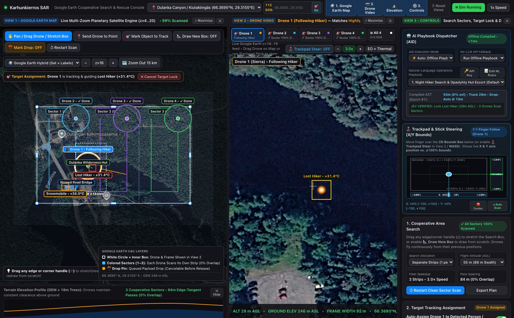
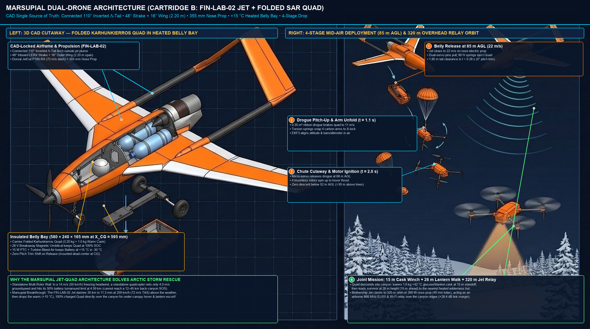

# Karhunkierros SAR & "Digital Wilderness Hut" (`v1.6` / `v2.0` Concept Release) — Autonomous Wilderness Rescue Drone System

> **Open-source, GNSS-independent Arctic wilderness search-and-rescue (SAR) drone & digital trail-hut guidance system (`~€1,189–€1,329` snap-in COTS). A private, pro-bono free-market COTS build. 🇫🇮 Finnish engineering.**
>
> * **GitHub Topics:** `arducopter` · `ardupilot` · `pixhawk` · `mavlink` · `bvlos` · `gnss-denied` · `optical-flow` · `visual-odometry` · `thermal-imaging` · `lora` · `expresslrs` · `raspberry-pi-5` · `cots` · `allied-cots` · `open-hardware` · `search-and-rescue` · `sar-drone` · `arctic` · `finland` · `nordic` · `baltic`
> * **Visual Architecture & System Presentation (30-Slide PDF Deck):** [`KARHUNKIERROS_SAR_PRESENTATION.pdf`](KARHUNKIERROS_SAR_PRESENTATION.pdf)
> * **Executive Concept Brief (English PDF Booklet):** [`docs/ARCTIC_SAR_DRONE_EXECUTIVE_BRIEF_EN.pdf`](docs/ARCTIC_SAR_DRONE_EXECUTIVE_BRIEF_EN.pdf) | **Suomeksi (FI PDF):** [`docs/KARHUNKIERROS_PRO_BONO_SAR_BRIEF_FI.pdf`](docs/KARHUNKIERROS_PRO_BONO_SAR_BRIEF_FI.pdf)
> * **Sister Project (RF-Silent Arctic Trail & Cabin Camera with 1-Way Optical Diode):** [`arctic-trail/arctic-trail-cam`](https://github.com/arctic-trail/arctic-trail-cam)
> * **Tier-3 Fast-SAR Jet-Hybrid & `[P12]` Gap-Closure Module (`FIN-LAB-02` `350–400 km/h` Open 3D `STEP AP214` CAD + `12-Cell +15 °C` Rapid-Launch Box + `285 km/h` Cold-Rated COTS Fast-Climber):** [`fast_sar_jet_finlab02/README.md`](fast_sar_jet_finlab02/README.md) | **29-Plate Engineering Design, Envelope Protection, Dorsal Surge Guard, 20 Extreme-Arctic Protections, Marsupial Dual-Drone, Multi-Screen Command UI & 100k-Flight Actuarial FMEA Gallery:** [`fast_sar_jet_finlab02/docs/ENGINEERING_DESIGN_AND_ARCHITECTURE.md`](fast_sar_jet_finlab02/docs/ENGINEERING_DESIGN_AND_ARCHITECTURE.md)
> * **License:** [`MIT License`](LICENSE)

> **🛠️ PLEASE FORK, BUILD, BREAK & IMPROVE THIS (NO PERMISSION NEEDED)**
> These repositories are **100% open-source (`MIT License`) public-good engineering** for harsh Nordic & Baltic conditions.
> * **No ego, no gatekeeping:** You do **not** need to ask permission to fork this, build a module on your kitchen table, use it for a university course/thesis, or spin a commercial product out of it.
> * **Test logs > theory:** Almost everything here is currently at bench/simulation stage. If you build a €68 acoustic pod, freeze a battery at `-25 °C`, or 3D-print a sub-scale airframe and prove our numbers wrong—**please open a Pull Request or Issue with your real-world data!**
> * **100% Civilian & Legal to Tinker With:** Everything in these repos (weather/wildlife nodes, optical diodes, airport/corridor acoustic logging, SAR navigation, cooperative own-drone soft-net recovery) is strictly civilian and legal for students, hobbyists, and labs to build and test. While the harsh-environment resilience techniques explored here—such as GNSS-denied optical/magnetometer/terrain navigation, mouldless COTS airframes, 1-way optical data diodes, acoustic/micro-Doppler airspace hazard detection, and cooperative own-drone soft-net recovery—draw technical inspiration from drone technology widely seen in Ukraine and on public media, the **intended use case of this project is 100% civilian**.

> **PROJECT STATUS DISCLAIMER — EARLY-STAGE ENGINEERING CONCEPT & SIMULATION REFERENCE (`MIT LICENSE`):**
> - **Concept & Simulation Stage (First Public Release):** This repository publishes an open-source **engineering concept, COTS hardware bill-of-materials (`€1,189–€1,329`), and software simulation reference architecture** for wilderness search-and-rescue (SAR). It is **not** a flight-certified aircraft, an operational rescue service, or a field-deployed system.
> - **What Is Built & Tested Today vs. What Remains Conceptual:**
>   1. **Hardware Bench-Verified Today:** The shared trail-camera sensor node (`Raspberry Pi 5` + `Pico 2` + `100BASE-FX` optical diode) and `LoRa` collector hub stack (shared 100% with [`arctic-trail/arctic-trail-cam`](https://github.com/arctic-trail/arctic-trail-cam)) have been assembled and verified on the indoor bench.
>   2. **Software-Simulated & Unit-Tested Today (`TRL 3`, `42/42` Suites Passing):** The SAR drone companion module (`collector_hub/drone_observer.py`), 37-parameter `ArduCopter 4.5+` configuration, GNSS-spoofing EKF fence logic, above-canopy (`28 m` AGL) spotlight geometry, "Uber-for-SAR" dispatch coordinator, JEV natural-language playbook compiler (`collector_hub/playbook_agent_dispatcher.py`), and the Tier-3 Fast-SAR Jet-Hybrid (`fast_sar_jet_finlab02/` `STEP AP214` CAD + `10/10` jet test suites + `[P12-HEATED]` `6.5 s` rapid-launch box + `285 km/h` cold-rated COTS fast-climber & 3D PN cooperative rendezvous) are verified in software simulation (`0.0` physical flight hours flown yet).
>   3. **Unvalidated / Concept Stage (Next Steps):** Physical assembly of the `Holybro X500 V2` SAR airframe, `-25 °C` winter flight endurance, payload release trials, heated roofed nest (`+10 °C`) mechanics, and **Traficom / EASA Specific Category (SORA)** aviation approvals have **not yet been flight-tested or authorized** (see the [Readiness & Verification Matrix](#readiness--verification-matrix-design-vs-simulation-vs-field-validation) below).

An off-grid, GNSS-independent wilderness search-and-rescue (**Karhunkierros SAR Drone System** / `drone_observer.py`) and "Digital Wilderness Hut" (*Digitaalinen Autiotupa*) guidance architecture designed for roadless boreal canyons and Arctic fells far from cellular coverage or plowed roads. Engineered for harsh Finnish winter conditions (`-30°C` *Kaamos* polar night, freezing drizzle, and heavy GNSS/RF jamming), the system pairs `0.00 W RF` passive trail posts (48-hour auto-purging ring buffer unlocked strictly on an explicit `112` / `inReach` / trail-post SOS trigger) with a snap-in commercial off-the-shelf (`COTS`) quadcopter (`Holybro X500 V2` + `Pixhawk 6C` + `Raspberry Pi 5` + `TOPDON TC001 LWIR Thermal` + `Arducam IMX462 Starvis` + `Benewake TF02-Pro 40m LiDAR` + `MicoAir MTF-02P Optical Flow` + `8,000 mAh 4S2P -40°C Li-Ion`) that locates lost hikers, enables live two-way human rescuer voice contact and manual pilot override, drops a `+42°C` warm glucose-electrolyte care cask at a safe `15 m` offset, and guides them at walking pace with an `800 lm` aerial lantern beam (*Opaslyhty*) to the nearest heated state wilderness cabin (*Autiotupa*).


> **Project Ethos — Private, Pro-Bono Free-Market Engineering & Voluntary Civil Society (`🇫🇮 Finnish Engineering`):**
> - **Free-Market COTS vs. `€50,000+` Bureaucratic Procurement:** Rather than waiting years for slow public-sector procurement tenders or locked `€50,000+` proprietary aerospace systems, this is an independent, private, **pro-bono free-market engineering project** demonstrating how standard retail commercial off-the-shelf (`COTS`) parts (`€1,189–€1,329`) can deliver life-saving Arctic capability at `~1/40th` of legacy cost.
> - **Decentralized Voluntary Dispatch ("Uber-for-SAR") & Strict Privacy:** Instead of top-down bureaucracy or persistent state surveillance, the architecture relies on **permissionless, voluntary civil-society participation** (local volunteer rescue clubs, snowmobilers, trail associations, and field patrols accepting open tasks bottom-up) paired with **hardware-enforced privacy** (`0.00 W` RF passive trail posts that auto-purge anonymous counts after 48 hours and never record identities).
> - **100% Shared Camera & Collector Stack With [`arctic-trail/arctic-trail-cam`](https://github.com/arctic-trail/arctic-trail-cam) + Zero Custom PCBs:** Both the ground camera (`pi5_sender_node/`, `pico_gatekeeper/`) and the SAR drone (`Holybro X500 V2` + `Pixhawk 6C` + `Raspberry Pi 5` + `USB Thermal/Starvis` + `Benewake TF02-Pro 40m IP65 LiDAR` + `MicoAir MTF-02P / Matek PMW3901 Optical Flow` + `8,000 mAh 4S2P 14.8V (118.4 Wh) Ultra-Low-Temp Li-Ion`, **`~€1,189`**) assemble in `~2.5 hours` using standard `JST-GH`, `STEMMA QT / Qwiic`, `USB-C UVC`, and `XT60` connectors with **zero custom circuit boards**.

## Key Documentation & Architecture Guides

1. **[Executive Concept Brief in English (PDF — All Images Embedded)](docs/ARCTIC_SAR_DRONE_EXECUTIVE_BRIEF_EN.pdf)** | **[30-Slide System Presentation Deck (PDF — Browser Viewable)](KARHUNKIERROS_SAR_PRESENTATION.pdf)** | **[Markdown Source](docs/ARCTIC_SAR_DRONE_EXECUTIVE_BRIEF_EN.md)** — *End-to-end wilderness rescue chain (Stages 1–5), 3D isometric terrain overview, 30-slide complete system architecture presentation, timeline comparison, and Privacy-by-Design architecture.*
2. **[Benchtop Quickstart & Step-by-Step Hardware Assembly Guide](docs/BENCHTOP_QUICKSTART_GUIDE.md)** — *Real-photo COTS hardware inventory (`[D01]`–`[D20]`), exact `Pixhawk 6C` / `Raspberry Pi 5` / `X500 V2` plug-and-play wiring, and 3-Stage bench verification.*
3. **[Master Design Evolution, Trade-Off Audit & Stabilization Log (`v2.1-FinLab-USpace-Surge-And-SupplyChain-Hardened`)](docs/DESIGN_EVOLUTION_AND_STABILIZATION_LOG.md)** — *Chronological log of all 20 design iterations, independent Round-1 to Round-3 audit remediations (`F01`–`F53`), `FIN-LAB-01..05` reference benchmarks, why we reject custom PCBs in favor of 100% snap-in COTS parts, and the `€1,189–€1,329` plug-and-play BOM.*
4. **[Comprehensive Technical & Engineering Guide](docs/AERIAL_OBSERVATION_DRONE_GUIDE.md)** — *Full mathematical, hardware, 65-byte MAVLink v2 (#84), multi-drone swarm, 48h ephemeral ring buffer, Poronhoitolaki compliance, and Finnish ETRS-TM35FIN / Rajavartiolaitos aviation coordinate specification.*
5. **[Finnish Regional Case Study & Stakeholder Brief / Suomeksi (PDF)](docs/KARHUNKIERROS_PRO_BONO_SAR_BRIEF_FI.pdf)** | **[Markdown Source (FI)](docs/KARHUNKIERROS_PRO_BONO_SAR_BRIEF_FI.md)** — *Karhunkierros SAR Pro Bono -konseptimuistio suomalaisille sidosryhmille (Metsähallitus, Vapepa, Pelastuslaitos, Rajavartiolaitos, Poliisi).*

## Quick Verification & CLI Commands

```bash
# Run the One-Command External Evaluator & Verification Readiness Certificate (<15 seconds)
python3 -B run_full_verification_and_readiness_audit.py

# Run all 38+ automated unit test suites across all 5 test files (27 SAR Drone tests + 9 Fast-SAR Jet tests + 3 shared arctic-trail-cam suites)
python3 -B -m unittest discover -s tests -v

# Run the interactive Guided Bench Doctor (including Stage 5 SAR Drone Companion Bench Check)
python3 -B run_guided_bench_doctor.py --self-test --drone-bench

# Run standalone SAR Drone Companion Hardware Bench Check & export 37-parameter ArduCopter 4.5+ .param file
python3 -B collector_hub/drone_observer.py --mode bench-check --export-params /tmp/pixhawk6c_sar.param

# Simulate "Uber-for-SAR" Open-Alert Dispatch Marketplace, Roofed Auto-Stations & Elastic Pull-Guidance
python3 -B collector_hub/drone_observer.py --mode dispatch-marketplace

# Simulate Aerial Lantern & Autiotupa Trail Guide ("Opaslyhty: Seuraa minua autiotuvalle")
python3 -B collector_hub/drone_observer.py --mode lantern-guide

# Simulate Split Tourist Group SAR & Onboard Self-Guidance
python3 -B collector_hub/drone_observer.py --mode sar-tourist-group

# Simulate Multi-Drone Boustrophedon Grid Search
python3 -B collector_hub/drone_observer.py --mode grid-search --num-drones 4

# Run the FIN-LAB Conformance Suite (FIN-LAB-01/02/03/04/05 U-Space Surge Fusion, 105m GNSS-Free Nav, Monte Carlo & Allied BOM Audit)
python3 -B collector_hub/drone_observer.py --mode finlab-suite

# Open the Field Operator Command & Conquer (C&C) Mission, Terrain Auto-Mapping & Guidance Console
open collector_hub/ui/operator_mission_console.html
```

## Field Operator Command & Conquer (`C&C`) Mission, Auto-Terrain Mapping & Guidance UX (`collector_hub/ui/operator_mission_console.html`)

While `flight_simulator.html` provides the engineering 6-DOF aerodynamics/CFD wind-tunnel workbench, **actual field SAR operators, Vapepa coordinators, and mobile patrol crews use the dedicated Command & Conquer (`C&C`) Tactical Overwatch & Guidance Console** ([`collector_hub/ui/operator_mission_console.html`](collector_hub/ui/operator_mission_console.html), also embedded as a live 3D terrain-draped `🕹️ C&C Overwatch` mode inside [`collector_hub/ui/index.html`](collector_hub/ui/index.html) and backed by `CommandAndConquerTacticalOverwatchController` in [`collector_hub/drone_observer.py`](collector_hub/drone_observer.py)):

1. **Command & Conquer (`C&C`) Fog-of-War & Live Camera-Feed Map Projection:**
   - **Pitch-Black Unobserved Shroud (`#000000`):** Unexplored wilderness areas outside sensor coverage render pitch black on the tactical map so operators immediately see what terrain has **not** yet been searched (`43.8%` unmapped vs. `56.2%` revealed).
   - **Swept Terrain Memory (`Dimmed DEM`):** Areas previously swept by airborne drones retain a dimmed `32%` Maanmittauslaitos (`MML`) topographic contour memory trail.
   - **Live Camera Feeds Drawn Directly Inside Sensor Footprints:** Wherever a ground trail camera (`NODE-NORTH-01`, `NODE-GORGE-02`) or airborne drone (`DRONE-ALPHA`, `DRONE-BRAVO`, `FIN-LAB-02 JET`) points its `TOPDON TC001 LWIR` / `IMX462 Starvis` sensor, its exact ground footprint trapezoid/sector is **drawn directly onto the map as a live projected camera feed** with thermal/night-vision imagery, scanlines, HUD crosshairs, sensor headers, and live AI bounding boxes (`PERSON 96% +31.4°C`, `VEHICLE 93% +18.2°C`).
2. **How Auto-Missions Are Designed & Mapped to Actual Physical Terrain (`compile_terrain_following_auto_mission`):**
   - **Step 1 — Draw on Real Coordinates (`WGS84` + `ETRS-TM35FIN EPSG:3067`):** The operator drags a rectangular **Boustrophedon (Lawnmower) Search Box** or clicks a **Trail / Road Corridor** on the map anchored to real Oulanka / Ruka coordinates (`66.2602°N, 29.4189°E`, `ETRS-TM35FIN N:7351420 E:608740`).
   - **Step 2 — Automatic Sensor Swath & Lane Spacing:** From the selected AGL altitude ($h_{\text{AGL}} = 28\text{ m}$ quad or $65\text{ m}$ wide search), camera FOV ($56^\circ$ `TC001` LWIR or $90^\circ$ `IMX462` Starvis), and side-lap ($25\%$), the planner computes exact ground swath width $W_{\text{swath}} = 2 \cdot h_{\text{AGL}} \cdot \tan(\text{FOV}/2) \cdot (1 - \text{overlap})$ (`22.4 m` lane spacing) and generates parallel turnaround legs perpendicular to the wind vector.
   - **Step 3 — 3-Layer Real-Terrain Elevation Draping (`MML 2m/10m LiDAR DEM + 18 m Canopy + 40 m TF02-Pro LiDAR`):** Every waypoint $(x_i, y_i)$ queries the offline **Maanmittauslaitos (`MML`) 2m/10m elevation grid** ($h_{\text{DEM}}$, e.g. `172 m` river gorge to `268 m` Kiutaköngäs ridge) plus the `18 m` boreal spruce canopy clearance floor, setting target altitude $Z_{\text{ASL}}(x_i,y_i) = h_{\text{DEM}}(x_i,y_i) + h_{\text{canopy}} + h_{\text{AGL}}$. Waypoints export in 1 click as a **`QGroundControl / ArduPilot WPL 110` (`.waypoints`)** file using **`MAV_FRAME_GLOBAL_TERRAIN_ALT` (`Frame = 10`)**, while in flight the onboard `Benewake TF02-Pro` (`40 m` IP65 LiDAR) + `BMP390` barometer + `MicoAir MTF-02P` optical flow maintain exact real-time height above the physical snow and tree crowns even under `100%` GNSS spoofing.
3. **Priority Target Detection & Automatic Mission Preemption (`OPTIONS` Panel):**
   - Operators configure real-time preemption toggles: **`[☑] Follow Lost People & Vehicles With Priority Over Mapping`**, **`[☑] Detect Lost People (Thermal + AI P1/P2)`**, **`[☑] Detect Lost Vehicles / Snowmobiles (Mag + Thermal P3)`**, **`[☑] Ignore Wildlife / ≥100 m Reindeer Floor (Poronhoitolaki)`**, and **Multi-Drone Split Policy** (`Closest Follows Target • Others Map Black Shroud` vs. `All Converge` vs. `Pin Beacon Only`).
   - When `DRONE-ALPHA` detects a lost hiker or stranded snowmobile inside its live camera footprint, it **immediately pauses its lawnmower mapping leg**, saves its exact resume waypoint (`WP #2/6`), transitions to `TARGET_LOCK_FOLLOW`, and hands off the remaining black shroud to `DRONE-BRAVO`.
4. **Autonomous OR Manual Remote-Control (`RC`) Guidance for Both Lost People & Vehicles:**
   - **Lost Person (`P1/P2`):** In **Auto Guide (`Opaslyhty`)**, the drone drops the `+42 °C` warm berry-electrolyte cask at a safe `15 m` offset (`25 N` breakaway fuse) and leads the hiker at walking pace (`1.2 m/s`, pausing if they stop) via a `28 m` AGL above-canopy `1,500 lm` spotlight beam aimed `15 m` ahead on the snow trail to the nearest warm **Metsähallitus Autiotupa** wilderness hut (`580 m`).
   - **Lost / Stranded Vehicle or Snowmobile (`P3`):** In **Auto Guide (`Vehicle Escort`)**, the drone flies `35 m` ahead at `45 m` AGL projecting a high-contrast `1,500 lm` ground corridor beam along a hazard-free forestry route (avoiding thin lake ice and steep gullies) back to the plowed main road (`1.40 km`).
   - **Manual Remote Control (`🕹️ Manual RC`) & Real MAVLink v2 Field-Test Bridge (`collector_hub/mavlink_field_bridge.py`):** At any instant, the operator can click any drone on the **Google Earth Multi-Zoom Satellite Map** (`z = 4..20`) to stream its live camera feed (`View 2`), toggle the **`🪂 Enable "Mark Payload Drop" Mode`** switch (`OFF/ON`) to queue or cancel (`[✕ Cancel Drop]`) a payload drop before release, cancel a target lock (`[✕ Cancel Target Lock]`) to return the drone to cooperative zero-overlap sector scanning, and transmit real binary **MAVLink v2 (`0xFD`, CRC-16/MCRF4XX)** `MISSION_ITEM_INT (#73)`, `GLOBAL_POSITION_INT (#33)`, and `COMMAND_LONG (#76)` (`MAV_CMD_DO_SET_SERVO` Ch9 `1100 µs`/`1900 µs` & `MAV_CMD_DO_MOUNT_CONTROL #205`) frames over UDP `:14550` / telemetry radio to `Pixhawk 6C` / `ARK FPV`.



## "Uber-for-SAR" Open-Alert Dispatch Marketplace & Automated Roofed Shelters (`SARDispatchMarketplaceCoordinator`)

When a verified `112` / `inReach` / Trail-Post `SOS` alert is issued, the coordination system broadcasts an **Open SAR Task** (`OPEN_FOR_UNIT_ACCEPTANCE`) across two classes of units:
1. **Mobile Patrol Drone Units (`MOBILE_PATROL_UNIT` — e.g., Police vans, Border Guard patrols, Vapepa sleds):** Field crews see the open alert on their vehicle terminal (like an Uber driver seeing a nearby ride request) with distance, flight ETA, and coordinates, and tap **`[Accept Task]`**.
2. **Automated Roofed Wilderness Stations (`AUTOMATED_ROOFED_NEST` — `+10 °C` weather-sealed roofed shelters):** Protect stationed drones under a motorized snow/rain roof. When set to **`AUTO_ACCEPT_GEOFENCE`** mode, stations automatically accept alerts relevant to their location (`<= 14 km`), open their roof hatch, launch autonomously, close the roof while away, deliver the `+42 °C` berry-electrolyte & thermal-blanket package (`15 m` safe offset), **follow and "pull" the hiker to the nearest *autiotupa* at `28 m` above the treetops (`compute_elastic_pull_guidance_vector`)**, and autonomously return to dock and recharge under the roof.
3. **Multi-Unit Auto-Prioritization & Human Control Panel:** If multiple mobile units and roofed stations accept the same alert, the system auto-prioritizes them by Flight ETA (`45%`), Winter Battery Margin (`25%`), Sensor/Payload Capability (`15%`), and Readiness (`15%`), awarding `#1 PRIMARY_SAR_RESCUER` and `#2 SECONDARY_BACKUP_INTERCEPT` — while giving the human coordinator full control via the web dashboard (`collector_hub/ui/index.html`) to switch between **Auto-Prioritize**, **Manual Approval Only**, or **Human Override** (`Assign #1`, `Hold Launch`, `Force Immediate RTB`).

## System Architecture & Subsystem Overview

### 1. One System, Eight Parts Working Across the Landscape


### 2. Snap-In COTS Aircraft Subsystems (`~2.1 kg` AUW, Zero Custom PCBs)


| Subsystem Category | Off-the-Shelf Modules (`JST-GH` / `STEMMA QT` / `USB-C` / `XT60`) | Cost (EUR) |
| :--- | :--- | :--- |
| **1. Airframe & Propulsion** | `Holybro X500 V2` `500 mm` carbon frame + `Pixhawk 6C` + `M10` GNSS + `4× 2216 KV920` motors + `1045` props + `RAL 2005` orange arms | `€490` |
| **2. Navigation Sensors (`<= 40 m` AGL)** | `Benewake TF02-Pro` (`40 m`, `IP65`) LiDAR + `MicoAir MTF-02P` (`PMW3901`) optical flow | `€134` |
| **3. Companion Compute & Storage** | `Raspberry Pi 5` (`8 GB`) + active cooler + `27W` buck (`5.1V/5A`) + `SanDisk Industrial 64 GB` | `€117` |
| **4. Dual Vision Payload (`EO + LWIR`)** | `256×192 LWIR` USB-C thermal camera (`25 Hz`) + `Sony IMX462 Starvis` low-light USB camera (`130° FOV`) | `€235` |
| **5. Telemetry & Pilot Override** | `Holybro SiK / RFD868x` (`868 MHz`) or `900 MHz` LoRa + `RadioMaster ER5A V2` (`2.4 GHz ELRS`) + optional `LTE` modem (`+€95`) | `€50` |
| **6. Lantern, Strobe, Audio & Care Drop** | `1,500 lm` (`10°`) spotlight + `1,200 lm` sky strobe + `80 dB` speaker + `25 N` servo breakaway release + `+42 °C` care cask | `€145` |
| **7. Arctic Battery (`-40 °C`) & Fastener Kit** | `8,000 mAh 4S2P` (`14.8 V`, `118.4 Wh`) `-40 °C` Li-Ion (`XT60`) + `2.5 mm` silicone pad + `M3` hardware | `€113` |
| **Base Core Drone Subtotal (`v1.6` Bench Kit)** | **Complete snap-in COTS drone assembly (`~2.5 hours`, zero custom PCBs)** | **`€1,189`** |
| **8. `v2.0` Field-Hardening Additions (`FIN-LAB`)** | Optional `LTE` burst modem (`+€95`) + `31-material` clamp-on EMI ferrite kit (`+€15`) + wireless `UHF/DECT` drop-cask mic (`+€30`) | `+€140` |
| **Hardened `v2.0` Core Aircraft Total (`X4` Baseline)** | **Full `v2.0` field-hardened SAR aircraft (excluding optional `€610` `+10 °C` roofed launch nest)** | **`€1,329`** |
| **9. Option B `Karhunkierros-X8` Coaxial Heavy-Sprint Upgrade (`+€310`)** | `8× 3115 KV900` `6S` motors + `2× 60A 4-in-1` fault-isolated ESCs + `10×5.0×3`/`10×6.0×3` differential-pitch props + `13,500 mAh 6S3P` (`300 Wh`, `-40 °C`) pack (**`3.0 kg` payload, `138.6 km/h` sprint, `22.5 km` calm / `14.8 km` storm radius, 1-of-8 motor-loss survival**) | **`€1,639`** |

### 3. Five-Layer Jam-Resilient Navigation Stack & Four-Tier Link Ladder


### 4. Above-Canopy (`28 m` AGL) Aerial Lantern & Standoff Geometry


### 5. Tier-3 Fast-SAR Jet-Hybrid (`FIN-LAB-02`) & "Marsupial" Dual-Drone Architecture (`35–45 km` Storm Rescue to `285 km` Regional SAR)

When a `14 m/s` (`50 km/h`) freezing headwind strikes northern fells, a standalone multi-rotor (`18 m/s` airspeed $\rightarrow$ `4.0 m/s` net groundspeed) hits its `50%` cold-battery turnaround limit at **`4.59 km`**. Conversely, a fast fixed-wing jet can dash `35 km` in `11.3 minutes` at `259 km/h` (`72 m/s`), **but cannot hover beneath spruce trees to winch down a `+42 °C` drink cask or walk a survivor along a forest trail at `1.2 m/s`.**

Implemented in [`fast_sar_jet_finlab02/`](fast_sar_jet_finlab02/README.md), **`FIN-LAB-02` (`Cartridge B`)** solves both physics limits simultaneously via a **Marsupial Dual-Drone Architecture**:
* **Captive `+15 °C` Belly-Bay Dash (`0–35 km` in `11.3 min` at `259 km/h`):** The `2.20 m` wingspan twin-boom `110°` Inverted-V (`/\` / $\Lambda$) tail Mothership Jet (`12.60 kg` Marsupial MTOW) carries the H-folding `Karhunkierros` SAR quadcopter (`2.65 kg` Cartridge B total = `2.28 kg` free-flying quad with `+42 °C` care cask + `0.37 kg` drogue cradle, stowed to `385 × 162 × 132 mm`) inside its insulated ventral belly bay (`420 × 180 × 145 mm` centered at `X_CG = 595.0 mm`), keeping the quadcopter's battery at **`+15.0 °C` and `100.0%` SOC (`118.4 Wh`)** via an 8-pin magnetic pogo-pin umbilical during the `35 km` storm transit.
* **Mid-Air Drogue Drop (`85 m` AGL) + Joint Canyon Rescue & `320 m` Overhead Relay:** Over the canyon (`85 m` AGL), the Mothership Jet slows to `25.5 m/s` (`92 km/h`) on its `355 mm` nose electric prop and ejects the folded quadcopter (`-0.13 mm` longitudinal CG shift). A `60 cm` ribbon drogue chute (`Cd·A = 0.32 m²`) brakes the quad while torsion springs snap its 4 carbon arms open at `t + 0.90 s` and capture hover lock at **`69.2 m` AGL (`15.8 m` drop) in `2.76 seconds`** with **`99.4%` battery remaining**. While the quad descends into the canyon to winch the `+42 °C` glucose/blanket cask (`15 m` standoff) and lead the survivor via the `28 m` aerial lantern walk to a warm wilderness hut (*Autiotupa*) before docking in a `+10 °C` roofed trail nest box (`21.7%–34.2%` SOC remaining), the Mothership Jet climbs to **`320 m` AGL on `285 W` nose-electric power** to serve as an airborne `868 MHz` ELRS/LoRa & `940 nm` optical relay over the canyon ridges (`+28.4 dB` link margin)!




| Platform & Modular Configuration (Pareto-Optimal 4-Tier Lineup) | Cruise / Dash Airspeed | Max Range in `14 m/s` (`50 km/h`) Storm Headwind | Max Calm / Hybrid Range | Max Endurance | Primary Payload & Operational Capability | Unit Hardware BOM |
| :--- | :---: | :---: | :---: | :---: | :--- | :---: |
| **Tier 1/2 (A). Standalone `Karhunkierros` SAR Quadcopter (`v1.6` / `v2.0` `X4` Lite)** | `65 km/h` (`18 m/s`) | **`4.59 km`** *(aborts at 50% SOC due to `4.0 m/s` net groundspeed)* | **`14.0 km`** *(round-trip)* | `32 min` | `1.0 kg` `+42 °C` warm cask winch (`15 m` offset) + `28 m` above-canopy `1,500 lm` lantern walk to hut. | **`€1,189 – €1,329`** |
| **Tier 1/2 (B). Option B `Karhunkierros-X8` Coaxial Heavy-Sprint (`6S` `8× 3115 KV900` Upgrade)** | **`90 km/h` cruise / `138.6 km/h` (`38.5 m/s`) sprint** | **`14.80 km` radius** (`3.2×` farther at `28–32 m/s` into `14 m/s` headwind) | **`22.5 km` radius** (`45.0 km` round-trip) | **`38.3 – 47.9 min`** | **`3.0 kg` nominal (`4.2 kg` overload) payload** (`3× 1.0 kg` multi-cask or `1.15 kg` canyon relay + `1.85 kg` cask) + `1-of-8` motor-loss survival (`X8-H1..H5`). | **`€1,639`** |
| **Tier 3A. `FIN-LAB-02 Sled B-Prop` + `Cartridge B` (*High-Speed De-Iced Pusher Marsupial Carrier, `2.20 m` Wing*)** | **`275 km/h` (`76.4 m/s` dash)** / `92 km/h` loiter | **`35 – 45 km` radius** (`9.35 min` calm / `11.2 min` storm; quad arrives at `100%` SOC!) | **`165 km`** *(optimal `151 km/h` cruise)* | `55 min` carrier + `28 min` quad hover | **Primary `<300 km/h` Marsupial carrier (`M_tip = 0.73 < 0.85`):** `3.5×` propulsive efficiency, `0.08 s` go-around response, `0 °C` exhaust, saves **`€2,400`** vs. turbine! | **`€2,450` (`~$2,650`) + `€1,189` Quad** |
| **Tier 3B. `FIN-LAB-02 Sled A` + `Cartridge A/B` (*`2.20 m` Straight `16°` Wing `259 km/h` COTS Hobby RC Turbine Baseline*)** | **`259 km/h` (`72 m/s`) cruise / `288 km/h` (`80 m/s`) level dash** ($V_{NE} \le 300\text{ km/h}$) | **`35 km` radius** (`11.3 min` to `35 km` in `14 m/s` wind) | **`95 km`** *(Breguet) / `285 km` (`Cartridge C`)* | `32 min` dash + `45 min` loiter | **Turnkey COTS hobby RC turbine (`100 N` `JetCat P100-RX-BL`):** `+12°` flaperons + `355 mm` nose electric loiter prop slow to `92 km/h` (`25.5 m/s`) for `5.0 kg` capsule or `Cartridge B` quad drop. | **`€4,850` (`~$5,150`)** |
| **Tier 3B-Ext. `FIN-LAB-02` + `Cartridge C` (*Extended-Range Hybrid Recon & Airborne BLOS Relay*)** | **`259–288 km/h`** dash / `103 km/h` electric | **`113 km`** *(storm dash)* | **`285 km`** *(geofenced `<300 km` civilian SAR reach)* | **`3.75 hours`** (`225 min`) | `3.60 kg` (`1,015 Wh`) aux battery + `2.65 kg` Jet-A1 + `Sky-Diode Build D` airborne BLOS relay (`255 km` radio horizon, zero satellite dependency). | **`~$5,220`** |
| **Tier 3C. `FIN-LAB-02` Airframe + `Sled C` (*`35–40 cc` 4-Stroke Canyon Relay Loiter, `<300 km` Capped*)** | `101 – 130 km/h` (`28–36 m/s` loiter) | **`45 km` box** (`6.0 hr` canyon relay orbit in `14 m/s` wind) | **`284.5 km`** *(`<= 285 km` EU `2021/821` `<300 km` fuel/geofence cap)* | **`6.0 hours`** | `0.68 kg` capped UAT tank (`12.9 g/min` burn) + `5.0 kg` sensor/drop pod for `6-hour` `320 m` AGL canyon communications relay. | **`€3,800` (`~$4,100`)** |

## Readiness & Verification Matrix (Design vs. Simulation vs. Field Validation)


| Subsystem / Capability | Designed | Simulated / Unit-Tested (`29/29`) | Hardware Bench | Field-Validated | Authorised |
| :--- | :---: | :---: | :---: | :---: | :---: |
| **Trail Posts & Collector Hub (`arctic-trail-cam` stack)** | Yes | Yes | Yes (`Pi 5` + `Pico` + `LoRa`) | Partial (winter optical/RF) | No (`Metsähallitus` permit pending) |
| **Core SAR Drone Hardware (`X500 V2` + `Pixhawk 6C` + `Pi 5`)** | Yes | Yes (`37` `ArduCopter 4.5+` params) | Bench check (`drone_observer.py`) | No (`-25 °C` flight endurance open) | No (`Traficom SORA` required) |
| **GNSS Spoof Fence & `<= 40 m` Optical Flow / LiDAR Hold** | Yes | Yes (`F01`–`F53` regression suites) | Sensor bench check | No (live jamming flight open) | No |
| **Above-`40 m` Baro-DEM & Thermal/Visual Odometry (`FIN-LAB-02 / FIN-LAB-03`)** | Yes | Modelled (`20.76 m <= 30 m`) | Not yet flight-tested (winter range gate) | No | No |
| **Tier-3 Fast-SAR Jet-Hybrid (`FIN-LAB-02` `350–400 km/h` `STEP AP214` CAD) & `[P12-HEATED]` `6.5 s` Launch Box + `285 km/h` COTS Fast-Climber (`#8` / `#9`)** | Yes (`fast_sar_jet_finlab02/`) | Yes (`test_fast_sar_jet_finlab02.py`) | Analytical / 3D CAD model | No (capability-gated roadmap, no date promises) | No (`Traficom SORA` required) |
| **Open Sensor Ingest (`FIN-LAB-01 v1.0`), `10 Hz` `-30 °C` Logger (`FIN-LAB-05`) & Fleet Twin (`FIN-LAB-04`)** | Yes | Yes (`--mode finlab-suite`) | Bench verified | No (winter range gate) | No |
| **Aerial Lantern (`28 m` AGL, `>= 15 m` Standoff) & `25 N` Drop** | Yes | Yes (`compute_elastic_pull_guidance_vector`) | Mechanical bench | No (local canopy survey required) | No |
| **"Uber-for-SAR" Open Dispatch & `+10 °C` Roofed Nest** | Yes | Yes (`SARDispatchMarketplaceCoordinator`) | Dashboard & API verified | No (winter roof-actuator test open) | No (`Poliisi` / `RVL` / `ERC` MoU) |

### Objective Technical Risks, Known Unknowns & Unvalidated Assumptions

To help external evaluators, SAR volunteers, and engineers assess our current progress stage objectively, the table below separates **what has been verified on the bench / in software** from the **key physical unknowns** that remain unproven until outdoor flight and winter soak trials are completed:

| Risk Area & Subsystem | What Is Verified / Modelled Today | Primary Real-World Failure Risk / Unknown | Planned Physical Validation Step |
| :--- | :--- | :--- | :--- |
| **1. Outdoor Flight Endurance & Wind-Gust Margin at `-25 °C` (`0.0 FH` Flown)** | Bench checks verify `Raspberry Pi 5`, `TC001` LWIR, `IMX462` Starvis, `TF02-Pro` LiDAR, `MTF-02P` optical flow, and `37` `ArduCopter 4.5+` parameters; hover/cruise power (`164–235 W`) is modelled analytically. | Cold-air propeller blade icing in freezing drizzle, real-world rotor downwash over fuselage payload boxes, and high-current motor transients (`25–40 A`) in `14 m/s` gusts can increase power draw by `15–30%` or trigger ESC low-voltage protection if the `4S2P` pack cools below `-15 °C`. | `-18 °C` household freezer cold-crank discharge test + tethered outdoor hover endurance trials on the `Holybro X500 V2` airframe. |
| **2. Optical Flow (`MTF-02P`) & Visual Odometry Over Uniform Snow / Spindrift** | EKF spoof-fence logic (`F01`–`F53`) cleanly switches from spoofed GNSS to `TF02-Pro` (`<= 40 m` LiDAR) + `MTF-02P` (`PMW3901`) optical flow and thermal/visual odometry in software simulation. | Over featureless white snowfields, rotor-blown powder snow (*lumituisku*), or pitch-black polar night without canopy contrast, optical flow can lose texture lock and drift at IMU dead-reckoning rates (`1–3 m/min`). | Low-altitude (`5–30 m` AGL) winter snowfield and forest-canopy hover-hold trials comparing `1,500 lm` spotlight-illuminated `MTF-02P` vs. `TC001` thermal flow. |
| **3. Above-Canopy (`28 m` AGL) Tree-Crown Clearance & LiDAR Multipath** | `28 m` AGL cruise height provides a `6–10 m` margin above typical `18–22 m` northern boreal spruce crowns in `DEM` terrain models. | Isolated emergent old-growth pines (`> 26 m`), steep canyon walls, or snow-laden branches scattering the `TF02-Pro` `850 nm` beam can cause false altitude jumps unless filtered by barometer + radar fusion. | Local canopy height profiling and baro-damped LiDAR median filtering during Stage 5 field walks. |
| **4. Motorized Roofed Nest (`+10 °C` / `+15 °C`) Ice-Bridging & Snow Drift Load** | `SARDispatchMarketplaceCoordinator` simulates a `6.5 s` clamshell roof opening and `42 W` steady thermal heating. | Heavy wet snow accumulation (`> 30 cm`) or freeze-thaw ice bridging along the clamshell lip can stall linear actuators or prevent clean precision landing alignment in crosswinds. | Physical roof-hatch freeze-spray stall test and IR-beacon optical landing pad trials. |
| **5. Out-of-Band Voice (`UHF/DECT`) & `868/915 MHz` LoRa Range in Deep Canyons** | Line-of-sight and single-bounce canyon models predict `8–25 km` LoRa reach and clear `15 m` standoff voice audio over `68 dBA` rotor noise. | Steep granite gorges (such as Oulanka / Korouoma) can block direct ground-to-drone LOS beyond `2–4 km`, requiring either store-and-forward autonomous execution or an overhead airborne relay (`Cartridge B` Marsupial mothership). | Non-line-of-sight forest/hill range walk tests with `MicoAir LR900-F` and `[D07]`/`[D19]` acoustic voice intelligibility recordings under live rotor wash. |

## Aviation, Life-Safety & Experimental Reference Disclaimer

> **IMPORTANT — EXPERIMENTAL OPEN-SOURCE REFERENCE ARCHITECTURE (`MIT LICENSE`):**
> 1. **Not a Certified Aviation or Medical Device:** This repository provides an open-source research and engineering reference design for civilian wilderness search-and-rescue (SAR). It is **not** a certified aircraft, flight-control system, or life-safety appliance, and is provided strictly **"AS IS" without warranty of any kind** (see [`LICENSE`](LICENSE)).
> 2. **Regulatory Compliance & Remote Pilot in Command (`RPIC`):** Operating unmanned aircraft requires compliance with all applicable national aviation and radio-spectrum regulations (including **EASA / Traficom Open & Specific Category SORA** rules in Finland/EU, **FAA Part 107** in the United States, and local airspace authorizations). Never fly autonomously without a qualified safety pilot able to assume immediate manual override, and never deploy in active rescue operations without official authority (`Poliisi` / `Rajavartiolaitos` / `Pelastuslaitos`) authorization.

