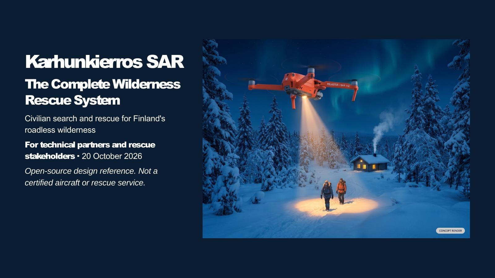
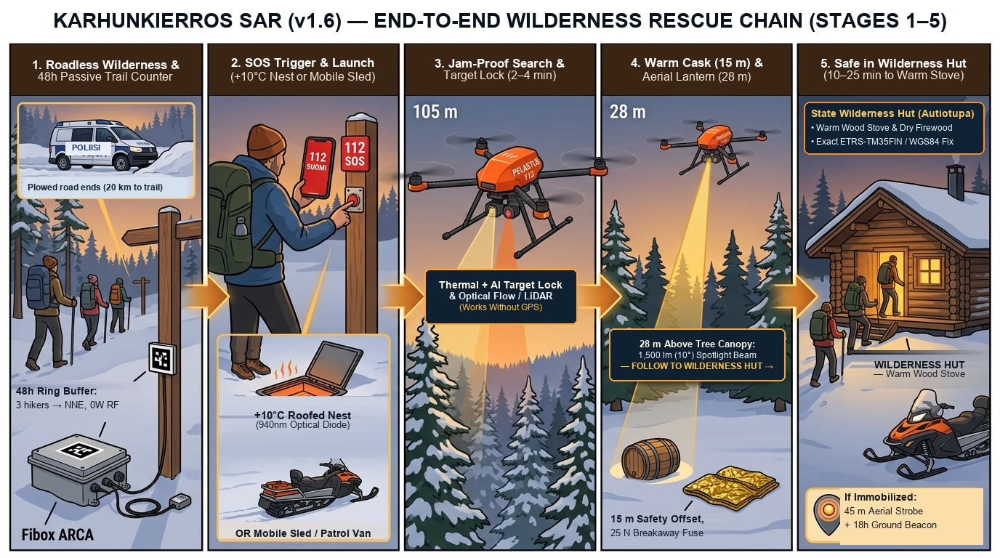
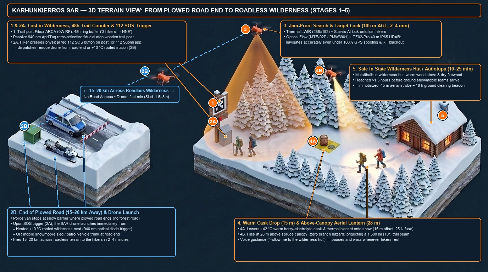
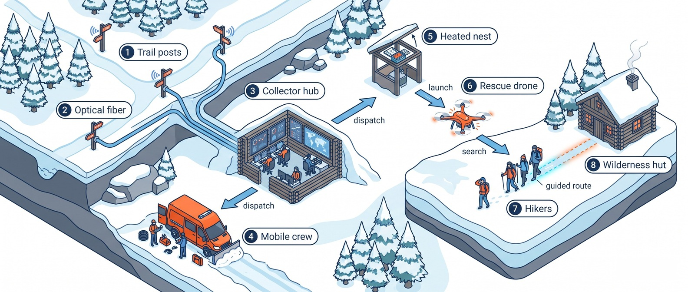
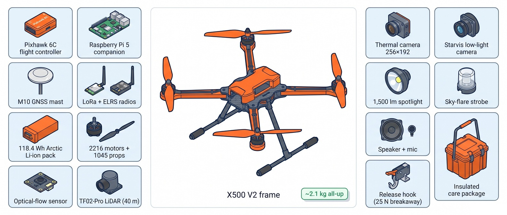
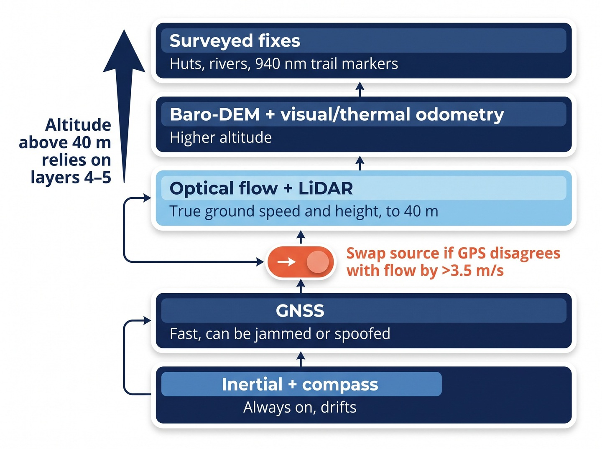
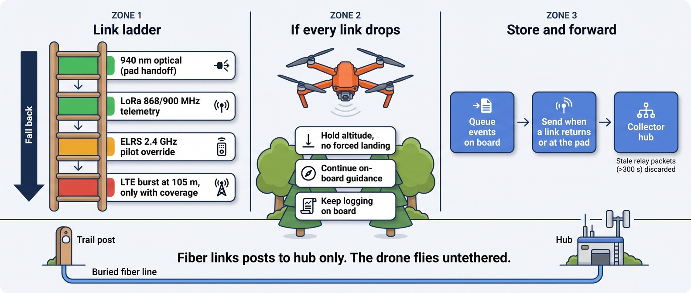
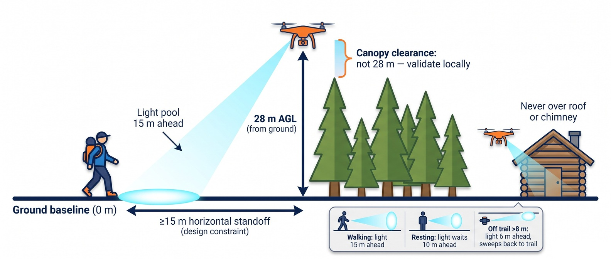
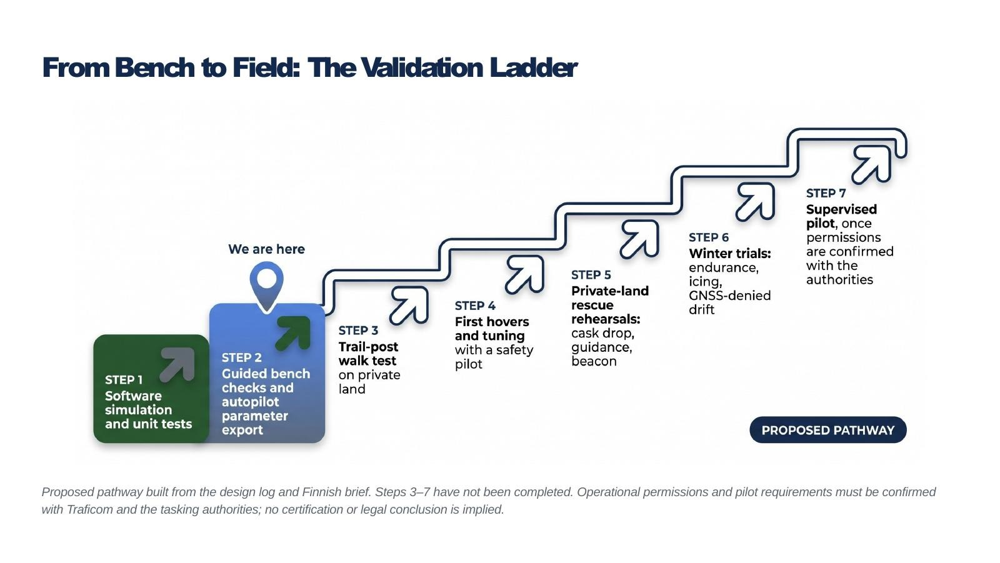

# Karhunkierros SAR & "Digital Wilderness Hut" (`v1.6` / `v2.0` Concept Release) — Autonomous Wilderness Rescue Drone System

> **Open-source, GNSS-independent Arctic wilderness search-and-rescue (SAR) drone & digital trail-hut guidance system (`~€1,189–€1,329` snap-in COTS). A private, pro-bono free-market COTS build. 🇫🇮 Finnish engineering.**
>
> * **GitHub Topics:** `ardupilot` · `pixhawk` · `raspberry-pi-5` · `search-and-rescue` · `sar-drone` · `gnss-denied` · `optical-flow` · `thermal-imaging` · `lora` · `open-hardware` · `arctic-engineering` · `cots`
> * **Visual Architecture & System Presentation (30-Slide PDF Deck):** [`KARHUNKIERROS_SAR_PRESENTATION.pdf`](KARHUNKIERROS_SAR_PRESENTATION.pdf)
> * **Executive Concept Brief (English PDF Booklet):** [`docs/ARCTIC_SAR_DRONE_EXECUTIVE_BRIEF_EN.pdf`](docs/ARCTIC_SAR_DRONE_EXECUTIVE_BRIEF_EN.pdf) | **Suomeksi (FI PDF):** [`docs/KARHUNKIERROS_PRO_BONO_SAR_BRIEF_FI.pdf`](docs/KARHUNKIERROS_PRO_BONO_SAR_BRIEF_FI.pdf)
> * **License:** `MIT License`

> **PROJECT STATUS DISCLAIMER — EARLY-STAGE ENGINEERING CONCEPT & SIMULATION REFERENCE (`MIT LICENSE`):**
> - **Concept & Simulation Stage (First Public Release):** This repository publishes an open-source **engineering concept, COTS hardware bill-of-materials (`€1,189–€1,329`), and software simulation reference architecture** for wilderness search-and-rescue (SAR). It is **not** a flight-certified aircraft, an operational rescue service, or a field-deployed system.
> - **What Is Built & Tested Today vs. What Remains Conceptual:**
>   1. **Hardware Bench-Verified Today:** The shared trail-camera sensor node (`Raspberry Pi 5` + `Pico 2` + `100BASE-FX` optical diode) and `LoRa` collector hub stack (shared 100% with [`arctic-trail/arctic-trail-cam`](https://github.com/arctic-trail/arctic-trail-cam)) have been assembled and verified on the indoor bench.
>   2. **Software-Simulated & Unit-Tested Today (`29/29` Suites Passing):** The SAR drone companion module (`collector_hub/drone_observer.py`), 37-parameter `ArduCopter 4.5+` configuration, GNSS-spoofing EKF fence logic, above-canopy (`28 m` AGL) spotlight geometry, and "Uber-for-SAR" dispatch coordinator are verified in software simulation.
>   3. **Unvalidated / Concept Stage (Next Steps):** Physical assembly of the `Holybro X500 V2` SAR airframe, `-25 °C` winter flight endurance, payload release trials, heated roofed nest (`+10 °C`) mechanics, and **Traficom / EASA Specific Category (SORA)** aviation approvals have **not yet been flight-tested or authorized** (see the [Readiness & Verification Matrix](#readiness--verification-matrix-design-vs-simulation-vs-field-validation) below).







> **Project Ethos — Private, Pro-Bono Free-Market Engineering & Voluntary Civil Society (`🇫🇮 Finnish Engineering`):**
> - **Free-Market COTS vs. `€50,000+` Bureaucratic Procurement:** Rather than waiting years for slow public-sector procurement tenders or locked `€50,000+` proprietary aerospace systems, this is an independent, private, **pro-bono free-market engineering project** demonstrating how standard retail commercial off-the-shelf (`COTS`) parts (`€1,189–€1,329`) can deliver life-saving Arctic capability at `~1/40th` of legacy cost.
> - **Decentralized Voluntary Dispatch ("Uber-for-SAR") & Strict Privacy:** Instead of top-down bureaucracy or persistent state surveillance, the architecture relies on **permissionless, voluntary civil-society participation** (local volunteer rescue clubs, snowmobilers, trail associations, and field patrols accepting open tasks bottom-up) paired with **hardware-enforced privacy** (`0.00 W` RF passive trail posts that auto-purge anonymous counts after 48 hours and never record identities).
> - **100% Shared Camera & Collector Stack With [`arctic-trail/arctic-trail-cam`](https://github.com/arctic-trail/arctic-trail-cam) + Zero Custom PCBs:** Both the ground camera (`pi5_sender_node/`, `pico_gatekeeper/`) and the SAR drone (`Holybro X500 V2` + `Pixhawk 6C` + `Raspberry Pi 5` + `USB Thermal/Starvis` + `Benewake TF02-Pro 40m IP65 LiDAR` + `MicoAir MTF-02P / Matek PMW3901 Optical Flow` + `8,000 mAh 4S2P 14.8V (118.4 Wh) Ultra-Low-Temp Li-Ion`, **`~€1,189`**) assemble in `~2.5 hours` using standard `JST-GH`, `STEMMA QT / Qwiic`, `USB-C UVC`, and `XT60` connectors with **zero custom circuit boards**.

## Key Documentation & Architecture Guides

1. **[Executive Concept Brief in English (PDF — All Images Embedded)](docs/ARCTIC_SAR_DRONE_EXECUTIVE_BRIEF_EN.pdf)** | **[30-Slide System Presentation Deck (PDF — Browser Viewable)](KARHUNKIERROS_SAR_PRESENTATION.pdf)** | **[Markdown Source](docs/ARCTIC_SAR_DRONE_EXECUTIVE_BRIEF_EN.md)** — *End-to-end wilderness rescue chain (Stages 1–5), 3D isometric terrain overview, 30-slide complete system architecture presentation, timeline comparison, and Privacy-by-Design architecture.*
2. **[Benchtop Quickstart & Step-by-Step Hardware Assembly Guide](docs/BENCHTOP_QUICKSTART_GUIDE.md)** — *Real-photo COTS hardware inventory (`[D01]`–`[D20]`), exact `Pixhawk 6C` / `Raspberry Pi 5` / `X500 V2` plug-and-play wiring, and 3-Stage bench verification.*
3. **[Master Design Evolution, Trade-Off Audit & Stabilization Log (`v1.6-Round2-Multi-Model-Hardened`)](docs/DESIGN_EVOLUTION_AND_STABILIZATION_LOG.md)** — *Chronological log of all 16 design iterations, independent Round-1 and Round-2 multi-model audit remediation (`F01`–`F44`), why we reject custom PCBs in favor of 100% snap-in COTS parts, and the `€1,189` plug-and-play BOM.*
4. **[Comprehensive Technical & Engineering Guide](docs/AERIAL_OBSERVATION_DRONE_GUIDE.md)** — *Full mathematical, hardware, 65-byte MAVLink v2 (#84), multi-drone swarm, 48h ephemeral ring buffer, Poronhoitolaki compliance, and Finnish ETRS-TM35FIN / Rajavartiolaitos aviation coordinate specification.*
5. **[Finnish Regional Case Study & Stakeholder Brief / Suomeksi (PDF)](docs/KARHUNKIERROS_PRO_BONO_SAR_BRIEF_FI.pdf)** | **[Markdown Source (FI)](docs/KARHUNKIERROS_PRO_BONO_SAR_BRIEF_FI.md)** — *Karhunkierros SAR Pro Bono -konseptimuistio suomalaisille sidosryhmille (Metsähallitus, Vapepa, Pelastuslaitos, Rajavartiolaitos, Poliisi).*

## Quick Verification & CLI Commands

```bash
#Run all 29 automated unit test suites across all 4 test files (26 SAR Drone tests + 3 shared arctic-trail-cam suites)
python3 -B -m unittest discover -s tests -v

# Run the interactive Guided Bench Doctor (including Stage 5 SAR Drone Companion Bench Check)
python3 -B run_guided_bench_doctor.py --self-test --drone-bench

# Run standalone SAR Drone Companion Hardware Bench Check & export 37-parameter ArduCopter 4.5+ .param file
python3 -B collector_hub/drone_observer.py --mode bench-check --export-params /tmp/pixhawk6c_sar.param

# Simulate "Uber-for-SAR" Open-Alert Dispatch Marketplace, Roofed Auto-Stations & Elastic Pull-Guidance
python3 -B collector_hub/drone_observer.py --mode dispatch-marketplace

# Simulate Aerial Lantern & Autiotupa Trail Guide ("Opaslyhty: Seuraa minua autiotuvalle")
python3 -B collector_hub/drone_observer.py --mode lantern-guide

# Simulate Split Tourist Group SAR & Onboard Self-Guidance
python3 -B collector_hub/drone_observer.py --mode sar-tourist-group

# Simulate Multi-Drone Boustrophedon Grid Search
python3 -B collector_hub/drone_observer.py --mode grid-search --num-drones 4
```

## "Uber-for-SAR" Open-Alert Dispatch Marketplace & Automated Roofed Shelters (`SARDispatchMarketplaceCoordinator`)

When a verified `112` / `inReach` / Trail-Post `SOS` alert is issued, the coordination system broadcasts an **Open SAR Task** (`OPEN_FOR_UNIT_ACCEPTANCE`) across two classes of units:
1. **Mobile Patrol Drone Units (`MOBILE_PATROL_UNIT` — e.g., Police vans, Border Guard patrols, Vapepa sleds):** Field crews see the open alert on their vehicle terminal (like an Uber driver seeing a nearby ride request) with distance, flight ETA, and coordinates, and tap **`[Accept Task]`**.
2. **Automated Roofed Wilderness Stations (`AUTOMATED_ROOFED_NEST` — `+10 °C` weather-sealed roofed shelters):** Protect stationed drones under a motorized snow/rain roof. When set to **`AUTO_ACCEPT_GEOFENCE`** mode, stations automatically accept alerts relevant to their location (`<= 14 km`), open their roof hatch, launch autonomously, close the roof while away, deliver the `+42 °C` berry-electrolyte & thermal-blanket package (`15 m` safe offset), **follow and "pull" the hiker to the nearest *autiotupa* at `28 m` above the treetops (`compute_elastic_pull_guidance_vector`)**, and autonomously return to dock and recharge under the roof.
3. **Multi-Unit Auto-Prioritization & Human Control Panel:** If multiple mobile units and roofed stations accept the same alert, the system auto-prioritizes them by Flight ETA (`45%`), Winter Battery Margin (`25%`), Sensor/Payload Capability (`15%`), and Readiness (`15%`), awarding `#1 PRIMARY_SAR_RESCUER` and `#2 SECONDARY_BACKUP_INTERCEPT` — while giving the human coordinator full control via the web dashboard (`collector_hub/ui/index.html`) to switch between **Auto-Prioritize**, **Manual Approval Only**, or **Human Override** (`Assign #1`, `Hold Launch`, `Force Immediate RTB`).

## System Architecture & Subsystem Overview

### 1. One System, Eight Parts Working Across the Landscape


### 2. Snap-In COTS Aircraft Subsystems (`~2.1 kg` AUW, Zero Custom PCBs)


| Subsystem Category | Off-the-Shelf Modules (`JST-GH` / `STEMMA QT` / `USB-C` / `XT60`) | Cost (EUR) |
| :--- | :--- | :--- |
| **1. Airframe & Propulsion** | `Holybro X500 V2` `500 mm` carbon frame + `Pixhawk 6C` + `M10` GNSS + `4× 2216 KV920` motors + `1045` props + `RAL 2005` orange arms | `€490` |
| **2. Navigation Sensors (`<= 40 m` AGL)** | `Benewake TF02-Pro` (`40 m`, `IP65`) LiDAR + `MicoAir MTF-02P` (`PMW3901`) optical flow | `€134` |
| **3. Companion Compute & Storage** | `Raspberry Pi 5` (`8 GB`) + active cooler + `27W` buck (`5.1V/5A`) + `SanDisk Industrial 64 GB` | `€117` |
| **4. Dual Vision Payload (`EO + LWIR`)** | `256×192 LWIR` USB-C thermal camera (`25 Hz`) + `Sony IMX462 Starvis` low-light USB camera (`130° FOV`) | `€235` |
| **5. Telemetry & Pilot Override** | `Holybro SiK / RFD868x` (`868 MHz`) or `900 MHz` LoRa + `RadioMaster ER5A V2` (`2.4 GHz ELRS`) + optional `LTE` modem (`+€95`) | `€50` |
| **6. Lantern, Strobe, Audio & Care Drop** | `1,500 lm` (`10°`) spotlight + `1,200 lm` sky strobe + `80 dB` speaker + `25 N` servo breakaway release + `+42 °C` care cask | `€145` |
| **7. Arctic Battery (`-40 °C`) & Fastener Kit** | `8,000 mAh 4S2P` (`14.8 V`, `118.4 Wh`) `-40 °C` Li-Ion (`XT60`) + `2.5 mm` silicone pad + `M3` hardware | `€113` |
| **Base Core Drone Subtotal (`v1.6` Bench Kit)** | **Complete snap-in COTS drone assembly (`~2.5 hours`, zero custom PCBs)** | **`€1,189`** |
| **8. `v2.0` Field-Hardening Additions (`FIN-LAB`)** | Optional `LTE` burst modem (`+€95`) + `31-material` clamp-on EMI ferrite kit (`+€15`) + wireless `UHF/DECT` drop-cask mic (`+€30`) | `+€140` |
| **Hardened `v2.0` Core Aircraft Total** | **Full `v2.0` field-hardened SAR aircraft (excluding optional `€610` `+10 °C` roofed launch nest)** | **`€1,329`** |

### 3. Five-Layer Jam-Resilient Navigation Stack & Four-Tier Link Ladder




### 4. Above-Canopy (`28 m` AGL) Aerial Lantern & Standoff Geometry


## Readiness & Verification Matrix (Design vs. Simulation vs. Field Validation)



| Subsystem / Capability | Designed | Simulated / Unit-Tested (`29/29`) | Hardware Bench | Field-Validated | Authorised |
| :--- | :---: | :---: | :---: | :---: | :---: |
| **Trail Posts & Collector Hub (`arctic-trail-cam` stack)** | Yes | Yes | Yes (`Pi 5` + `Pico` + `LoRa`) | Partial (winter optical/RF) | No (`Metsähallitus` permit pending) |
| **Core SAR Drone Hardware (`X500 V2` + `Pixhawk 6C` + `Pi 5`)** | Yes | Yes (`37` `ArduCopter 4.5+` params) | Bench check (`drone_observer.py`) | No (`-25 °C` flight endurance open) | No (`Traficom SORA` required) |
| **GNSS Spoof Fence & `<= 40 m` Optical Flow / LiDAR Hold** | Yes | Yes (`F01`–`F53` regression suites) | Sensor bench check | No (live jamming flight open) | No |
| **Above-`40 m` Baro-DEM & Thermal/Visual Odometry (`FIN-LAB-01`)** | Yes | Modelled | Not yet flight-tested | No | No |
| **Aerial Lantern (`28 m` AGL, `>= 15 m` Standoff) & `25 N` Drop** | Yes | Yes (`compute_elastic_pull_guidance_vector`) | Mechanical bench | No (local canopy survey required) | No |
| **"Uber-for-SAR" Open Dispatch & `+10 °C` Roofed Nest** | Yes | Yes (`SARDispatchMarketplaceCoordinator`) | Dashboard & API verified | No (winter roof-actuator test open) | No (`Poliisi` / `RVL` / `ERC` MoU) |

## Aviation, Life-Safety & Experimental Reference Disclaimer

> **IMPORTANT — EXPERIMENTAL OPEN-SOURCE REFERENCE ARCHITECTURE (`MIT LICENSE`):**
> 1. **Not a Certified Aviation or Medical Device:** This repository provides an open-source research and engineering reference design for civilian wilderness search-and-rescue (SAR). It is **not** a certified aircraft, flight-control system, or life-safety appliance, and is provided strictly **"AS IS" without warranty of any kind** (see [`LICENSE`](LICENSE)).
> 2. **Regulatory Compliance & Remote Pilot in Command (`RPIC`):** Operating unmanned aircraft requires compliance with all applicable national aviation and radio-spectrum regulations (including **EASA / Traficom Open & Specific Category SORA** rules in Finland/EU, **FAA Part 107** in the United States, and local airspace authorizations). Never fly autonomously without a qualified safety pilot able to assume immediate manual override, and never deploy in active rescue operations without official authority (`Poliisi` / `Rajavartiolaitos` / `Pelastuslaitos`) authorization.

