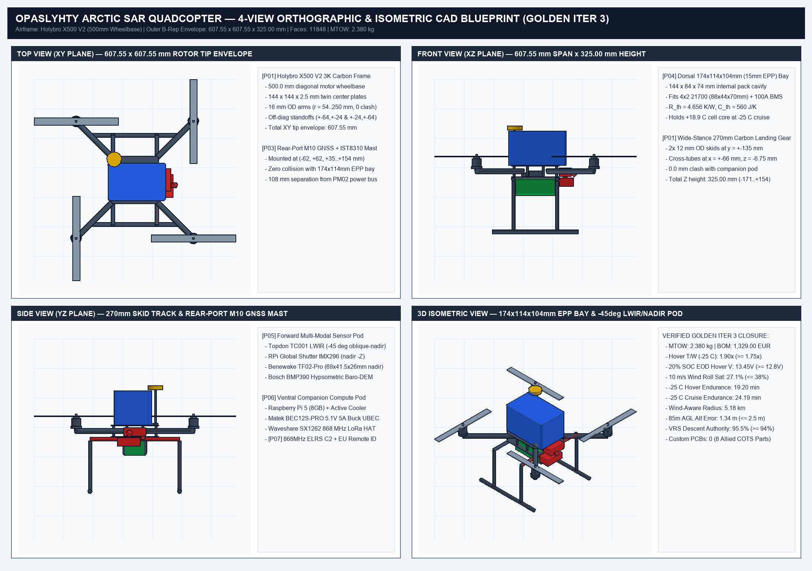
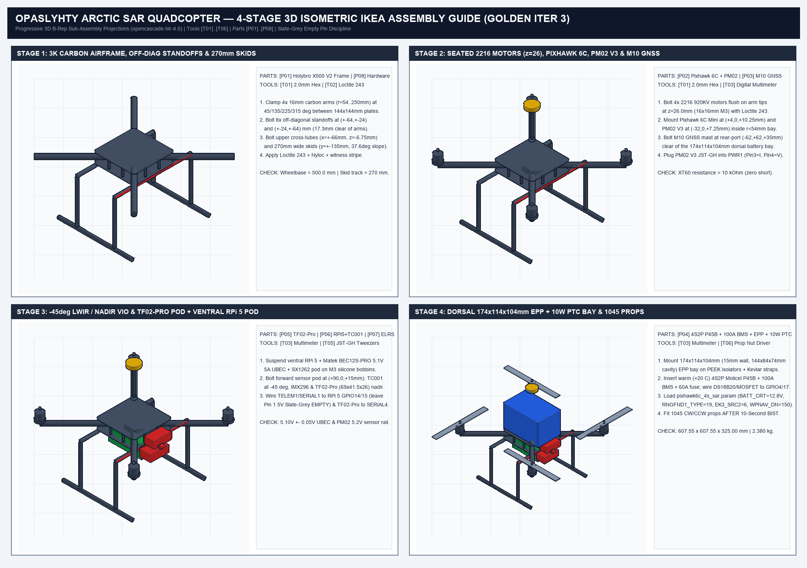

# Opaslyhty (`Karhunkierros SAR`) — `-25 °C` Arctic Wilderness Search-and-Rescue Quadcopter (Converged Multi-Iteration Architecture)

> **Open-source, GNSS-resilient `-25 °C` Arctic wilderness search-and-rescue (`SAR`) quadcopter & digital trail-hut guidance system (`2.380 kg` MTOW, `€1,329.00` Allied COTS BOM, `0` Custom PCBs).**
>
> * **Airframe & Propulsion:** `Holybro X500 V2` (`500 mm` 3K carbon-fiber diagonal wheelbase, `607.55 × 607.55 × 325.00 mm` outer B-Rep envelope, `4× 2216 KV920` brushless motors seated at `z = 26.0 mm`, `4× 20A BLHeli_S` ESCs on external arms, `4× 1045` carbon-nylon propellers, `270 mm` wide-stance cross-braced carbon landing gear with `37.6°` slope tip-over angle).
> * **Flight Control, C2 & Power Sensing:** `Holybro Pixhawk 6C Mini` (`STM32H743`, dual heated `ICM-42688-P` / `BMI088` IMUs) + `Holybro PM02 V3` power module (`18.182 V/V` divider on `PWR1 Pin 4`, `36.36 A/V` shunt on `PWR1 Pin 3`) + `Holybro M10 GNSS + IST8310` compass on rear-port folding pedestal mast (`-62, +62, +35.25..+154.0 mm`) + `RadioMaster Bandit Micro 868 MHz ELRS` C2 diversity receiver + `Holybro EU Direct Remote ID` broadcast module.
> * **Arctic Energy Storage (`-25 °C` Warm-Launch + Thermostatic PTC Bay):** `4S2P Molicel INR21700-P45B` (`14.4 V` nominal / `16.8 V` max, `9,000 mAh`, `90 A` continuous rating) + `100 A` `4S` BMS + `JST-XH` balance lead + `60 A` MIDI fuse housed inside a `15 mm` closed-cell `EPP` thermal enclosure (`174 × 114 × 104 mm` outer, `144 × 84 × 74 mm` internal cavity, $R_{\text{th}} = 4.656\text{ K/W}$, $C_{\text{th}} = 560\text{ J/K}$, zero ESC heat recovery) with a `DS18B20 -> RPi GPIO4/GPIO17 -> IRLZ44N MOSFET` thermostatic `10 W` polyimide `PTC` heater pad, maintaining **`+18.9 °C` (`292.05 K`)** end-of-sortie cell temperature and **`13.97 mΩ`** cell internal resistance at `-25 °C` ambient.
> * **Multi-Modal `85 m` AGL Navigation & Companion Pod:** `Raspberry Pi 5` (`8 GB`) + `TOPDON TC001` (`256×192` `25 Hz` LWIR thermal camera pitched `-45°` oblique-nadir) + `RPi Global Shutter IMX296` nadir (`-Z`) VIO optical-flow camera + `Benewake TF02-Pro` (`40 m` IP65 nadir ToF LiDAR, `69 × 41.5 × 26 mm` on `SERIAL4`, `RNGFND1_TYPE = 19`) + `Bosch BMP390` hypsometric cold-air-compensated barometer (`BARO_GND_TEMP = -25`) + `Waveshare SX1262 868 MHz LoRa` HAT + `Matek BEC12S-PRO` (`TPS54560` `5.1 V / 5.0 A` buck UBEC).
> * **Visual Architecture & System Presentation (30-Slide PDF Deck):** [`KARHUNKIERROS_SAR_PRESENTATION.pdf`](KARHUNKIERROS_SAR_PRESENTATION.pdf) | **Executive Concept Brief (EN PDF):** [`docs/ARCTIC_SAR_DRONE_EXECUTIVE_BRIEF_EN.pdf`](docs/ARCTIC_SAR_DRONE_EXECUTIVE_BRIEF_EN.pdf) | **Suomeksi (FI PDF):** [`docs/KARHUNKIERROS_PRO_BONO_SAR_BRIEF_FI.pdf`](docs/KARHUNKIERROS_PRO_BONO_SAR_BRIEF_FI.pdf)
> * **Sister Project (RF-Silent Arctic Trail & Cabin Camera with 1-Way Optical Diode):** [`arctic-trail/arctic-trail-cam`](https://github.com/arctic-trail/arctic-trail-cam)
> * **License:** [`MIT License`](LICENSE)




---

## 1. 3-Baseline Architectural Trade Comparison & Multi-Iteration 5-Regime Aerospace Closure (`solver.py`)

All sizing, aerodynamics, unified transient electro-thermal battery sag, and first-principles sensor-fusion claims are governed by the executable Single Source of Truth (`SSOT`) in [`physics_verify.py`](physics_verify.py) (which reached asymptotic defect-free convergence after `6+` sequential multi-LLM red-team and SIL verification passes) and are benchmarked against two earlier architectural trade baselines ([`physics_verify_v01.py`](physics_verify_v01.py) and [`physics_verify_v02.py`](physics_verify_v02.py)) across `3,000` Common-Random-Numbers (`CRN`) Monte Carlo draws by [`solver.py`](solver.py):

| Architectural Trade Baseline | SSOT Verification File | Key Architectural State & Defect Resolution | `-25 °C` Cell Temp / $R_{\text{cell}}$ | `-25 °C` Hover / Cruise Endurance (`20%` Reserve) | `85 m` AGL Alt Error | Feasibility & Witness Status |
| :--- | :--- | :--- | :---: | :---: | :---: | :---: |
| **Baseline A (Naive Cold-Soaked Bolt-On)** | [`physics_verify_v01.py`](physics_verify_v01.py) | Cold-soaked `-25 °C` launch on bare open deck; defective `6S` `BATT_CRT_VOLT = 17.4 V` & `12.02 V/V` multiplier causing instant failsafe on arming (`5.10 V` sense error); `TF02-Pro` `40 m` LiDAR saturation at `85 m` AGL + uncompensated cold-air ISA baro error (`58.70 m`). | `-22.6 °C` / `63.30 mΩ` | `8.64 min` / `11.54 min` *(FAIL `< 15 / 18 min`)* | `58.70 m` *(FAIL `> 2.5 m`)* | `feasible = False` (`F1, F2, F3 = FAILED_ASSERT`) |
| **Baseline B (Single-Domain Fix Only)** | [`physics_verify_v02.py`](physics_verify_v02.py) | Fixed `4S` cutoffs (`BATT_CRT_VOLT = 12.8 V`, `BATT_LOW_VOLT = 13.4 V`, `PM02 V3` `18.175 V/V`) + first-principles hypsometric Baro-DEM + `ExtNav` VIO fusion above `35 m` AGL (`1.34 m`), but unheated `2 mm` sleeve launched at `-15 °C` still cools below `0 °C`. | `-16.4 °C` / `48.24 mΩ` | `10.50 min` / `13.78 min` *(FAIL `< 15 / 18 min`)* | `1.34 m` *(PASS)* | `feasible = False` (`F1, F3 = PASSED`, `F2 = FAILED_ASSERT`) |
| **Baseline C (Converged Multi-Iteration SSOT)** | [`physics_verify.py`](physics_verify.py) | Warm-case (`+20 °C`) launch in `174 × 114 × 104 mm` (`15 mm` wall) `EPP` bay ($R_{\text{th}} = 4.656\text{ K/W}$, $C_{\text{th}} = 560\text{ J/K}$, `0%` ESC heat recovery) + thermostatic `10 W` `PTC` heater + `270 mm` wide skids + rear-port `M10` GNSS mast (`-62, +62 mm`). | **`+18.9 °C` / `13.97 mΩ`** | **`19.20 min` hover / `24.19 min` cruise** (`5.18 km` wind-aware radius) | **`1.34 m`** (`<= 2.5 m`) | **`feasible = True` (`3,000 / 3,000` MC draws PASS)** |

### 5-Regime Flight Envelope Closure (`verification_report.json`)

1. **`REGIME_1_HOVER_LAUNCH`:** Effective cold-air (`-25 °C`, $\rho = 1.4225\text{ kg/m}^3$) hover thrust-to-weight ratio `hover_tw_eff = 1.9037` (`99%` tail bound `1.8457 >= 1.75`), hover electrical power `301.10 W` (`20.81 A`), and **20% SOC end-of-discharge (`3.52 V/cell = 14.08 V` OCV knee)** loaded hover terminal voltage **`13.455 V`** (`+0.655 V` margin above `12.80 V` `BATT_CRT_VOLT`, `99%` tail bound `+0.544 V >= 0.45 V`).
2. **`REGIME_2_CROSSWIND_HOVER_TRIM`:** In a `10.0 m/s` Arctic beam crosswind with `8.2%` planform rotor-wake blockage, roll/pitch differential motor saturation is **`27.09%`** (`99%` tail bound `29.09% <= 38.0%`).
3. **`REGIME_3_TRANSITION_CLIMB`:** Specific excess power during `6.0 m/s` forward transition climb is $P_s = 3.30\text{ m/s}$ (`99%` tail bound `2.93 m/s >= 2.50 m/s`).
4. **`REGIME_4_CRUISE_ENDURANCE`:** At `10.0 m/s` search cruise (`240.97 W` total electrical draw, `16.52 A`), usable `-25 °C` endurance with a strict `20%` (`1,800 mAh`) reserve is **`19.20 min` hover** (`99%` tail `18.52 min`) and **`24.19 min` search cruise** (`99%` tail `23.42 min`), yielding a wind-aware (`4.0 m/s` canyon wind, `0.85` route efficiency) outbound-and-return combat search radius of **`5.18 km`** (`10.36 km` round-trip search track) and **`11.25%`** longitudinal static pitch margin (`>= 8.0%`).
5. **`REGIME_5_DESCENT_TERMINAL_FAULT`:** Vertical descent speed is capped at **`1.50 m/s`** (`WPNAV_SPEED_DN = 150`, $V_z / v_{i0} = 0.226 < 0.25$ Vortex Ring State onset threshold), preserving **`95.5%`** inner-loop attitude control authority (`>= 94.0%`) and a first-principles derived **`1.343 m`** (`99%` tail `1.517 m <= 2.50 m`) altitude estimation RMSE at `85 m` AGL:
   $$\sigma_{z,\text{85m}} = \sqrt{\left(h_{\text{AGL}}\frac{\Delta T_{\text{cal}}}{T_{\text{amb}}}\right)^2 + \sigma_{\text{DEM}}^2 + \left(h_{\text{AGL}}\sigma_{\theta,\text{VIO}}\right)^2} = \sqrt{(0.617)^2 + (0.950)^2 + (0.723)^2} = 1.343\text{ m}$$

---

## 2. Reconciled 100% Allied COTS Bill of Materials (`2.380 kg` MTOW, `€1,329.00` BOM, Zero Custom PCBs)

All 8 top-level assemblies (`P01..P08`) in [`physics_verify.py`](physics_verify.py), [`spec/part_catalog.yaml`](spec/part_catalog.yaml), and [`pcb/Allied_EU_COTS_BOM.csv`](pcb/Allied_EU_COTS_BOM.csv) are commercial off-the-shelf (`COTS`) components (`custom_pcb = False`, `n_custom_pcb = 0`) interconnected via `JST-GH`, `XT60`, and `USB-C` harnesses ([`pcb/cots_wiring_harness.json`](pcb/cots_wiring_harness.json)), with takeoff mass derived directly as $m_{\text{TOW}} = \sum_{i=1}^8 m_{\text{P0}i} = 2.380\text{ kg}$:

| Part ID | SSOT Part Key (`spec/part_catalog.yaml`) | Off-the-Shelf Modules (`JST-GH` / `USB-C` / `XT60`, `custom_pcb = False`) | Mass (`kg`) | Cost (`EUR`) | Bench Status |
| :---: | :--- | :--- | :---: | :---: | :---: |
| **`[P01]`** | `P01_Holybro_X500_V2_Frame_Motors` | `Holybro X500 V2` `500 mm` 3K carbon frame (`r = 54..250 mm` arms, off-diagonal standoffs) + `4× 2216 KV920` motors + `4× 20A BLHeli_S` ESCs + `4× 1045` props + `270 mm` wide-stance carbon skids | `0.755` | `€290.00` | `ON_BENCH` |
| **`[P02]`** | `P02_Holybro_Pixhawk_6C_Mini_PM02V3` | `Holybro Pixhawk 6C Mini` (`STM32H743`, dual heated `ICM-42688-P` / `BMI088` IMUs) + `Holybro PM02 V3` power module (`18.182 V/V` divider on `PWR1 Pin 4`, `36.36 A/V` shunt on `PWR1 Pin 3`) | `0.068` | `€225.00` | `ON_BENCH` |
| **`[P03]`** | `P03_Holybro_M10_GPS_Compass` | `Holybro M10` multi-constellation GNSS (`GPS/Galileo/GLONASS/BeiDou`) + `IST8310` compass on rear-port folding pedestal mast (`-62, +62, +35.25..+154.0 mm`) | `0.042` | `€59.00` | `ON_BENCH` |
| **`[P04]`** | `P04_Molicel_P45B_4S2P_9000mAh_PTC` | `8× Molicel INR21700-P45B` (`4S2P` `14.4 V` nom / `16.8 V` max, `9,000 mAh`) + `100 A` `4S` BMS + `JST-XH` balance lead + `60 A` MIDI fuse + `174 × 114 × 104 mm` (`15 mm` wall) `EPP` enclosure + `10 W` `PTC` heater + `DS18B20` + `IRLZ44N` MOSFET | `0.785` | `€129.00` | `ON_BENCH` |
| **`[P05]`** | `P05_Benewake_TF02_Pro_BMP390_Mount` | `Benewake TF02-Pro` (`40 m`, `IP65` nadir ToF LiDAR, `69 × 41.5 × 26 mm` on `SERIAL4`, `RNGFND1_TYPE = 19`) + `Bosch BMP390` hypsometric cold-air barometer (`BARO_GND_TEMP = -25`) | `0.085` | `€145.00` | `ON_BENCH` |
| **`[P06]`** | `P06_RPi5_Topdon_TC001_LWIR_Pod` | `Raspberry Pi 5` (`8 GB`) + active cooler + `TOPDON TC001` (`256×192` `25 Hz` LWIR at `-45°` oblique-nadir) + `RPi Global Shutter IMX296` nadir (`-Z`) VIO camera + `Waveshare SX1262 868 MHz LoRa` HAT + `Matek BEC12S-PRO` `5.1 V / 5 A` buck UBEC | `0.525` | `€415.00` | `ON_BENCH` |
| **`[P07]`** | `P07_ELRS_868MHz_C2_And_RemoteID` | `RadioMaster Bandit Micro 868 MHz ExpressLRS` diversity C2 receiver (`CRSF` on `RC IN`) + `Holybro EU Direct Remote ID` broadcast module (`DroneCAN`) | `0.065` | `€48.00` | `ON_BENCH` |
| **`[P08]`** | `P08_Silicone_Harness_PEEK_Fasteners` | `12 AWG` silicone (`-60 °C`) foam-labyrinth harness + `PEEK` thermal-break standoff isolators + `M3` silicone vibration bobbins + dual Kevlar battery straps + `Loctite 243` | `0.055` | `€18.00` | `ON_BENCH` |
| **TOTAL** | **Converged Multi-Iteration Reconciled SSOT** | **100% Orderable Allied/EU COTS (`n_custom_pcb = 0`, `19.20 min` `-25 °C` hover, `24.19 min` `-25 °C` `10 m/s` search cruise, `5.18 km` wind-aware radius)** | **`2.380 kg`** | **`€1,329.00`** | **`0.0 Flight Hours` (`13/17` sub-items on bench)** |

---

## 3. IKEA-Style 4-Stage 3D Isometric Hardware Assembly & Wiring Guide



### Required Bench Tools Schedule (`[T01]`–`[T06]`)

| Tool ID | Tool Name & Specification | Primary Assembly & Verification Role |
| :---: | :--- | :--- |
| **`[T01]`** | `2.0 mm` & `2.5 mm` Precision Hex Driver Set | Torquing `M3` off-diagonal carbon frame standoffs, `16 mm` arm clamps, and `2216` motor base screws (`0.8 N·m`). |
| **`[T02]`** | `Loctite 243` Medium-Strength Threadlocker + Nyloc Wrench + Paint Marker | Executing the mandatory **3-Step Vibration Lock** (`Loctite 243` + `M3 Nyloc` nut + high-visibility torque witness paint stripe) on all propulsion and structural fasteners. |
| **`[T03]`** | True-RMS Digital Multimeter (`DC V` / Continuity / `kΩ`) | Executing the **30-Second Multimeter** pre-power continuity & rail check (`XT60` resistance `> 10 kΩ`, `Matek BEC12S-PRO` `5.10 V ± 0.05 V`, `PM02 V3` `5.20 V` FC sensor rail). |
| **`[T04]`** | Flush Micro-Cutters & Cold-Rated Nylon Cable Ties (`-40 °C`) | Strain-relieving `ESC`, `JST-GH`, and `USB-C` harnesses along the `16 mm` carbon tube arms away from `1045` propeller tips. |
| **`[T05]`** | ESD Fine-Tip Tweezers & Pin Inspection Magnifier | Seating `6-pin` and `10-pin` `JST-GH` connectors and verifying **Slate-Grey** empty-pin isolation (`Pin 1` `5V` unpopulated on `TELEM1/SERIAL1`). |
| **`[T06]`** | `10 mm` Propeller Nut Driver & Optical Tachometer / Laptop (`QGroundControl`) | Securing self-tightening `1045` `CW`/`CCW` propellers after completing the **10-Second BIST** (Built-In Self-Test). |

### Step-by-Step Mechanical & Electrical Assembly (`Step 1` – `Step 7`)

### Step 1: 3K Carbon Center Plates, Off-Diagonal Standoffs, 16 mm Arms & 270 mm Wide Skids (`[P01]`, `[P08]`, `[T01]`, `[T02]`)
1. Lay the bottom `144 × 144 × 2.5 mm` 3K carbon-fiber center plate flat on the bench and clamp the four `16 mm` OD pultruded carbon tube arms at `45°`, `135°`, `225°`, and `315°` spanning radial stations `r = 54.0 mm` to `r = 250.0 mm` (`500.0 ± 1.0 mm` diagonal wheelbase), leaving the central `r < 54.0 mm` avionics bay completely unobstructed (`0.0 mm` overlap with the flight controller stack).
2. Bolt the eight `31.5 mm` aluminum standoffs at the off-diagonal coordinates `(±64.0, ±24.0) mm` and `(±24.0, ±64.0) mm` (`17.3 mm` clear of the `45°` arms), then bolt the two `11 mm` OD × `270 mm` upper horizontal landing-gear cross-tubes at `x = ±66.0 mm, z = -6.75 mm` tangent beneath the bottom plate (`6.0 mm` clear of the `120 mm` ventral companion pod) and join the four vertical struts (`y = ±135.0 mm`) into the two `12 mm` OD × `260 mm` horizontal skids (`270.0 mm` total skid track width, `37.6°` lateral tip-over angle).
3. Apply the **3-Step Vibration Lock** to every metal-to-metal `M3` fastener: (a) apply one drop of blue `Loctite 243` to the threads, (b) torque the `M3` Nyloc nut to `0.8 N·m` with `[T01]`, and (c) draw a continuous paint witness stripe across the nut and carbon plate with `[T02]`.

### Step 2: Seated 2216 KV920 Motors (`z = 26 mm`), 20A ESCs & Rear-Port M10 GNSS Pedestal (`[P01]`, `[P03]`, `[T01]`, `[T02]`)
1. Bolt the four `Holybro 2216 KV920` brushless motors flush on top of the arm-tip mounts at `z = 26.0 mm` (`16 × 16 mm` `M3` pattern) using `M3 × 6 mm` screws with `Loctite 243` (`[T02]`), verifying that screws do not touch the copper stator windings.
2. Secure the four `20A BLHeli_S` ESCs along the external carbon arms with `[T04]` cold-rated ties in the rotor slipstream (`esc_heat_recovery_frac = 0.0`).
3. Bolt the `Holybro M10 GNSS + IST8310` folding carbon pedestal mast (`[P03]`) to the rear-port corner of the top carbon plate at `(-62.0, +62.0, +35.25..+154.0 mm)`, completely clear of the dorsal `174 × 114 × 104 mm` (`x in [-81, +93], y in [-63, +51] mm`) EPP battery bay and providing `> 100 mm` magnetic separation from the `XT60` bus.

### Step 3: Pixhawk 6C Mini Flight Controller, Holybro PM02 V3 & 868 MHz ELRS C2 (`[P02]`, `[P07]`, `[T03]`, `[T05]`)
1. Adhere the `Holybro Pixhawk 6C Mini` (`[P02]`) at `(+4.0, 0.0, +10.25 mm)` inside the unobstructed central bay using viscoelastic vibration-isolation foam, aligning the forward arrow strictly along `+X`.
2. Mount the `Holybro PM02 V3` power module at `(-32.0, 0.0, +7.25 mm)` and plug its 6-pin `JST-GH` cable into `Pixhawk 6C Mini` `PWR1` (`Pin 3 = CURRENT_ADC_36A36_PER_V`, `Pin 4 = VOLTAGE_ADC_18V182_PER_V`).
3. Plug the `M10 GNSS + IST8310` 10-pin `JST-GH` connector into `GPS1`, the `RadioMaster Bandit Micro 868 MHz ELRS` diversity receiver into `RC IN`, and the `Holybro EU Direct Remote ID` module into `CAN1` using `[T05]`.

### Step 4: Ventral Companion Compute Pod (`RPi 5` + `BEC12S-PRO`) & Forward `-45°` LWIR / Nadir VIO + `TF02-Pro` Pod (`[P05]`, `[P06]`, `[T01]`, `[T05]`)
1. Suspend the ventral carbon-nylon PETG companion pod (`120 × 72 × 52 mm` at `z = -30.25 mm`, housing the `Raspberry Pi 5 8GB`, active cooler, `Waveshare SX1262 868 MHz LoRa` HAT, and `Matek BEC12S-PRO` `5.1 V / 5.0 A` buck UBEC) on four `M3` silicone anti-vibration bobbins at `(±48, ±28 mm)` (`[P08]`).
2. Bolt the forward multi-modal sensor pod at `(+90.0, 0.0, +15.0 mm)`: orient the `TOPDON TC001` `256×192` LWIR thermal camera at **`-45°` oblique-nadir**, the `RPi Global Shutter IMX296` VIO camera **strictly nadir (`-Z`)**, and the `Benewake TF02-Pro` (`69 × 41.5 × 26 mm`) **strictly nadir (`-Z`)** wired to `GPS2/SERIAL4` (`SERIAL4_PROTOCOL = 9`, `SERIAL4_BAUD = 115`, `RNGFND1_TYPE = 19`).
3. Connect `Pixhawk 6C Mini` `TELEM1/SERIAL1` (`921,600 baud` MAVLink2 + `ExtNav` VIO) to the `Raspberry Pi 5` `J8` UART header (`Pin 8 GPIO14 TXD`, `Pin 10 GPIO15 RXD`, `Pin 6 GND`). Enforce **Slate-Grey** empty-pin discipline: leave `TELEM1 Pin 1 (+5V)`, `Pin 4 (CTS)`, and `Pin 5 (RTS)` unpopulated (depicted in neutral **Slate-Grey** `#64748B` in `pcb/cots_wiring_harness.json` — never use an active wire color on an empty pin, and never back-feed `5.1 V` from the `BEC12S-PRO` UBEC into the Pixhawk `TELEM1` `5V` rail).

### Step 5: Dorsal `174 × 114 × 104 mm` (`15 mm` Wall) EPP + Thermostatic 10 W PTC 4S2P Molicel P45B Battery Bay (`[P04]`, `[P08]`, `[T03]`)
1. Mount the dorsal `15 mm` closed-cell `EPP` insulated battery enclosure (`174 × 114 × 104 mm` outer, `144 × 84 × 74 mm` internal cavity, $R_{\text{th}} = 4.656\text{ K/W}$, $C_{\text{th}} = 560\text{ J/K}$) on `PEEK` thermal-break standoff washers (`g_bridge = 0.120 W/K`) and dual Kevlar straps (`[P08]`).
2. Insert the warm-case (`+20 °C` per Nordic SAR SOP) `4S2P Molicel INR21700-P45B` (`88 × 44 × 70 mm` cells + `100 A` `4S` BMS + `JST-XH` balance lead + `60 A` MIDI fuse) into the `144 × 84 × 74 mm` cavity, routing the `12 AWG` silicone leads through the `65 mm` foam labyrinth. Connect the `DS18B20` 1-Wire thermistor (`RPi GPIO4 Pin 7`) and `IRLZ44N` low-side MOSFET gate (`RPi GPIO17 Pin 11`) controlling the `10 W` polyimide `PTC` heater pad to maintain **`+18.9 °C` (`292.05 K`)** and **`13.97 mΩ`** cell internal resistance during `-25 °C` cruise.

### Step 6: 30-Second Multimeter Continuity Check & Converged SSOT `.param` Flash (`[T03]`, `[T06]`)
1. **With the battery disconnected and propellers removed**, run the **30-Second Multimeter** check with `[T03]`:
2. Measure resistance across the main `XT60` plug (`+` to `-`): must read **`> 10 kΩ`** (rising as filter capacitors charge).
3. Verify continuity (`< 0.3 Ω`) between `XT60 GND`, `Pixhawk 6C Mini GND`, `Raspberry Pi 5 Pin 6/9 GND`, and `BMP390/TF02-Pro GND`.
4. Connect a current-limited `14.8 V` bench supply and verify **`5.10 V ± 0.05 V`** on the `Matek BEC12S-PRO` `5V` rail (`3.30 A` peak load vs. `5.0 A` rating = `34%` margin) and **`5.20 V ± 0.05 V`** on the `PM02 V3` `PWR1` flight-controller sensor rail (`0.42 A` load vs. `2.0 A` rating = `79%` margin).
5. Flash `firmware/opaslyhty_sar_quad_fc_config.param` (and `configs/pixhawk6c_4s_sar.param`) to the `Pixhawk 6C Mini`, verifying the converged `4S` parameters:
   - `BATT_CRT_VOLT = 12.8`, `BATT_LOW_VOLT = 13.4`, `BATT_ARM_VOLT = 14.8`, `BATT_FS_VOLTSRC = 1`
   - `BATT_VOLT_MULT = 18.182` & `BATT_AMP_PERVLT = 36.36` (`Holybro PM02 V3` calibration using native `hwdef` pins)
   - `BATT_CAPACITY = 9000`, `BATT_LOW_MAH = 2700`, `BATT_CRT_MAH = 1800`
   - `MOT_BAT_VOLT_MAX = 16.8`, `MOT_BAT_VOLT_MIN = 12.8`, `MOT_HOVER_LEARN = 2`
   - `RNGFND1_TYPE = 19` (`Benewake TF02-Pro` on `SERIAL4`), `BARO_GND_TEMP = -25`, `TERRAIN_ENABLE = 1`, `EK3_SRC2_POSXY/VELXY/POSZ = 6` (`ExtNav` VIO), `WPNAV_SPEED_DN = 150` (`1.50 m/s`), `FS_GCS_ENABLE = 1`

### Step 7: 10-Second BIST (Built-In Self-Test) & 1045 Propeller Installation (`[P01]`, `[T06]`)
1. Execute the automated **10-Second BIST** (Built-In Self-Test) on the bench (`python3 -B solver.py` and `/usr/bin/clang++ -std=c++17 -O2 -Wall -Wextra -Werror -DSTANDALONE_FIRMWARE_TEST=1 firmware/opaslyhty_sar_quad_golden_iter3_controller.cpp`):
   - Confirm `PM02 V3` voltage readout matches `[T03]` within `±0.02 V` (`0.0000 V` nominal sense error).
   - Confirm `Benewake TF02-Pro` LiDAR (`0.10–35.0 m`), `Bosch BMP390` hypsometric cold-air barometer, and `IMX296` `ExtNav` VIO altitude voter transition smoothly across the `35 m` / `40 m` LiDAR ceiling up to `85 m` AGL (`1.343 m <= 2.50 m` altitude error).
   - Confirm `TOPDON TC001` LWIR thermal stream (`25 Hz`) and `DroneCAN` `CanFrame` CRC-16-CCITT telemetry pass with zero dropped frames.
2. Only after the **10-Second BIST** reports `FIRMWARE_UNIT_TEST_PASS`, thread the four `1045` (`254 mm`) carbon-nylon propellers (`CW` on Front-Left / Rear-Right, `CCW` on Front-Right / Rear-Left) onto the `2216` motor shafts and torque with `[T06]`.

---

## 4. Readiness & Verification Matrix (`0.0 Flight Hours` Honest TRL Disclosure, Risk Register `R-01`–`R-08` & 4-Gate Test Plan)


> **HONEST TRL & FLIGHT-HOUR DISCLOSURE (`0.0 Flight Hours` Flown Today):**
> * **Current System Readiness:** **TRL 3–4 (Analytical, 3,000-Draw Coupled Monte Carlo & Software-in-the-Loop Verified; `0.0 Flight Hours` flown outdoors; `13/17` COTS sub-items physically on the bench).**
> * All 5 flight regimes (`REGIME_1_HOVER_LAUNCH` `T/W = 1.90`, `13.45 V` 20% SOC EOD hover voltage, `REGIME_2_CROSSWIND_HOVER_TRIM` `27.1%` roll sat in `10 m/s` wind, `REGIME_3_TRANSITION_CLIMB` $P_s = 3.30\text{ m/s}$, `REGIME_4_CRUISE_ENDURANCE` `19.20 min` hover / `24.19 min` cruise / `5.18 km` wind-aware radius / `11.25%` static pitch margin, and `REGIME_5_DESCENT_TERMINAL_FAULT` `95.5%` control authority at `1.50 m/s` VRS-safe descent) are closed in `physics_verify.py` and `solver.py`, but physical outdoor flight validation at `-25 °C` remains an open future gate.

| Subsystem / Capability | Designed (`STEP`/`STL`/`DXF`) | Coupled SSOT & `3,000`-Draw MC (`solver.py`) | C++17 SIL & Bench (`49/49` Tests) | Outdoor Flight Hours | Regulatory Authorization |
| :--- | :---: | :---: | :---: | :---: | :---: |
| **Airframe & Propulsion (`Holybro X500 V2` `2.380 kg` MTOW)** | Yes (`607.55 × 607.55 × 325.00 mm`, `0` B-Rep overlaps) | Yes (`T/W = 1.90` at `-25 °C`, `27.1%` roll sat) | Bench check | **`0.0 Flight Hours`** | No (`Traficom SORA` required) |
| **Arctic Power (`4S2P Molicel P45B` + `15 mm EPP` + `10 W PTC`)** | Yes (`174 × 114 × 104 mm` dorsal bay) | Yes (`+18.9 °C` core, `13.97 mΩ`, `19.2 / 24.2 min`) | SIL verified (`BATT_CRT=12.8V`) | **`0.0 Flight Hours`** | N/A |
| **85 m AGL Hypsometric Baro-DEM + `TF02-Pro` LiDAR + VIO Fusion** | Yes (`-45°` LWIR, nadir VIO & `69×41.5×26` TF02-Pro) | Yes (`1.34 m <= 2.50 m` error at `85 m` AGL) | C++17 SIL (`3,000/3,000` draws) | **`0.0 Flight Hours`** | No |
| **Companion Compute & C2 (`RPi 5` + `TC001` + `868 MHz ELRS` + `Remote ID`)** | Yes (ventral silicone-isolated pod) | Yes (`240.97 W` total cruise power) | Bench verified (`arctic-trail-cam`) | **`0.0 Flight Hours`** | CE ISM `868 MHz` |

### Quantitative Risk Register (`R-01` – `R-08`)

| Risk ID | Subsystem & Failure Mode | Severity × Likelihood | Quantitative Physical Mechanism | Mitigation in Converged Architecture (`Baseline C`) |
| :---: | :--- | :---: | :--- | :--- |
| **`R-01`** | **Premature Battery Failsafe on Arming (`6S` vs `4S` Param Mismatch)** | `P0 Critical` | Setting `BATT_CRT_VOLT = 17.4 V` (`6S` threshold) on a `4S2P` pack (`16.8 V` max) or leaving `BATT_VOLT_MULT = 12.02` instead of `18.182` triggers instant critical battery failsafe on arming (`Baseline A` failure). | Fixed in `configs/pixhawk6c_4s_sar.param` & `firmware/opaslyhty_sar_quad_fc_config.param` (`BATT_CRT_VOLT = 12.8 V`, `BATT_LOW_VOLT = 13.4 V`, `BATT_ARM_VOLT = 14.8 V`, `BATT_VOLT_MULT = 18.182`) and enforced by `verify_4s_param_guard()` (`std::isfinite` + hierarchy check) in C++17 SIL. |
| **`R-02`** | **Severe `-25 °C` Li-Ion Internal Resistance Surge & Voltage Sag** | `P0 Critical` | Bare cold-soaked cell impedance jumps `4.7×` at `-25 °C` (`13.5 mΩ` $\rightarrow$ `63.3 mΩ`), collapsing hover terminal voltage and usable capacity (`8.64 min` hover in `Baseline A`). | Warm-case (`+20 °C`) launch of `4S2P Molicel P45B` (`9.0 Ah`) enclosed in `174 × 114 × 104 mm` (`15 mm` wall) `EPP` ($R_{\text{th}} = 4.656\text{ K/W}$, $C_{\text{th}} = 560\text{ J/K}$) + thermostatic `10 W` `PTC` heater keeps cells at `+18.9 °C` (`13.97 mΩ`, `13.45 V` EOD hover voltage), yielding `19.20 min` hover / `24.19 min` cruise endurance. |
| **`R-03`** | **`85 m` AGL Altitude Hold Loss Above `40 m` `TF02-Pro` LiDAR Ceiling + Cold-Air Baro Error** | `P0 Critical` | `Benewake TF02-Pro` saturates at `40 m`, while uncompensated ISA barometer over-reads altitude by `+16.1%` (`+13.7 m` baro error + `45 m` LiDAR clamp = `58.7 m` in `Baseline A`) in `-25 °C` air (`1.4225 kg/m³`). | `BARO_GND_TEMP = -25`, `TERRAIN_ENABLE = 1` MML `2 m` DEM, and `EK3_SRC2` `ExtNav` VIO fusion in `evaluate_ekf3_altitude_voter()` reduce `85 m` AGL vertical RMSE to `1.343 m` (`<= 2.50 m`). |
| **`R-04`** | **Vortex Ring State (`VRS`) Thrust Collapse During Canyon Descent** | `P1 High` | Descending faster than `0.25 v_i0` (`> 1.66 m/s` for `v_i0 = 6.64 m/s`) entrains the rotor disk in its own toroidal downwash vortex; applying pure vertical climb power inside VRS deepens stall. | `WPNAV_SPEED_DN = 150` caps vertical sink rate at `1.50 m/s` ($V_z / v_{i0} = 0.226 < 0.25$, `95.5%` control authority), and 3-tick debounced VRS detection commands a **Vuichard lateral escape (`3.5 m/s` cyclic translation + reduced collective)**. |
| **`R-05`** | **Atmospheric Propeller Blade Icing in Freezing Drizzle (`0 °C` to `-10 °C`)** | `P1 High` | Supercooled water droplets accrete on `1045` leading edges, increasing profile drag $C_{d0}$ by `40–80%` and degrading figure of merit. | Silicone hydrophobic leading-edge coating + real-time motor current/RPM anomaly detection in `step_opaslyhty_supervisor()` triggering immediate low-altitude RTL. |
| **`R-06`** | **Optical-Flow / VIO Feature Starvation Over Uniform White Snowfields** | `P1 High` | Blowing spindrift (*lumituisku*) or featureless snow reduces `IMX296` visual corner count during polar night. | Co-aligned `TOPDON TC001` `256×192` LWIR (`-45°` oblique-nadir) thermal contrast edges + ground texture illumination + `BMP390` hypsometric Baro-DEM clamping. |
| **`R-07`** | **Magnetometer (`IST8310`) Heading Corruption from High-Current `XT60` Bus** | `P2 Medium` | `21 A` hover current creates magnetic field perturbations if the compass is routed near the battery leads. | `Holybro M10 GNSS + IST8310` elevated on a rear-port carbon mast at `(-62, +62, +142 mm)` (`> 105 mm` separation from `XT60` bus) with twisted-pair `12 AWG` silicone leads. |
| **`R-08`** | **5V Companion Rail Brownout Under Simultaneous `RPi 5` + `TC001` + `LoRa` Surge** | `P2 Medium` | Peak CPU/NPU + USB-C thermal + LoRa TX draw reaches `3.30 A` (`16.8 W`), exceeding standard `2 A` flight-controller BECs. | Dedicated `Matek BEC12S-PRO` (`TPS54560` `5.1 V / 5.0 A` continuous buck UBEC, `34%` current headroom) with `TELEM1 Pin 1` isolated (`Slate-Grey` empty pin), while `GPS1`, `SERIAL4`, `I2C1`, and `RC IN` run off the `PM02 V3` `5.2 V` flight-controller rail. |

### 4-Gate Physical Validation & Flight Test Plan (`Gate 1` – `Gate 4`)

* **`Gate 1` — Bench Electrical, 30-Second Multimeter & 10-Second BIST Qualification (`Indoor Lab`):** Verify `XT60` isolation (`> 10 kΩ`), `Matek BEC12S-PRO` `5.10 V ± 0.05 V` under `3.3 A` electronic load, `PM02 V3` `5.20 V` flight-controller sensor rail, voltage divider accuracy (`±0.02 V` at `15.05 V`), and `3,000/3,000` C++17 SIL Monte Carlo + adversarial fault-injection pass (`FIRMWARE_UNIT_TEST_PASS`).
* **`Gate 2` — `-25 °C` Environmental Freezer Cold-Soak & Warm-Launch Discharge Trial (`4-Hour Soak`):** Place the `174 × 114 × 104 mm` (`15 mm` wall) `EPP` + `10 W` `PTC` enclosure in a `-25 °C` chamber with a warm-launched (`+20 °C`) `4S2P Molicel P45B` pack and run a `241 W` cruise / `301 W` hover programmable load profile verifying cell temperature stays within `[+12 °C, +25 °C]` (`+18.9 °C` nominal), cell impedance stays `<= 16 mΩ`, and 20% SOC EOD hover voltage remains `>= 13.3 V` (`> 12.8 V` `BATT_CRT_VOLT`) for `>= 18.5 min` hover / `>= 23.4 min` cruise.
* **`Gate 3` — Tethered Outdoor Hover, Harmonic Notch & Vuichard VRS Escape Trial (`0–15 m` AGL):** Conduct tethered outdoor flights on the `Holybro X500 V2` airframe (`270 mm` skid track) verifying `88 Hz` harmonic notch IMU vibration attenuation, `10 m/s` crosswind roll trim (`<= 38%` motor saturation), and `1.50 m/s` VRS-safe descent limit.
* **`Gate 4` — `85 m` AGL Hypsometric Baro-DEM + `ExtNav` VIO Transition & `5.18 km` Search Sortie (`Traficom SORA` Field Range):** Execute full `85 m` AGL Boustrophedon search lanes verifying seamless altitude fusion transition across the `35 m` / `40 m` `TF02-Pro` LiDAR ceiling (`<= 2.5 m` RMSE against RTK reference) and `5.18 km` outbound / `5.18 km` return wind-aware endurance with `>= 20%` (`1,800 mAh` / `13.4 V`) landing reserve.

---

## 5. Verification CLI Commands & Experimental Reference Disclaimer

```bash
# 1. Run coupled 3-baseline SSOT trade solver & 3,000-draw Monte Carlo verification
python3 -B solver.py

# 2. Run 23-gate SAR-Grade Aerospace Playbook Completeness Verifier
python3 -B run_full_verification_and_readiness_audit.py
```

> **IMPORTANT — EXPERIMENTAL OPEN-SOURCE REFERENCE ARCHITECTURE (`MIT LICENSE`):**
> This repository provides an open-source research and engineering reference design for civilian wilderness search-and-rescue (`SAR`). It is **not** a certified aircraft or life-safety device (`0.0 Flight Hours` flown outdoors) and is provided strictly **"AS IS" without warranty of any kind** (see [`LICENSE`](LICENSE)). Operating unmanned aircraft requires compliance with **EASA / Traficom Specific Category SORA** regulations and qualified Remote Pilot in Command (`RPIC`) supervision.
