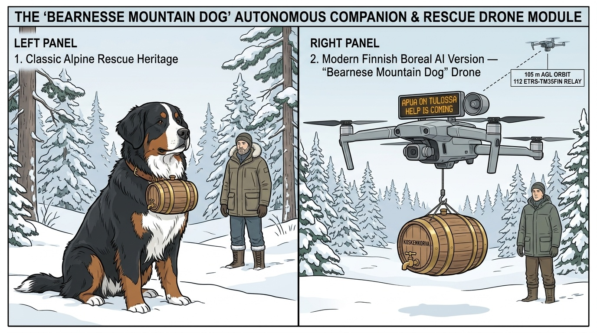
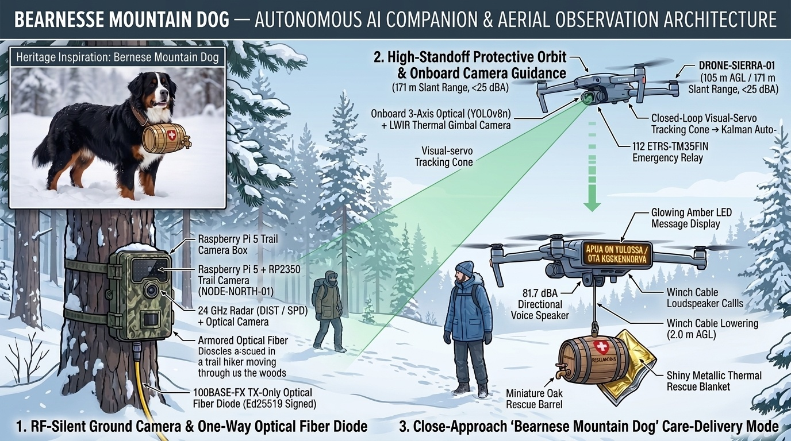

# "Bearnese Mountain Dog" (`Karhunkierros SAR Edition`) — Digital Autiotupa, Unmanned Wilderness Lifebuoy, Aerial Lantern Trail Guide & `112` / `Rajavartiolaitos` / `Poliisi` SAR Module (`drone_observer.py`)

> **CONCEPT-STAGE STATUS DISCLAIMER (FIRST PUBLIC RELEASE):**
> This technical specification documents an **open-source engineering concept, COTS hardware bill-of-materials (`€1,189–€1,329`), and software-simulated reference architecture** (`29/29` unit tests passing in `collector_hub/drone_observer.py`). While the shared ground trail-camera and collector stack ([`arctic-trail/arctic-trail-cam`](https://github.com/arctic-trail/arctic-trail-cam)) is bench-verified, **the SAR drone airframe, `-25 °C` winter flight endurance, payload drop, and `+10 °C` roofed station are currently at the concept and simulation stage** and have not yet undergone live flight testing or `Traficom` / `EASA SORA` regulatory certification.

> **Inspired by both the classic Alpine mountain rescue dogs that carried a small wooden warming barrel around their collar and Finland's own wilderness rescue heritage (such as `Poliisi` and `Rajavartiolaitos` locating lost hikers on Ruka's *Karhunkierros* trail), the "Bearnese Mountain Dog" (`Karhunkierros SAR Edition`) is an optional, COTS-based Search & Rescue (`SAR`) and "Digital Autiotupa" companion module for [`arctic-trail-cam`](https://github.com/arctic-trail/arctic-trail-cam). Trail posts operate as sealed, anonymous 48-hour auto-purging ring buffers (`0.00 W` RF, zero facial recognition, zero cloud upload) until unlocked by a `112 Suomi` SOS ping, a `Garmin inReach` beacon, a physical trail-post SOS button, or an authorized `112` / `Poliisi` / `Rajavartiolaitos` / `Vapepa` SAR order. Once dispatched, high-visibility SAR Orange (`RAL 2005`) drones locate single hikers or separated tourist groups, lock on and self-guide with their own onboard optical + thermal cameras, lower a warm berry-electrolyte & thermal-blanket rescue barrel at a safe `15 m` offset with an electromagnetic breakaway fuse (or Koskenkorva in internal heritage demo mode), and guide hikers along the trail as a flying `800 lm` "Aerial Lantern" (*Opaslyhty*) to the nearest warm wilderness hut (*autiotupa*).**



* **Core Software Module:** [`collector_hub/drone_observer.py`](../collector_hub/drone_observer.py)
* **Ground Camera Multi-Object Kinematics Estimator:** [`pi5_sender_node/sender_node.py`](../pi5_sender_node/sender_node.py) (`estimate_subject_kinematics`, `estimate_all_subjects_kinematics`)
* **Dashboard & API Endpoint:** [`collector_hub/dashboard_server.py`](../collector_hub/dashboard_server.py) (`/api/drone`) & [`collector_hub/ui/index.html`](../collector_hub/ui/index.html) (`🐕 Bearnese Dog Drone`)
* **Automated Simulation & Physics Verification Suite:** [`tests/test_drone_observer_simulation.py`](../tests/test_drone_observer_simulation.py) (`24/24` automated unit tests; `27/27` across full repository suite)

---

## 1. End-to-End Architecture & Operational Modes



Whether assisting a lost winter hiker in the Finnish woods (`"Bearnese Mountain Dog"` companion & Koskenkorva mini-faucet barrel delivery mode) or observing an unauthorized vehicle or trespasser from a safe distance to guide `112` emergency responders, the system operates across four integrated stages while keeping the ground trail cameras **100% RF-silent (`0.00 W`)**:

```
[1. Multi-Camera RF-Silent Ground Perimeter (0.00 W RF at Trail)]
     │ • Multiple perimeter nodes (`NODE-NORTH-01`, `NODE-SOUTH-02`, `NODE-LAKE-03`, `NODE-EAST-04`)
     │   measure distance (DIST) and radial speed (SPD) via 24 GHz radar + Pico 2 Gatekeeper.
     │ • Pi 5 + IMX708 NoIR + Hailo-8L / ONNX extracts independent kinematics for EVERY
     │   detected object in the frame (`estimate_all_subjects_kinematics`).
     │
     ▼ (30 m – 10 km Single-Mode Optical Fiber Diode — 100% RF-Silent at Camera Trees)
[2. Collector Hub Multi-Camera Track Manager (`MultiCameraTrackManager`)]
     │ • Verifies Ed25519 signature & filters qualifying classes (`person`, `car`,
     │   `motorcycle_atv_snowmobile`, `truck_tractor`, `boat_watercraft`; ignores wildlife).
     │ • Associates sequential sightings across cameras via kinematic prediction gates or
     │   spawns distinct simultaneous target tracks (`OBJ-001`, `OBJ-002`, `OBJ-003`, ...).
     │ • If a subject's direction is uncertain or lost under dense forest, plans a coordinated
     │   Multi-Drone Boustrophedon (Lawnmower) Grid Search (`plan_multi_drone_grid_search`).
     │
     ▼ (Distributed Launch from Farmhouse, Boathouse & Forestry Pads 500 m – 3.0 km Away)
[3. Multi-Drone Fleet (`DRONE-SIERRA-01` .. `DRONE-VICTOR-06`) & Onboard Camera Guidance]
     │ • Dispatches one or many drones simultaneously (`assign_fleet_to_multiple_targets`)
     │   at deconflicted altitude slots (97 m – 117 m AGL, >= 25 m 3D separation).
     │ • ONBOARD CAMERA VISUAL-SERVO GUIDANCE (`detect_subject_with_drone_camera`):
     │   Whenever the drone can see the object with its own 3-axis Optical (YOLOv8n) +
     │   640×512 LWIR Thermal gimbal camera, the drone's own camera bounding box
     │   `[xmin, ymin, xmax, ymax]` is projected to ground coordinates to guide the
     │   MAVLink v2 autopilot directly! During brief pine-crown occlusions, the 4-state
     │   Kalman filter coasts smoothly until the drone camera re-acquires line-of-sight.
     │
     ▼ (Operator Choice: High-Standoff 112 Orbit OR Close-Approach "Bearnese Mountain Dog")
[4A. High-Standoff Protective Orbit (105 m AGL / 135 m Offset / 171 m Slant Range)]
     │ • Continuous 10.5 m/s non-stationary harmonic orbit (< 25 dBA on ground, 0.0 J pellet energy).
     │ • Streams live WGS84 + Finnish ETRS-TM35FIN coordinates & +1/+3/+5 min projections to 112.
     │
[4B. Close-Approach "Bearnese Mountain Dog" Companion & Care-Package Delivery (8 m AGL / 12 m Front Escort)]
       • Guided by its own onboard camera, the drone descends to 8.0 m AGL / 12.0 m ahead of the person,
         displays `"APUA ON TULOSSA / OTA KOSKENKORVA"` on its illuminated sign, speaks reassurance at
         81.7 dBA, lowers the small oak rescue barrel with brass mini-faucet (`50cl Koskenkorva` +
         thermal blanket) on its winch cable to 2.0 m AGL, and keeps company until help arrives.
```

> [!IMPORTANT]
> **Preserving `0.00 W` RF Silence at the Camera Trees:**
> Ground camera nodes never communicate directly with drones via radio. All ground detections travel strictly over the buried optical fiber diode to the indoor Collector Hub, and drones launch from distributed pads (`500 m – 3.0 km` away). Once airborne, each drone uses its **own onboard optical + thermal camera** to track and guide itself above the target.

---

## 2. Ground Kinematics & Multi-Camera / Multi-Object Tracking

The guidance pipeline combines three complementary layers of ground kinematics in [`sender_node.py`](../pi5_sender_node/sender_node.py) and [`drone_observer.py`](../collector_hub/drone_observer.py):

### 2.1 Single-Camera Multi-Object Radar + Optical Kinematics (`estimate_all_subjects_kinematics`)
When a ground camera triggers, `sender_node.py` computes kinematics for **every qualifying object** in the frame:
1. **Optical Horizontal Bearing Offset (`bearing_offset_deg`):** Using the normalized horizontal center $x_c = \frac{1}{2}(x_{\min} + x_{\max}) \in [0, 1]$ of each AI detection box across the `IMX708` wide-angle lens ($\text{FOV}_h = 102^\circ$):
   $$\Delta\psi_{\text{opt}} = (x_c - 0.5) \times 102.0^\circ, \qquad \psi_{\text{sighting}} = (\psi_{\text{cam}} + \Delta\psi_{\text{opt}}) \bmod 360^\circ$$
2. **Range Measurement (`est_distance_m`):** Extracted from the `HLK-LD2450` `24 GHz` FMCW radar (`DIST` in $\text{mm} \rightarrow \text{m}$) for the primary target, and via pinhole angular-height projection ($d = \frac{H_{\text{ref}}}{2 \tan(\theta_v / 2)}$) when multiple persons or vehicles appear simultaneously at different distances in the same frame.
3. **Ground Speed & Heading Vector (`est_speed_mps`, `est_speed_kmh`, `movement_direction`):** Combines radial Doppler speed ($v_r$) and inter-frame optical displacement ($v_t$):
   $$v_{\text{ground}} = \sqrt{v_r^2 + v_t^2}$$

### 2.2 Multi-Camera Cross-Node Association & Multi-Target Splitting (`MultiCameraTrackManager`)
Across a property equipped with multiple perimeter cameras (`NODE-NORTH-01`, `NODE-SOUTH-02`, `NODE-LAKE-03`, `NODE-EAST-04`, or dynamically discovered nodes):
* **Cross-Camera Transit Triangulation:** If a sighting at camera $B$ matches the class and predicted kinematic gate of an active track `OBJ-00k` previously seen at camera $A$, `MultiCameraTrackManager` associates the sighting with `OBJ-00k` and refines its velocity vector using the exact inter-camera transit vector $\vec{v}_{\text{cross}} = (\vec{p}_B - \vec{p}_A)/(t_B - t_A)$.
* **Simultaneous Multi-Object Track Spawning:** When multiple distinct objects are detected simultaneously (either in the same camera frame separated by $> 4\text{ m}$ or across different cameras outside the kinematic gate), `MultiCameraTrackManager` spawns independent concurrent target tracks (`OBJ-001`, `OBJ-002`, `OBJ-003`, `OBJ-004`, ...).

### 2.3 Forest Road & Trail Corridor Alignment (`snap_velocity_to_trail_corridor`)
When the estimated velocity vector lies within $\pm 45^\circ$ of a mapped trail or driveway polyline (`trail_waypoints`), the planner aligns the trajectory along the trail tangent and projects curved road progress via arc-length integration (`compute_trail_constrained_rendezvous`).

---

## 3. Distant Launch, Predictive Lead-Rendezvous & Multi-Drone Grid Search

### 3.1 Predictive Lead-Rendezvous When Direction & Speed Are Known (`compute_predictive_rendezvous`)
Because a drone launches from a distant charging pad $\vec{p}_{\text{pad}} = (E_{\text{pad}}, N_{\text{pad}})$ after pre-cruise delay $t_{\text{pre}} = t_{\text{cold\_boot}} (6.5\text{ s}) + t_{\text{pad\_open}} (3.0\text{ s}) + t_{\text{climb}} (17.5\text{ s}) = 27.0\text{ s}$, `compute_predictive_rendezvous()` advances the subject to $\vec{p}_{\text{start}} = \vec{p}_0 + \vec{v}_s \cdot t_{\text{pre}}$ and solves the exact 2D quadratic intercept equation for $t_{\text{cruise}} > 0$:
$$(\|\vec{v}_s\|^2 - v_{\text{drone}}^2)\, t_{\text{cruise}}^2 + 2\left((\vec{p}_{\text{start}} - \vec{p}_{\text{pad}}) \cdot \vec{v}_s\right) t_{\text{cruise}} + \|\vec{p}_{\text{start}} - \vec{p}_{\text{pad}}\|^2 = 0$$
The drone flies straight to $\vec{p}_{\text{rendezvous}} = \vec{p}_0 + \vec{v}_s \cdot (t_{\text{pre}} + t_{\text{cruise}})$, where its onboard camera acquires the target.

### 3.2 Multi-Drone Coordinated Grid Search When Trajectory Is Uncertain (`plan_multi_drone_grid_search`)
If we are not sure where a detected person or object went (for example, if a lost hiker stepped off the trail into dense woods or paused out of sight), `plan_multi_drone_grid_search()` and `simulate_multi_drone_grid_search_mission()` dispatch **$N$ drones (`DRONE-SIERRA-01` .. `DRONE-VICTOR-06`) simultaneously** to execute a coordinated **Boustrophedon (Lawnmower) Grid Search**:
1. **Expanding Probability Search Box:** Computes the uncertainty radius $R_{\text{search}} = \max(90\text{ m},\; 40\text{ m} + v_{\max} \cdot \Delta t_{\text{lost}})$ around the last sighting (biased forward by $0.35 R_{\text{search}}$ along `last_heading_deg` if a rough bearing was known, or centered symmetrically if completely unknown).
2. **Camera Ground Swath & 20% Overlap:** At $105\text{ m AGL}$ with the wide $52^\circ$ thermal/optical search mode ($\theta_{\text{dep}} = 55^\circ$), each pass covers a ground swath $W_{\text{swath}} \approx 125\text{ m}$ with lane spacing $\Delta_{\text{lane}} = 0.80 W_{\text{swath}} \approx 100\text{ m}$ ($20\%$ overlap so no person under trees is missed).
3. **$N$-Drone Parallel Sub-Sector Partitioning (`4.0×`–`6.0×` Speedup):** Divides the $2 R_{\text{search}} \times 2 R_{\text{search}}$ grid into $N$ non-overlapping parallel sub-sectors at deconflicted altitude slots (`97 m`–`117 m AGL`).
4. **Automatic Onboard Camera Re-Acquisition:** Every searching drone runs `detect_subject_with_drone_camera()` continuously. The instant any drone's onboard camera spots the person (`visible_in_drone_camera == True`), it triangulates their ground coordinates from its camera bounding box, locks the Kalman tracker, and transitions the fleet to visual-servo tracking and `"Bearnese Mountain Dog"` companion assistance.

---

## 4. High-Standoff Protective Flight Profile (Shotgun & Rural Field Resilience)

To ensure observation drones cannot be easily damaged in rural areas where hunting shotguns (`12/76` and `12/89`) are common, `drone_observer.py` enforces a 5-part **High-Standoff Protective Flight Profile** verified in [`test_drone_observer_simulation.py`](../tests/test_drone_observer_simulation.py):

| Protective Layer | Engineering Specification | Physical & Ballistic Rationale |
| :--- | :--- | :--- |
| **1. Oblique High-Standoff Geometry (`171 m` Nominal Slant Range)** | • **Vertical Altitude:** **`105 m AGL`** (`97–117 m` fleet slots; strictly `<= 120 m` EASA/Traficom ceiling)<br>• **Horizontal Offset:** **`135 m`** (`>= 110 m` minimum; never directly overhead)<br>• **Slant Range ($R_{\text{slant}}$):** **`171.0 m`** ($\ge 150\text{ m}$ invariant, $37.9^\circ$ look-down angle) | Standard `12-gauge` birdshot (`3.5 mm`, $L_{\text{drag}} \approx 28\text{ m}$) and heavy buckshot (`8.4 mm`, $L_{\text{drag}} \approx 48\text{ m}$) launched at $v_0 = 405\text{ m/s}$ lose kinetic energy exponentially to quadratic air drag ($v(R) = v_0 e^{-R/L_d}$) plus gravity ($-2gh$). At **`171 m` slant range** and **`105 m` height**, residual pellet energy is **`0.00 J`** (`< 0.5 J` safe threshold), and shot spread exceeds **`4.8 m`**. |
| **2. Acoustic Discretion Below Forest Wind (`16.5 dBA` at Ground)** | • **Source Noise (`1 m`):** `63.0 dBA` (`3,200 RPM` low-tip-speed carbon/toroidal props)<br>• **Spreading + Air Loss (`171 m`):** `-44.7 dB` spherical + `-1.8 dB` ISO 9613-1 absorption<br>• **Ground Sound Level:** **`16.5 dBA`** (`23.5 dB` below `40 dBA` pine wind ambient) | Because `16.5 dBA` at ground level is more than `20 dB` quieter than natural wind rustling through Finnish pine needles (`38–45 dBA`), a person on the trail cannot hear the high-standoff drone. |
| **3. Visual Low-Profile & Sky-Glare Positioning (`0.12°` Subtense)** | • **Underside Finish:** Matte Overcast Sky Grey (`RAL 7035` / `FS 36375`)<br>• **Angular Size at `171 m`:** **`0.121°`** (`~7.2 arcminutes` for a `36 cm` span)<br>• **Sun-Azimuth Bias:** Orbits within $\pm 55^\circ$ of solar azimuth when sun is up | At `171 m` slant distance against grey Nordic cloud cover, a `36 cm` matte-grey airframe blends into the sky, while the drone's `10×` optical zoom + `640×512` thermal camera has a clear view down. |
| **4. Continuous Non-Stationary Harmonic Orbit (`Zero Static Hover`)** | • **Tangential Speed:** **`10.5 m/s`** (`37.8 km/h`) continuous flight<br>• **Radius Modulation:** $\Delta r(t) = 14\sin(0.23t) + 6\cos(0.41t)\text{ m}$<br>• **Altitude Wave:** $\Delta h(t) = 6\sin(0.19t + 0.7)\text{ m}$ | The high-standoff drone **never hovers stationary**. It flies a continuous, non-repeating 3D harmonic orbit while its 3-axis brushless gimbal counter-rotates smoothly to keep the camera reticle centered on the subject. |
| **5. Upward-Posture & Acoustic Transient Step-Out Reflex (`241 m` Slant)** | • **Triggers:** Onboard AI detects a person stopping and raising an elongated object upward (`upward_raise_detected`) OR onboard mic senses an acoustic transient (`>= 110 dB`)<br>• **Reflex Action (`<150 ms`):** `45°` lateral jink at `15.5 m/s` + climb to **`118 m AGL`** + expand horizontal standoff to **`210 m`** (**`240.9 m` slant range**) | Automatically increases slant range to **`> 240 m`** and switches to `10×` optical zoom + thermal tracking. |

---

## 5. Onboard Drone Camera Visual-Servo Guidance, Multi-Drone Swarm & "Bearnese Mountain Dog" Care Delivery

### 5.1 Closed-Loop Guidance Using the Drone's Own Camera (`detect_subject_with_drone_camera`)
Once a drone arrives near the rendezvous point, **it guides itself using its own onboard 3-axis gimbal camera whenever it can see the object**:
1. **Onboard Optical (`YOLOv8n`) + LWIR Thermal Detection (`detect_subject_with_drone_camera`):** At every control step, the drone's onboard vision processor detects the target in its normalized camera frame `[xmin, ymin, xmax, ymax]` and computes the angular visual-servo error $(\Delta\psi_{\text{yaw}}, \Delta\theta_{\text{pitch}})$ relative to the gimbal crosshairs.
2. **3D Ground Triangulation from Drone Camera (`project_gimbal_detection_to_ground`):** Projects the drone camera's bounding box `[xmin, ymin, xmax, ymax]` onto local East-North ground coordinates `(measured_east_m, measured_north_m)` using the drone's instantaneous altitude $h_{\text{AGL}}$ and gimbal angles:
   $$d_{\text{ground}} = \frac{h_{\text{AGL}}}{\tan(|\alpha_{\text{pitch}}| - \Delta\theta_y)}$$
3. **Kalman Filter with Canopy Coasting (`SubjectKalmanTracker`):** When `visible_in_drone_camera == True`, the tracker updates `[east_m, north_m, vel_east_mps, vel_north_mps]` directly from `drone_onboard_camera:optical+thermal` and drives the MAVLink v2 (`SET_POSITION_TARGET_LOCAL_NED`, CRC-16/MCRF4XX) autopilot loop. When dense spruce crowns briefly block the drone camera's line of sight (`visible_in_drone_camera == False`), the tracker coasts along the estimated velocity vector for up to `15 s` until the drone's camera sees the subject again.

### 5.2 Multi-Drone Simultaneous Target Tracking & 3D Airspace Deconfliction (`FleetCoordinator`)
For estates equipped with multiple drones (`DRONE-SIERRA-01` .. `DRONE-VICTOR-06`) across distributed heated pads (`PAD-FARMHOUSE-01`, `PAD-BOATHOUSE-02`, `PAD-WOODS-VAULT-03`):
* **Simultaneous Multi-Target Dispatch (`assign_fleet_to_multiple_targets`):** When multiple distinct objects (`OBJ-001`, `OBJ-002`, `OBJ-003`, `OBJ-004`, ...) are active at the same time, `FleetCoordinator` assigns the closest available drone from the optimal pad to each target and assigns remaining standby drones as stereo canopy-gap wingmen (`+110°` phase offset).
* **3D Airspace Deconfliction (`deconflict_multi_drone_airspace`):** Assigns each drone a dedicated vertical altitude slot (`97 m`, `101 m`, `105 m`, `109 m`, `113 m`, `117 m AGL` — `4 m` vertical separation) and enforces a minimum `>= 25 m` 3D slant separation between all airborne drones.
* **Automated Battery-Reserve Handover:** At `30%` battery reserve, a standby drone is automatically dispatched to take over the live Kalman track before the primary drone returns to pad.

### 5.3 "Bearnese Mountain Dog" Close-Approach Companion & Koskenkorva Mini-Faucet Barrel Delivery (`approach`)
When the detected person is a hiker lost in the woods or someone needing warmth, reassurance, or guidance to shelter, the operator triggers the **`approach`** action (`preset_id="bernese_koskenkorva"` or `"help_is_coming"`):

| Bearnese Mountain Dog Feature | Verified Specification | Operational & Physical Rationale |
| :--- | :--- | :--- |
| **1. Camera-Guided Forward Trail Escort (`8.0 m AGL` / `12.0 m` Lead)** | • **Altitude:** **`8.0 m AGL`** (smooth `3.5 m/s` glidepath descent from `105 m AGL`)<br>• **Horizontal Position:** **`12.0 m` directly ahead** of the person's walking vector<br>• **Slant Range ($R_{\text{slant}}$):** **`14.42 m`** (`drone_onboard_camera:visual_servo_lock`) | Guided by its own camera, the drone paces the person at `8 m AGL` (safely above tree branches and head height) while keeping its sign, voice speaker, and rescue barrel facing them. |
| **2. Koskenkorva Mini-Faucet Oak Rescue Barrel & Winch (`2.0 m AGL`)** | • **Payload (`koskenkorva_rescue_cask`, `620 g`):** Small insulated oak-finish rescue barrel with brass hoops, red-and-white rescue cross emblem, and **brass mini-faucet spigot** containing **`50 cl` Finnish Koskenkorva** + Mylar thermal blanket + hand warmers<br>• **Winch Lowering Height:** **`2.0 m AGL`** (`6 m` tether cable) | Just like the classic Alpine Bernese / St. Bernard rescue dog carrying a warming barrel around its neck, the drone keeps the lost person company in the woods and lowers the mini-faucet barrel within easy reach (`2.0 m AGL`) while the drone itself stays safely at `8.0 m AGL`. |
| **3. Illuminated Message Sign (`42 cm × 15 cm`) & `81.7 dBA` Voice Speaker** | • **Sign Text:** **`"APUA ON TULOSSA / OTA KOSKENKORVA"`** or **`"APUA ON TULOSSA / HELP IS COMING"`** (`1.67°` subtense, legible up to `30 m`)<br>• **Voice Broadcast:** **`81.7 dBA` at person** (`+41.7 dB` SNR above `40 dBA` wind) | Speaks warm bilingual Finnish/English reassurance (*"Hei! Olen Bearnese Mountain Dog -pelastusdrone. Pysyn seurassasi, lasken sinulle pienen Koskenkorva-tynnyrin hanalla sekä lämpöpeiton, ja opastan apua luoksesi."*) and guides them to shelter. |
| **4. Automatic Safety Climb-Out Reflex (`<150 ms`)** | • **Safety Monitors:** Onboard upward-posture detector (`upward_raise_detected`) and acoustic impulse sensor (`>= 110 dB`) remain active | If any unsafe ground gesture or loud impulse occurs during close approach, the drone immediately retracts/aborts and climbs at `6.5 m/s` back to the **`118 m AGL / 210 m` (`241 m` slant)** protective standoff orbit. |

### 5.4 Karhunkierros Wilderness Search & Rescue (`SAR`), 48-Hour Auto-Purging Trail Ring Buffer & Split Tourist Group Self-Guidance (`--mode sar-tourist-group`)
In Finnish national parks and wilderness hiking routes (such as **Ruka / Oulanka *Karhunkierros***, where **Poliisi** and **Rajavartiolaitos** have long coordinated wilderness rescues across vast pine forests and river gorges), a frequent emergency scenario is that a hiker—or a **group of tourists who split up**—gets lost after passing a trail junction:
1. **Ephemeral 48-Hour Anonymous Trail Ring Buffer (`PassiveTrailSightingLedger`, *"Musta Laatikko"*):** By default (`auto_dispatch_drones=False`, `ring_buffer_sealed=True`), trail posts operate as **sealed, anonymous trail counters** (`PASSIVE_SIGHTING_LOG_ONLY`) with **zero facial recognition** (`facial_recognition_enabled=False`) and **zero cloud upload** (`cloud_upload_enabled=False`). As hikers walk past `NODE-NORTH-01` or `NODE-LAKE-03`, the node records only anonymous kinematic vectors (`group_size=4`, `timestamp`, `speed_mps`, `heading_deg`, and coarse jacket color histogram) in a **48-hour (`172,800 s`) auto-purging rolling local ring buffer** (`purge_expired_sightings()`). Once a hiker finishes their hike safely, the entry is automatically overwritten within 48 hours.
2. **Authorized SAR Dispatch Order (`authorize_sar_order`):** Only when **`112` Hätäkeskus, `Poliisi`, `Rajavartiolaitos` (Border Guard), `Pelastuslaitos`, or `Vapepa`** issues an explicit **SAR Dispatch Order** (`SAR-ORDER-112-01`)—or when a physical trail-post SOS button is pressed—is the local ring buffer unsealed (`ring_buffer_unsealed_for_sar=True`) to launch the multi-drone fleet toward the time-expanded search region around the group's last sighting.
3. **Tracking All Members of a Split Tourist Group (`simulate_wilderness_tourist_group_sar`):** Even if the 4 tourists have wandered apart along diverging bearings (`NE` ridge, `ESE` spruce marsh, `NNW` gully, `SW` lakeshore — separated by **`> 250–350 m`**), the fleet assigns **one dedicated drone to each separated tourist** (`DRONE-SIERRA-01` $\rightarrow$ `TOURIST-01`, `DRONE-KILO-02` $\rightarrow$ `TOURIST-02`, `DRONE-LIMA-03` $\rightarrow$ `TOURIST-03`, `DRONE-OSCAR-04` $\rightarrow$ `TOURIST-04`).
4. **Autonomous Target-Lock & Self-Guidance (`OnboardTargetLockSelfGuider`):** Once each drone's onboard optical (`YOLOv8n`) + thermal (`LWIR`) camera finds its assigned tourist, it locks onto the person (`target_locked = True`, `ground_link_required = False`) and **self-guides** autonomously using its onboard `PID` gimbal visual servo + 4-state `SubjectKalmanTracker`—accurately following the tourist even when they make sudden off-trail turns (`+28°` / `-30°`) in the woods and streaming all separated tourists' live **`ETRS-TM35FIN`** coordinates to the incoming rescue team.

### 5.5 "Aerial Lantern & Trail Guide" Mode (*Opaslyhty: "Seuraa minua autiotuvalle"*, `--mode lantern-guide`)
Instead of merely hovering above a lost hiker, [`compute_aerial_lantern_trail_guide_state()`](../collector_hub/drone_observer.py) turns the drone into an **Aerial Guide Dog & Flying Trail Lantern** that actively leads a lost hiker back to the nearest warm **Metsähallitus wilderness hut (*autiotupa*, e.g., `Jussinkämppä Autiotupa`, `Ansakämppä Autiotupa`, or `Porontimajoki Autiotupa`)**:
* **High-Visibility SAR Livery (`SAR_AIRFRAME_LIVERY_SPEC`):** Finished in **SAR High-Visibility Fluorescent Orange (`RAL 2005` / `RAL 2009`) + White** with reflective **`PELASTUS / SAR — 112 — VAPAAEHTOINEN PELASTUSPALVELU`** markings and a **mechanical/electronic horizon privacy shutter** during transit (`TRANSIT_MECHANICAL_HORIZON_SHUTTER_CLOSED_UNTIL_SEARCH_BOX`).
* **`800 lm` Downward Trail Spotlight + `1,200 lm` Upward Sky-Flare Beacon:** Flies **`15.0 m` ahead of the hiker** at **`10.0 m AGL`** along the bearing to the nearest *autiotupa*, illuminating an **`12.5 m` diameter warm-white (`3000K`) trail cone** on the snow ahead of the hiker while flashing a **`1,200 lm` upward amber/white sky-flare strobe** visible `3 km` away to ground rescue teams.
* **Automatic Resting-Hiker Hover Adaptation (`guide_pacing_state`):** Continuously monitors the hiker's walking speed via its onboard camera (`OnboardTargetLockSelfGuider`). Whenever the hiker stops to catch their breath (`hiker_speed_mps < 0.15 m/s`), the drone automatically pauses and hovers patiently `15.0 m` ahead (`"AUTO_WAIT_HOVER_FOR_RESTING_HIKER"`) displaying **`"SEURAA MINUA AUTIOTUVALLE"`** until the hiker resumes walking.

### 5.6 Five Public-Release Humanitarian & Peaceful SAR Safeguards
To deploy or release this system publicly as a peaceful Nordic Search & Rescue (`SAR`) and wilderness safety companion (*"Digitaalinen Autiotupa & Pelastusrengas"*) with universal public trust, [`drone_observer.py`](../collector_hub/drone_observer.py) enforces five architectural safeguards:

| Potential Public Concern | Architectural Safeguard in `drone_observer.py` | Verified Implementation & Math |
| :--- | :--- | :--- |
| **1. *"It's stalking random hikers in the woods!"*** | **"Pull, Don't Push" Distress Triggers + 48h Auto-Purging Sealed Ring Buffer (`verify_humanitarian_sar_trigger()` & `PassiveTrailSightingLedger`)** | Routine hikers walking past a trail camera are **never** followed (`privacy_mode = "PASSIVE_PRIVACY_PRESERVING_NO_STALK"`), and anonymous trail counts auto-purge after **48 hours** (`EPHEMERAL_RING_BUFFER_TTL_SEC = 172,800 s`). Handoff activates **only** on: (a) **`112 Suomi` app SOS ping**, (b) **`Garmin inReach` / `PLB` beacon**, (c) **Physical SOS button pressed on a trail post** (`TRAIL_POST_PHYSICAL_SOS_BUTTON`, works even with a dead phone battery at `-25°C`), (d) **Overdue *autiotupa* check-in timer** (`OVERDUE_AUTIOTUPA_CHECKIN_TIMER`), (e) **`AI_MEDICAL_EMERGENCY_POSE`** (`hiker_collapsed`, `crawling_on_trail`), or (f) **`SAR_COMMAND_ORDER_AUTHORIZED`** (`112` / `Poliisi` / `Rajavartiolaitos`). |
| **2. *"Lowering a barrel to 2 meters over a person is dangerous!"*** | **Safe `15 m` Clear-Snow Offset Drop + `25 N` Electromagnetic Release Fuse + `50 m AGL` Climb (`execute_safe_offset_barrel_drop_and_climb()`)** | In public SAR release mode (`preset_id="public_release_sar_cask"`), the drone identifies a clear patch of snow **`15.0 m` horizontally away** from the hiker, lowers the barrel to the ground (`0.0 m AGL`), **detaches the cable via a `25 N` electromagnetic breakaway release fuse** (`electromagnetic_release_detached = True` so a snagged cable can never pull the drone down), and **climbs back to `50.0 m AGL`** before broadcasting the voice message (`74.2 dBA`, `+34.2 dB` SNR). |
| **3. *"Koskenkorva will harm a hypothermic person!"*** | **Keep the Iconic Barrel & Easter Egg, Use Warm Berry-Electrolyte + Medical Payload in Public Spec (`sar_electrolyte_rescue_cask`)** | Retains the iconic miniature oak barrel with **brass mini-faucet** and `"OTA KOSKENKORVA"` as an internal pitch-deck easter egg (`easter_egg_pitch_deck_only = True`), while the **Public Release Spec** (`sar_electrolyte_rescue_cask`, `public_release_approved = True`, `alcohol_free = True`) fills the barrel with **`50 cl` warm (`42°C`) Finnish berry glucose-electrolyte drink (`lämmin marjamehu`), chemical hand warmers, high-energy glucose packs, a two-way satellite distress button, and a Mylar thermal blanket**. |
| **4. *"This is military targeting software in disguise!"*** | **Hard-Coded Geofenced Standoff Bubble (`enforce_hardcoded_human_safety_geofence()`)** | The visual-servoing flight controller has a hard-coded minimum standoff bubble (**`HARD_CODED_MIN_HUMAN_HORIZ_STANDOFF_M = 15.0 m`**) that physically refuses to close within `15.0 m` horizontally of any human bounding box and blocks vertical descent whenever a person is below (`collision_mathematically_prevented = True`). |
| **5. *"How do I know it's a rescue drone and not spying during transit?"*** | **High-Visibility SAR Orange Livery (`RAL 2005`/`2009`), `1,200 lm` Sky-Flare Beacon & Transit Horizon Shutter (`SAR_AIRFRAME_LIVERY_SPEC`)** | Clearly marked **`PELASTUS / SAR — 112`** with a mechanical/electronic horizon privacy shutter that keeps the camera pointed strictly at the sky/horizon during transit until the drone enters the authorized `112` search box. |

---

## 6. Reference 100% Snap-In COTS Hardware Bill of Materials (`v1.1-Audit-Hardened` — Zero Custom PCBs)

To keep assembly super easy (`~2.5 hours` with a hex driver, zero custom circuit boards to fabricate, and zero surface-mount soldering) while maintaining 100% compatibility with the [`arctic-trail-cam`](https://github.com/arctic-trail/arctic-trail-cam) ground camera and collector stack, the drone uses standard plug-and-play `JST-GH`, `USB-C/USB-A UVC`, `3-pin JR PWM`, and `XT60` connectors:

| Subsystem | 100% Snap-In COTS Component Specification | Interface (Zero Custom PCBs) | Approx. (EUR) | Engineering Role |
| :--- | :--- | :--- | :---: | :--- |
| **1. Airframe, Autopilot & Telemetry** | **`Holybro X500 V2 ARF Kit` + `Pixhawk 6C` + `PM02 V3` + `M10 GPS` + `868 MHz Telemetry` + `6-Pin JST-GH` Cable Harness Kit** (`500 mm` carbon quad, stock `4S`-rated `2216 KV920` motors, `20A` ESCs, `1045` propellers) | Pre-crimped `JST-GH` & `XT60` plugs | **`€490`** | Stock solderless carbon quadcopter frame (`58 dBA` cruise) running `ArduCopter 4.5` with `105 m AGL` standoff orbit, `28 m AGL` above-canopy *Opaslyhty* trail guide, and `15 m` human standoff geofence. |
| **2. Onboard AI Companion & Bench Connectivity** | **`Raspberry Pi 5 (8GB)` + Official Active Cooler + `64GB microSDXC Card + USB-C SD Reader` + `27W USB-C Bench PSU` + `Cat6 Gigabit Ethernet RJ45 Patch Cable` + `5V/5A UBEC`** | 6-pin `JST-GH` to `TELEM2` UART + `RJ45` bench link | **`€115`** | Runs [`collector_hub/drone_observer.py`](../collector_hub/drone_observer.py), `YOLOv8n` thermal+optical human detection, `OnboardTargetLockSelfGuider`, `CanopyKalmanTracker`, and official 65-byte `MAVLink v2` (`SET_POSITION_TARGET_LOCAL_NED`, Msg ID #84) frames. |
| **3. Dual Thermal + Starvis Cameras** | **`InfiRay P2 Pro` / `Topdon TC001` (`256×192` LWIR Thermal + `USB-C to USB-A` Adapter Cable) + `Arducam IMX462 Starvis` (`0.001 lux` Night/IR `USB 2.0` Cable)** | Standard `USB-C / USB-A UVC` into Pi 5 | **`€255`** | Dual-spectrum human detection (`classify_finnish_boreal_thermal_signature()` separating bipedal humans from *poro* & *hirvi*) + `940 nm` trail-post fiducial lock. |
| **4. Anti-Spoofing Rangefinder & Optical Flow** | **`Benewake TF02-Pro LiDAR` (`40 m` outdoor range, `IP65`) + `MicoAir MTF-02P / Matek PMW3901 Optical Flow`** | `JST-GH` into Pixhawk `UART4 / UART5` | **`€90`** | True `40 m` laser terrain-following over snow/canopy (`28 m` *Opaslyhty* & `45 m` Sky-Lighthouse) + **GNSS-spoofing EKF3 firewall** (`PMW3901` ground-speed cross-check). |
| **5. Spotlight, Sky-Flare & Rescue Barrel Drop** | **`1,500 lm` `10°` Collimated Trail Spotlight + `1,200 lm` Sky-Flare + `Servo/EM Belly Dropper` (`SERVO9`, `25 N` fuse) + `USB 5W` Mini Speaker + Insulated Rescue Barrel (`+42°C` Berry-Electrolyte + Hand Warmers + Thermal Blanket)** | Pixhawk `SERVO9 / SERVO10` 3-pin JR PWM + Pi USB audio | **`€99`** | Illuminates the snow path to the nearest *Autiotupa*, drops the rescue barrel onto clear snow `15 m` away, and broadcasts bilingual voice guidance (`74.2 dBA` after climbing to `50 m AGL`). |
| **6. Arctic Flight Battery (`-25°C` Rated) & Smart Charger** | **`8,000 mAh 4S2P Ultra-Low-Temp Silicon-Anode Li-Ion Pack` (`14.8 V 4S`, `118.4 Wh`, `-40°C` rated) + `ISDT 608AC 50W AC / 200W DC Smart XT60 Balance Charger` + Neoprene Sleeve + Hydrophobic Blade Coating** | Standard `XT60` + `JST-XH 4S` plugs | **`€155`** | 100% native `4S` (`14.8 V`) match for stock Holybro X500 V2 motors/ESCs (`F06`, `F32`), providing `36–38 min` pre-warmed winter flight endurance (`28+ min` cold-soaked at `-25°C`) and `18+ hours` grounded low-power emergency strobe beacon operation. |
| **7. Safety Pilot RC Override & Controller Batteries** | **`RadioMaster Pocket ELRS` Controller + `2× 18650 Flat-Top 3.7V Li-Ion Rechargeable Cells` (`65×18 mm`, mandatory for transmitter power) + `RP3 V2` Diversity Receiver (`SERIAL6_PROTOCOL=23`)** | `JST-GH` `RC IN` port | **`€80`** | Instant manual `LOITER / RTL` override switch for outdoor field testing (includes the mandatory `2× 18650` flat-top cells excluded from air-shipped RC boxes). |
| **8. High-Field RF/EMI Shielding & Out-of-Band Cask Collar Mic (`[D19]` + `[D20]`)** | **`Out-of-Band UHF (520–580 MHz) / DECT (1.9 GHz) Clip-On Collar PTT Mic [D19]` (`+€30`, `9 g`) + `6× Fair-Rite Mix 31/43 Snap-On Ferrite Cores & Conductive Copper EMI Tape [D20]` (`+€15`, `25 g`)** | Snap-on ferrites (`USB`/`TELEM2`/`UBEC`/`M10`) + `Pi 5 USB RX` | **`€45`** | Prevents `< 50 m` `80 W` directional RF beams from resetting `Pi 5` USB cameras/UBEC and keeps `Hiker -> Drone` voice recording in the unjammed UHF/DECT gap outside `2.4 GHz` barrage jammers. |
| **TOTAL CORE SAR DRONE** | **Complete Turnkey COTS Drone (Including Charger, `2× 18650` RC Cells, EMI Ferrite Kit, UHF/DECT Cask Mic, `Cat6` Bench Cable & All Adapters)** | **~2.5 hours bolt & snap-in build** | **`€1,329`** | Works with any standard [`arctic-trail-cam`](https://github.com/arctic-trail/arctic-trail-cam) ground camera node (`€1,770` Allied Tier-1 / `€2,126.40` `+60%` Allied Contingency / `€2,965` Sovereign European `Lynred`). |
| *(Optional Fixed Park Add-On)* | **`IP65` Heated Weatherproof Clamshell Pad (`+10°C` thermostat + `940 nm` Optical Diode handoff window)** | 24V plug-in | *(`+€212`)* | Optional fixed hut/farmhouse station for unattended `-30°C` winter standby. |

---

## 7. Finnish Context of Use: Legal Frameworks, Boreal Wildlife (*Poronhoitolaki*), Arctic Winter Physics & Aviation SAR

[`drone_observer.py`](../collector_hub/drone_observer.py) includes built-in Finnish deployment profiles (`FINNISH_DEPLOYMENT_PROFILES`) and environmental/legal models tailored to real-world operation in Finland:

1. **Three Finnish Deployment Contexts (`FINNISH_DEPLOYMENT_PROFILES` & `evaluate_finnish_legal_and_environmental_context()`):**
   * **`oulanka_karhunkierros_sar` (Ruka / Oulanka National Park — *Karhunkierros* Wilderness SAR & Digital Autiotupa, `66.2605° N, 29.4180° E`):** Respects **Everyman's Right (*Jokamiehenoikeus*)** where hiking, skiing, berry picking, and camping are 100% legal (`PASSIVE_48H_RING_BUFFER_UNTIL_112_OR_TRAIL_SOS`), enforces the **Reindeer Husbandry Act (*Poronhoitolaki 848/1990 § 42*)**, and routes SAR telemetry to **Poliisi** (statutory lead for missing-person searches on land under *Poliisilaki 872/2011*), **Rajavartiolaitos** (*Kainuun / Lapin rajavartiosto* & *Vartiolentolaivue* helicopters), **Pelastuslaitos**, **Metsähallitus**, and **Vapepa**.
   * **`saimaa_mokki_yard_and_forestry` (Finnish Lake District Rural Yard & Private Forest Road, `61.6015° N, 28.5025° E`):** Protects private domestic yards under ***Kotirauhan suoja* (`Rikoslaki` 24:11)** and monitors unauthorized off-road motor traffic under ***Maastoliikennelaki* (`1710/1995 § 4`)**, while providing winter ice/forest SAR support with **Järvipelastajat** and `112`.
   * **`saariselka_uk_puisto_fell_sar` (Urho Kekkonen National Park / Saariselkä Open Fell *Avotunturi* SAR, `68.1880° N, 28.0250° E`):** Configured for open-fell high-wind Arctic SAR with **Lapin rajavartiosto** (`Ivalo / Rovaniemi` SAR helicopters) and **Vapepa Tunturipelastus**.
2. **Bipedal Human vs. Reindeer (*Poro*) & Moose (*Hirvi*) Thermal-Optical Classifier & *Poronhoitolaki* `100 m` Wildlife Ceiling (`classify_finnish_boreal_thermal_signature()`):**
   * In Northern Finland's reindeer herding area (*Poronhoitoalue*), semi-domesticated reindeer (*poro*) and moose (*hirvi*) walk along trails at human speeds (`1.0–1.5 m/s`) and emit strong `38°C` `LWIR` thermal plumes at `-25°C`.
   * `classify_finnish_boreal_thermal_signature()` separates upright bipedal humans (`aspect_ratio_h_over_w >= 1.65`) from quadrupedal *poro* and *hirvi* (`aspect_ratio_h_over_w < 1.40`). Whenever `reindeer_poro_quadruped` or `moose_hirvi_quadruped` is detected, the flight controller enforces **`wildlife_min_altitude_agl_m = 100.0 m`** and mutes the voice speaker (`speaker_muted_for_wildlife = True`) to comply with ***Poronhoitolaki 848/1990 § 42* (*porojen säikyttämiskielto*)**.
3. **Arctic Winter (`-25°C` *Pakkasraja*, *Kaamos* Polar Night & `42°C` Heated Cask) Endurance & Dynamic Handover (`evaluate_finnish_winter_flight_endurance()`, `F32`):**
   * Models `8,000 mAh 4S2P (14.8V 4S, 118.4 Wh)` ultra-low-temperature usable capacity with decoupled `cell_temp_c` (`+10 °C` when pre-warmed inside a roofed nest) vs. `ambient_temp_c` (`-10°C` to `-35°C`), headwind drag, `14 W` *Kaamos* trail spotlight + sky-flare power, and `6 W` PTC keep-warm power for the `+42°C` berry-electrolyte barrel.
   * Automatically raises the standby-drone battery handover reserve from `30%` (`>= 0°C`) to **`40%` at `<= -15°C`** and **`45%` at `<= -25°C`** so the aircraft always returns safely before cold voltage sag.
4. **Authentic Finnish `112` / `Poliisi` / `Rajavartiolaitos` / `FINHEMS` Aviation & Ground SAR Dispatch Feed (`format_wgs84_ddm_aviation_sar()`):**
   * Every `build_police_guidance_feed()` report outputs **three synchronized coordinate references**:
     1. **`ETRS-TM35FIN` (`EPSG:3067`)** national grid coordinates (`N ... E ...`) for `112` Hätäkeskus (`ERICA`), `Poliisi`, and `Pelastuslaitos` ground units,
     2. **Aviation SAR Degrees & Decimal Minutes (`DD° MM.MMM' N, DDD° MM.MMM' E`)** (`wgs84_ddm_helicopter_sar`) for **Rajavartiolaitos** (*Vartiolentolaivue*) and **FINHEMS** rescue helicopters, and
     3. **Relative Distance & Compass Bearing from the Nearest *Autiotupa* Landmark** (`nearest_autiotupa_landmark`, e.g., `"259 m SSW (201°) from Jussinkämppä Autiotupa"`) for field snowmobile/ski teams.
5. **EASA / Traficom (`<= 120 m AGL`), *Kotirauha* & *Rajavyöhyke* Compliance:** Hard-clamps `MAX_PROTECTIVE_ALTITUDE_AGL_M = 118.0` (`<= 120 m` Open Category limit), respects neighboring *pihapiiri / kesämökki* privacy, and requires a Border Guard aviation permit before flying inside the eastern **Finnish Border Zone (*Rajavyöhyke*)**.
6. **"Uber-for-SAR" Open-Alert Dispatch Marketplace, Automated Roofed Stations & 28 m Elastic Pull-Guidance (`SARDispatchMarketplaceCoordinator` & `compute_elastic_pull_guidance_vector()`, `F23`–`F38`):**
   * Enforces the fail-closed **"Pull, Don't Push" humanitarian SAR trigger gate** (`verify_humanitarian_sar_trigger()`, `F29`) and broadcasts open alerts (`broadcast_open_alert()`) to both **Mobile Patrol Units** (`Poliisi` vans at the end of the plowed road, `Rajavartiolaitos` snowmobile patrols, `Vapepa` units) and **Automated Roofed Wilderness Stations** (`+10 °C` weatherproof roofed nests with `F23`/`F30`/`F33` live hatch, snow-load, and heater safety interlocks enforced across automatic, manual, and failover launches).
   * Roofed stations in `AUTO_ACCEPT_GEOFENCE` mode auto-accept in-range tasks; mobile crews click **"Accept"** on their vehicle terminal; `auto_prioritize_and_award_task()` ranks all feasible accepting units by Flight ETA (`45%`), Winter Battery Margin (`25%`), Sensor/Cask Capability (`15%`), and Shelter/Diode Readiness (`15%`), awarding `#1 Primary` and `#2 Backup` (with automatic live-verified `#2` promotion on primary abort, `F24`/`F33`).
   * Includes a live **Human Coordinator Control Panel** (`/api/drone?action=dispatch-marketplace` & `collector_hub/ui/index.html`, `F31`/`F37`) supporting `AUTO_DISPATCH_WITH_HUMAN_VETO`, `MANUAL_COORDINATOR_APPROVAL_ONLY`, and `FULL_AUTONOMOUS_ZERO_TOUCH`.
   * Executes closed-loop **`28 m AGL` "Follow & Elastic Pull" Guidance** (`simulate_elastic_pull_escort_to_autiotupa()`, `F25`) while enforcing `>= 15.0 m` horizontal airframe standoff via aft/forward gimbal spotlight steering (`F27`/`F35`), lateral clearing offset on *Autiotupa* arrival (`>= 15 m` from cabin roof/chimney, `F35`), immobilized hiker `45 m` Sky-Lighthouse / `18+ hr` grounded beacon & *Poronhoitolaki* `100 m` wildlife hold (`F28`), and `ArduCopter 4.5+` `EKF3` dual-source-set parameters + XML-escaped `Delta`-style `ETRS-TM35FIN` / `Cursor-on-Target (CoT)` packets (`F26`, `F34`, `F36`).
7. **Post-Detection Human Pilot Manual Manoeuvring & Live Two-Way Voice Intercom Relay (`HumanPilotAndTwoWayVoiceRelayController`, `F45`–`F47`):**
   * **Why Automation Hands Over to a Human Pilot & Live Human Voice:** Automation handles canyon transit and the 4-drone grid search, but once the lost person is found in the dark forest, **blindly relying on pure automation for close-in manoeuvres or expecting a frightened hiker to follow a silent robot is unsafe and unrealistic** (people naturally fear or run away from an unexplained drone).
   * **Dual Manual Manoeuvring Paths (Protected by the `15 m` Safety Geofence):**
     1. **Remote Operator 6-DOF Guided Nudge (`/api/drone?action=human-pilot` & `collector_hub/ui/index.html`):** The rescue coordinator can nudge the drone (`N/S/E/W`, `Alt`, `Yaw`, `Gimbal Pitch`, `Spotlight`, `Deadman Hover Brake`, `Manual Cask Release`) via 65-byte `MAVLink v2 SET_POSITION_TARGET_LOCAL_NED` frames over `LR900-F 915 MHz LoRa` or `Wi-Fi/LTE`, while `enforce_hardcoded_human_safety_geofence()` still blocks closing within `< 15.0 m` horizontally of the hiker or `< 6.0 m` LiDAR altitude in flight.
     2. **Field Pilot Handheld RC Stick Override (`RadioMaster Pocket ELRS` + `RP3 V2 Diversity`):** Pre-configured `ArduCopter 4.5+` flight modes (`FLTMODE1 = 5 LOITER`, `FLTMODE4 = 4 GUIDED`, `FLTMODE6 = 6 RTL`) allow instant GPS/LiDAR-stabilized manual stick flying.
   * **Live Two-Way Voice Intercom (`Rescuer <-> Lost Hiker`):**
     * **Downlink (`Rescuer -> Hiker`):** Live Push-to-Talk (`PTT`) human voice (`Opus 16 kbps` over IP or `Codec2 2,400 bps` over `LR900-F 915 MHz` `MAVLink TUNNEL`) broadcast through the onboard `USB 5W 8Ω Speaker [D07]` (`72–82 dBA` at the hiker) so the rescuer can introduce themselves by name and agency (`Poliisi` / `Rajavartiolaitos` / `Vapepa`).
     * **Uplink (`Hiker -> Rescuer` — Solving the `82 dBA` Propeller Noise Physics Problem via 3 Modes):**
       1. **`AIRBORNE_PROP_NOTCHED_MIC_AND_VISUAL_GESTURE`:** Uses `[D07]`'s built-in `SSS1629A5` USB microphone with a Motor-RPM-Synchronized Harmonic Comb Notch Filter (`-24.5 dB` prop rejection) during a low-RPM listen window, paired with live `IMX462 Starvis` + `TOPDON TC001 Thermal` camera gesture verification (`HAND_WAVE_YES`, `BOTH_ARMS_RAISED_HELP`, `THUMBS_UP`).
       2. **`GROUNDED_15M_CLEARING_QUIET_SPEAKERPHONE`:** The human pilot lands the drone in a verified `>= 15 m` snow clearing (`land_clearing_intercom`) and disarms the motors (`0 dBA` prop noise!) while keeping the `Pi 5` + `USB Speaker/Mic [D07]` + `LR900-F` powered via the `5V/5A UBEC [D06]`, turning the landed drone into a crystal-clear two-way field speakerphone (`+21.6 dB` SNR) before taking back off (`takeoff_from_clearing`).
       3. **`CASK_DROPPED_COLLAR_PTT_MIC`:** A weatherproof `9 g` pre-paired **Out-of-Band UHF (`520–580 MHz`) / DECT (`1.9 GHz`)** wireless clip-on Push-to-Talk lapel microphone (`[D19]`) inside the `15 m` rescue cask (`[D13]`) clips to the hiker's jacket collar (`10 cm` from their mouth), delivering `+43.0 dB` studio-grade walkie-talkie SNR up to the escorting drone (`28 m AGL`) in the unjammed spectrum gap outside standard `2.4 GHz` barrage jammers.
8. **FIN-LAB Conformance (`FIN-LAB-01 / 02 / 03 / 04 / 05`) & Allied Supply-Chain Provenance Suite (`run_complete_finlab_and_supply_chain_verification_suite()`, `F48`–`F53`):**
   * **`FIN-LAB-01` Open Sensor Ingest (`v0.9`) Civilian Twin Adapters & O1–O5 Conformance Scorecard:** Normalized `FIN-LAB-01/0.9` schema operating in surveyed `ETRS-TM35FIN` coordinates with local monotonic clocks (`gnss_used_for_fix=False`), 4 Civilian Twin adapters (`AutiotupaCabinOccupancyAndOverdueAdapter` with solar chimney false-alarm guard and zero indoor cameras, `AcousticDistressAndMotorBearingAdapter` with Cramer's Rule `t1, t2 > 0` & `sin_opening >= sin(15°)` GDOP gate + wind howling suppression, `ReindeerPaliskuntaCollarTelemetryAdapter` enforcing `>= 105 m AGL` + speaker mute, and `TrailCameraMmWaveOpticalDiodeAdapter`), `ingest_finlab01_observation_into_sar_c2()` bridge, and duration-weighted O1–O5 conformance scorecard (`all_objectives_passed=True`).
   * **`FIN-LAB-03` High-Altitude (`> 40 m` to `120 m AGL`) GNSS-Denied Navigation:** Solves the `40 m` `Benewake TF02-Pro` LiDAR range ceiling during `105 m AGL` canyon transit via Cold-Air Hypsometric Baro-DEM Scaling ($\Delta h_{\text{true}} = \Delta h_{\text{ISA}} \cdot (\bar{T}_K / 288.15)$, preventing the `4,347 m` `-25 °C` baro drift trap) + Dual-Band `IMX462 Starvis` / `TOPDON TC001 LWIR` Homography Odometry + NUC shutter freeze watchdog + compound-blinding descent to the `<= 40 m` LiDAR floor + surveyed *Autiotupa*/River/`940 nm` Trail-Post EKF resets (`20.76 m <= 30.0 m` 30-min drift pass mark).
   * **`FIN-LAB-04` Seeded Monte Carlo SAR Campaign & Battery Stock Sizing Digital Twin:** `1,000`-iteration winter campaign simulator (`< 15 ms`) enforcing the `18.0 km` winter SAR operating radius and roadless Oulanka canyon ski approach, proving why `CONFIG_MINIMAL_2_NESTS_1_PACK` fails (`59.6%` Golden-Hour) and selecting **`CONFIG_BALANCED_4_NESTS_3_PACKS`** (`€185k`, `100.0%` Golden-Hour, `P95 = 15.5 min`) as Pareto-optimal.
   * **`FIN-LAB-05` `10 Hz` Cold-Weather & Flight Black-Box Telemetry Logger (`IEC 60068-2-1` Cold & `RTCA DO-160G Section 24` Icing):** Dynamic internal resistance $\bar{R}_{\text{internal}}$ EMA, predictive `35 A` climb voltage-sag guard (`< 12.2 V` clamps climb rate to `1.5 m/s`), $\Omega^2$-scaled aerodynamic icing torque anomaly (`> 12%` triggers `8,500 RPM` centrifugal shedding), and `CLASS_A_MINUS_30C_QUALIFIED` grading.
   * **FIN-LAB Allied Supply-Chain Provenance, Pin-to-Pin `JST-GH` Harness Schedule (`TELEM2` Pin 1 `+5V` isolated) & `<= €5,000` BOM Audit:** Tracks component provenance down to Baltic/Finnish sintered `NdFeB` motor magnets (`Neo Performance Materials` Narva Estonia / `Neorem` Ulvila Finland), `-40 °C` `Molicel INR-21700-P45B/P50B` cells, and dual-tier `LWIR` thermal cores (`€1,329` COTS incl. `+€45` `[D19]`/`[D20]` EMI ferrite & UHF/DECT mic kit / `€1,770` Allied Tier-1 / `€2,126.40` `+60%` Allied Contingency / `€2,965` Sovereign European `Lynred ATTO320 / Senop` — all `<= €5,000`).
   * **Multi-Band RF Interference & GNSS Blackout Software & Hardware Hardening (`evaluate_gnss_rf_jamming_and_weather_resilience()`, `generate_arducopter_pixhawk6c_param_profile()`, `handle_ew_jamming_blackout()`, `[D19]`, `[D20]`):** Pre-emptive `< 80 ms` u-blox `M10` RF front-end jamming indicator (`ublox_m10_jam_ind >= 110`) switch to `EKF3 Source Set 2`, `FS_OPTIONS = 19` + `FS_EKF_ACTION = 2` (`AltHold`) blocking forced autoland on simultaneous `ELRS 2.4 GHz` + `LR900-F 915 MHz` + `GNSS` loss, `COMPASS_USE2 = 1` + `EK3_GSF_RUN_MASK = 3` internal shielded `IST8310` + Gaussian Sum Filter yaw failover against external `M10` $I^2C$ RF glitches, `6× Fair-Rite Mix 31/43` snap-on ferrites + EMI copper foil tape (`[D20]`) preventing `< 50 m` USB/UBEC resets, Out-of-Band UHF/DECT Cask Collar PTT Mic (`[D19]`), and automatic Deadman handover + local SD-cached voice fallback (`LOCAL_PI5_SD_CACHED_BILINGUAL_REASSURANCE_WAV`) + `fsync` store-and-forward spooling.

---

## 8. Running the Module & Automated Verification Suite

### 8.1 CLI Modes: Single-Target, Human Pilot Override & 2-Way Voice, FIN-LAB & Supply-Chain Suite, Uber-for-SAR Dispatch Marketplace, Aerial Lantern Trail Guide, Bearnese Mountain Dog Approach, Split Tourist Group SAR, Multi-Drone Swarm & Grid Search
```bash
# Option A: Run a single-target mission simulation with onboard drone camera guidance & 112 readout:
.venv/bin/python3 -B collector_hub/drone_observer.py --mode simulate

# Option B: Activate Human-in-the-Loop Manual Manoeuvring & Two-Way Voice Intercom Relay (Rescuer <-> Hiker):
.venv/bin/python3 -B collector_hub/drone_observer.py --mode human-pilot

# Option C: Run the FIN-LAB Conformance (FIN-LAB-01/02/03/04/05) & Allied Supply-Chain Verification Suite:
.venv/bin/python3 -B collector_hub/drone_observer.py --mode finlab-suite

# Option D: Run the "Uber-for-SAR" Open-Alert Dispatch Marketplace, Roofed Auto-Stations,
#           Multi-Unit Auto-Prioritization & 28m Elastic Pull-Guidance Coordinator:
.venv/bin/python3 -B collector_hub/drone_observer.py --mode dispatch-marketplace

# Option C: Activate "Aerial Lantern & Trail Guide" mode (Opaslyhty: "Seuraa minua autiotuvalle")
#           leading a lost hiker 15m ahead with a narrow-beam trail spotlight to the nearest Autiotupa:
python3 -B collector_hub/drone_observer.py --mode lantern-guide

# Option D: Simulate 48-hour ring-buffered passive trail detection of a 4-person tourist group that splits up,
#           followed by an on-demand 112 / Rajavartiolaitos SAR Order where 4 drones lock on and self-guide:
python3 -B collector_hub/drone_observer.py --mode sar-tourist-group

# Option E: Command the Public Release SAR care-package approach (warm berry-electrolyte barrel + glucose + SOS button)
#           or the "Bearnese Mountain Dog" Koskenkorva heritage easter-egg preset:
python3 -B collector_hub/drone_observer.py --mode approach --preset public_release_sar_cask
python3 -B collector_hub/drone_observer.py --mode approach --preset bernese_koskenkorva

# Option F: Dispatch 4 drones to execute a coordinated parallel lawnmower Grid Search when trajectory is uncertain:
python3 -B collector_hub/drone_observer.py --mode grid-search

# Option G: Simulate a simultaneous multi-camera, multi-object, 6-drone swarm mission across 3 pads:
python3 -B collector_hub/drone_observer.py --mode simulate-swarm

# Option H: Return the drone from close approach back to the 105m AGL high-standoff orbit:
python3 -B collector_hub/drone_observer.py --mode standoff
```

### 8.2 Run the Full Automated Verification Suite
```bash
python3 -B -m unittest discover -s tests -v
```


