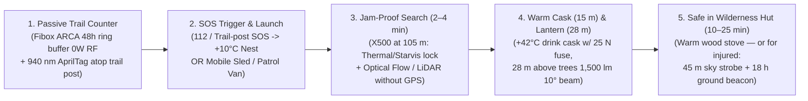

# Karhunkierros SAR & "Digital Wilderness Hut" (`v1.6-Round2-Multi-Model-Hardened`) — End-to-End Wilderness Rescue Chain (Executive Brief)

> **Core Premise (Why This Saves Lives in Roadless Arctic Wilderness):**
> When a hiker or family becomes lost in roadless boreal or Arctic wilderness (such as Finland's **Karhunkierros** trail in Oulanka / Ruka), the nearest plowed road is often **`8–25 km` away**. **A police van or ambulance cannot drive into roadless forest**, and mobilizing a snowmobile or ski patrol (`Poliisi` / `Rajavartiolaitos` / `Pelastuslaitos` / `Vapepa`) to reach the coordinates typically takes **`1.5–3 hours`**.
>
> In sub-zero winter conditions (`-15 °C to -30 °C`), wet clothing, or darkness, waiting stationary on the ground leads to severe hypothermia in **`30–45 minutes`** — long before a ground rescue team can arrive.
>
> Yet across Finnish Lapland and Koillismaa, the state forestry agency (**Metsähallitus Parks & Wildlife Finland**) maintains a unique network of **`450+` open wilderness huts (*autiotupa*) and day huts**, each equipped with a **wood-burning stove, dry firewood, and warm shelter**, often located just **`0.5–2.5 km`** from the lost party — **provided the hikers can find the trail and direction to the hut in darkness, blowing snow, or active GPS jamming.**

---

## 1. End-to-End Rescue Chain (Stages 1–5): From Lost on the Trail to a Warm Wilderness Hut

### 3D Isometric Terrain & Operational Overview (Stages 1–5 in Practice)

### Stage 1: Lost in Roadless Wilderness & Passive 48h Trail Counter (`Fibox ARCA` + `940 nm` Fiducial)
* **Field Scenario:** A family or hiking group is trekking along an autumn or winter wilderness route (`15–25 km` from the nearest plowed road, unreachable by wheeled vehicles). Darkness, a sudden snow squall, or exhaustion sets in, and the party drifts off the trail or becomes separated.
* **Background Preparation (`PassiveTrailSightingLedger`):** At the base of the wooden trail-junction signpost sits an industrial weatherproof enclosure (**`Fibox ARCA IP67`**), a compact sensor pod at `2 m` height (`PIR` + `24 GHz` FMCW radar + `Starvis` optical camera), and a passive **`940 nm` AprilTag retro-reflective fiducial plate** mounted atop the post. Operating 100% RF-silent (`0.00 W` RF, isolated via a one-way optical fiber diode), the node logs only an anonymous kinematic vector into its local 48-hour volatile ring buffer: *"3 hikers passed junction at 14:20 heading NNE at 1.1 m/s"*. If no official SAR alert occurs, the record auto-purges after 48 hours.

### Stage 2: Calling for Help, "Uber-for-SAR" Open Dispatch & Heated Roofed Nests (`SARDispatchMarketplaceCoordinator`)
* **Strict Humanitarian Trigger (`verify_humanitarian_sar_trigger`):** The system activates **only** upon a verified emergency trigger:
  1. An SOS ping from the hiker's **`112 Suomi`** app or **`Garmin inReach`** satellite communicator,
  2. Pressing the **physical red `112 SOS` button** on a trail post (works even when a smartphone battery has frozen dead at `-25 °C`!), or
  3. An official cryptographic search order (`SAR-ORDER`) from **`Poliisi`** (Police), **`Rajavartiolaitos`** (Border Guard), or **`Pelastuslaitos`** (Rescue Services).
* **Open Task Dispatch ("Uber-for-SAR"), Auto-Prioritization & Human Control Panel:**
  * **Mobile Patrol Drone Units (`MOBILE_PATROL_UNIT` — e.g., Police vans at the plowed road end, Border Guard patrols, Vapepa snowmobile sleds):** Field crews see the open alert on their vehicle terminal (distance, estimated flight ETA, target coordinates) and tap **`[Accept Task]`**, just like an on-call driver accepting a nearby dispatch request.
  * **Automated Roofed Wilderness Stations (`AUTOMATED_ROOFED_NEST`, `+10 °C`):** Stationed drones protected under a heated, motorized snow/freezing-rain roof in **`AUTO_ACCEPT_GEOFENCE`** mode automatically accept alerts within their service radius (`<= 14 km`), open their motorized roof hatch, launch autonomously, close the roof during the flight, and dock back under the roof afterward to recharge.
  * **Multi-Unit Auto-Prioritization & Human Command Override:** When multiple mobile units and roofed stations accept the same alert, the coordinator automatically scores and ranks them (Flight ETA `45%`, Winter Battery Margin `25%`, Sensor/Payload Capability `15%`, Readiness `15%`), assigning the fastest unit as **`#1 PRIMARY_SAR_RESCUER`** and the second-best as **`#2 SECONDARY_BACKUP_INTERCEPT`**. A human incident commander can override automation at any time from the dashboard (`Force Assign`, `Hold Launch`, `Force RTB`) or lock the system to **`MANUAL_COORDINATOR_APPROVAL_ONLY`**.

### Stage 3: High-Speed Transit, GNSS/RF Jamming Bypass & Target Lock (`2–4 Minutes`)
* **Airframe (`Holybro X500 V2` `500 mm` carbon frame + `-40 °C` `8,000 mAh 4S2P` (`14.8 V`, `118.4 Wh`) Ultra-Low-Temp Li-Ion):** Painted in high-visibility **SAR International Orange (`RAL 2005`)** with low-noise 10-inch propellers (`58 dBA`), the rescue drone transits at `105 m` AGL (`65 km/h`) to the search sector in **2–4 minutes**.
* **Operates Through 100% GPS Spoofing & RF Blackout (`evaluate_gnss_rf_jamming_and_weather_resilience`):**
  * **GNSS jamming or spoofing** (increasingly common in northern and eastern border regions) neither halts nor misleads the aircraft: a downward **optical flow sensor (`MicoAir MTF-02P / PMW3901`) and `Benewake TF02-Pro` (`40 m`, `IP65`) LiDAR** continuously measure true ground speed and height above the snow/canopy. If GNSS diverges from optical flow (`> 3.5 m/s`), the flight stack **fences off GNSS (`ekf_gnss_fenced_off_no_flyaway`)** and navigates via optical-inertial dead-reckoning and the `940 nm` AprilTag trail-post fiducials.
  * Even under complete **radio jamming (`RF Blackout`)**, the drone executes the full rescue mission **100% autonomously onboard (`abort_rescue_on_rf_loss = False`)**.
* **Autonomous Search & Target Lock (`OnboardTargetLockSelfGuider`):** The drone's onboard thermal camera (`256×192 LWIR`) and low-light camera (`IMX462 Starvis` + `YOLOv8n`) detect human signatures (including separated tourist groups), distinguish humans from reindeer and moose, and maintain a Kalman-filtered lock across pine-canopy occlusions.

### Stage 4: Warm Cask Delivery (`15 m`) & Above-Canopy `28 m` Elastic Pull-Guidance (`compute_elastic_pull_guidance_vector`)
* **Safe First-Aid Drop onto Open Snow (`15 m` Safety Offset + `25 N` Breakaway Fuse):** The drone selects an open snow patch **at least `15 meters` away** from the hikers and lowers its **insulated warming cask and survival kit** (`+42 °C` warm berry-glucose electrolyte drink on tap, hand warmers, glucose gel packs, aluminized mylar thermal blanket, and two-way emergency button). The payload releases cleanly via a `25 N` magnetic breakaway fuse, and the drone climbs back to `50 m` AGL before playing voice instructions.
* **Above-Canopy `28 m` Elastic Pull-Guidance (*Follow & Elastic Pull to Safety*):**
  * To guarantee the aircraft **never** clips spruce branches in wind or darkness, `TF02-Pro` LiDAR terrain following keeps the drone safely **above the tree crowns (`28 m` AGL)** while tracking the hikers via thermal vision and **"pulling" them along the trail** by projecting a narrow **`10°` (`1,500 lm`) spotlight beam** onto the snow **`15 meters` ahead of the hikers** toward the nearest wilderness hut.
  * If a hiker drifts off the trail (`> 8 m`), the airframe remains safely `>= 15 m` away while sweeping the spotlight closer (`6 m` ahead of the hiker) and issuing voice guidance back onto the packed trail. Whenever the hiker stops to rest, the beam pauses and waits (`10 m` beam offset, `>= 15 m` airframe distance). Upon reaching the wilderness hut (`<= 20 m`), the drone offsets `15 m` to the clearing in front of the cabin (never hovering over the roof or chimney!) and illuminates the cabin door before returning to dock (`RTB_DOCKED_UNDER_ROOF_AND_RECHARGING`).

### Stage 5: Safe Inside the State Wilderness Hut (`10–25 min`) — OR `18-Hour` Beacon for an Immobilized Casualty
* **Case A — Ambulatory Party (`10–25 Minutes` to a Warm Wood Stove):** Following the `1,500 lm` aerial lantern beam, the hikers walk directly into the **Metsähallitus** wilderness hut (or mobile rescue shelter) and light the stove more than **90 minutes before** a ground snowmobile patrol could reach them.
* **Case B — Injured or Exhausted Hiker Who Cannot Walk (`IMMOBILIZED_SHELTER_IN_PLACE`):**
  * If the hiker cannot move within `3 minutes` of receiving the thermal survival kit (e.g., ankle fracture or severe hypothermia), the drone automatically detects immobility and switches its voice guidance to: **`"STAY IN PLACE INSIDE THE THERMAL BLANKET — GROUND RESCUE IS BEING GUIDED TO YOU"`**.
  * The drone ascends to `45 m` AGL as a **high-visibility sky beacon (`1,200 lm` strobe visible `3–5 km` away)**. When flight battery reaches `25%` before ground teams arrive, the drone never abandons the casualty in darkness—it lands in a clearing `15 m` away, disarms its motors, and operates for **`18+ hours` as a low-power ground strobe beacon (`GROUNDED_CLEARING_18HR_LOW_POWER_STROBE_BEACON`)** until the snowmobile patrol arrives.

---

## 2. Timeline Comparison: Freezing Stationary vs. Aerial Lantern Guidance to a Wilderness Hut

| Stage / Metric (`12 km` from road, `-22 °C`, dark forest + GPS jamming) | Without Rescue Drone (Waiting for Ground Patrol) | With Karhunkierros SAR (`v1.6`) Guide Drone (*Guided to State Wilderness Hut*) |
| :--- | :--- | :--- |
| **1. Police Van / Ambulance Road Access** | **Impossible** (`12.0 km` across roadless ridge and river terrain) | **Not required for initial response** — launches from `+10 °C` roofed station (`940 nm` optical diode) or snowmobile sled at road end. |
| **2. First Contact & Operation Under GPS/RF Jamming** | **`~135 minutes`** (`2 h 15 min` for snowmobile/ski patrol to arrive) | **`~2.5 minutes`** (operates without GPS or radio links using `MTF-02P / PMW3901` optical flow, `TF02-Pro` `40 m` LiDAR, and `940 nm` post fiducials). |
| **3. First Aid & Thermal Energy Restoration** | None available until ground patrol arrives | Lowers **onto snow `15 m` away** (`25 N` magnetic fuse) a **warm (`+42 °C`) berry-glucose drink cask, hand warmers, and thermal blanket**. |
| **4. Guidance to Wilderness Hut (`28 m` Aerial Lantern)** | Lost hikers cannot see the trail in darkness or tell which way the hut lies | Flies safely **above the trees (`28 m` AGL) `15 m` ahead**, illuminates the trail with a **`1,500 lm` (`10°`) beam**, waits when hikers rest, and leads directly to the hut door. |
| **5. If Hiker Is Injured and Cannot Walk** | High hypothermia risk in darkness without visual pinpointing | **`45 m` sky strobe beacon** + at `25%` battery lands in a clearing as an **`18+ hour` ground beacon** beside the sheltered casualty. |
| **6. Time to Reach a Warm Stove Under a Roof** | **`135 min`** *(exceeds the `30–45 min` hypothermia window several times over!)* | **`~10–25 minutes`** (**over `110 minutes` before ground teams arrive!**) |

---

## 3. Privacy-by-Design Architecture ("Digital Wilderness Hut")

Even though the system exists purely to save human lives in emergencies, every hardware and software layer is engineered from the ground up to satisfy strict European data-protection standards (GDPR / Data Protection Ombudsman), public right-of-access traditions (*Jokamiehenoikeudet*), and wilderness ethics without compromise:

1. **48-Hour Auto-Purging "Black Box" (`PassiveTrailSightingLedger`):** Trail-side ground nodes (`Fibox ARCA`, sharing 100% of the hardware/software stack with [`arctic-trail-cam`](https://github.com/arctic-trail/arctic-trail-cam)) are completely RF-silent (`0.00 W` RF), **never** use facial recognition or cloud uploads, and automatically overwrite anonymous movement vectors after 48 hours.
2. **Strictly Emergency-Triggered ("Pull, Don't Push"):** The drone launches **only** when a hiker triggers an SOS via `112 Suomi` / `Garmin inReach`, presses the **physical red `112 SOS` button** on a trail post, or when `Poliisi`, `Rajavartiolaitos`, or `Pelastuslaitos` issues a cryptographically signed search order (`SAR-ORDER`).
3. **Jamming-, Freeze-, and Icing-Resilient (`-25 °C` Polar Night, GPS Spoofing & Freezing Drizzle):** Powered by `-40 °C` rated `8,000 mAh 4S2P` (`14.8 V`, `118.4 Wh`) ultra-low-temp Li-Ion cells, hydrophobic propeller coating + automated ice-shedding spin bursts (`ICE_SHED_RPM_BURST`), a `940 nm` optical diode, and spoof-proof optical flow (`MTF-02P / PMW3901`) + `Benewake TF02-Pro` (`40 m`, `IP65`) LiDAR.
4. **Reindeer Herding Act (`Poronhoitolaki 848/1990 § 42`) Wildlife Protection:** Onboard AI distinguishes humans from reindeer and moose; whenever reindeer are detected, the aircraft automatically enforces **`>= 100 m` altitude** and mutes its acoustic speaker.
5. **Hard-Coded `15 m` Horizontal Safety Offset, `28 m` Above-Canopy Floor & `~€1,189` Snap-In COTS Build (Zero Custom PCBs):** Software safety gates prohibit flying closer than `15 m` horizontally to any person, keep the drone at `28 m` AGL above the spruce canopy, and allow the entire aircraft to be assembled in **`~2.5 hours` with zero custom circuit boards** from off-the-shelf plug-and-play modules (`Holybro X500 V2` + `Pixhawk 6C` + `Pi 5` + `USB Thermal/Starvis` + `TF02-Pro 40m LiDAR`, total **`~€1,189`**).

---

## 4. Pro Bono Pilot & Phased Field Validation (Phases 1–3)

1. **Phases 1–2 (Private Forest Validation — "Lean-To / Cabin = Wilderness Hut"):** Validate first via mobile trunk/sled launch in dense coniferous forest (`€350` camera walk test $\rightarrow$ `€1,189` full COTS drone pilot under a safety pilot's RC override).
2. **Phase 3 (Northern Finland Pro Bono Pilot):** Offer the field-proven open-source reference package for joint evaluation with **Metsähallitus Parks & Wildlife Finland** (*Oulanka / Karhunkierros*, *Urho Kekkonen National Park*, *Pallas-Yllästunturi*), **Vapepa** ( Voluntary Rescue Service), **Finnish Air Rescue Society (SLPS)**, **Poliisi**, **Rajavartiolaitos**, and regional **Rescue Departments**.
