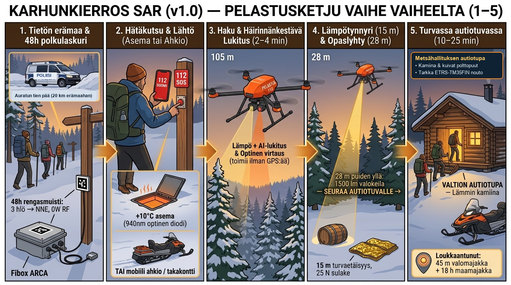
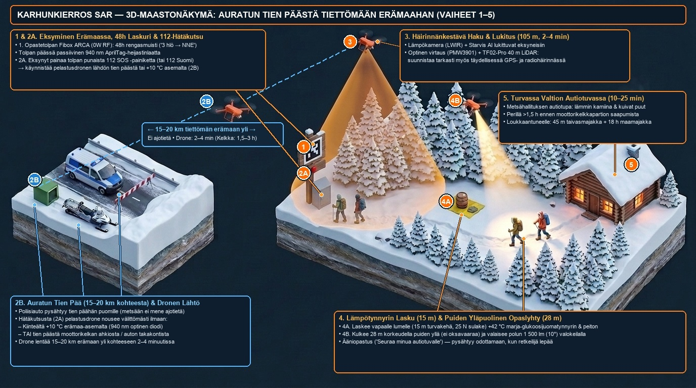
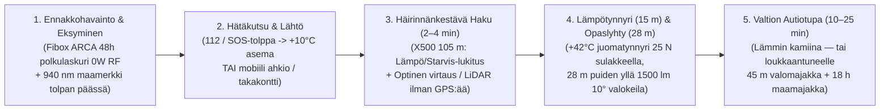

# Karhunkierros SAR & "Digitaalinen Autiotupa" (`v1.6` / `v2.0` Konseptijulkaisu) — Tiettömän taipaleen pelastusketju (Pro Bono -konseptimuistio)

> **HUOMAUTUS KEHITYSVAIHEESTA & HANKEFILOSOFIA (`MIT-LISENSSI` — 🇫🇮 SUOMALAINEN INSINÖÖRITYÖ):**
> - **Yksityinen, markkinaehtoinen Pro Bono -kansalaishanke:** Tämä työ on riippumaton, yksityinen pro bono -insinöörihanke (`🇫🇮 Finnish engineering`), joka osoittaa, kuinka avoimilla kaupan hyllyltä saatavilla (`COTS`) vakiokomponenteilla (`1 189–1 329 €`) ja vapaaehtoisuuteen perustuvalla hajautetulla tehtävänvälityksellä ("Uber-for-SAR") voidaan ratkaista pohjoisen erämaan pelastushaasteita murto-osalla (`~1/40`) raskaiden `50 000+ €` julkisten hankintojen kustannuksista ja täysin ilman kansalaisten yksityisyyttä loukkaavaa valvontaa.
> - **Konsepti- ja simulaatiovaihe:** Tämä asiakirja esittelee **avoimen lähdekoodin teknisen konseptin, COTS-komponenttilistan (`1 189–1 329 €`) ja ohjelmistosimuloidun viitearkkitehtuurin** (`29/29` yksikkötestiä `collector_hub/drone_observer.py` -moduulissa). Vaikka polunvarsikameran ja keskusyksikön laitteisto ([`arctic-trail/arctic-trail-cam`](https://github.com/arctic-trail/arctic-trail-cam)) on pöytätestattu, **pelastusdrone (`Holybro X500 V2`), `-25 °C` talvilentokesto, ensiapupudotus ja `+10 °C` katettu automaattiasema ovat tässä ensimmäisessä julkaisussa konsepti- ja simulaatiovaiheessa**, eikä niille ole vielä suoritettu maastolentokokeita tai haettu `Traficomin` (`EASA Specific SORA`) ilmailulupia.

> **Ydinajatus (Miksi tämä pelastaa ihmishenkiä Suomen erämaissa):**
> Kun retkeilijä tai perhe eksyy Suomen kansallispuistossa tai erämaassa (kuten Rukan / Oulangan **Karhunkierroksella**), lähimmälle auratulle tielle on usein **`8–25 kilometriä`**. **Poliisiauto tai ambulanssi ei pääse tiettömään metsään**, ja moottorikelkka- tai jalkapartion (`Poliisi` / `Rajavartiolaitos` / `Pelastuslaitos` / `Vapepa`) kokoaminen ja saapuminen kohteeseen kestää helposti **`1,5–3 tuntia`**.
>
> Pakkasella (`-15 °C ... -30 °C`), märissä vaatteissa tai pimeässä paikallaan odottaminen johtaa vaaralliseen hypotermiaan jo **`30–45 minuutissa`** — kauan ennen kuin maapartio ehtii paikalle.
>
> Suomessa on kuitenkin ainutlaatuinen, valtion (**Metsähallitus Luontopalvelut**) ylläpitämä yli **`450+` autiotuvan ja päivätuvan verkosto**, joissa on valmiina **kamiina, kuivat polttopuut ja lämmin suoja** usein vain **`0,5–2,5 kilometrin`** päässä eksyneestä — **kunhan eksynyt perhe vain löytäisi pimeässä, lumipyryssä tai GPS-häirinnän keskellä oikean suunnan polulle ja tuvalle.**

---

## 1. Koko pelastusketju vaihe vaiheelta (1–5): Eksymisestä lämpimään autiotupaan

### Isometrinen kokonaiskuva järjestelmän toiminnasta maastossa (Vaiheet 1–5 käytännössä)

### Vaihe 1: Eksyminen tiettömässä erämaassa & Passiivinen 48 h polkulaskuri (`Fibox ARCA` + `940 nm` maamerkki)
* **Tilanne maastossa:** Perhe tai retkeilijäseurue kulkee talvisella tai syksyisellä vaellusreitillä (esim. Karhunkierroksella 15–25 km päässä lähimmästä auratusta tiestä, jonne poliisiauto ei pääse). Pimeys, lumipyry tai väsymys yllättää, ja seurue harhautuu polulta tai joutuu erilleen toisistaan.
* **Mitä järjestelmä on tehnyt taustalla (`PassiveTrailSightingLedger`):** Polun risteyksessä olevan puisen opastetolpan juuressa on teollinen harmaa sääsuojakaappi (**`Fibox ARCA IP67`**), 2 metrin korkeudella pieni anturipää (`PIR` + `24 GHz` tutka + `Starvis`-kamera) ja tolpan päällä passiivinen **`940 nm` AprilTag-heijastinlaatta**. Täysin radiohiljainen (`0.00 W` RF, yksisuuntaisella optisella diodilla eristetty) yksikkö kirjaa paikalliseen 48 tunnin rengasmuistiinsa vain anonyymin kulkuvektorin: *"3 henkilöä ohitti risteyksen klo 14:20 suuntaan NNE vauhdilla 1,1 m/s"*. Jos etsintähälytystä ei tule, tieto pyyhkiytyy automaattisesti 48 tunnin kuluttua.

### Vaihe 2: Avun kutsuminen, "Uber-tyyppinen" tehtävänvälitys & Sääsuojatut automaattiasemat (`SARDispatchMarketplaceCoordinator`)
* **Miten apu kutsutaan (`verify_humanitarian_sar_trigger`):** Järjestelmä käynnistyy **vain** todellisesta hätäkutsusta:
  1. Retkeilijän **`112 Suomi`** -sovelluksen tai **`Garmin inReach`** -satelliittilähettimen SOS-kutsusta,
  2. Opastetolpassa olevasta **fyysisestä punaisesta `112 SOS` -hätäpainikkeesta** (toimii silloinkin, kun puhelimen akku on jäätynyt `-25 °C` pakkasessa!), tai
  3. **`Poliisin`**, **`Rajavartiolaitoksen`** tai **`Pelastuslaitoksen`** virallisesta etsintämääräyksestä (`SAR-ORDER`).
* **Avoin tehtävänvälitys ("Uber-for-SAR"), automaattinen priorisointi ja ihmisen ohjauspaneeli:**
  * **Mobiilit droneyksiköt (`MOBILE_PATROL_UNIT` — esim. Poliisin tai Rajavartiolaitoksen partioautot ja Vapepan kelkkapartiot):** Näkevät avoimen hälytyksen ajoneuvopäätteellään (etäisyys, arvioitu lentoaika, kohteen tiedot) ja voivat kuitata tehtävän vastaanotetuksi (**`[Hyväksy tehtävä]`**, aivan kuten taksin tai Uberin kuljettaja hyväksyy kyytipyynnön).
  * **Katetut, sääsuojatut automaattiasemat (`AUTOMATED_ROOFED_NEST`, `+10 °C`):** Maastossa katon alla (suojassa lumelta, sateelta ja jäätävältä tihkulta) päivystävät dronet voidaan asettaa **`AUTO_ACCEPT_GEOFENCE`**-tilaan, jolloin asema hyväksyy automaattisesti oman toimintasäteensä (`<= 14 km`) hälytykset, avaa moottoroidun suojakaton, lähettää dronen matkaan, sulkee katon lennon ajaksi ja ottaa dronen tehtävän päätteeksi takaisin katon alle latautumaan.
  * **Automaattinen priorisointi & Ihmisen johtokeskuspaneeli:** Jos useampi mobiiliyksikkö ja automaattiasema hyväksyy saman tehtävän, järjestelmä pisteyttää ja priorisoi ne automaattisesti (lentoaika `45 %`, pakkasakun marginaali `25 %`, kyvykkyys `15 %`, lähtövalmius `15 %`), valitsee nopeimman **ykköspelastajaksi (`PRIMARY_SAR_RESCUER`)** ja toiseksi parhaan **taustavarmistukseksi (`SECONDARY_BACKUP_INTERCEPT`)**. Johtokeskuksen ihmisoperaattori voi milloin tahansa puuttua automaation päätöksiin ohjauspaneelista (`Force Assign`, `Hold Launch`, `Force RTB`) tai asettaa järjestelmän täysin manuaaliseen hyväksyntätilaan (`MANUAL_COORDINATOR_APPROVAL_ONLY`).

### Vaihe 3: Haku, GPS-häirinnän ohitus ja lukittuminen kohteeseen (`2–4 minuutissa`)
* **Rauta (`Holybro X500 V2` `500 mm` hiilikuiturunko + `-40 °C` `8 000 mAh 4S2P` (`14,8 V`, `118,4 Wh`) Ultra-Low-Temp Li-Ion):** Huomiovärinen (**SAR International Orange, RAL 2005**) 10-tuumaisilla hiljaisilla (`58 dBA`) potkureilla varustettu pelastusdrone lentää `105 m` korkeudella (`65 km/h`) oletetulle alueelle **2–4 minuutissa**.
* **Toimii täydellisessä GPS- ja radiohäirinnässä (`evaluate_gnss_rf_jamming_and_weather_resilience`):**
  * Itä- ja Pohjois-Suomessa yleinen **GPS-häirintä tai -huijaus (*spoofing*)** ei pysäytä eikä eksytä dronea: alaspäin suunnattu **optinen virtausanturi (`MTF-02P / PMW3901`) ja `Benewake TF02-Pro` (`40 m`, `IP65`) LiDAR** mittaavat todellisen maanopeuden ja korkeuden puiden ja lumen pinnasta. Jos GPS-signaali hyppää tai poikkeaa optisesta virtauksesta (`> 3,5 m/s`), ohjelmisto **irrottaa GPS:n ohjauksesta (`ekf_gnss_fenced_off_no_flyaway`)** ja suunnistaa optis-inertiaalisesti sekä reittitolppien `940 nm` heijastinlaattojen avulla.
  * Myös täydellisessä **radiohäirinnässä (`RF Blackout`)** drone suorittaa koko pelastustehtävän **100 % itsenäisesti ilman radioyhteyttä (`abort_rescue_on_rf_loss = False`)**.
* **Automaattinen haku ja lukittuminen (`OnboardTargetLockSelfGuider`):** Dronen oma lämpökamera (`256×192 LWIR`) ja hämäräkamera (`IMX462 Starvis` + `YOLOv8n`) löytävät ihmiset (myös eri suuntiin hajaantuneen seurueen), erottavat ihmisen poroista ja hirvistä, ja lukittuvat kohteeseen puiden latvuston katveiden läpi (Kalman-suodatus).

### Vaihe 4: Lämpötynnyrin lasku (`15 m`) & Puiden yläpuolinen `28 m` "vetävä" Opaslyhty-johdatus (`compute_elastic_pull_guidance_vector`)
* **Turvallinen ensiapupudotus vapaalle lumelle (`15 m` turvakehä + `25 N` sulake):** Drone valitsee vapaan lumilaikun **vähintään `15 metrin` päässä** ihmisistä ja laskee maahan **pienen puutynnyrin ja lämpöpakkauksen** (`+42 °C` lämmin marja-glukoosijuoma hanasta, kädenlämmittimet, glukoosipakkaukset, avaruuslakana ja kaksisuuntainen hätäpainike), joka irtoaa automaattisesti `25 N` magneettisulakkeella, minkä jälkeen drone nousee `50 m` korkeuteen ennen ääniohjeistusta.
* **Puiden yläpuolinen `28 m` "joustava veto-opastus" (*Follow & Elastic Pull to Safety*):**
  * Jotta drone ei **koskaan** törmää kuusen oksiin tuulessa tai pimeässä, se pysyy `TF02-Pro` LiDAR-korkeusseurannalla turvallisesti **puiden latvojen yläpuolella (`28 m` korkeudella)**, seuraa retkeilijää lämpökameralla ja **vetää retkeilijää oikeaan suuntaan** pitämällä kapean **`10°` (`1 500 lm`) valokeilan** polulla **`15 metriä` retkeilijän edellä** kohti lähintä autiotupaa.
  * Jos retkeilijä harhautuu polulta sivuun (`> 8 m`), drone pitää rungon turvallisesti `>= 15 m` etäisyydellä mutta kääntää valokeilan lähemmäs (`6 m` retkeilijän eteen), pyyhkäisee valolla takaisin oikealle uralle ja ohjaa äänellä takaisin polulle. Jos retkeilijä pysähtyy lepäämään, valokeila odottaa `10 m` etäisyydellä (`>= 15 m` runkoetäisyys). Autiotuvalle saavuttaessa (`<= 20 m`) drone siirtyy `15 m` sivuun tuvan edustan aukealle (ei koskaan tuvan katon tai savupiipun päälle!) ja suuntaa `1 500 lm` valokeilan suoraan tuvan ovelle ennen automaattista paluuta (`RTB_DOCKED_UNDER_ROOF_AND_RECHARGING`).

### Vaihe 5: Turvassa valtion autiotuvassa (`10–25 min`) — TAI `18 tunnin` majakka loukkaantuneelle
* **Tapaus A — Kävelykykyinen seurue (`10–25 minuutissa` lämpimään tupaan):** Seurue kävelee valokeilan opastamana suoraan valtion (**Metsähallitus**) autiotuvalle (tai mobiilille pelastustukikohdalle) kamiinan ääreen yli puolitoista tuntia ennen maapartion saapumista.
* **Tapaus B — Loukkaantunut tai uupunut retkeilijä, joka EI pysty kävelemään (`IMMOBILIZED_SHELTER_IN_PLACE`):**
  * Jos retkeilijä ei pysty liikkumaan `3 minuutin` kuluessa lämpöpakkauksen saamisesta (esim. nilkkamurtuma tai vaikea hypotermia), drone tunnistaa tilanteen automaattisesti ja vaihtaa ohjeeksi: **`"PYSY PAIKALLASI LÄMPÖPEITOSSA — PELASTUSPARTIO OHJATAAN LUOKSESI"`**.
  * Drone nousee `45 m` korkeuteen **taivasmajakaksi (`1 200 lm` vilkku, näkyy `3–5 km` päähän)**. Jos akku laskee `25 %` tasolle ennen maapartion tuloa, drone ei jätä loukkaantunutta yksin pimeään, vaan laskeutuu `15 m` turva-aukealle, sammuttaa moottorit ja toimii **`18+ tuntia` kestävänä maamajakkana (`GROUNDED_CLEARING_18HR_LOW_POWER_STROBE_BEACON`)**, kunnes moottorikelkkapartio saapuu.

---

## 2. Aikajana-ero: Paikallaan paleltuminen vs. Dronen johdatus valtion autiotupaan

| Vaihe / Mittari (`12 km` tieltä, `-22 °C`, pimeä metsä + GPS-häirintä) | Ilman pelastusdronea (Perinteinen maapartion odotus) | Karhunkierros SAR (`v1.6`) -opasdronen avulla (*Johdatus valtion autiotupaan*) |
| :--- | :--- | :--- |
| **1. Poliisiauton / ambulanssin pääsy kohteeseen** | **Ei mahdollista** (`12,0 km` tiettömän vaara- ja jokimaaston takana) | **Ei tarvita ensivaiheessa** — lähtee `+10 °C` asemalta (`940 nm` optinen diodi) tai tien päästä moottorikelkan ahkiosta. |
| **2. Ensikontakti & toiminta GPS-/radiohäirinnässä** | **`~135 minuuttia`** (`2 h 15 min` moottorikelkka-/hiihtopartion saapumiseen) | **`~2,5 minuuttia`** (toimii myös ilman GPS:ää ja radioverkkoa `PMW3901` optisen virtauksen, `TF02-Pro` `40 m` LiDARin ja `940 nm` tolppamaamerkkien avulla). |
| **3. Ensiapu ja lämpöenergian palautus** | Ei saatavilla ennen maapartion tuloa | Laskee **`15 m` päähän lumelle** (`25 N` magneettisulakkeella) **lämpimän (`+42 °C`) marja-glukoosijuomatynnyrin, kädenlämmittimet ja lämpöpeiton**. |
| **4. Johdatus valtion autiotupaan (`28 m` Opaslyhty)** | Eksynyt ei näe pimeässä polkua eikä tiedä, missä suunnassa autiotupa on | Lentää turvallisesti **puiden yllä (`28 m`) `15 m` edellä**, valaisee polun **`1 500 lm` (`10°`) valokeilalla**, odottaa kun retkeilijä lepää, ja johdattaa suoraan autiotuvalle. |
| **5. Jos retkeilijä on loukkaantunut eikä voi kävellä** | Paleltumisvaara pimeässä ilman tarkkaa paikannusta | **`45 m` taivasmajakka** + akun ehtyessä laskeutuu aukealle **`18+ tunnin` maamajakaksi** lämpöpeitossa odottavan vierelle. |
| **6. Aika lämpimään tupaan kamiinan ääreen** | **`135 min`** *(ylittää `30–45 min` hypotermiaikkunan moninkertaisesti!)* | **`~10–25 minuuttia`** (**yli `110 minuuttia` ennen maapartion saapumista!**) |

---

## 3. Suunnittelu, josta tietosuojavaltuutettukin tykkää ("Digitaalinen Autiotupa")

Vaikka kyse on puhtaasti ihmishenkien pelastamisesta hätätilanteessa, arkkitehtuuri on rakennettu alusta asti niin, että tiukinkin tietosuojavaltuutettu, jokamiehenoikeuksien puolustaja ja eränkävijä näkee heti, että myös yksityisyydensuoja ja turvallisuus on huomioitu ilman kompromisseja:

1. **48 tunnin automaattisesti pyyhkiytyvä "Musta Laatikko" (`PassiveTrailSightingLedger`):** Polunvarsiyksiköt (`Fibox ARCA`, 100 % yhteinen laitealusta `arctic-trail-cam`-järjestelmän kanssa) ovat täysin radiohiljaisia (`0.00 W` RF), eivät **koskaan** käytä kasvojentunnistusta tai pilvilatausta, ja pyyhkivät anonyymit kulkuvektorit automaattisesti 48 tunnin kuluttua.
2. **Aktivoituu vain hätätilanteessa ("Pull, Don't Push"):** Drone nousee ilmaan **vain**, kun retkeilijä painaa `112 Suomi` / `Garmin inReach` -SOS-painiketta, polun opastetolpan **fyysistä punaista `112 SOS` -painiketta**, tai kun `Poliisi`, `Rajavartiolaitos` tai `Pelastuslaitos` antaa virallisen etsintämääräyksen (`SAR-ORDER`).
3. **Häirinnän-, pakkasen- ja jäätämisenkestävä (`-25 °C` *Kaamos*, GPS-spoofing & *jäätävä tihku*):** Käyttää `-40 °C` luokiteltuja `8 000 mAh 4S2P` (`14,8 V`, `118,4 Wh`) Li-Ion -kennoja, hydrofobista potkuripinnoitetta + automaattista jäänpoistopyöräytystä (`ICE_SHED_RPM_BURST`), `940 nm` optista diodia sekä GPS-huijauksen estävää optista virtausanturia (`MTF-02P / PMW3901`) ja `Benewake TF02-Pro` (`40 m`, `IP65`) LiDARia.
4. **Poronhoitolain (`848/1990 § 42`) kunnioitus ja eläintunnistus:** Tekoäly erottaa ihmisen poroista ja hirvistä; porotokan kohdalla drone pitää automaattisesti **`>= 100 m` korkeuden** ja mykistää kaiuttimen.
5. **Kovakoodattu `15 m` turvaetäisyys, `28 m` latvustokorkeus ja `~1 189 €` COTS-pikaliitinrakenne (0 kpl omia piirilevyjä):** Ohjelmisto estää lentämästä `15 m` lähemmäs ihmistä, pitää dronen `28 m` korkeudella puiden yläpuolella ja koko laitteisto on koottavissa **ilman omien piirilevyjen teettämistä tai juottamista ~2,5 tunnissa** suoraan yhteensopivista COTS-pikaliitinosista (`Holybro X500 V2` + `Pixhawk 6C` + `Pi 5` + `USB Thermal/Starvis` + `TF02-Pro 40m LiDAR`, yhteensä **`~1 189 €`**).

---

## 4. Pro Bono -pilottimahdollisuus ja vaiheistus (Vaiheet 1–3)

1. **Vaihe 1–2 (Kenttätesti yksityismaalla — "Laavu/Tupa = Autiotupa"):** Testataan ensin mobiililla takakontti-/ahkio-lähdöllä havumetsässä (`350 €` kamerakävelytesti -> `1 189 €` täysi COTS-dronepilotti turvapilotin RC-ohjaimen valvonnassa).
2. **Vaihe 3 (Pohjois-Suomen Pro Bono -pilotti):** Viedään koeteltu paketti yhteiskäyttöön **Metsähallituksen Luontopalveluiden** (*Oulanka / Karhunkierros*, *UKK-puisto*, *Pallas-Yllästunturi*), **Vapepan**, **Suomen Lentopelastusseuran (SLPS)** sekä **Poliisin**, **Rajavartiolaitoksen** ja **Pelastuslaitosten** kanssa.

