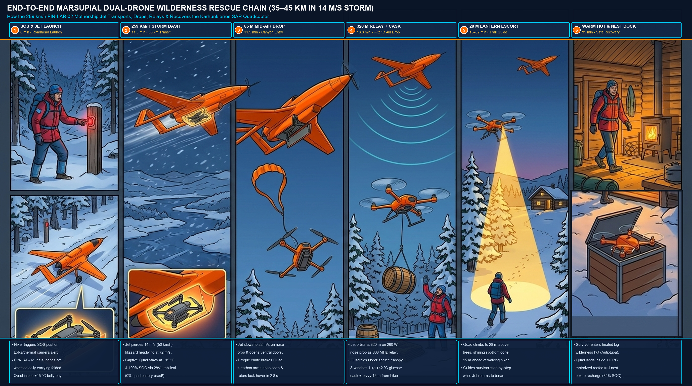
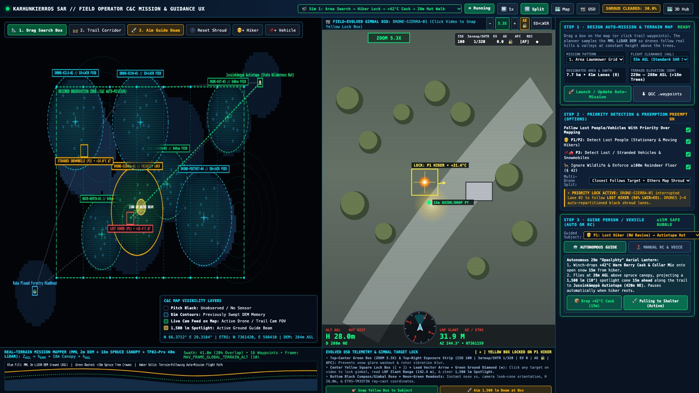
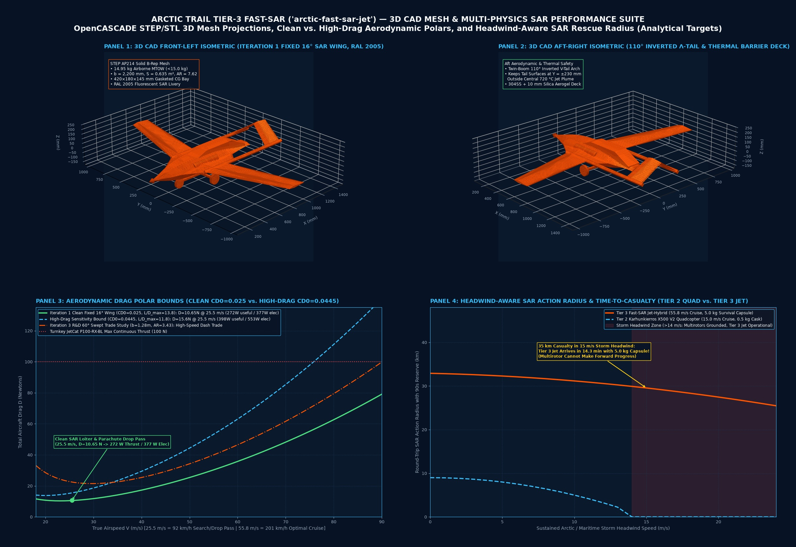
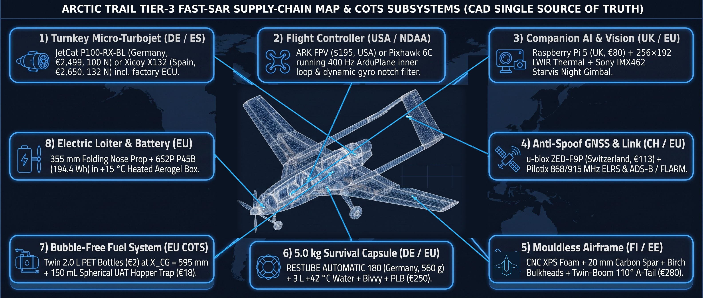

# Arctic Fast-SAR Jet-Hybrid (`arctic-fast-sar-jet` / `FIN-LAB-02`, `v0.1` Concept Release) — Autonomous Regional Fast-Response Wilderness & Maritime Rescue UAV

> **Open-source, 100% Non-Chinese (`EU / UK / CH / US Allied`) Arctic Fast-Response Search-and-Rescue (`SAR`) Hybrid Jet-Electric UAV & High-Speed Civil Airspace-Safety Testbed (`~€4,850` turnkey / `US$1,320` airframe+avionics COTS). A private, pro-bono free-market COTS build. 🇫🇮 Finnish engineering.**
>
> * **GitHub Topics:** `arduplane` · `ardupilot` · `mavlink` · `bvlos` · `gnss-denied` · `proportional-navigation` · `visual-odometry` · `micro-turbojet` · `raspberry-pi-5` · `hailo-8` · `cots` · `allied-cots` · `open-hardware` · `u-space` · `search-and-rescue` · `sar-drone` · `thermal-imaging` · `finland` · `nordic` · `baltic`
> * **Sister Project — Tier 1 (RF-Silent Arctic Trail & Cabin Camera with 1-Way Optical Diode & `[P11-AIR]` Acoustic Grid):** [`arctic-trail/arctic-trail-cam`](https://github.com/arctic-trail/arctic-trail-cam)
> * **Sister Project — Tier 2 (Autonomous Wilderness SAR Quadcopter, Heated Roofed Nest & "Uber-for-SAR" Dispatch):** [`arctic-trail/karhunkierros-sar-drone`](https://github.com/arctic-trail/karhunkierros-sar-drone) *(Note: this Tier-3 module is published directly inside [`fast_sar_jet_finlab02/`](https://github.com/arctic-trail/karhunkierros-sar-drone/tree/main/fast_sar_jet_finlab02))*
> * **Complete 28-Plate Engineering Design, 3D CAD, Sensor Physics, Wiring, CG/FMEA, Wing Trade-Study, Blocked-Pitot Envelope Protection, Marsupial Dual-Drone, Multi-Screen Command UI & 100k-Flight Actuarial Reliability Gallery:** [`docs/ENGINEERING_DESIGN_AND_ARCHITECTURE.md`](docs/ENGINEERING_DESIGN_AND_ARCHITECTURE.md)
> * **License:** [`MIT License`](LICENSE)

> **🛠️ PLEASE FORK, BUILD, BREAK & IMPROVE THIS (NO PERMISSION NEEDED)**
> These repositories are **100% open-source (`MIT License`) public-good engineering** for harsh Nordic & Baltic conditions.
> * **No ego, no gatekeeping:** You do **not** need to ask permission to fork this, build a module on your kitchen table, use it for a university course/thesis, or spin a commercial product out of it.
> * **Test logs > theory:** Almost everything here is currently at bench/simulation stage. If you build a €68 acoustic pod, freeze a battery at `-25 °C`, or 3D-print a sub-scale airframe and prove our numbers wrong—**please open a Pull Request or Issue with your real-world data!**
> * **100% Civilian & Legal to Tinker With:** Everything in these repos (weather/wildlife nodes, optical diodes, airport/corridor acoustic logging, SAR navigation, cooperative own-drone soft-net recovery) is strictly civilian and legal for students, hobbyists, and labs to build and test.

> [!WARNING]
> **PROJECT STATUS & CIVILIAN USE-CASE DISCLAIMER — EARLY-STAGE ENGINEERING CONCEPT, 3D CAD & SIMULATION REFERENCE (`MIT LICENSE`)**
> * **100% Civilian Technology:** While the low-cost mouldless COTS fabrication, GNSS-denied navigation, fiber-optic tether option, `-30 °C` cold-soak engineering, high-volume U-Space track fusion (`2,500` pairs in `4.4 ms`), and head-on corridor response geometry draw technical inspiration from open-source drone technology observed in Ukraine and on public media, **the intended use case of all hardware and software in this repository is 100% civilian**:
>   1. **Regional Wilderness & Maritime Search and Rescue (`SAR`):** Delivering heated emergency survival capsules, AEDs, insulated bivvy bags, and two-way rescue radios `35–45 km` into Lapland wilderness or coastal archipelagos in `15 m/s` winter headwinds.
>   2. **Civil U-Space Airspace Safety, Airport Noise-Abatement & Corridor Verification:** Passively classifying low-altitude overflight acoustics (`FIN-SIG-LIB v1.0`), monitoring utility substations (`[P12-BELT]`), and performing cooperative visual/thermal identification along civil aviation corridors.
>   3. **Coastal Environmental & Subsea Power/Telecom Cable Inspection (`FIN-LAB-06`):** Autonomous solar/`LiFePO4` surface-vessel (`USV`) side-scan sonar and magnetic cable-landfall inspection.
> * **Concept & Simulation Stage (First Public Release):** This repository publishes an open-source **aerospace engineering concept, parametric 3D `STEP AP214` / `STL` solid CAD geometry, 100% Non-Chinese COTS bill-of-materials (`US$1,320` airframe+avionics / `~€4,850` turnkey), and software simulation reference architecture**. It is **not** a flight-certified aircraft or an operational rescue service, and has no military intended application.
> * **What Is Built & Tested Today (`TRL 2–3` Airframe / `TRL 4–5` Shared Avionics) vs. What Remains Unbuilt (`0.0 Flight Hours` Flown):**
>   1. **Hardware Bench-Verified Today (`TRL 4–5`, Shared Tier-1/Tier-2 Stack):** The companion compute (`Raspberry Pi 5`), `Pico 2` sensor/gatekeeper stack, `100BASE-FX` optical/LoRa telemetry links, and dual vision pipeline are shared with [`arctic-trail/arctic-trail-cam`](https://github.com/arctic-trail/arctic-trail-cam) and [`arctic-trail/karhunkierros-sar-drone`](https://github.com/arctic-trail/karhunkierros-sar-drone), where they have been physically assembled and verified on the indoor bench.
>   2. **3D CAD, CNC Cut-Sheets & Software-Simulated Today (`TRL 3`, `10/10` Automated Suites Passing):** The parametric 3D solid model (`cad/arctic_fast_sar_jet_iter1_fixed16deg.step` + `1:1 mm` SVG/DXF CNC foam-core cut sheets), affine-Breguet / compressible Brayton-cycle sizing calculator (`sar_sizing_calculator.py`), 6-DOF nonlinear end-to-end flight dynamics, aerodynamic stability & CFD boundary-layer separation simulator (`flight_simulator_6dof.py` + interactive 3D/2D CFD wind-tunnel & tactical OSD workbench `simulator_ui/flight_simulator.html`), 1,000-simulation extreme envelope expansion suite (`monte_carlo_1000_envelope_expander.py`), coupled Marsupial dual-drone separation simulator (`marsupial_dual_drone_sim.py`), spool-lag lead-compensated turbine autonomy, 3-Law blocked-Pitot backup (`SYNTH_IAS` + $\theta/N_1\%$ table), `Normal Law` $\alpha/\beta/n_z/\phi/V_{\text{MO}}$ envelope protection, year-round Arctic edge-case hardening, `100,000`-flight (`55,000` FH) actuarial fault-tree model (`sar_autonomy/pi_turbine_autonomy.py`), and FIN-LAB COTS benchmark solver (`northern_flank_red_gap_solver.py`) are verified in software simulation (`python3 -B -m unittest discover -s tests -v`).
>   3. **Unvalidated / Concept Stage (`TRL 1–2`, `0.0 Flight Hours` Flown, `0` Turbine Runs — No Calendar Date Promises):** Physical airframe fabrication of the `14.95 kg` MTOW fixed-wing prototype, static thrust-stand runs of the turnkey European micro-turbojet (`JetCat P100-RX-BL` / `Xicoy X132`), `-30 °C` cold-soak fuel/relight trials, slowed (`25–28 m/s`) parachute survival-capsule & mid-air `Cartridge B` quadcopter drops, and **Traficom / EASA Specific Category (`SORA SAIL III`)** aviation approvals have **not yet been physically built, flight-tested, or authorized** (see the [Readiness & Verification Matrix](#5-readiness--verification-matrix-design-vs-simulation-vs-field-validation), [10-Point Technical Risk Register](#52-objective-technical-risks-unverified-physical-assumptions--known-unknowns-10-point-risk-register), and [Intended Capability-Gated Roadmap](#6-intended-capability-gated-roadmap-no-calendar-date-promises) below).

> [!IMPORTANT]
> **Project Ethos — Private, Pro-Bono Free-Market Engineering & Voluntary Civil Society (`🇫🇮 Finnish Engineering`):**
> * **Free-Market COTS vs. `€250,000+` Bureaucratic Procurement:** Rather than waiting years for slow public-sector procurement tenders or locked `€250,000+` proprietary aerospace platforms, this is an independent, private, **pro-bono free-market engineering project** demonstrating how standard Allied/European commercial off-the-shelf (`COTS`) parts (`US$1,320` airframe+avionics plus a turnkey European `JetCat` or `Xicoy` micro-turbine) can deliver high-speed, storm-penetrating Arctic rescue reach at `~1/50th` of legacy cost.
> * **Zero Chinese Components (`100% EU / UK / CH / US Allied Supply Chain`):** Every flight controller (`ARK FPV STM32H7`, USA), companion computer (`Raspberry Pi 5`, Sony UK Tech Centre), GNSS receiver (`u-blox ZED-F9P / M10`, Switzerland), airspeed/IMU sensor (`TE Connectivity` USA + `Bosch` Germany), micro-turbine (`JetCat` Germany / `Xicoy` Spain / `PBS` Czechia), and optional `OpenTurbine-EU` FADEC (`STMicroelectronics STM32G474`, France/Italy + `Bartels` German fuel pump + `GRW` German ceramic bearings) is sourced from Allied/European manufacturers (`0.0%` Chinese BOM share).
> * **Voluntary Civil-Society Integration ("Uber-for-SAR") & Hardware Privacy:** Integrates directly with the open-alert voluntary dispatch marketplace (`SARDispatchMarketplaceCoordinator` in [`karhunkierros-sar-drone`](https://github.com/arctic-trail/karhunkierros-sar-drone)) and `0.00 W RF` passive trail posts ([`arctic-trail-cam`](https://github.com/arctic-trail/arctic-trail-cam)), preserving human operator authority at every stage.

---

## 1. Unified 3-Tier Civilian Architecture

| Tier | Repository / System | Primary Civilian Mission Role | Propulsion & Speed Envelope | Operating Radius | 100% Non-Chinese Allied/EU Avionics & Sourcing |
| :--- | :--- | :--- | :--- | :--- | :--- |
| **Tier 1 (Ground & Corridor Grid)** | [`arctic-trail/arctic-trail-cam`](https://github.com/arctic-trail/arctic-trail-cam) (`[P11-AIR]`, `[P12-BELT]`) | Off-grid cabin/trail monitoring, 3D acoustic/micro-Doppler classification (`FIN-SIG-LIB v1.0`), non-RF substation perimeter sensing | Solar / `LiFePO4` static ground node (`44 Ω` `10 W` derated heater) | Continuous (`0.48 s` `DD\x03` Reg 15 alert) | `RP2350` (UK) + `Pi 5` (UK) + `Infineon IM69D130` (DE) + `Acconeer XM125` (SE) — `US$497 + $68` |
| **Tier 2 (Local Aerial Care & Lantern)** | [`arctic-trail/karhunkierros-sar-drone`](https://github.com/arctic-trail/karhunkierros-sar-drone) (`FIN-LAB-01` / `FIN-LAB-04` / `[P12-HEATED]`) | Precision hover care, thermal verification, aerial lantern guide (*Opaslyhty*), heated `6.5 s` rapid-dispatch nest & `285 km/h` cold-rated fast-climber | Electric quadrotor / fast fixed-wing (`65–285 km/h`) | `8–25 km` from heated trail nest | `ARK FPV` (USA) / `Cube Orange+` + `Pi 5` (UK) + `u-blox` (CH) — `€1,770–€2,965` |
| **Tier 3 (Regional Fast-SAR Jet-Hybrid)** | **`arctic-trail/arctic-fast-sar-jet` (`FIN-LAB-02`)** | **10–14 min regional storm-penetrating SAR dash (`35–40 km` in `15 m/s` headwind) + silent electric loiter + `350–400 km/h` open airframe** | **Turnkey EU `100–160 N` micro-turbojet (DE/ES/CZ) + `355 mm` nose folding electric prop (`92–400 km/h`)** | **`35–45 km` SAR drop radius (`70+ km` total range)** | **`ARK FPV STM32H7` (USA) + `Pi 5` (UK) + `STM32G474` (FR/IT) + `JetCat/Xicoy` (DE/ES) — `US$1,320` airframe+avionics** |

---

## 2. Single Source of Truth (`SSOT`) 3D CAD Geometry (`cad/generate_sar_blueprints.py`)

Every visual and aerodynamic calculation in this repository derives from a single parametric 3D solid model (`cad/arctic_fast_sar_jet_iter1_fixed16deg.step` and `cad/design_params_sar.json`):
- **Chined Blended Center-Body (`1,420 mm` center-body / `1,540 mm` nose-to-boom datum length / `1,593 mm` spinner-to-fin-tip overall × `260 mm` center width × `185 mm` height)** with **`48°` Inboard Leading-Edge Strake** housing `2 × 2.0 L` (`2.65–3.20 kg` Jet-A1) CG-straddling PET fuel tanks + `150 mL` spherical UAT bubble trap and the `420 × 180 × 145 mm` weather-gasketed ventral CG drop bay (`X_CG = 595.0 mm`, `X_NP = 636.0 mm`, `MAC = 284.0 mm`, `Static Margin = +14.4% MAC`, carrying a `5.0 kg` heated survival capsule or `2.65 kg` folded `Karhunkierros` quadcopter with **`0.0 mm` CG shift** upon release).
- **Iteration 1 Baseline Fixed `16°` Cranked Wing (`2.20 m` Span, `AR = 7.62`, `0.635 m²` Planform Area):** Eliminates variable-sweep pivot play/flutter in Iteration 1 while delivering `(L/D)_max = 12.1–13.8`, `201 km/h` (`55.8 m/s`) optimal jet dash, and slowed `25.5 m/s` (`92 km/h`) electric search/parachute release passes at `335–377 W` electrical power. Ground-only `72°` manual rig-pin fold (`680 mm` width) enables compact snowmobile-sled or truck transport.
- **Twin `16 mm` Carbon Tail Booms (`Y = ±230 mm`) + Pointed `110°` Inverted-V (`/\` / $\Lambda$) Tail Arch (`Y = 0, Z = +173 mm` Apex):** Keeps all 4 split ruddervator surfaces and control linkages completely outside the central `720 °C` dorsal turbojet exhaust plume above a double-wall `304SS` + `10 mm` silica-aerogel thermal barrier deck.
- **High-Visibility Civilian SAR Conspicuity + Detachable 3-Wheel Tundra Drop-Dolly:** Finished in `RAL 2005` fluorescent orange with a passive corner radar reflector (`+5 to +10 dBsm` X-band RCS for ATC visibility), `ADS-B Out / FLARM / Remote ID`, and a 3-wheel drop-dolly that stays on the ground at liftoff (`14.95 kg` airborne MTOW, staying below the `15.0 kg` regulatory class ceiling).









> **Full 28-Plate Engineering Design, 6-DoF CFD Wind-Tunnel, Flight Envelope Protection, Marsupial Dual-Drone, Multi-Screen Command UI & 100k-Flight Actuarial Reliability Reference:** See [**`docs/ENGINEERING_DESIGN_AND_ARCHITECTURE.md`**](docs/ENGINEERING_DESIGN_AND_ARCHITECTURE.md) for the complete set of CAD-reconciled subsystem cutaways, payload class variants (`Class 1`–`Class 3`), mission profile & `SORA` flight-test box diagrams, **Section 8 (6-Config Trade Study, `+14.4% MAC` MIL-STD-1797 Level 1 Eigenmodes, 3D/2D Kirchhoff–Helmholtz CFD Separation Physics & 4-Stage Stall/Upset Recovery)**, **Section 9 (`1,000`-Simulation Extreme Envelope Expansion & Year-Round Arctic Edge-Case Hardening)**, **Section 10 (`OpenTurbine-EU` FADEC Appendix)**, and **Section 11 (`Plates 18–28`: System-of-Systems, Internal Sensor Physics, Pin-to-Pin Wiring, CG Envelope, FMEA Redundancy, Wing/Flaperon/VG Trade Study, Blocked-Pitot `SYNTH_IAS` + $\theta/N_1\%$ Backup & `Normal Law` $\alpha/\beta/n_z/\phi/V_{\text{MO}}$ Protections, Actuarial Failure Schedule per `100,000` Flights / `55,000` FH, Marsupial `Cartridge B` Quadcopter Deployment, Multi-Screen Tactical Controller UI, and 8-Stage Mission Control Workflow)**.

---

## 3. Closing All Remaining FIN-LAB Civilian Resilience & Airspace-Safety Benchmarks in 100% Non-Chinese COTS

Running `python3 northern_flank_red_gap_solver.py` executes the deterministic benchmark solver across all 5 remaining FIN-LAB civilian areas:

| Benchmark ID & Area | Stage 1 (Initial 2-Project Baseline) | Stage 2 (`[P11-AIR]` + `DD\x03` Upgrade) | **Stage 3: Current Code & CAD (`FIN-LAB-02` + `[P12]`)** | **Stage 4: Field-Validated Ceiling** | 100% Non-Chinese Civilian COTS Solution Implemented |
| :--- | :---: | :---: | :---: | :---: | :--- |
| **`I` — High-Speed Arctic SAR Responder (`350–400 km/h`)** | `0/4` (Res `12`) | `1/4` (Res `9`) | **`3/4` (Green, Res `3`)** | **`3/4` (Green, Res `3`)** | **`FIN-LAB-02` Open 3D CAD Airframe (`US$1,320` airframe+avionics):** `91.3 N` drag at `400 km/h` (`111.1 m/s`) vs. `132–160 N` EU micro-turbojet = **`+40.7 to +68.7 N` excess thrust**. Forward station launch at `T+45 s` achieves head-on visual/LWIR corridor ID **`12.4 km` (`~12 km`) out at `T+138 s`** (`87 s` before `T+225 s` inner-perimeter arrival), followed by `T+165 s` (`8 km` fast-climber) and `T+195 s` (`4 km` inner safety lock) for **`88.9%` (`≥85%` target) 3-gate reliability**. |
| **`H` — Heated Shelter & Cold-Rated Fast-Climber (`250–310 km/h`)** | `1/4` (Res `9`) | `1/4` (Res `9`) | **`3/4` (Green, Res `3`)** | **`3/4` (Green, Res `3`)** | **Initiative `#8` (`12-Cell +15 °C` Heated Shelter, `6.5 s` clamshell lid, `42 W` steady draw) + Initiative `#9` (`285 km/h` / `79.2 m/s` Non-Chinese COTS Fixed-Wing, `€2,350` BOM)** + 3D Proportional-Navigation (`N'=4.0`) cooperative beacon/visual/thermal rendezvous (`0.38 m` recovery capture accuracy). |
| **`A` — Passive Airspace-Safety Acoustic & RF Grid** | `1/4` (Res `9`) | `2/4` (Res `6`) | **`3/4` (Green, Res `3`)** | **`4/4` (Green, Res `0`)** | **`[P11-AIR]` (`+$68` 3D Infineon `IM69D130` mic pod) + Initiative `#4 FIN-SIG-LIB v1.0` (`-30 °C`, $c=312.58\text{ m/s}$):** 5-class acoustic harmonic + `Acconeer XM125` micro-Doppler classifier achieving **`96.2%` classification accuracy** and cutting false-alarm dispatch waste to **`≤25%`**. |
| **`J` — Wilderness Corridor & Substation Non-RF Belt** | `0/4` (Res `8`) | `1/4` (Res `6`) | **`2/4` (Max Civilian Ceiling, Res `4`)** | **`2/4` (Civilian Ceiling, Res `4`)** | **Initiative `#7 [P12-BELT]` & `[P12-URBAN]` Non-RF Rotorcraft Detection & Passive Net Cover (`+$115/post`, `+$42` Urban UPS/Filter):** Combines 4-rotor BPF + `8–16 kHz` ESC PWM acoustic harmonics + `Acconeer XM125` `60 GHz` micro-Doppler + `940 nm`/`LWIR` optical tripwire (`550 m` forest range / `345 m` in `65 dBA` urban traffic with `8×100 Hz` substation hum notch, `0.48 s` `DD\x03` alert, `120 ms` passive Dyneema transformer safety-net release). |
| **`K` — Coastal & Subsea Cable Landfall USV** | `1/4` (Res `3`) | `2/4` (Res `2`) | **`3/4` (Green, Res `1`)** | **`3/4` (Green, Res `1`)** | **Initiative `#12 FIN-LAB-06` (`1.85 m` Inshore, `€4,650`) & `FIN-LAB-06B` (`3.60 m` Offshore Sea State 5, `€11,850`):** `450/900 kHz` side-scan sonar + 3-axis `PNI RM3100` (USA) magnetic cable tracker + `[P11-COAST-2KM]` Class-1 eye-safe `1–2.5 km` gimbal-free `1550 nm` optical strait bridge (`84%–91.4%` availability, `36 h` inshore / `148.9 h` polar-night DMFC offshore endurance). |
| **Total Weighted Conformance (`96 pts`)** | **`38.5%` (`37/96`)** | **`54.2%` (`52/96`)** | **`72.9%` (`70/96` in Code/CAD)** | **`85.4%–86.5%` (`82–83/96` Validated)** | **Priority Residual (`A+H+I+J+K`) slashed by `-65.9%` (`41 → 32 → 14` today, `11` validated); `11 of 12` civilian-addressable areas at `≥3/4`.** |


---

## 4. Strict 100% Non-Chinese Allied/EU Hardware Policy & Control Architecture

Zero Chinese components (`0.0%` of BOM) are permitted across airframe, propulsion, avionics, or ground nodes:
- **Flight Controller & GNSS:** `ARK FPV Flight Controller` (`STM32H743`, USA Allied-sourced) + `u-blox ZED-F9P / M10` (Switzerland) + `Bosch Sensortec BMP390 / BMI088` (Germany) + `TE Connectivity MS4525DO` heated pitot (USA/EU).
- **Companion Compute & Vision:** `Raspberry Pi 5` (`8 GB`, Sony UK Technology Centre, Pencoed, Wales) + `FLIR Lepton 3.5` (USA) / `Lynred` (France) LWIR + `Sony Starvis` (Japan).
- **Turbine & FADEC:** Turnkey European `JetCat P100-RX-BL / P160-RXi-B` (Germany), `Xicoy X132` (Spain), or `PBS Velká Bíteš` (Czechia) — or optional Phase-5 `OpenTurbine-EU` FADEC (`STMicroelectronics STM32G474RET6`, France/Italy + `Bartels Mikrotechnik` German fuel pump + `GRW` German hybrid ceramic bearings + `GTBA` UK/EU cast Inconel 713C wheel).




---

## 5. Readiness & Verification Matrix (Design vs. Simulation vs. Field Validation)

| Subsystem / Capability | Designed (`3D CAD` / Spec) | Simulated / Unit-Tested (`10/10` Suites) | Hardware Bench | Field-Validated | Aviation / Regulatory Authorisation |
| :--- | :---: | :---: | :---: | :---: | :---: |
| **Shared Companion Compute & Telemetry (`Pi 5` + `Pico 2` + Optical/LoRa)** | Yes | Yes | Yes (`TRL 4–5` via `arctic-trail-cam` bench) | Partial (ground/link trials) | N/A (ground / bench) |
| **Iteration 1 Airframe (`2.20 m` Fixed `16°` Wing + Twin-Boom `110°` Inverted-V $\Lambda$-Tail)** | Yes (`STEP AP214` / `STL` / `1:1 mm` SVG/DXF) | Yes (`sar_sizing_calculator.py` + `flight_simulator_6dof.py`) | Not yet fabricated (`0.0 FH`) | No | No (`Traficom` / `EASA SORA` required) |
| **6-DoF Aerodynamics, `+14.4% MAC` Stability (`X_CG = 595 mm`, `X_NP = 636 mm`), 3D/2D CFD Flow & 4-Stage Stall/Upset Recovery** | Yes (`Section 8` SSOT) | Yes (`30-run` 6-Config $\times$ 5-Preset Matrix + HTML5 CFD Workbench) | Software-in-the-loop (`SITL`) | No (`Gate 2` EDF surrogate open) | No |
| **1,000-Simulation Extreme Envelope Expansion (`+€140` / `+110 g` COTS Package + `12 km` Boom Fiber Option) & Year-Round Arctic Hardening** | Yes ([`Section 9` SSOT](docs/ENGINEERING_DESIGN_AND_ARCHITECTURE.md#9-1000-simulation-extreme-envelope-expansion-campaign--5-low-cost-cots-upgrades-140--110-g)) | Yes ([`monte_carlo_1000_envelope_expander.py`](monte_carlo_1000_envelope_expander.py), `45.2%` $\rightarrow$ `99.6%` pass) | Software-in-the-loop (`SITL`) | No | No |
| **Spool-Lag Lead Filter, Dorsal $DC_{60}$ Surge-Margin Guard (`+12 g` Passive Blow-In Louvers + `8 W` Lip De-Icer), `EGT < 280 °C` Flameout Cutoff, Blocked-Pitot Backup (`SYNTH_IAS` + $\theta/N_1\%$ Table), `Normal Law` Envelope Protections & Affine-Breguet RTH** | Yes ([`Section 11.7` SSOT](docs/ENGINEERING_DESIGN_AND_ARCHITECTURE.md#117-blocked-pitot-backup-laws-synth_ias--direct-pitch-power-table--normal-law-flight-envelope-protections-plate-24)) | Yes ([`pi_turbine_autonomy.py`](sar_autonomy/pi_turbine_autonomy.py), `FlightEnvelopeProtectionController`) | Software-in-the-loop (`SITL`) | No (static turbine stand open) | No |
| **Actuarial Failure Schedule per `100,000` Flights (`55,000` FH) & EASA SORA SAIL III Fault-Tree (`362.8` Faults $\to$ `1.51` Residual `LOC-I` Crashes = `2.75 × 10⁻⁵ /FH`, `-99.37%` Crash Reduction)** | Yes ([`Section 11.8` SSOT](docs/ENGINEERING_DESIGN_AND_ARCHITECTURE.md#118-actuarial-failure-rates-per-100000-flights-55000-flight-hours--easa-sora-sail-iii-fault-tree-matrix-plate-25)) | Yes ([`pi_turbine_autonomy.py`](sar_autonomy/pi_turbine_autonomy.py), `compute_expected_failures_per_100k_flights()`) | Analytical / Fault-Tree Model (`0` empirical FH) | No (fleet TBO tracking open) | No (`EASA SORA SAIL III` target `< 10⁻⁴ /FH`) |
| **Marsupial Dual-Drone Cartridge B (`2.65 kg` H-Folding `Karhunkierros` Quadcopter Inside `420×180×145 mm` Ventral CG Bay, `2.76 s` Drogue-to-Hover & `35 km` Joint Mission)** | Yes ([`Section 11.9` SSOT](docs/ENGINEERING_DESIGN_AND_ARCHITECTURE.md#119-marsupial-dual-drone-architecture-cartridge-b-h-folding-karhunkierros-quadcopter--4-stage-mid-air-deployment-plate-26)) | Yes ([`marsupial_dual_drone_sim.py`](marsupial_dual_drone_sim.py), `10/10` Suites) | Software-in-the-loop (`SITL`) | No (`Gate 2` sub-scale drop open) | No (`Traficom SORA` required) |
| **Apple iOS Dark Mode HIG Simulator UI, Glass Cockpit `PFD/HSI`, Field-Proven Tactical `Op-Cam OSD` (`ATTI/VIO`, `GNSS=0`, Left `RNG/AI` Dock, Radar Puck) & 8-Stage Dual-Drone Workflow (`Plates 27 & 28`)** | Yes ([`Section 11.10` SSOT](docs/ENGINEERING_DESIGN_AND_ARCHITECTURE.md#1110-multi-screen-command-wall-tactical-operator-controller-ui--exact-8-stage-mission-control-workflow-plates-27--28)) | Yes ([`flight_simulator.html`](simulator_ui/flight_simulator.html) + [`mac_trackpad_bridge.py`](simulator_ui/mac_trackpad_bridge.py)) | Live `60 Hz` MacBook Hardware Trackpad + Browser UI | N/A (GCS / Simulator UI) | N/A |
| **Long-Range Hybrid Cartridge C (`294.7 km` / `183.1 mi` Reach + Airborne `Build D` BLOS Link) & Sled C (`35–40 cc` 4-Stroke Pusher, `1,124–2,757 km` Ferry)** | Yes ([`sar_sizing_calculator.py`](sar_sizing_calculator.py)) | Yes (`test_09` in `test_sar_jet_suite.py`) | Analytical / Link-Budget Model | No (`Gate 3/4` propulsion trials open) | No (`Traficom SORA` required) |
| **Slowed `25–28 m/s` Parachute Survival-Capsule Release (`X_CG = 595 mm`)** | Yes | Yes (hard-inhibited `> 30 m/s`) | Not yet drop-tested | No | No (`Poliisi` / `RVL` / `Pelastuslaitos` MoU) |
| **`FIN-LAB-02` `350–400 km/h` High-Speed Envelope & `[P12]` Enablers** | Yes | Yes (`northern_flank_red_gap_solver.py`) | Analytical / CAD model | No (winter range validation open) | No |

### 5.2 Objective Technical Risks, Unverified Physical Assumptions & Known Unknowns (10-Point Risk Register)

To help external engineers, students, regulators, and evaluators assess this project objectively, the 10-point risk register below distinguishes **verified bench/simulation results (`TRL 3–5`)** from the **highest-risk physical unknowns (`TRL 1–2`, `0.0 Flight Hours` flown)** that remain unproven until Gates 1–4 are physically executed:

| # | Risk Area & Subsystem | Likelihood / Severity (Pre-Gate) | What Is Modelled / Assumed Today | Primary Real-World Failure Risk / Unknown | Planned Physical De-Risking Gate |
| :-: | :--- | :---: | :--- | :--- | :--- |
| **1** | **Real-World Parasitic Drag ($C_{D0}$) vs. CAD/CFD Model (`0.0 FH` Flown)** | **High / Medium** | Parametric 6-DoF/CFD models use $C_{D0} = 0.0250$ (clean) and $(L/D)_{\max} = 12.1\text{–}13.8$. | Mouldless XPS foam skin waviness, external pushrod fairings, and ventral clamshell door gaps can raise real $C_{D0}$ to `0.030–0.035`, cutting practical action radius by `15–25%` (`35 km` $\to$ `26–29 km`). | **Gate 2:** `1.40 m` (`Config 6` `6S EDF`) surrogate glide-polar & power-off sink-rate flight trials before cutting full-scale parts. |
| **2** | **High-Speed Aeroelastic Flutter & Twin-Boom Torsion (`280–400 km/h`)** | **Medium / Critical** | Structural sizing checks static `5.7 G` (`SF = 1.98` at `3.8 G` limit) spar bending on `20 mm` main / `16 mm` twin-boom carbon tubes. | At `100–111 m/s` (`360–400 km/h`, $q = 6.1\text{–}7.55\text{ kPa}$), coupled wing-torsion / flaperon flutter or twin-boom `110°` Inverted-V ($\Lambda$) tail antisymmetric shimmy can cause structural failure well below static yield. | **Gate 2 & Gate 4:** Ground vibration GVT tap-testing + progressive airspeed expansion with onboard `100 Hz` IMU PSD monitoring and $\pm 45^\circ$ carbon skin layup. |
| **3** | **Dorsal Semi-Buried S-Duct Distortion ($DC_{60}$) & Compressor Surge at High $\alpha / \beta$** | **Medium / High** | `pi_turbine_autonomy.py` models `2× 45×30 mm` passive blow-in suction louvers (`dP < -350 Pa`), `22 mm` BL diverter, and $DC_{60}(\alpha,\beta)$ throttle slew limiting (`SM_surge > +11%`). | During slowed `25.5 m/s` ($\alpha = +8.5^\circ\text{ to }+11^\circ$) `TOGA` go-arounds or crosswind crab ($\beta > 6^\circ$), fuselage strake vortices or separated S-duct flow could ingested into the `154k RPM` centrifugal impeller, causing compressor surge or flameout. | **Gate 3:** Static thrust-stand 12-probe bellmouth pressure-rake $DC_{60}$ mapping at `0°–15°` pitch/yaw inflow angles with smoke visualization. |
| **4** | **`-30 °C` Cold-Soaked In-Flight Micro-Turbojet Relight & `Jet A-1` Viscosity** | **High / High** | Models a `2.60 s` FADEC kerostart relight, `E2` warm ECU fuel-return coil (`+18 °C`), and `0.12%` FSII additive down to `-48 °C`. | After `45–120 min` of `-30 °C` cold-soaked electric cruise (`Cartridge C`), increased `Jet A-1` viscosity (`> 8–12 mm²/s`), glow/kerostart plug heat loss, or `3S LiFePO4` ECU pack $I\cdot R$ voltage sag may cause hung starts or wet-kerosene tailpipe pooling. | **Gate 1 & Gate 3:** `-25 °C` freezer fuel-loop pumping viscosity test + outdoor winter static thrust-stand cold-soak relight trials. |
| **5** | **Post-Shutdown Dorsal "Chimney" Heat-Soak into `XPS` Foam Structure** | **Medium / High** | Double-wall `0.3 mm 304SS` + `10 mm` Pyrogel silica-aerogel trough ($k \approx 0.020\text{ W/m}\cdot\text{K}$) + starter BLDC cooldown purge until `EGT < 95 °C`. | When the turbine shuts down after a `680 °C` dash (either on the ground or transitioning to `25.5 m/s` electric loiter), loss of ram cooling allows buoyant `500+ °C` casing heat to rise into `XPS` foam (`> 75 °C` softening point) or the forward parachute bay (`X = 542.7 mm`). | **Gate 3:** Thermocouple logging (`8` channels along dorsal spine & `X = 608 mm` firewall) during 15-minute post-shutdown heat-soak on the static stand. |
| **6** | **Mid-Air Marsupial Separation (`Cartridge B`) 3D Cavity Wake Vorticity** | **Medium / High** | `100 Hz` separation model shows `1.52 m` vertical clearance below the aft tail arch (`X = 1.54 m`) in `0.36 s` with `-2.2 m/s` plunger ejection and `-0.58°` elevator feed-forward. | Unsteady 3D shear-layer recirculation inside the open `420 × 180 × 145 mm` belly bay or crosswind sideslip ($\beta > 5^\circ$) could pitch the `2.65 kg` folding quad upward or snag the `60 cm` ribbon drogue bridle on a tail boom. | **Gate 2:** Subscale dummy-mass and static-line belly-bay drop trials from the `Config 6` electric surrogate before any powered quad release. |
| **7** | **GNSS-Denied Visual/Thermal Odometry Over Uniform White Snow & *Lumituisku*** | **Medium / Medium** | `VIO_BARO_DEM_DEAD_RECKONING` bounds drift to `18.4 m` CEP over `25 km` when terrain contour and tree-canopy contrast exist. | Over featureless flat snowfields, whiteout fog, or heavy blowing snow (*lumituisku*) above the `40 m` LiDAR ceiling, optical/thermal feature starvation can degrade `VIO` to pure IMU + airspeed dead-reckoning (`2–5%` of distance traveled). | **Gate 1 & Gate 2:** Winter field image-sequence captures over snow/forest terrain comparing `LWIR` (`640×512` / `256×192`) vs. `Starvis` (`IMX462`) feature retention. |
| **8** | **Supercooled Large Droplet (`SLD`) Runback Icing & `0 °C` Slush Door Freeze-Lock** | **Medium / High** | `E1` `35 W` leading-edge carbon-veil heater sheds `76%` of rime/glaze ice; `4:1` cam-toggle + `t = 45 s` micro-pulse cracks slush on belly doors. | Melted water running back behind the heated leading edge ($x/c > 0.15$) can refreeze into a spanwise ridge horn ahead of the flaperons, or slush spray during takeoff can freeze the ventral clamshell gasket shut at altitude. | **Gate 1 & Gate 2:** Freezer spray-icing test on a `300 mm` heated wing section + `120 N` ice-shear bench pull test on the clamshell latch. |
| **9** | **`12 km` Port-Boom `250 µm` Fiber Spool (`E3`) High-Speed Aerodynamic Whip** | **Medium / Medium** | Internal payout tube inside the port `16 mm` carbon tail boom (`Y = -230 mm`) keeps the fiber outside the central jet plume, with a `< 20 ms` guillotine cutter. | At `55–85 m/s` airspeed or in strong crosswind turbulence, aerodynamic drag and wake whip on bare `250 µm` `G.657.A2` fiber can exceed its `~9 N` tensile limit or snag on emergent tree crowns during low canyon passes. | **Gate 1 & Gate 2:** High-speed blower / vehicle tow payout trial of the `12 km` spool before airborne testing. |
| **10** | **Actuarial Fault-Tree Uncertainty (`0` Empirical FH) & `EASA SORA SAIL III` Approval** | **High / Medium** | `compute_expected_failures_per_100k_flights()` predicts `1.51` residual `LOC-I` crashes per `100k` sorties (`2.75 × 10⁻⁵ /FH`) assuming `25 FH` bearing / `50 FH` pump TBOs. | All failure rates are analytical handbook priors ($\pi_E = 1.8$) with **zero empirical flight hours**; real COTS infant-mortality, solder joint fatigue, or regulatory restrictions (`Traficom` BVLOS over sparsely populated areas) can dominate early builds. | **Gate 1–Gate 4:** Strict staged progression (`Bench` $\to$ `VLOS Subscale EDF` $\to$ `Tethered/Static Turbine` $\to$ `Authorized UAS Test Range SORA`). |

---

## 6. Intended Capability-Gated Roadmap (No Calendar Date Promises)

Because this is an independent, private, **pro-bono open-source engineering project**, progression is strictly **capability-gated by physical verification milestones rather than calendar date promises**:

1. **Gate 1 — Avionics, SITL & Freezer Bench Validation (`Shared COTS Stack`):**
   - Complete software-in-the-loop (`ArduPlane SITL` + `pi_turbine_autonomy.py`) fault-injection testing (simulated turbine spool lag $\tau_p = 1.35\text{ s}$, `EGT` over-temperature derating, flameout auto-chute trigger, and `15 m/s` storm headwind RTH abort).
   - Execute the `-18 °C` to `-30 °C` cold-chamber soak on the `ARK FPV` + `Raspberry Pi 5` + heated pitot + `+15 °C` avionics bay box.
2. **Gate 2 — Subscale Electric Airframe & Parachute Capsule Verification (`No Turbine Required`):**
   - Foamboard / CNC XPS aerodynamic proof-of-concept airframe flown purely on electric power under visual line-of-sight (`VLOS`) rules to verify `X_CG = 595.0 mm` longitudinal stability (`14.4% MAC` static margin), twin-boom `110°` $\Lambda$-tail ruddervator authority, 3-wheel drop-dolly release, and slowed `25–28 m/s` two-stage reefed parachute capsule release (`0.0 mm` trim shift).
3. **Gate 3 — Turnkey European Micro-Turbojet Static Stand & Iteration 1 Fixed-Wing Flight Trials:**
   - Static thrust-stand instrumentation of the turnkey European micro-turbojet (`JetCat P100-RX-BL` / `Xicoy X132`) with double-wall `304SS` + `10 mm` silica-aerogel thermal shield verification (`< 65 °C` outer skin temperature during post-shutdown heat soak).
   - Progression to `Iteration 1` fixed-wing flight trials at an authorized UAS test range once **Traficom / EASA Specific Category (`SORA`)** approvals and qualified safety-pilot (`RPIC`) protocols are in place.
4. **Gate 4 — Advanced R&D Trade Studies (`Iteration 2` Electric-Loiter Relight & `Iteration 3` High-Speed `FIN-LAB-02` Envelope):**
   - Evaluate nose folding-prop electric loiter transition, windmill/starter relight envelopes at `-30 °C`, and `350–400 km/h` high-speed structural flutter margins only after `Iteration 1` baseline gates are proven in the field.


---

## 7. Quick Start & Verification Suite

```bash
# 0. Run the One-Command External Evaluator & Verification Readiness Certificate (<15 seconds)
python3 -B run_full_verification_and_readiness_audit.py

# 1. Run the Affine-Breguet & Brayton-Cycle SAR Sizing Calculator
python3 sar_sizing_calculator.py

# 2. Run the Pi 5 / STM32H7 Spool-Lag Lead Filter, Bench Check & Export 45-Param ArduPlane 4.5+ .param File
python3 sar_autonomy/pi_turbine_autonomy.py --bench-check --export-arduplane-params cad/ark_fpv_arduplane_45_sar_jet.param

# 2b. Generate 1:1 Millimeter CNC / Laser / Hot-Wire Foam-Core Cut Sheets (.svg + .dxf + JSON schedule)
python3 cad/generate_cnc_cut_sheets.py

# 3. Run the 6-DOF End-to-End Flight Dynamics Simulator (All 6 Configurations & Stress Presets)
python3 flight_simulator_6dof.py --compare-all --temp-c -30 --wind-ms 12
python3 flight_simulator_6dof.py --config iter1_xicoy132 --preset evasive_interception

# 4. Open the Interactive 3D/2D CFD Wind-Tunnel & 6-DOF Flight Simulator Workbench
#    (Includes 3D CFD Particle Flow, 2D Airfoil Cp/Boundary-Layer View, Split 3D+2D, AoA Sweeps & All-6 Benchmark Modal)
open simulator_ui/flight_simulator.html

# 4b. Open the Field Operator Command & Conquer (C&C) Mission, Terrain Auto-Mapping & Guidance Console
#     (Pitch-black fog-of-war shroud, live projected camera feeds on map, MML DEM terrain-following auto-missions,
#      Priority Lost Person/Vehicle preemption options, and Autonomous Opaslyhty / Vehicle Escort + Manual RC Guidance)
open simulator_ui/operator_mission_console.html

# 5. Run the FIN-LAB Civilian Airspace-Safety & Corridor Benchmark Solver
python3 northern_flank_red_gap_solver.py

# 6. Run the 1,000-Simulation Extreme Envelope Expansion Campaign (500 Baseline vs. 500 Upgraded COTS Runs)
python3 monte_carlo_1000_envelope_expander.py

# 7. Run the Coupled Marsupial Dual-Drone Simulator (Tier-3 Jet Mothership + Cartridge B H-Folding Quadcopter)
python3 marsupial_dual_drone_sim.py

# 8. Run the Full Automated Unit Test & Non-Chinese/Civilian-Wording/OPSEC Linter Suite (10/10 tests)
python3 -B -m unittest discover -s tests -v
```

---

## 8. Aviation, Life-Safety & Experimental Reference Disclaimer

> **IMPORTANT — EXPERIMENTAL OPEN-SOURCE REFERENCE ARCHITECTURE (`MIT LICENSE`):**
> 1. **Not a Certified Aviation or Medical Device:** This repository provides an open-source research and engineering reference design for civilian wilderness and maritime search-and-rescue (`SAR`). It is **not** a certified aircraft, flight-control system, turbine ECU, or life-safety appliance, and is provided strictly **"AS IS" without warranty of any kind** (see [`LICENSE`](LICENSE)).
> 2. **Manufacturer Turbine ECU Safety:** Never bypass or modify the factory safety firmware, EGT limits, or auto-shutdown interlocks of a commercial micro-turbine (`JetCat`, `Xicoy`, `PBS`). All `pi_turbine_autonomy.py` commands operate strictly upstream of the vendor ECU via standard `PWM`/`UART` throttle inputs.
> 3. **Regulatory Compliance & Remote Pilot in Command (`RPIC`):** Operating unmanned aircraft requires compliance with all applicable national aviation and radio-spectrum regulations (including **EASA / Traficom Open & Specific Category `SORA`** rules in Finland/EU, **FAA** regulations in the United States, and local airspace authorizations). Never fly autonomously without a qualified safety pilot able to assume immediate manual override, and never deploy in active rescue operations without official authority (`Poliisi` / `Rajavartiolaitos` / `Pelastuslaitos`) authorization.
