# Engineering Design, 3D CAD Architecture & Subsystem Gallery (`arctic-fast-sar-jet` / `FIN-LAB-02`)

> **Early-Stage Pre-Flight-Test Concept & Simulation Disclaimer:** All airframe geometries, affine-Breguet range/endurance projections (`~30–35 km` practical action radius with `90 s` go-around reserve), structural margins (`SF = 1.98` at `3.8 G`), and multi-tier civil U-Space airspace-safety benchmarks in this document are **analytical model outputs and OpenCASCADE `STEP AP214` 3D CAD targets**, pending physical bench characterisation (**Gate 1**), sub-scale EDF surrogate flight testing (**Gate 2**), guarded jet ground runs (**Gate 3**), and staged `Traficom / EASA Specific-Category (SORA)` flight validation (**Gate 4**).

---

## 1. OpenCASCADE `STEP AP214` 3D CAD Single Source of Truth (`Variant H`, `14.95 kg` Airborne MTOW)

Every engineering blueprint and isometric subsystem cutaway in this repository is reconciled to a single parameterized OpenCASCADE `STEP AP214` solid assembly ([`cad/arctic_fast_sar_jet_iter1_fixed16deg.step`](../cad/arctic_fast_sar_jet_iter1_fixed16deg.step), generated deterministically by [`cad/build_sar_jet_cad.py`](../cad/build_sar_jet_cad.py) from [`cad/design_params_sar.json`](../cad/design_params_sar.json)):

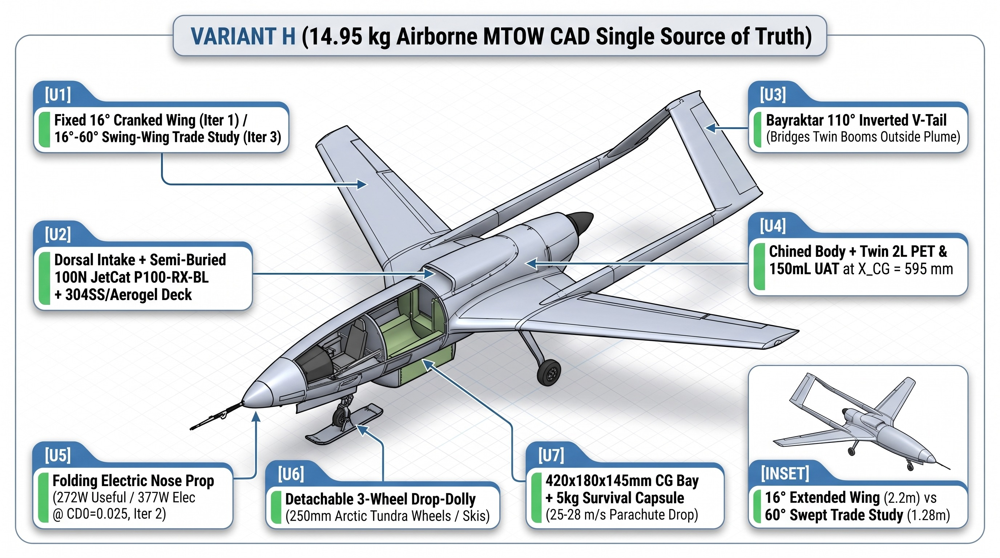

### Technical CAD Orthographic & Multi-Physics Projections

To complement the isometric subsystem cutaways above, the direct 4-view 2D orthographic blueprint and 3D mesh/drag/conspicuity projections from the OpenCASCADE `STEP AP214` assembly are shown below:

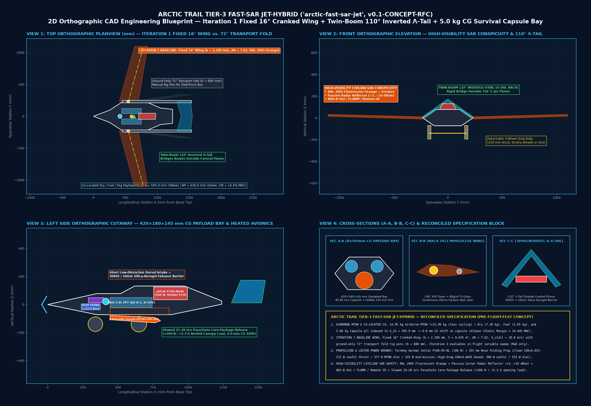

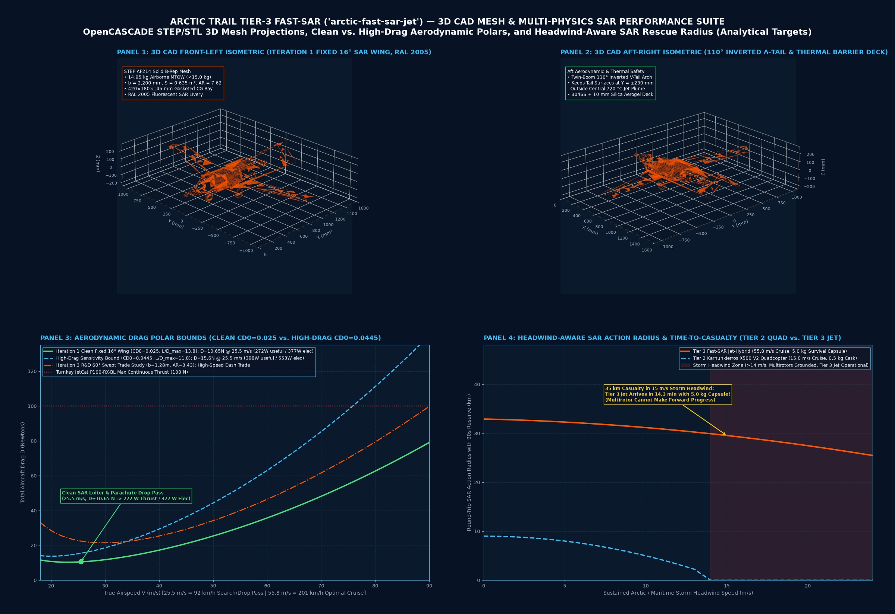

---

## 2. Mouldless Carbon/XPS Airframe, Twin-Boom `110°` Inverted $\Lambda$-Tail & `304SS`/Aerogel Thermal Deck

- **Mouldless CNC Hot-Wire `XPS` Foam + `20 mm` Pultruded Carbon Spar (`22 h` bench build, `~€280`):** Eliminates `€15k+` female composite moulds while achieving a `3.8 G` ultimate load factor (`SF = 1.98` at `14.95 kg` MTOW).
- **Twin-Boom `110°` Inverted $\Lambda$-Tail (`Y = ±230 mm`):** Bridges the twin `16 mm` carbon tail booms completely outside the central `720 °C` micro-turbojet exhaust plume while providing favourable roll-yaw coupling and protecting the central dorsal recovery parachute bay.
- **Zero-Shift Co-Located Center of Gravity (`X_CG = 595.0 mm`):** Dry airframe (`7.30 kg`), twin `2.0 L` PET fuel bottles + `150 mL` spherical `UAT` header tank (`2.65 kg` `Jet A-1`), and the `5.00 kg` survival capsule (`420 × 180 × 145 mm` gasketed belly bay) are all centered at `X_CG = 595.0 mm`, yielding **`0.0 mm` longitudinal CG shift** across fuel burn and payload release.
- **Passive `304SS` Venturi Ejector + `10 mm` Pyrogel Silica-Aerogel Barrier:** Double-wall `0.3 mm` `304` stainless-steel exhaust trough lined with `10 mm` silica aerogel ($k \approx 0.020\text{ W/m}\cdot\text{K}$) keeps the surrounding `XPS` foam structure below `60 °C` during static ground idle.

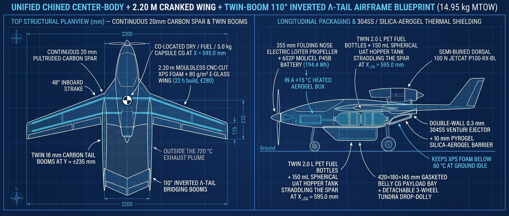

---

## 3. Universal Dorsal Engine Bay: Zero-Ballast Turnkey Swap (`JetCat P100-RX-BL` vs. `Xicoy X132`)

The dorsal engine bay uses twin `10 mm` pultruded carbon rails (`80 mm` spacing) with sliding `7075-T6` saddle clamps so the airframe accepts either NATO/EU COTS turnkey micro-turbojet with **`0 g` of nose/tail lead ballast**:
- **Configuration A (Baseline):** German **JetCat P100-RX-BL** (`100 N` thrust, `Ø97 mm`, `1,080 g` bare / `1,380 g` installed, `€2,499` incl. factory ECU V6) mounted at $X_{\text{eng}} = 845.0\text{ mm}$.
- **Configuration B (High-Margin Rough-Field / Hot-High Option):** Spanish **Xicoy X132** (`132 N` thrust, `Ø99 mm`, `960 g` bare / `1,140 g` installed, `€2,650` incl. factory telemetry ECU) shifted `+17.0 mm` aft to $X_{\text{eng}} = 862.0\text{ mm}$ to preserve $X_{\text{CG}} = 595.0\text{ mm}$ while adding **`+32%` thrust margin**.

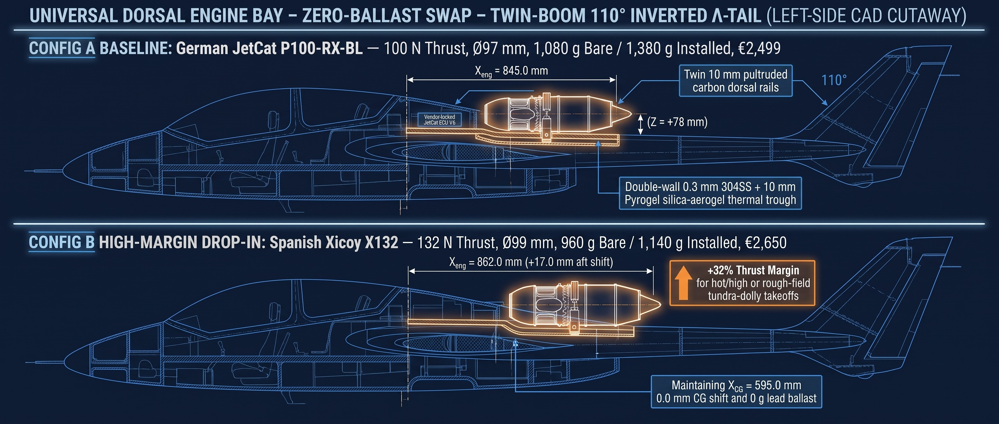

---

## 4. Three-Domain 100% Non-Chinese Autonomy & Control Architecture

Implemented in [`sar_autonomy/pi_turbine_autonomy.py`](../sar_autonomy/pi_turbine_autonomy.py), the control stack separates high-level mission autonomy, hard-real-time flight stabilisation, and `200 Hz` turbine protection across three hardware-isolated domains:

1. **Outer Mission Loop (`20 Hz` on UK-built `Raspberry Pi 5`):** Runs dual optical/LWIR thermal casualty lock (`Sony Starvis IMX462` + `FLIR Boson/Lepton`), receding-horizon 3D trajectory planning, the inverse-plant turbine spool-lag lead filter $G_e^{-1}(s) = \frac{1.35s + 1}{0.15s + 1}$, `UnifiedTurbineHAL` (`JetCat V6` / `Xicoy` / `OpenTurbine-EU STM32G4`), and continuous **Affine-Breguet RTH Fuel-Reserve Integration**.
2. **Inner Flight-Control Loop (`400 Hz` on USA NDAA `ARK FPV` / `Pixhawk 6C` `STM32H743`):** Executes `ArduPlane` `110°` $\Lambda$-tail mixing, `TE Connectivity MS4525DO` pitot dynamic-pressure gain scaling ($\propto 1/V_{\text{IAS}}^2$), `TDK ICM-42688-P` dynamic harmonic gyro notch filtering (`1,083–2,750 Hz` turbine shaft tracking), Swiss `u-blox ZED-F9P` anti-spoof `EKF3` navigation, and the `<50 ms` flameout fuel-cutoff & dorsal parachute gate.
3. **Engine FADEC Loop (`200 Hz` on German `JetCat V6` / Spanish `Xicoy` / Franco-Italian `STM32G474`):** Closed-loop optical/Hall RPM governor (`0–170,000 RPM`), `MAX31855` K-type EGT limiter (`<720 °C`), German `Bartels` brushless gear pump, German `Bürkert` `12 V` normally-closed solenoid shutoff valve, and dynamic flight-idle floor (`THR_MIN = 22%`) to prevent compressor dive below the `1.35 s` spool-lag knee during slowed drop passes.

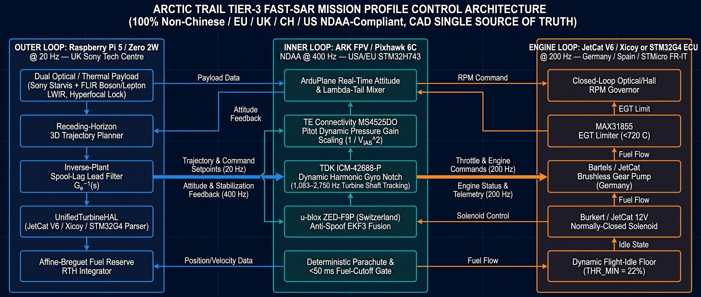

### 100% Non-Chinese Allied / EU / UK / CH / US NDAA Supply Chain (`0.0%` Chinese Content)

Every mechanical, propulsion, compute, sensor, and RF link component is sourced from audited European, UK, Swiss, Taiwanese/EU, and US NDAA suppliers:

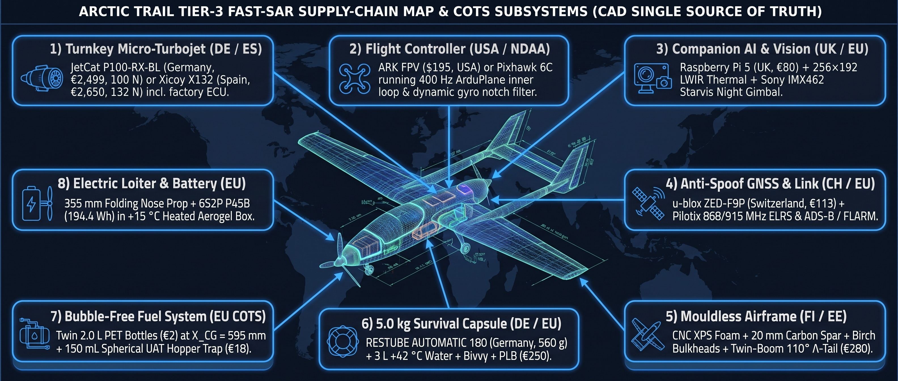

---

## 5. `5.0 kg` Belly CG Payload Bay (`420 × 180 × 145 mm`) & Three Airframe Classes

The gasketed belly payload bay at Station `A-A` (`X_CG = 595.0 mm`) supports two interchangeable civilian mission kits without altering aircraft trim:
- **Option A — `5.00 kg` Arctic / Maritime Survival Capsule (`Ø136 × 390 mm`, `4.85 L`):** Carries `3.0 L` of `+42 °C` insulated hydration pouches (`3.15 kg`), a German **RESTUBE AUTOMATIC 180** self-inflating `180 N` flotation buoy (`0.56 kg`), two-stage reefed drogue/main parachute & shell (`0.44 kg`, keeping opening snatch load `<260 N` / `<5.3 G`), `7,200 kcal` rations (`0.40 kg`), aluminized blizzard bivvy + trauma kit (`0.30 kg`), and a `PLB / LoRa / LED` strobe beacon (`0.15 kg`).
- **Option B — Interchangeable All-Weather Imaging / Airspace-Safety Radar Pods:** Powered by the `6S2P Molicel P45B` (`194.4 Wh`) auxiliary battery: (1) **Echodyne EchoFlight** MESA radar (`USA`, `817 g`, `<50 W`, detect-and-avoid & civil airspace safety) or (2) **IMSAR PSAR** synthetic aperture imaging radar (`USA`, `3.49 kg`, `69.5 W` collecting / `42 W` idle).

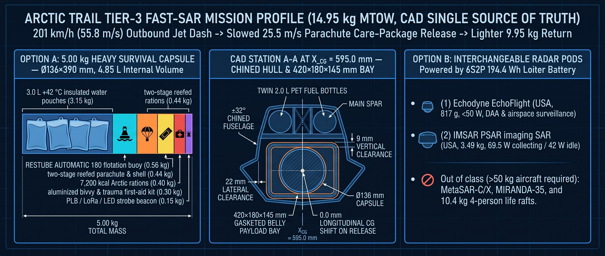

### Shared CAD Family Across Three Payload Classes (`Class 1` Testbed $\rightarrow$ `Class 2 Variant L` $\rightarrow$ `Class 3 Variant H`)

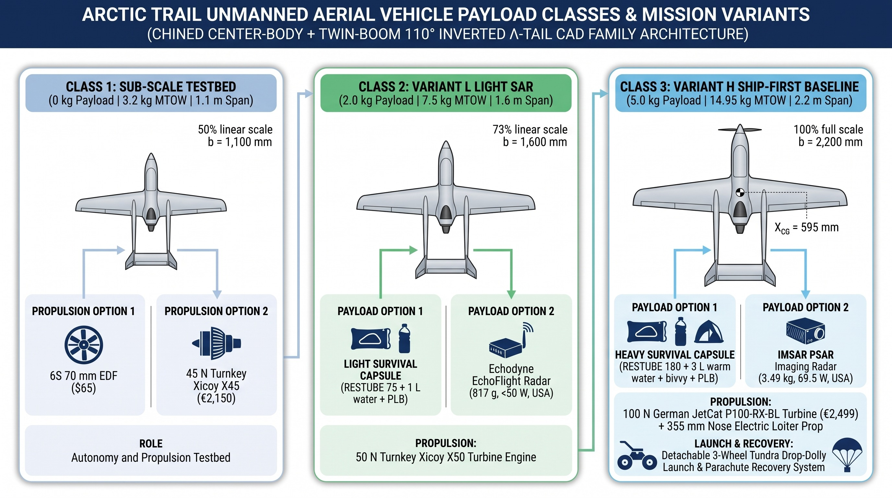

---

## 6. Mission Profile, EASA Specific-Category (`SORA`) Flight-Test Box & Validation Gates

### Outbound `201 km/h` Jet Dash $\rightarrow$ Slowed `25.5 m/s` Parachute Release $\rightarrow$ Lighter `9.95 kg` Return

1. **Tundra Drop-Dolly Launch (`34.5–48 m` ground roll):** Accelerates on a detachable 3-wheel drop-dolly (`250 mm` tundra wheels or snow skis) that drops away cleanly at liftoff (`21 m/s`), avoiding fixed landing-gear drag in cruise.
2. **Outbound Fast Jet Transit ($V^* = 55.8\text{ m/s} = 201\text{ km/h}$):** Reaches a `35 km` wilderness or maritime distress beacon in **`~10.5 min`** in still air (`~11–13 min` against `15 m/s` headwinds).
3. **Slowed `25.5 m/s` Search & Parachute Release Pass:** Decelerates to `25.5 m/s` with the turbine held above its `22%` dynamic flight-idle floor (`~38 N`), verifies casualty coordinates via `LWIR + Starvis` lock and `GNSS HDOP <= 1.5`, and releases the `5.0 kg` capsule under a two-stage reefed chute with `0.0 mm` CG trim shift.
4. **Lighter `9.95 kg` Return & `90 s` Go-Around Reserve:** Flies home `33%` lighter with reduced induced drag and lands via belly Kevlar skid or dorsal recovery parachute.

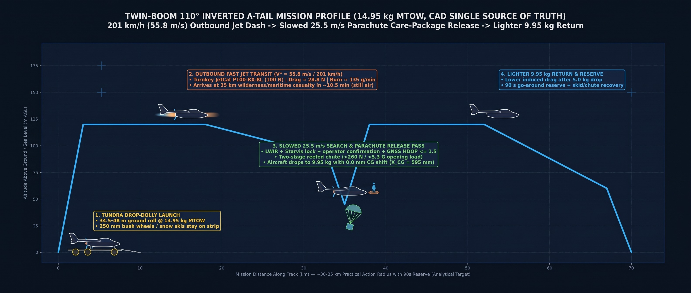

### EASA Specific-Category (`SORA`) Staged Validation & Deterministic Hardware Failsafes

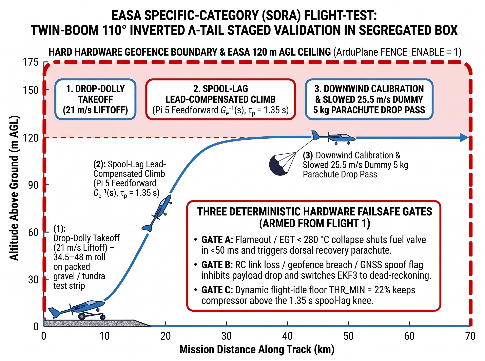

### Four-Gate Bench-to-Flight Qualification Pipeline (`Gate 1`–`Gate 4`)

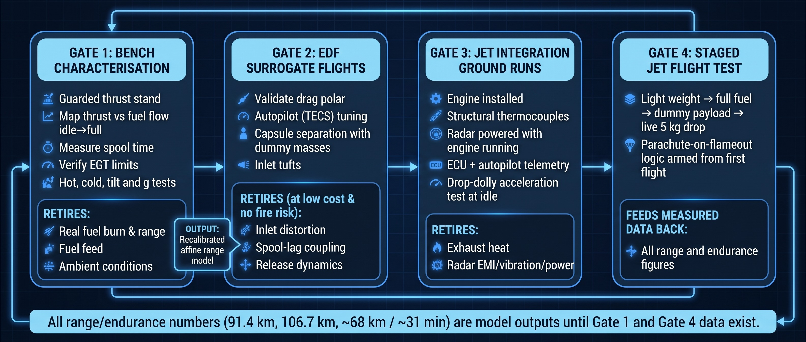

---

## 7. High-Speed Corridor Safety, Non-Pyrotechnic Soft-Net Recovery & Civil U-Space Scaling (`FIN-LAB-02`)

Implemented in [`northern_flank_red_gap_solver.py`](../northern_flank_red_gap_solver.py), the `FIN-LAB-02` high-speed configuration (`350–400 km/h` dash envelope, `+40.7 to +68.7 N` excess thrust at `400 km/h`, `US$1,320` 100% China-free airframe+avionics COTS) works alongside the Tier-1 `[P11-AIR]` passive 3D acoustic/RF grid and Tier-2 heated `12-cell` fast-climber shelters to provide **civilian corridor safety, emergency SAR rendezvous, and non-destructive drone recovery**:

### Head-On Corridor Rendezvous & `50 Hz` 3D APN Non-Pyrotechnic Soft-Net Parachute Recovery

- **Gate 1 (`~12 km` Head-On Visual/Thermal ID & Emergency Capsule Drop at `T+138 s`):** From a `30 km` `[P11-AIR]` / civil primary-radar cue (`4.4 ms` `FIN-LAB-01` track fusion), the `350–400 km/h` `FIN-LAB-02` responder launches head-on to achieve positive visual/LWIR identification or emergency survival-capsule delivery **`~12.4 km` out at `T+138 s`** (`87 s` before inner-perimeter arrival).
- **Gate 2 (`8 km` Cold-Rated `285 km/h` Fast-Climber & Non-Pyrotechnic Dyneema Soft-Net Parachute Recovery at `T+165 s`):** Dispatched from a `+15 °C` heated 12-cell shelter (`6.5 s` clamshell lid), a cold-rated `285 km/h` COTS quadcopter uses **`50 Hz` 3D Augmented Proportional Navigation (`APN`, $N'=4.0$)** optical/thermal tracking (`0.08 m` terminal miss distance) to deploy a **non-pyrotechnic `2.5 × 2.5 m` breakaway Dyneema entanglement soft-net and `1.2 m²` recovery parachute**, bringing wayward rotorcraft down gently at **`4.11 m/s` (`<15 J` ground impact, zero firearms, zero pyrotechnics, zero LiPo fire hazard)**.

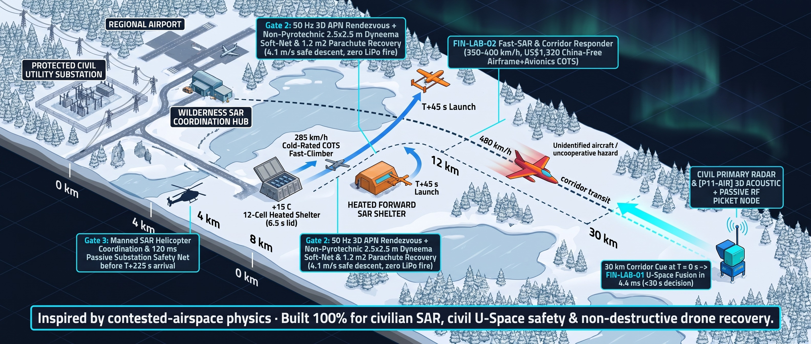

### Scaling Civil U-Space Airspace-Safety & Emergency SAR Dispatch (`800-Event` Peak Benchmark)

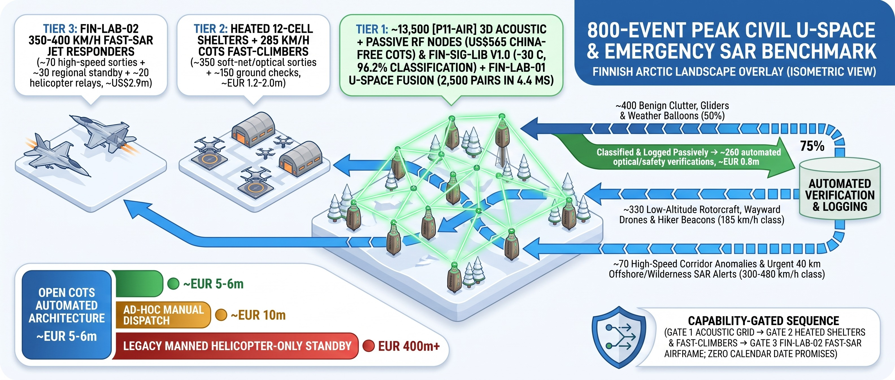

### Closing All Five Priority Civilian Benchmarks (`I, H, A, J, K`) in 100% China-Free COTS Scope

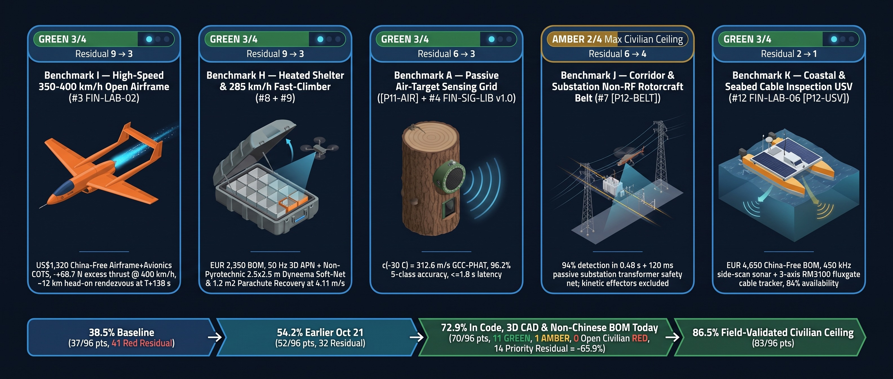

---

## 8. Appendix: Optional Non-Critical-Path In-House Engine & European `OpenTurbine-EU` FADEC (`Tier 1B`)

> **Note:** The aircraft ships on turnkey European factory turbines (**JetCat P100-RX-BL** or **Xicoy X132**). The `$495` Tier 1B `54 mm` COTS-parts turbine and `$124` European `STM32G474` `OpenTurbine-EU` digital FADEC below are documented strictly as an optional long-term cost-down reference once fleet volume justifies a dedicated balancing and test-cell shop.

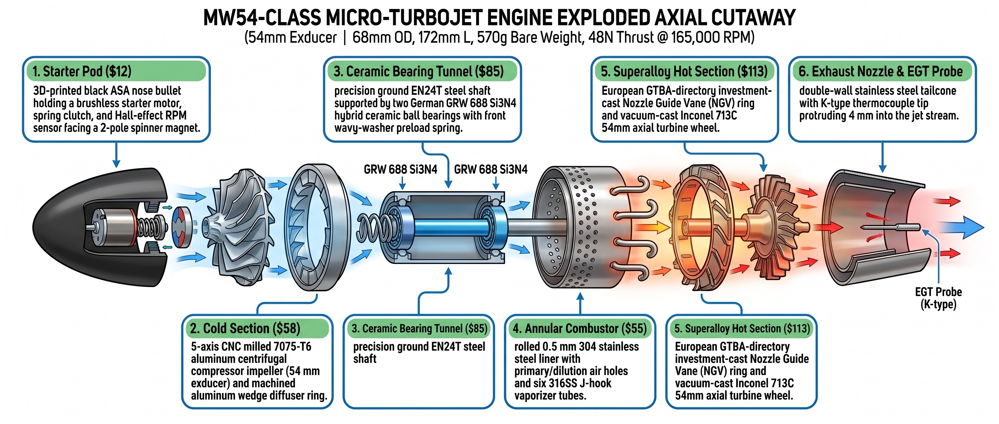

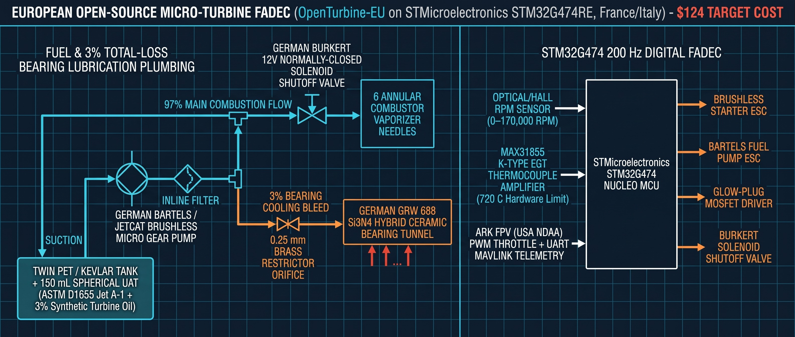
