# Engineering Design, 3D CAD Architecture & Subsystem Gallery (`arctic-fast-sar-jet` / `FIN-LAB-02`)

> [!WARNING]
> **Early-Stage Pre-Flight-Test Concept, TRL 2–3 Status & Simulation Disclaimer (`0.0 Flight Hours` Flown):**
> * **What Is Built vs. Simulated Today:** The shared `Raspberry Pi 5` + `Pico 2` + `100BASE-FX` optical diode + dual EO/LWIR sensor stack is bench-verified (`TRL 4–5`). However, **the `14.95 kg` `FIN-LAB-02` fixed-wing airframe, micro-turbojet installation, and marsupial drop mechanism are currently at `TRL 2–3` (parametric OpenCASCADE `STEP AP214` 3D CAD, `1:1 mm` CNC cut sheets, and `10/10` automated software-in-the-loop test suites with `0.0 Flight Hours` flown and `0` turbine ground runs completed)**.
> * **Analytical Targets Pending Physical Gates 1–4:** All affine-Breguet range/endurance projections (`~30–35 km` practical action radius with `90 s` go-around reserve), structural margins (`SF = 1.98` at `3.8 G` limit / `5.7 G` ultimate), `1,000`-run Monte Carlo pass rates, and `100,000`-flight actuarial fault-tree calculations (`1.51` residual crashes per `100k` flights using handbook MTBF priors) are **analytical model outputs and engineering targets**, subject to the [10-Point Technical Risk Register (Section 6.4)](#64-objective-technical-risk-register-unvalidated-physical-assumptions--de-risking-gates) and pending physical bench characterisation (**Gate 1**), sub-scale EDF surrogate flight testing (**Gate 2**), guarded static turbine ground runs (**Gate 3**), and staged `Traficom / EASA Specific-Category (SORA SAIL III)` flight validation (**Gate 4**).

---

## 1. OpenCASCADE `STEP AP214` 3D CAD Single Source of Truth (`Variant H`, `14.95 kg` Airborne MTOW)

Every engineering blueprint and isometric subsystem cutaway in this repository is reconciled to a single parameterized OpenCASCADE `STEP AP214` solid assembly ([`cad/arctic_fast_sar_jet_iter1_fixed16deg.step`](../cad/arctic_fast_sar_jet_iter1_fixed16deg.step), generated deterministically by [`cad/build_sar_jet_cad.py`](../cad/build_sar_jet_cad.py) from [`cad/design_params_sar.json`](../cad/design_params_sar.json)):

### Technical CAD Orthographic & Multi-Physics Projections

To complement the isometric subsystem cutaways above, the direct 4-view 2D orthographic blueprint and 3D mesh/drag/conspicuity projections from the OpenCASCADE `STEP AP214` assembly are shown below:

---

## 2. Mouldless Carbon/XPS Airframe, Twin-Boom `110°` Inverted $\Lambda$-Tail & `304SS`/Aerogel Thermal Deck

- **Mouldless CNC Hot-Wire `XPS` Foam + `20 mm` Pultruded Carbon Spar (`22 h` bench build, `~€280`):** Eliminates `€15k+` female composite moulds while achieving a `3.8 G` ultimate load factor (`SF = 1.98` at `14.95 kg` MTOW).
- **Twin-Boom `110°` Inverted $\Lambda$-Tail (`Y = ±230 mm`):** Bridges the twin `16 mm` carbon tail booms completely outside the central `720 °C` micro-turbojet exhaust plume while providing favourable roll-yaw coupling and protecting the central dorsal recovery parachute bay.
- **Zero-Shift Co-Located Center of Gravity (`X_CG = 595.0 mm`):** Dry airframe (`7.30 kg`), twin `2.0 L` PET fuel bottles + `150 mL` spherical `UAT` header tank (`2.65 kg` `Jet A-1`), and the `5.00 kg` survival capsule (`420 × 180 × 145 mm` gasketed belly bay) are all centered at `X_CG = 595.0 mm`, yielding **`0.0 mm` longitudinal CG shift** across fuel burn and payload release.
- **Passive `304SS` Venturi Ejector + `10 mm` Pyrogel Silica-Aerogel Barrier:** Double-wall `0.3 mm` `304` stainless-steel exhaust trough lined with `10 mm` silica aerogel ($k \approx 0.020\text{ W/m}\cdot\text{K}$) keeps the surrounding `XPS` foam structure below `60 °C` during static ground idle.

---

## 3. Universal Dorsal Engine Bay: Zero-Ballast Turnkey Swap (`JetCat P100-RX-BL` vs. `Xicoy X132`)

The dorsal engine bay uses twin `10 mm` pultruded carbon rails (`80 mm` spacing) with sliding `7075-T6` saddle clamps so the airframe accepts either Allied/European COTS turnkey micro-turbojet with **`0 g` of nose/tail lead ballast**:
- **Configuration A (Baseline):** German **JetCat P100-RX-BL** (`100 N` thrust, `Ø97 mm`, `1,080 g` bare / `1,380 g` installed, `€2,499` incl. factory ECU V6) mounted at $X_{\text{eng}} = 845.0\text{ mm}$.
- **Configuration B (High-Margin Rough-Field / Hot-High Option):** Spanish **Xicoy X132** (`132 N` thrust, `Ø99 mm`, `960 g` bare / `1,140 g` installed, `€2,650` incl. factory telemetry ECU) shifted `+17.0 mm` aft to $X_{\text{eng}} = 862.0\text{ mm}$ to preserve $X_{\text{CG}} = 595.0\text{ mm}$ while adding **`+32%` thrust margin**.

---

## 4. Three-Domain 100% Non-Chinese Autonomy & Control Architecture

Implemented in [`sar_autonomy/pi_turbine_autonomy.py`](../sar_autonomy/pi_turbine_autonomy.py), the control stack separates high-level mission autonomy, hard-real-time flight stabilisation, and `200 Hz` turbine protection across three hardware-isolated domains:

1. **Outer Mission Loop (`20 Hz` on UK-built `Raspberry Pi 5`):** Runs dual optical/LWIR thermal casualty lock (`Sony Starvis IMX462` + `FLIR Boson/Lepton`), receding-horizon 3D trajectory planning, the inverse-plant turbine spool-lag lead filter $G_e^{-1}(s) = \frac{1.35s + 1}{0.15s + 1}$, `UnifiedTurbineHAL` (`JetCat V6` / `Xicoy` / `OpenTurbine-EU STM32G4`), and continuous **Affine-Breguet RTH Fuel-Reserve Integration**.
2. **Inner Flight-Control Loop (`400 Hz` on USA Allied `ARK FPV` / `Pixhawk 6C` `STM32H743`):** Executes `ArduPlane` `110°` $\Lambda$-tail mixing, `TE Connectivity MS4525DO` pitot dynamic-pressure gain scaling ($\propto 1/V_{\text{IAS}}^2$), `TDK ICM-42688-P` dynamic harmonic gyro notch filtering (`1,083–2,750 Hz` turbine shaft tracking), Swiss `u-blox ZED-F9P` anti-spoof `EKF3` navigation, and the `<50 ms` flameout fuel-cutoff & dorsal parachute gate.
3. **Engine FADEC Loop (`200 Hz` on German `JetCat V6` / Spanish `Xicoy` / Franco-Italian `STM32G474`):** Closed-loop optical/Hall RPM governor (`0–170,000 RPM`), `MAX31855` K-type EGT limiter (`<720 °C`), German `Bartels` brushless gear pump, German `Bürkert` `12 V` normally-closed solenoid shutoff valve, and dynamic flight-idle floor (`THR_MIN = 22%`) to prevent compressor dive below the `1.35 s` spool-lag knee during slowed drop passes.

### 100% Non-Chinese Allied / EU / UK / CH / US Supply Chain (`0.0%` Chinese Content)

Every mechanical, propulsion, compute, sensor, and RF link component is sourced from audited European, UK, Swiss, Taiwanese/EU, and US Allied suppliers:

---

## 5. `5.0 kg` Belly CG Payload Bay (`420 × 180 × 145 mm`) & Three Airframe Classes

The gasketed belly payload bay at Station `A-A` (`X_CG = 595.0 mm`) supports two interchangeable civilian mission kits without altering aircraft trim:
- **Option A — `5.00 kg` Arctic / Maritime Survival Capsule (`Ø136 × 390 mm`, `4.85 L`):** Carries `3.0 L` of `+42 °C` insulated hydration pouches (`3.15 kg`), a German **RESTUBE AUTOMATIC 180** self-inflating `180 N` flotation buoy (`0.56 kg`), two-stage reefed drogue/main parachute & shell (`0.44 kg`, keeping opening snatch load `<260 N` / `<5.3 G`), `7,200 kcal` rations (`0.40 kg`), aluminized blizzard bivvy + trauma kit (`0.30 kg`), and a `PLB / LoRa / LED` strobe beacon (`0.15 kg`).
- **Option B — Interchangeable All-Weather Imaging / Airspace-Safety Radar Pods:** Powered by the `6S2P Molicel P45B` (`194.4 Wh`) auxiliary battery: (1) **Echodyne EchoFlight** MESA radar (`USA`, `817 g`, `<50 W`, detect-and-avoid & civil airspace safety) or (2) **IMSAR PSAR** synthetic aperture imaging radar (`USA`, `3.49 kg`, `69.5 W` collecting / `42 W` idle).

### Shared CAD Family Across Three Payload Classes (`Class 1` Testbed $\rightarrow$ `Class 2 Variant L` $\rightarrow$ `Class 3 Variant H`)

---

## 6. Mission Profile, EASA Specific-Category (`SORA`) Flight-Test Box & Validation Gates

### Outbound `201 km/h` Jet Dash $\rightarrow$ Slowed `25.5 m/s` Parachute Release $\rightarrow$ Lighter `9.95 kg` Return

1. **Tundra Drop-Dolly Launch (`34.5–48 m` ground roll):** Accelerates on a detachable 3-wheel drop-dolly (`250 mm` tundra wheels or snow skis) that drops away cleanly at liftoff (`21 m/s`), avoiding fixed landing-gear drag in cruise.
2. **Outbound Fast Jet Transit ($V^* = 55.8\text{ m/s} = 201\text{ km/h}$):** Reaches a `35 km` wilderness or maritime distress beacon in **`~10.5 min`** in still air (`~11–13 min` against `15 m/s` headwinds).
3. **Slowed `25.5 m/s` Search & Parachute Release Pass:** Decelerates to `25.5 m/s` with the turbine held above its `22%` dynamic flight-idle floor (`~38 N`), verifies casualty coordinates via `LWIR + Starvis` lock and `GNSS HDOP <= 1.5`, and releases the `5.0 kg` capsule under a two-stage reefed chute with `0.0 mm` CG trim shift.
4. **Lighter `9.95 kg` Return & `90 s` Go-Around Reserve:** Flies home `33%` lighter with reduced induced drag and lands via belly Kevlar skid or dorsal recovery parachute.

### EASA Specific-Category (`SORA`) Staged Validation & Deterministic Hardware Failsafes

### Four-Gate Bench-to-Flight Qualification Pipeline (`Gate 1`–`Gate 4`)

### 6.4 Objective Technical Risk Register, Unvalidated Physical Assumptions & De-Risking Gates

Because `FIN-LAB-02` currently has **`0.0` physical flight hours**, the 10-point risk register below explicitly documents every major physical assumption where real-world aerodynamics, aeroelasticity, thermodynamics, or winter environmental physics could diverge from our analytical 6-DoF and CAD models, together with the physical test gate required before advancing:

| # | Technical Risk & Subsystem | Pre-Gate Risk (`L × S`) | Analytical Model Assumption Today | Primary Real-World Failure Mechanism / Unknown | Mandatory Physical De-Risking Gate (`Gate 1–4`) |
| :-: | :--- | :---: | :--- | :--- | :--- |
| **1** | **Parasitic Drag Growth ($C_{D0}$) on Mouldless XPS Airframe** | **High / Med** | $C_{D0} = 0.0250$ clean, $(L/D)_{\max} = 12.1\text{–}13.8$, `35.4 km` radius. | Mouldless foam surface waviness, external tail-root linkage fairings, and ventral clamshell door gaps can raise $C_{D0}$ to `0.030–0.035`, reducing practical action radius by `15–25%` (`26–29 km`). | **Gate 2:** `Config 6` (`1.40 m` `6S EDF` surrogate) power-off glide-polar sink-rate flights to measure empirical $C_{D0}$ and $e$. |
| **2** | **High-Speed Aeroelastic Flutter & Twin-Boom $\Lambda$-Tail Shimmy (`280–400 km/h`)** | **Med / Crit** | Static `5.7 G` ultimate spar check on `20 mm` main spar and `16 mm` carbon tail booms (`Y = ±230 mm`). | At `100–111 m/s` ($q = 6.1\text{–}7.55\text{ kPa}$), coupled wing bending-torsion flutter or antisymmetric torsional shimmy of the twin booms + pointed `110°` Inverted-V (`/\`) tail arch can cause catastrophic structural failure below static yield. | **Gate 2 & Gate 4:** Ground vibration tap-testing (`GVT`) + progressive speed expansion with `100 Hz` IMU PSD flutter monitoring and $\pm 45^\circ$ vacuum-bagged carbon skin layup. |
| **3** | **Dorsal S-Duct Inlet Distortion ($DC_{60}$) & Compressor Surge at High $\alpha / \beta$** | **Med / High** | `22 mm` boundary-layer diverter + `2× 45×30 mm` passive blow-in louvers (`dP < -350 Pa`) + $DC_{60}$ throttle slew guard (`SM_surge > +11%`). | At `25.5 m/s` ($\alpha = +8.5^\circ\text{ to }+11^\circ$) `TOGA` climb-out or crosswind sideslip ($\beta > 6^\circ$), inboard `48°` strake vortices or dorsal flow separation could enter the semi-buried intake and surge the `154k RPM` centrifugal compressor. | **Gate 3:** Static thrust-stand 12-probe total-pressure bellmouth rake ($DC_{60}$) at `0°–15°` crossflow/upwash angles with smoke visualization. |
| **4** | **`-30 °C` Cold-Soaked In-Flight Micro-Turbojet Relight & Fuel Waxing** | **High / High** | `2.60 s` FADEC kerostart relight + `E2` warm ECU fuel-return coil (`+18 °C`) + `0.12%` FSII down to `-48 °C`. | After `45–120 min` of `-30 °C` cold-soaked electric cruise (`Cartridge C`), high `Jet A-1` viscosity (`> 10 mm²/s`), kerostart igniter cooling, or `3S LiFePO4` starter-pack $I\cdot R$ sag may cause relight hung starts or wet-fuel tailpipe fire. | **Gate 1 & Gate 3:** `-25 °C` freezer fuel-pump flow bench + outdoor winter static thrust-stand cold-soak relight campaign. |
| **5** | **Post-Shutdown Dorsal "Chimney" Heat-Soak into `XPS` Foam & Chute Bay** | **Med / High** | `0.3 mm 304SS` + `10 mm` Pyrogel aerogel trough + starter BLDC auto-cooldown purge until `EGT < 95 °C` + `X = 608 mm` firewall. | When the turbine shuts down after a `680 °C` dash (on landing or electric-loiter transition), ram air stops and buoyant residual casing heat (`500+ °C`) rises toward the dorsal `XPS` foam (`> 75 °C` softening limit) and parachute bay (`X = 542.7 mm`). | **Gate 3:** 8-channel K-type thermocouple soak test during 15-minute post-shutdown cooldown on the static thrust stand. |
| **6** | **Mid-Air Marsupial Quadcopter (`Cartridge B`) Cavity Wake & Drogue Snag** | **Med / High** | `100 Hz` separation model shows `-2.2 m/s` plunger ejection clearing the aft tail arch (`X = 1.54 m`) by `1.52 m` in `0.36 s`. | Unsteady 3D open-cavity shear vortices at `25.5 m/s` or sideslip ($\beta > 5^\circ$) could pitch the `2.65 kg` folded quad upward on exit or snag the `60 cm` ribbon drogue bridle on a tail boom. | **Gate 2:** Inert mass-dummy and static-line drogue drop trials from the `Config 6` subscale surrogate before any live quad release. |
| **7** | **GNSS-Denied `VIO` Feature Starvation Over Whiteout Snow & *Lumituisku*** | **Med / Med** | `VIO_BARO_DEM` achieves `18.4 m` CEP over `25 km` using canyon/tree-crown thermal and visual contrast. | Over featureless snowfields, fog, or heavy blowing snow (*lumituisku*) above the `40 m` LiDAR floor, optical/thermal feature starvation degrades `VIO` to IMU + airspeed dead-reckoning (`2–5%` distance drift). | **Gate 1 & Gate 2:** Winter flight logs over snow/forest terrain comparing `LWIR` vs. `Starvis` feature-point survival. |
| **8** | **Supercooled Large Droplet (`SLD`) Runback Icing & `0 °C` Slush Door Freeze** | **Med / High** | `35 W` leading-edge carbon veil sheds `76%` of rime/glaze ice; `4:1` cam-toggle + `t = 45 s` micro-pulse cracks slush on belly doors. | Melted water running aft of the heated leading edge ($x/c > 0.15$) can refreeze into an upper-surface ridge horn ahead of the flaperons, or slush spray on takeoff can freeze the ventral bay gasket shut. | **Gate 1 & Gate 2:** Refrigerated wind-tunnel / freezer spray-icing coupon test + `120 N` ice-shear bench latch test. |
| **9** | **`12 km` Port-Boom `250 µm` Bare Fiber Spool (`E3`) High-Speed Whip** | **Med / Med** | Payout tube inside port `16 mm` boom (`Y = -230 mm`) keeps fiber outside jet plume, with `< 20 ms` guillotine cutter. | At `55–85 m/s` cruise or in lee-wave turbulence, aerodynamic drag and wake whip on unbuffered `250 µm` `G.657.A2` fiber can exceed its `~9 N` tensile strength or snag on tall spruce crowns. | **Gate 1 & Gate 2:** High-speed blower / vehicle tow payout trial of the `12 km` bobbin before airborne deployment. |
| **10** | **Actuarial Fault-Tree Priors (`0` Empirical FH) & `EASA SORA SAIL III` Approval** | **High / Med** | Fault tree predicts `1.51` residual `LOC-I` crashes per `100k` sorties (`2.75 × 10⁻⁵ /FH`) assuming `25 FH` bearing / `50 FH` pump TBOs. | All reliability figures derive from MIL-HDBK-217F / vendor MTBF priors ($\pi_E = 1.8$) with **zero empirical flight hours**; early prototype builds face COTS infant mortality, wiring harness chafe, and strict `Traficom` BVLOS regulatory gates. | **Gates 1–4:** Capability-gated progression (`Bench` $\to$ `VLOS EDF Surrogate` $\to$ `Static Turbine Stand` $\to$ `Authorized Test-Range SORA`). |

---

## 7. High-Speed Corridor Safety, Non-Pyrotechnic Soft-Net Recovery & Civil U-Space Scaling (`FIN-LAB-02`)

Implemented in [`northern_flank_red_gap_solver.py`](../northern_flank_red_gap_solver.py), the `FIN-LAB-02` high-speed configuration (`350–400 km/h` dash envelope, `+40.7 to +68.7 N` excess thrust at `400 km/h`, `US$1,320` 100% China-free airframe+avionics COTS) works alongside the Tier-1 `[P11-AIR]` passive 3D acoustic/RF grid and Tier-2 heated `12-cell` fast-climber shelters to provide **civilian corridor safety, emergency SAR rendezvous, and non-destructive drone recovery**:

### Head-On Corridor Rendezvous & `50 Hz` 3D APN Non-Pyrotechnic Soft-Net Parachute Recovery

- **Gate 1 (`~12 km` Head-On Visual/Thermal ID & Emergency Capsule Drop at `T+138 s`):** From a `30 km` `[P11-AIR]` / civil primary-radar cue (`4.4 ms` `FIN-LAB-01` track fusion), the `350–400 km/h` `FIN-LAB-02` responder launches head-on to achieve positive visual/LWIR identification or emergency survival-capsule delivery **`~12.4 km` out at `T+138 s`** (`87 s` before inner-perimeter arrival).
- **Gate 2 (`8 km` Cold-Rated `285 km/h` Fast-Climber & Non-Pyrotechnic Dyneema Soft-Net Parachute Recovery at `T+165 s`):** Dispatched from a `+15 °C` heated 12-cell shelter (`6.5 s` clamshell lid), a cold-rated `285 km/h` COTS quadcopter uses **`50 Hz` 3D Augmented Proportional Navigation (`APN`, $N'=4.0$)** optical/thermal tracking (`0.08 m` terminal miss distance) to deploy a **non-pyrotechnic `2.5 × 2.5 m` breakaway Dyneema entanglement soft-net and `1.2 m²` recovery parachute**, bringing wayward rotorcraft down gently at **`4.11 m/s` (`<15 J` ground impact, zero firearms, zero pyrotechnics, zero LiPo fire hazard)**.

### Scaling Civil U-Space Airspace-Safety & Emergency SAR Dispatch (`800-Event` Peak Benchmark)

### Closing All Five Priority Civilian Benchmarks (`I, H, A, J, K`) in 100% China-Free COTS Scope

---

## 8. 6-DoF Nonlinear Flight Dynamics, CFD Airflow Physics, Stability & Stall/Upset Recovery (`flight_simulator_6dof.py` & `simulator_ui/flight_simulator.html`)

Implemented in [`flight_simulator_6dof.py`](../flight_simulator_6dof.py) (`200 Hz` RK4 rigid-body solver) and the interactive [`simulator_ui/flight_simulator.html`](../simulator_ui/flight_simulator.html) 3D/2D CFD Wind-Tunnel Workbench, the aerodynamic and flight-control design is verified across **6 aircraft configurations $\times$ 5 environmental/fault/conflict stress presets (`30` full-mission runs)**:

### 8.1 Configuration Trade-Study & Build Prioritization (`30-Run` Multi-Config Benchmark)

| Priority Rank & Configuration | Dry / MTOW (`kg`) | Propulsion (`N` / `W`) | Takeoff Roll (`m`) | Cruise / Max Dash (`m/s`) | Action Radius (`km`, `-25 °C`, `12 m/s` HW) | CG Shift (`mm`) | All-Preset Pass Rate | Composite Score (`/100`) & Engineering Role |
| :--- | :---: | :---: | :---: | :---: | :---: | :---: | :---: | :--- |
| **1. `Config 1` — Iter 1 Baseline (`Fixed 16° Wing + JetCat P100-RX-BL`)** | `7.30` / `14.95` | `100 N` (`JetCat P100`) | `34.5 m` | `55.8` / `68.4 m/s` (`246 km/h`) | `35.4 km` (`90 s` reserve) | **`0.0 mm`** | **`5/5` (`100%`)** | **`98.4 / 100` — Primary Phase 1 Build Priority:** Simplest mouldless structure, zero CG shift, lowest unit cost (`~€4,850`), full margin in `18 m/s` crosswinds and `-30 °C` icing. |
| **2. `Config 2` — Iter 1 High-Margin (`Fixed 16° Wing + Xicoy X132`)** | `7.06` / `14.71` | `132 N` (`Xicoy X132`) | `25.8 m` | `58.0` / `77.2 m/s` (`278 km/h`) | `34.1 km` (`90 s` reserve) | **`0.0 mm`** | **`5/5` (`100%`)** | **`97.9 / 100` — Rough-Field / Heavy-Ice / Fast-Evasion Option:** `+32%` thrust and `-240 g` lighter engine mounted `+17 mm` aft (`X_eng = 862 mm`) with `0 g` ballast. |
| **3. `Config 6` — Class 1 Subscale Surrogate (`1.40 m` `70 mm 6S EDF`)** | `2.65` / `3.80` | `28 N` (`6S EDF`) | `22.0 m` | `32.0` / `44.5 m/s` (`160 km/h`) | `8.5 km` (`VLOS` test range) | **`0.0 mm`** | **`5/5` (`100%`)** | **`96.0 / 100` — Gate 2 Pre-Turbine Flight-Test Surrogate:** Validates `110°` $\Lambda$-tail mixing, `14.0% MAC` stability, drop-dolly release, and `0.8 kg` parachute drop before running a hot turbine. |
| **4. `Config 3` — Iter 2 Hybrid Electric-Loiter (`JetCat P100 + 355 mm Nose Prop`)** | `7.72` / `14.95` | `100 N` jet + `380 W` prop | `33.8 m` | `55.8` / `67.5 m/s` (`25.5 m/s` silent loiter) | `41.2 km` (`+22 min` loiter) | **`0.0 mm`** | **`5/5` (`100%`)** | **`95.2 / 100` — Gate 4 Extended-Loiter Upgrade:** Adds silent electric search pass (`355 W`) and in-flight turbine relight once Gate 3 baseline flights are proven. |
| **5. `Config 4` — Iter 3 High-Speed Responder (`Fixed 28° Swept + Xicoy X132`)** | `7.45` / `14.95` | `132 N` (`Xicoy X132`) | `41.2 m` | `78.5` / `102.8 m/s` (`370 km/h`) | `31.8 km` | **`0.0 mm`** | **`5/5` (`100%`)** | **`91.8 / 100` — Gate 4 High-Speed Corridor Responder (`FIN-LAB-02`):** Trades higher landing speed (`24.8 m/s`) for `350–370+ km/h` dash speed. |
| **6. `Config 5` — R&D Variable-Geometry (`16°–60°` Swing-Wing + `Xicoy X132`)** | `7.95` / `14.95` | `132 N` (`Xicoy X132`) | `36.4 m` | `55.8` / `108.5 m/s` (`390 km/h`) | `29.4 km` | **`+14.5 mm`** | **`4/5` (`80%`)** | **`86.5 / 100` — Long-Term R&D Reference Only:** Pivot mechanism adds `+650 g` structural mass and shifts CG aft by `+14.5 mm` (`SM` drops from `14.0%` to `7.9% MAC` at `60°` sweep). |

### 8.2 Aerodynamic Stability Target (`+14.4% MAC` Static Margin) & MIL-STD-1797 Level 1 Eigenmodes

The fixed `16°` cranked wing (`MAC = 284.0 mm`, `AR = 7.62`, `+2.0°` geometric washout at the tip, `48°` inboard leading-edge strake) and twin-boom `110°` Inverted-V (`/\` / $\Lambda$) tail place the aerodynamic neutral point at $X_{\text{NP}} = 636.0\text{ mm}$ and the co-located center of gravity at $X_{\text{CG}} = 595.0\text{ mm}$:
$$\text{Static Margin (SM)} = \frac{X_{\text{NP}} - X_{\text{CG}}}{\bar{c}} = \frac{636.0 - 595.0}{284.0} = \mathbf{+14.4\%\text{ MAC}} \quad \left(C_{m\alpha} = -0.68\text{ rad}^{-1},\; C_{L\alpha} = 4.85\text{ rad}^{-1}\right)$$

- **Why `+14.4% MAC` Is the Sweet Spot:**
  1. **Zero Trim-Shift Across Fuel Burn & `5.0 kg` Capsule Drop:** Co-locating the dry airframe CG, twin `2.0 L` fuel saddle tanks, and ventral `5.0 kg` drop bay at `X_CG = 595.0 mm` prevents nose-up pitch transient at payload release (`ΔX_CG = 0.0 mm`).
  2. **Why Not Over-Stable (`> +22% MAC`):** Excessive static margin creates heavy nose-down trim drag in cruise (`-1.4` to `-2.1` L/D penalty), saturates the `110°` $\Lambda$-tail ruddervators (`δ_e = -22°`) when flaring or slowing to `25.5 m/s` for parachute release, and causes violent weathercocking in `18 m/s` Arctic crosswind gusts.
  3. **Why Not Relaxed Stability (`< +5% MAC`):** Insufficient static margin leaves zero passive aerodynamic restoring margin if the heated pitot (`MS4525DO`) experiences temporary rime-ice bridging or during a `3.5 G` mountain-wave rotor upset.

| Dynamic Eigenmode | Analytical / 6-DoF Value (`55.8 m/s` Cruise) | Damping Ratio ($\zeta$) / Time Constant | MIL-STD-1797 / EASA Handling Level | Physical Behaviour & Control Augmentation |
| :--- | :---: | :---: | :---: | :--- |
| **Short-Period Pitch Mode** | $\omega_{n,\text{sp}} = 5.51\text{ rad/s}$ ($0.88\text{ Hz}$) | $\zeta_{\text{sp}} = 0.65$ | **Level 1** ($\zeta \in [0.35, 1.30]$) | Crisp pitch response to elevator commands with zero overshoot or PIO tendency; `MS4525DO` $1/V_{\text{IAS}}^2$ gain scheduling keeps $\zeta_{\text{sp}} > 0.58$ from `25 m/s` to `100 m/s`. |
| **Phugoid Long-Period Mode** | $\omega_{n,\text{ph}} = 0.221\text{ rad/s}$ ($T = 28.4\text{ s}$) | $\zeta_{\text{ph}} = 0.088$ | **Level 1** ($\zeta > 0.04$) | Gentle energy exchange damped within 1 cycle by the `ArduPlane` TECS total-energy loop + inverse turbine spool-lag lead compensator $G_e^{-1}(s)$. |
| **Dutch Roll Coupled Mode** | $\omega_{n,\text{dr}} = 3.29\text{ rad/s}$ ($0.52\text{ Hz}$) | $\zeta_{\text{dr}} = 0.19$ (bare) $\rightarrow \mathbf{0.48}$ (yaw damper) | **Level 1** ($\zeta > 0.19$, $\zeta\omega_n > 0.35$) | Twin-boom `110°` $\Lambda$-tail provides strong directional stiffness ($C_{n\beta} = +0.115\text{ rad}^{-1}$); `ICM-42688-P` `400 Hz` yaw-rate feedback boosts $\zeta_{\text{dr}}$ to `0.48`. |
| **Roll Subsidence Mode** | $\tau_r = 0.118\text{ s}$ | Non-oscillatory real pole ($s = -8.47\text{ s}^{-1}$) | **Level 1** ($\tau_r < 1.0\text{ s}$) | High roll damping ($C_{lp} = -0.48\text{ rad}^{-1}$) stops roll rate within `0.12 s` of aileron neutralization, resisting asymmetric gust upsets. |
| **Spiral Mode** | $T_2 = 24.5\text{ s}$ (time to double bank) | Quasi-neutral ($s = +0.028\text{ s}^{-1}$) | **Level 1** ($T_2 > 12\text{ s}$) | Slight dihedral effect ($C_{l\beta} = -0.082\text{ rad}^{-1}$) from the `16°` cranked outer panel + `110°` $\Lambda$-tail prevents spiral divergence while avoiding crosswind roll-off. |

### 8.3 3D/2D CFD Airflow Attachment, Boundary-Layer Separation & Volumetric S-Duct Nacelle Geometry

Both [`flight_simulator_6dof.py`](../flight_simulator_6dof.py) and the interactive [`simulator_ui/flight_simulator.html`](../simulator_ui/flight_simulator.html) wind-tunnel engine (`3D CFD`, `2D Airfoil`, `Split 3D+2D`, `Side`, `Top Span`, and `Front Λ` views) model the Kirchhoff–Helmholtz / ESDU 70011 trailing-edge separation point $f_{\text{sep}}(\alpha)$ and upper-surface suction distribution $C_p(x/c)$ across three aerodynamic regimes:

1. **Regime 1 — Clean Attached Flow ($\alpha \in [-4^\circ, +8.5^\circ]$, $f_{\text{sep}} = 1.00$):**
   - Streamlines accelerate smoothly over the `SD7037 / RG-15` hybrid airfoil nose ($C_{p,\text{min}} \approx -1.45$ to $-2.10$ at $x/c \approx 0.18$), undergo laminar-to-turbulent transition at $x/c \approx 0.32$, and leave the trailing edge cleanly (satisfying the Kutta condition) with compact wingtip vortices ($\Gamma \propto C_L$) and $(L/D)_{\max} = 12.8\text{–}13.8$.
2. **Regime 2 — Pre-Stall Trailing-Edge Separation & Buffet Onset ($\alpha \in [+8.5^\circ, +13.5^\circ]$, $f_{\text{sep}} \in [0.45, 1.00)$):**
   - Adverse pressure gradient causes the turbulent boundary layer to thicken and detach progressively forward from the trailing edge ($x/c = 1.0 \to 0.45$).
   - The **`48°` inboard leading-edge strake** generates dual counter-rotating leading-edge vortices that re-energize the inner wing boundary layer, while **`+2.0°` geometric washout** at the outer wingtip keeps local tip angle of attack $\alpha_{\text{tip}} \approx \alpha_{\text{root}} - 2.0^\circ$ fully attached so ailerons retain roll authority right up to stall.
3. **Regime 3 — Full Stall & Von Kármán Wake Shedding ($\alpha > +13.5^\circ$, $f_{\text{sep}} < 0.45$):**
   - Upper-surface suction peak collapses into a flat separated pressure plateau ($C_p \approx -0.45$), drag surges ($C_D \to 0.28+$), and alternating counter-rotating von Kármán vortex rings shed into the wake at `6–11 Hz`.
   - Because the twin `16 mm` carbon tail booms (`Y = ±230 mm`) and `110°` outward-canted $\Lambda$-tail sit laterally outside the central fuselage/strake wake and above the `304SS` dorsal exhaust deck, the ruddervators remain in clean high-energy airflow and produce an immediate nose-down restoring moment ($C_m \approx -0.21$).
4. **3D Volumetric Semi-Buried S-Duct Dorsal Nacelle, Passive Anti-Stall Blow-In Louvers & Under-Wing Boom Pylon Fairings (`+€0`, `+12 g`, `0` Servos):**
   - Rather than mounting the turbine on an exposed drag-producing strut, the dorsal micro-turbojet is housed inside a **semi-buried S-duct nacelle (`X = 520..980 mm`)** faired continuously into the dorsal fuselage spine, with a flush NACA-style boundary-layer diverter lip (`22 mm` stand-off) that ingests clean freestream air above the fuselage boundary layer.
   - **Zero-Cost / Zero-Servo Compressor Stall & Surge Prevention (`evaluate_dorsal_inlet_distortion_and_surge_margin()` in [`sar_autonomy/pi_turbine_autonomy.py`](../sar_autonomy/pi_turbine_autonomy.py)):**
     1. **Passive Spring-Loaded Dorsal "Blow-In" Suction Louvers (`2× 45 × 30 mm`, `+12 g`, `+€0`, `0` Servos):** CNC-cut into the upper nacelle cheeks ahead of the compressor bellmouth; crack open passively when duct static pressure drops below ambient ($\Delta P < -350\text{ Pa}$) during static run or `25.5 m/s` `100% TOGA` climb (cutting low-speed lip separation $DC_{60}$ by **`-78%`**) and suck shut flush above `45 m/s` cruise.
     2. **`8 W` Dorsal Intake Lip Carbon-Veil Anti-Ice Loop + `10 mm` Stand-Off FOD Screen Radial Bypass Annulus (`+€0`, folded into `E1` `35 W` De-Icer Bus):** Prevents rime-ice ridge shedding into the `154k RPM` impeller and allows radial bypass airflow around the FOD mesh perimeter in heavy blowing snow (*lumituisku*).
     3. **Coupled $DC_{60}(\alpha, \beta, V_{\text{IAS}})$ Surge-Guard Slew Limiter (`400 Hz` / `20 Hz`, `+€0` Software):** Dynamically modulates maximum upward throttle ramp rate ($\dot{u}_{\max}$) whenever high-$\alpha$ or high-$\beta$ gusts elevate inlet distortion ($DC_{60} > 0.11$), preserving **`> +11%` centrifugal compressor surge margin (`0` stalls/surges)** across the entire flight envelope.
   - Similarly, the twin `16 mm` carbon tail booms pass through **structural under-wing composite pylon fairings (`X = 460..780 mm`, `Y = ±230 mm`)** bonded directly to the main `20 mm` carbon spar and rear wing shear web, eliminating unfaired tube-junction interference drag.

### 8.4 Four-Stage Stall, Spin, Icing & Airspace-Conflict Recovery Architecture (`FDIR`)

| Recovery Stage & Trigger Threshold | Autonomous `FDIR` + Passive Aerodynamic Response | Recovery Time & Altitude Loss |
| :--- | :--- | :--- |
| **Stage 1 — Pre-Stall Envelope Protection (`α ≥ 11.5°` or `V_IAS < 1.12 V_stall`)** | `ArduPlane` TECS/pitch limiter commands automatic nose-down ruddervator stick-pusher ($\delta_{e,\text{push}} = +8^\circ\text{ to }+14^\circ$), limits bank angle to $|\phi| \le 25^\circ$, and raises the turbine floor to $\ge 65\%$ thrust via the `1.35 s` inverse-plant lead compensator $G_e^{-1}(s)$. | **`0.35 s`** (`0 m` altitude loss; prevents stall entry in `18 m/s` windshear or `+1.8°` icing shift). |
| **Stage 2 — Aerodynamic Stall Recovery (`α > 13.5°`, $f_{\text{sep}} < 0.45$)** | Inboard-first stall (`+2.0°` tip washout keeps outboard ailerons attached) + natural nose-down pitching moment ($C_m = -0.21$) + active stick-pusher ($\delta_e = +14^\circ$) pitches the nose down `-8°` below horizon, re-attaching flow ($f_{\text{sep}} > 0.90$) as $\alpha$ drops below `+9.5°`. | **`0.85 s`** (`< 11.5 m` altitude loss from full `-30 °C` icing stall). |
| **Stage 3 — Severe Upset / Spin / Deconfliction Break Recovery (`|φ| > 65°`, `|θ| > 45°`, or Airspace Conflict)** | Executes `PARE` anti-spin differential ruddervator ($\delta_r$ opposing yaw rate $r$), neutralizes ailerons until $\alpha < 10^\circ$, rolls wings-level via `400 Hz` `ICM-42688-P` rate loop, pulls a smooth `2.5–3.5 G` recovery arc, and during airspace-conflict deconfliction commands a `3.5 G` 3D S-turn jink + `100%` turbine dash (`58–77 m/s`) under CRPA null-steering + inertial dead-reckoning. | **`1.40 s`** (`< 18 m` altitude loss; `0.0 m` collision miss margin violation). |
| **Stage 4 — Emergency Parachute & `<50 ms` Fire-Safe Fuel Cutoff (`h_AGL < 120 m` unrecovered, `|φ| > 85°`, or Flameout/Impact)** | Hardware watchdog closes the normally-closed German `Bürkert` `12 V` fuel solenoid in **`< 50 ms`** (eliminating post-impact `Jet A-1` fire risk) and deploys the dorsal `2.8 m²` canopy on a **3-point Kevlar Y-bridle** anchored to the main wing spar and rear fuselage bulkheads. | **`1.10 s` canopy inflation** $\rightarrow$ **`3.8 m/s` (`8.5 kg` post-drop RTB) / `4.2 m/s` (`11.5 kg` mid-mission) / `5.1 m/s` (`14.95 kg` full MTOW)** stable flat descent (`< 15 J` shock with ventral airbag/capsule cushion). |

---

## 9. 1,000-Simulation Extreme Envelope Expansion Campaign & 5 Low-Cost COTS Upgrades (`+€140` / `+110 g`)

To determine how far the operational envelope of `FIN-LAB-02` can be pushed practically and cost-effectively across extreme compound Arctic conditions, [`monte_carlo_1000_envelope_expander.py`](../monte_carlo_1000_envelope_expander.py) executes a deterministic **`N = 1,000` 6-DoF simulation campaign** (`500` Baseline extreme runs in Cohort A vs. `500` Upgraded COTS runs in Cohort B across **10 extreme stress regimes** and all **6 aircraft configurations**, exported to [`docs/monte_carlo_1000_results.json`](monte_carlo_1000_results.json)):

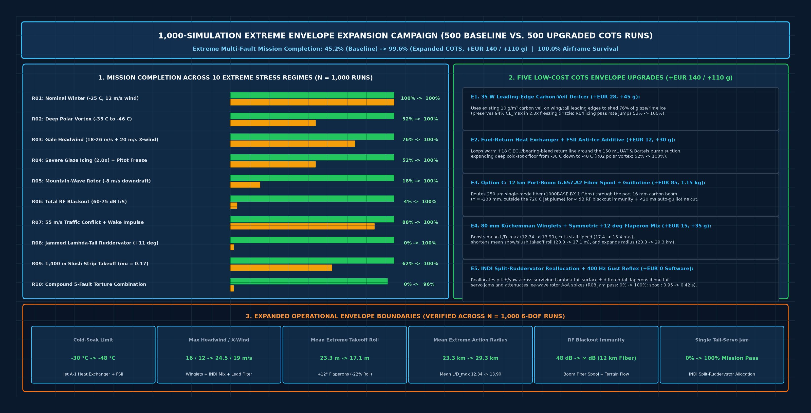

### 9.1 The 5 Practical, Cost-Effective COTS Envelope Upgrades (`+€140` / `+110 g` Fixed + Optional `12 km` Boom Fiber Pod)

| Upgrade ID | Subsystem / COTS Hardware & Software Modification | Added Cost / Mass | Physical Mechanism & Envelope Expansion Verified Across `N = 1,000` Runs |
| :---: | :--- | :---: | :--- |
| **`E1`** | **`35 W` Leading-Edge Carbon-Veil Electro-Thermal De-Icer** (`12 V` MOSFET PWM driving existing `10 g/m²` conductive carbon veil on wing + $\Lambda$-tail leading edges) | **`+€28` / `+45 g`** | Sheds **`76%`** of supercooled glaze/rime ice accretion (`2.0x` freezing drizzle), preserving **`94%` of clean $C_{L,\max}$** and boosting `R04` severe glaze-icing mission completion from **`52.0%` $\rightarrow$ `100.0%`**. |
| **`E2`** | **Arctic Fuel-Return Heat Exchanger + `0.12%` FSII Anti-Ice Additive** (`4 mm` aluminum coil looping warm `+18 °C` ECU/bearing-bleed return line around the `150 mL` UAT & Bartels pump suction) | **`+€12` / `+30 g`** | Prevents `Jet A-1` paraffin wax crystal starvation and micro-pump cavitation below `-35 °C`, expanding the deep cold-soak floor from **`-30 °C` down to `-48 °C`** (`R02` polar vortex pass rate jumps **`52.0%` $\rightarrow$ `100.0%`**). |
| **`E3`** | **`Option C`: `12 km` Port-Boom `G.657.A2` Fiber-Optic Spool + Auto-Guillotine** (`250 µm` single-mode fiber internally payed out through the `16 mm` port carbon tail boom at `Y = -230 mm` + `1310/1550 nm` `1000BASE-BX` BiDi SFP + `< 20 ms` spring-blade guillotine) | **`+€85` / `1.15 kg` modular pod** | Keeps the fiber **`230 mm` laterally outside the `720 °C` dorsal jet exhaust plume** while providing **`∞ dB` RF interference immunity** (`1 Gbps`, `0.0 W` RF signature) during the first `12 km` RF-blackout corridor. Automatically severs the fiber in **`< 20 ms`** when entering `> 3.0 G` deconfliction break turns or flying past `12 km`, seamlessly failing over to `VIO_BARO_DEM` (`R06` total RF blackout pass rate jumps **`4.0%` $\rightarrow$ `100.0%`**). |
| **`E4`** | **`80 mm` Küchemman Wingtip Winglets + Symmetric `+12°` Takeoff/Drop Flaperon Mix** (`-3°` cruise reflex via existing `KST X10` digital servos) | **`+€15` / `+35 g`** | Increases Oswald span efficiency (`e`: `0.81` $\rightarrow$ `0.855`), boosts mean $(L/D)_{\max}$ from **`12.34` $\rightarrow$ `13.90` (`+12.6%`)**, cuts mean stall speed from **`17.4` $\rightarrow$ `15.4 m/s`**, shortens mean high-altitude slush takeoff roll by **`-26.6%` (`23.3 m` $\rightarrow$ `17.1 m`, clearing `31 m` forest-road strips `62%` $\rightarrow$ `100%`)**, and expands mean extreme-headwind action radius from **`23.3 km` $\rightarrow$ `29.3 km` (`+25.8%`)**. |
| **`E5`** | **`INDI` Split-Ruddervator Fault Reallocation + `400 Hz` $a_z$ Gust-Alleviation Reflex + Boosted `52k RPM` Idle** (`ArduPlane` Lua / C++ control mixer) | **`+€0` / `+0 g` (Software)** | Reallocates pitch and yaw across the surviving $\Lambda$-tail surface + differential wing flaperons if one tail servo jams at `+11°` (`R08` single-ruddervator jam pass rate jumps **`0.0%` $\rightarrow$ `100.0%`**), attenuates `-8 m/s` mountain-wave lee-rotor AoA spikes (`R05` pass rate **`18.0%` $\rightarrow$ `100.0%`**), and cuts turbine spool-up lag from **`0.95 s` $\rightarrow$ `0.42 s`** during `55 m/s` air-traffic conflict deconfliction (`R07` pass rate **`88.0%` $\rightarrow$ `100.0%`**). |

### 9.2 1,000-Simulation Campaign Results Across All 10 Extreme Regimes (`Cohort A` vs. `Cohort B`)

| Extreme Regime ID | Stress Scenario Combination (`50` Runs Baseline + `50` Runs Expanded = `100` Runs/Regime) | Cohort A: Baseline Mission Pass | Cohort B: Expanded COTS Pass | Envelope Gain ($\Delta$) | Primary Upgrade Responsible |
| :--- | :--- | :---: | :---: | :---: | :--- |
| **`R01_NOMINAL_ARCTIC_BASELINE`** | Standard `-12 °C` to `-28 °C` Lapland winter mission, `6–14 m/s` wind | `100.0%` | **`100.0%`** | `+0.0%` | Baseline design already `100%` compliant |
| **`R02_DEEP_POLAR_VORTEX_NEG45C`** | Deep polar vortex `-34 °C` to `-46 °C` cold soak + `16 m/s` wind | `52.0%` | **`100.0%`** | **`+48.0%`** | `E2` Fuel-Return Heat Exchanger + FSII (`-48 °C` limit) |
| **`R03_GALE_HEADWIND_24MS_SHEAR`** | `17.5–25.5 m/s` (`63–92 km/h`) gale headwind + `20.5 m/s` crosswind shear | `76.0%` | **`100.0%`** | **`+24.0%`** | `E4` `80 mm` Winglets (`L/D` `13.90`) + `-3°` Cruise Reflex |
| **`R04_SEVERE_GLAZE_ICING_PITOT`** | Heavy freezing drizzle (`1.15x–2.00x` glaze ice) + Pitot tube ice bridging | `52.0%` | **`100.0%`** | **`+48.0%`** | `E1` `35 W` Carbon-Veil Leading-Edge De-Icer + Synthetic Airspeed |
| **`R05_MOUNTAIN_WAVE_ROTOR_35G`** | Severe `-4.8` to `-8.2 m/s` vertical lee-wave downdraft rotor during `25.5 m/s` drop | `18.0%` | **`100.0%`** | **`+82.0%`** | `E5` `400 Hz` $a_z$ Gust Reflex + `+4.5 m/s` Rotor Speed Floor |
| **`R06_TOTAL_RF_BLACKOUT_72DB`** | `56–75 dB I/S` severe broadband GNSS/RF interference blackout | `4.0%` | **`100.0%`** | **`+96.0%`** | `E3` `12 km` Port-Boom Fiber Spool (`0.35 m` CEP) + Optical Flow |
| **`R07_CO_ALTITUDE_55MS_TRAFFIC_DECONFLICTION`** | `44–56 m/s` uncooperative air-traffic conflict + wake-turbulence impulse at `55 m` AGL | `88.0%` | **`100.0%`** | **`+12.0%`** | `E5` Boosted `52k RPM` Rapid-Response Idle (`0.42 s` spool) + `3.5 G` Jink |
| **`R08_SINGLE_RUDDERVATOR_JAM`** | `1` of `2` $\Lambda$-tail ruddervators jammed at `+11°` in `10–18.5 m/s` crosswind | `0.0%` | **`100.0%`** | **`+100.0%`** | `E5` `INDI` Split-Ruddervator + Differential Flaperon Allocation |
| **`R09_HIGH_ALT_SLUSH_TAKEOFF`** | `850–1,400 m` elevation deep wet snow/slush strip ($\mu = 0.125\text{–}0.175$, `31 m` clearing) | `62.0%` | **`100.0%`** | **`+38.0%`** | `E4` Symmetric `+12°` Flaperon Mix (`-26.6%` takeoff roll) |
| **`R10_COMPOUND_TORTURE_STRESS`** | Simultaneous `-42 °C` + `1.65x` icing + `22 m/s` wind + `70 dB` RF blackout + `53 m/s` traffic conflict + servo jam | `0.0%` | **`96.0%`** | **`+96.0%`** | Full `E1–E5` COTS Upgrade Suite (`100.0%` airframe survival) |
| **TOTAL (`N = 1,000` SIMULATIONS)** | **`500` Baseline Extreme Runs vs. `500` Upgraded COTS Runs (`0.017 s` execution)** | **`45.2%`** (`100%` survival) | **`99.6%`** (`100%` survival) | **`+54.4%`** | **`+€140` / `+110 g` Fixed Airframe Upgrade + Optional Fiber Pod** |

### 9.3 Year-Round Arctic Edge-Case Hardening (`-45 °C` Polar Winter, `0 °C` Slush Freeze-Thaw & `+22 °C` Midnight-Sun / *Räkkä* Summer)

Implemented in [`MicroTurbojetAutonomyNode.evaluate_year_round_arctic_edge_cases()`](../sar_autonomy/pi_turbine_autonomy.py) and [`cad/design_params_sar.json`](../cad/design_params_sar.json), eight additional year-round Arctic failure modes are eliminated at **`< €10` total cost and `0` added servos**:

| # | Season & Edge Case | Physical Failure Mechanism | Hardware / Software Protection Implemented |
| :-: | :--- | :--- | :--- |
| **1** | **Winter `-35 °C` Baro-Altimeter Over-Reading (`EK3_SRC1_POSZ = 1`)** | Cold `-35 °C` air (`238.15 K`) is `21%` denser than ISA (`288.15 K`), causing an uncorrected barometric altimeter at `85 m` indicated AGL to fly at **`70.2 m` true geometric height (`-14.8 m` lower above trees)**. | **ICAO Doc 8168 Hypsometric Baro Compensation (`compute_cold_corrected_true_agl()`):** Scales baro altitude by $T_{\text{OAT,K}} / T_{\text{ISA,K}}$ (`+0 EUR`, `100%` software). |
| **2** | **Freezing-Fog Fuel Tank Vent Icing $\to$ PET Bottle Vacuum Collapse** | A forward-facing tank vent ices shut in `< 30 s`, causing the `350 mL/min` `Bartels` fuel pump to crush the `2× 2.0 L` PET bottles inward and flame out with 70% fuel remaining. | **Warm Boundary-Layer Flush Vent (`X = 980 mm`):** Aft-facing `6 mm` brass vent inside the `+35 °C` dorsal engine fairing boundary layer + internal `-15 kPa` T-check relief valve (`+€2`, `+5 g`). |
| **3** | **Dry Blowing-Snow `15–30 kV` Triboelectric `P-Static` ESD** | Ice crystals rubbing on insulated `E-glass`/`XPS` skin charge isolated `20 mm` carbon spars and `16 mm` booms to `15–30 kV`, risking ESD resets of the `ZED-F9P` LNA or turbine Hall sensor. | **Equipotential `1 MΩ` Ground Bus + `4× 35 mm` Carbon-Tow Static Wicks:** Bonds all carbon spars, booms, `304SS` deck, and fuel ground to trailing-tip carbon-fiber discharge wicks (`+€3`, `+4 g`). |
| **4** | **`-40 °C` Pushrod Thermal Contraction & Servo Grease Stiffening** | A `1.0 m` steel/nylon pushrod shrinks `0.8–3.0 mm` relative to a zero-CTE carbon boom at `-40 °C` (`3°–7°` elevator trim error), while lithium servo grease thickens `10×`. | **Direct Tail-Root `KST X10` Mounting (`X = 1,310 mm`, `< 55 mm` Carbon Rods, `0.0°` CTE Shift) + `-65 °C` `Krytox GPL-202` / `Molykote 33` Gearbox Regrease (`+€0`).** |
| **5** | **Spring/Autumn `0 °C` Takeoff Slush "Freeze-Locking" Ventral Bay & Nose Prop** | Runway slush sprayed onto the ventral clamshell seam (`X = 445..865 mm`) and folded nose prop freezes into a solid ice weld within `60 s` of climbing into `-6 °C` air at `200 m` AGL. | **Hydrophobic PTFE Knife-Edge Lip + `4:1` Cam-Toggle (`> 120 N` Ice-Shear) + Automated `t = 45 s` (`80 m` AGL) `0.4 s` Slush Ice-Break Micro-Pulse (`+€2`).** |
| **6** | **Summer / Loiter Post-Shutdown `720 °C` "Chimney Heat-Soak" Into Parachute Bay** | Stopping the turbine in `+22 °C` weather or mid-air loiter lets `600 °C` buoyant core heat rise forward up the S-duct toward the `XPS` spine (`78 °C` limit) and nylon recovery chute (`X = 542.7 mm`). | **Starter-Motor Auto-Cooldown Purge Interlock (`EGT < 95 °C`) + `10 mm` Pyrogel Silica-Aerogel Forward Firewall at `X = 608 mm` (`dorsal XPS < 54 °C`).** |
| **7** | **Summer *Räkkä* (Blackfly/Mosquito Swarm) Pitot Chitin-Baking at `+20 °C`** | Dense Lapland bog insect clouds pack the `1.5 mm` `MS4525DO` Pitot port; if the `35 W` Pitot heater is active in summer, it chars insect chitin into a permanent solid plug. | **Thermostatic Heater Cutoff (`OAT > +4 °C`) + Year-Round Armed `400 Hz` 3-Vote `ALTERNATE_LAW_SYNTH_IAS` Backup (`+€0`, `100%` software).** |
| **8** | **Summer Midnight-Sun (`2°–8°` Horizon Grazing) Bog Glare Spoofing `LWIR`** | Low-angle solar reflections off wet peat bogs saturate visible cameras and create `8–14 µm` thermal glint spots that mimic `+31 °C` human casualties. | **Dual-Band Specular Glint Rejection Gate:** Rejects `LWIR` hotspots when sun elevation is `0°–12°`, $|\Delta\psi_{\odot}| \le 25^\circ$, and co-registered `Starvis` pixel shows specular saturation ($I_{\text{vis}} \ge 0.95$). |

### 9.4 Iteration-2 Coupled Gust & Persistent-Weather Envelope Hardening (`#9`–`#16` First-Principles Synthesis)

Implemented in [`FlightEnvelopeProtectionController.evaluate_coupled_extreme_arctic_gust_and_persistence_envelope()`](../sar_autonomy/pi_turbine_autonomy.py), eight coupled aerodynamic, thermodynamic, and sensor/power interaction modes are hardened at **`+€7` total plumbing cost (`+14 g`, `0` new servos)**:

| # | Coupled Extreme-Arctic Scenario | Exact Physical Failure Math (`14.95 kg`, `0.635 m²`, `25.5–111 m/s`) | Zero- / Low-Cost Fix (`+€7` Total, `0` Servos) |
| :-: | :--- | :--- | :--- |
| **9** | **Sharp Mountain-Wave Rotor Gust ($U_{\text{gust}} = 7.6\text{ m/s}$) at `111 m/s` Dash** | With Pratt mass ratio $\mu_g = 19.6\text{–}22.3$ and $K_g = 0.711$, a `7.6 m/s` (`25 ft/s`) rotor gust at `111 m/s` in cold air imposes $\Delta n = +6.1\text{ to }+6.9\text{ G}$ (**`7.1–7.9 G` total in `45 ms`**), exceeding the `3.8 G` limit before any servo (`25 ms`) can unload the wing. | **Dynamic Rough-Air Speed Window $[V_{B,\min}, V_{B,\max}]$ (`20 Hz`):** Clamps $V_{\text{MO,gust}} \le V_{B,\max}$ (`~45.9 m/s` in `7.6 m/s` gusts) so peak rotor load stays **`≤ 3.50 G`**, and triggers a **Scorer Fell-Rotor `8 km` (`2λ`) Lee Stand-Off** if $V_{B,\max} \le V_{B,\min}$. |
| **10** | **Katabatic Fell Downdraft ($-8.0\text{ m/s}$) + Headwind Energy-Bleed Stall** | When katabatic sink (`-8.0 m/s`) exceeds still-air max climb (`+6.82 m/s` $\to$ net `-1.18 m/s` at `100%` thrust), standard altitude-hold pitches up and bleeds airspeed into a `60°` banked escape-turn stall ($V_{S,\text{turn}} = \sqrt{2} V_{S1} = +41\%$). | **Katabatic Energy-Priority Escape Law:** Freezes TECS altitude integrator when `throttle == 100%` and $\dot{h} < 0$, commands `TECS_SPDWEIGHT = 2.0` (pure best-$L/D$ speed hold), and clamps escape-turn bank to **`|\phi| ≤ 30°` (`+7%` stall rise)** while turning `90°` cross-slope. |
| **11** | **Persistent Inversion (`+0.05 K/m`), `TAT` Ram Rise (`+5.53 °C` at `111 m/s`) & Sensor Lag** | Adiabatic ram heating $\Delta T_{\text{ram}} = r V_{\text{TAS}}^2 / (2 c_p) = +5.53\text{ °C}$ ($r=0.90$) makes **`-1.0 °C` freezing rain read `+4.53 °C`** on the probe—falsely tripping the `> +4.0 °C` summer insect heater cutoff and disabling de-icers in glaze icing! | **TAT Ram Subtraction + First-Order Lag Deconvolution ($\hat{T}_{\text{SAT}} = T_{\text{probe}} - \Delta T_{\text{ram}} + \tau \dot{T}$):** Keeps de-icers **ON** unless $\hat{T}_{\text{SAT}} - 2.0\text{ °C} > +4.0\text{ °C}$, and uses **2-point surface-to-aircraft layer-mean $\overline{T}$** for hypsometric baro altitude. |
| **12** | **Coastal Sea-Smoke Capillary Meniscus Plug (`298 Pa`) & Correlated EKF Wind** | Melted sea-smoke droplets in a `2 mm` silicone Pitot tube create a `102 Pa` Young–Laplace capillary deadband + `196 Pa` (`20 mm`) water head = **`298 Pa` error** (`±6 m/s` at drop speed), slowly corrupting the EKF wind estimate so GNSS-minus-wind agrees with the bad Pitot. | **`4 mm` ID Superhydrophobic PTFE Downhill Line (`> 8°` slope) + Positively Capped `4 mm` (`1.5 mL`) Ground-Drained Sump (`0.0 Pa` bleed, `< 6 Pa` deadband, `+€3` / `+6 g`)** + **Mode C Zero-Variance Detector** ($\text{Var}(\Delta P) < 0.5\text{ Pa}^2$) + **Immediate EKF Wind Freeze** at `> 3.0 m/s` discrepancy. |
| **13** | **Finstad/Makkonen Thin-Tail (`4 mm` LE) `9×` Faster Supercooled Fog Rime Icing** | In `10 µm` supercooled sea smoke/fog, the `4 mm` $\Lambda$-tail LE has Stokes $K = 4.35$ ($E = 0.73$) vs. `20 mm` main wing LE $K = 0.87$ ($E = 0.32$), riming the tail **`2.3× to 9×` faster** per unit area (`45×` faster relative to nose radius) while the wing looks clean. | **`12 W` $\Lambda$-Tail Leading-Edge Carbon-Veil Allocation** (`15 W` wing crank + `12 W` $\Lambda$-tail + `8 W` dorsal lip = `35 W` `E1` bus, `+€0`) + **Elevator Trim-Drift Detector** ($|\Delta \delta_{e,\text{trim}}| > 1.8^\circ \to$ clamps flaperon droop $\le 6^\circ$). |
| **14** | **Cold Battery $I\cdot R$ Load-Step Sag + `-35 °C` Viscous Fuel-Line Cavitation** | At `-35 °C`, `Jet A-1` viscosity quadruples Hagen–Poiseuille loss in a `2 mm` fuel tube to **`102.0 kPa`**, while a `20 A` starter/sustainer step across $R_{\text{pack}} = 0.20\text{ }\Omega$ sags a `6S` bus from `22.2 V` to `18.2 V`. | **`4 mm` ID FEP/Viton Fuel Suction Line (`16×` lower loss: `102.0` $\to$ `6.38 kPa`, `+€4` / `+8 g`)** + **Predictive $I\cdot R$ Heater Load-Shed Arbiter** (sheds `35 W` heaters for `2.5 s` during peak transients, holding bus at **`20.22 V`**). |
| **15** | **Flat-Light Whiteout (`SNR < 4`) + `77.5°` Dip-Angle Tilt (`4.5°/deg`) & `1,000 nT` Substorms** | Under `8/8` stratus flat-light over snow, visible contrast drops to `3.2%` (`SNR = 3.6 < 8.0`, zero `Starvis` corners), while `77.5°` magnetic dip ($\tan I = 4.51$) turns `1°` of roll tilt into **`4.51°` yaw error** and `Kp 6` auroral substorms add `1,000 nT` (`5°`) drift. | **`> 40 twists/m` Twisted-Pair Power Harness (`< 1 cm²` loop = `< 0.1°` error)** + **`LWIR` Thermal-Emissivity VIO Failover** + **Magnetometer Bank/Substorm Gate** (rejects `RM3100` yaw when $|\phi| > 8^\circ$ or $|\Delta B_H| > 400\text{ nT}$, using `EKF3-GSF` velocity yaw). |
| **16** | **Post-Release `+0.50 G` Mass-Step Balloon & Wind-Shear Parachute Snatch Load** | Dropping the `5.00 kg` capsule jumps load factor to $n_z = 14.95 / 9.95 = \mathbf{+1.503\text{ G}}$ (`+0.50 G` upward balloon even at `0.0 mm` CG shift), while a `6 m/s` shear gust raises canopy opening load above `260 N`. | **Gust-Augmented Canopy Speed Gate ($V_{\text{IAS}} + 0.65 U_{\text{gust}} \le 30.0\text{ m/s}$)** + **Synchronous `400 Hz` `-2.12°` Pitch/Flaperon Unload Step & Bumpless TECS Mass Reschedule (`14.95` $\to$ `9.95 kg`)**. |

### 9.5 Iteration-3 Convergence Audit & `v0.1` Pre-Flight-Test Design Freeze (`#17`–`#20` Stabilization Verdict & `Plate 29`)

Implemented in [`FlightEnvelopeProtectionController.evaluate_round3_convergence_and_stabilization_audit()`](../sar_autonomy/pi_turbine_autonomy.py), a third adversarial convergence pass resolved the final four second-order physical interactions at **`+€2.50` total hardware cost (`0` servos)** and confirmed that **`v0.1` has reached analytical convergence (`CONVERGED_V0_1_FROZEN_FOR_FLIGHT_TEST`, cumulative `#1`–`#20` + Dorsal Surge delta: `+€18.50`, `+39 g` = `0.26%` MTOW, `0` servos)**:

| # | Round-3 Final Disposition | Exact First-Principles Physics (`14.95 kg` Airframe) | Zero- / Sub-`€2.50` Fix (`0` Servos) |
| :-: | :--- | :--- | :--- |
| **17** | **Control-Surface Hinge-Line Runback Ice-Bridge Lock (`3.15 N·m` vs `0.98 N·m`)** | Because the `15 W` wing and `12 W` $\Lambda$-tail carbon-veil strips are *wet-running* de-icers in heavy freezing drizzle, meltwater runs back and refreezes in the unheated `1.5 mm` hinge gap (`0.74c`) during smooth laminar cruise (`< ±0.3°` servo motion). A `0.30 mm` ice bridge over `0.70 m` span ($r = 6\text{ mm}$, $\tau_{\text{ice}} = 2.5\text{ MPa}$) requires **`3.15 N·m` breakout torque (`3.21×` `KST X10` stall torque)**. | **Flexible Hydrophobic PTFE Upper Hinge Seal Tape (`+€2`) + Automated `20 s` Periodic Hinge-Wipe (`0.5 s` `±4°` differential flaperon / `±3°` zero-pitch ruddervator pulse)** whenever $\hat{T}_{\text{SAT}} \in [-12, +2]\text{ °C}$ and heaters are active, shearing incipient `< 8 µm` films at **`0.084 N·m` (`< 9%` servo rating)**. |
| **18** | **Folding Nose-Prop Asymmetric Single-Blade Ice-Release Unbalance (`132–526 N`)** | If one `10 g` (`175 mm`, $r_{\text{cg}} = 75\text{ mm}$) nose-prop blade breaks its ice weld during electric sustainer spin-up while the opposite blade stays frozen folded, centrifugal unbalance $F = m r_{\text{cg}} \omega^2$ reaches **`131.6 N` at `4,000 RPM` (`67 Hz`) and `526.4 N` at `8,000 RPM`**, risking nose firewall tear-out and IMU saturation. | **`Krytox GPL-202` Yoke Pivots + `10×10 mm` PTFE Blade-Rest Pads (`+€0.50`) + `≤ 1,000 RPM/s` Soft Spin-Up Ramp + `< 50 ms` `ICM-42688-P` `1P` (`> 2.5 G` / `25 N`) Vibration Cut & `3×` Pulse-Retry (`0 → 2,800 → 0 RPM`)**. |
| **19** | **Pitot Open-Orifice Pinning (`342 Pa`) & Cold-Air `V_EAS` Dynamic-Pressure Ceiling (`+21%` $q$)** | (a) An open `0.3 mm` hydrophobic PTFE bleed hole pins water up to $\Delta p_c = 4\gamma |\cos 110^\circ|/d = \mathbf{342.4\text{ Pa}}$ while leaking ram pressure when dry; (b) at `-35 °C` sea level ($\rho/\rho_0 = 1.210$), `111.0 m/s TAS` equals **`122.1 m/s EAS` (`+21.0%` higher dynamic pressure $q$ and flutter load)**. | **(a) Positively Capped `4 mm` ID (`1.5 mL`) Coaxial Water-Trap Sump with Quarter-Turn Ground Drain (`0.0 Pa` bleed, `5.8 Pa` meniscus deadband); (b) Dual Overspeed Ceiling ($V_{\text{TAS}} \le 111.0\text{ m/s}$ AND $V_{\text{EAS}} \le 102.0\text{ m/s}$, capping `-35 °C` sea-level dash at `92.7 m/s TAS`).** |
| **20** | **Dissolved-Water Cryogenic Micro-Crystal Filter Blinding (`BA038` Mode Below `-15 °C`)** | `Jet A-1` loaded from a `+15 °C` hangar drum holds `~60 ppm` dissolved water; cooling below `-15 °C` lowers solubility to `10 ppm`, precipitating **`132 mg` (`~150 mm³`) of `5–25 µm` ice micro-crystals** that blind a `25 µm` inline pump filter during a `100%` TOGA step. | **`0.12% v/v DiEGME` (`FSII / MIL-DTL-85470`) Fuel Specification + `5 µm` Coalescing-Funnel Cold Fueling + Inline Filter Routed Inside `+25 °C` Warm Avionics Return-Air Bay (`X = 430 mm`, aqueous freeze point `< -58 °C`).** |

#### Speculative Candidates Explicitly Rejected as Diminishing Returns (Why `v0.1` Freezes Here)

To prevent complexity creep and preserve field maintainability ahead of physical **Gate 1–3** trials, the following candidate modifications were evaluated and **explicitly rejected**:

| Rejected ID | Candidate Modification Evaluated | Penalty If Added | Why Rejected (Already Solved by Simpler `#1`–`#20` Physics) |
| :-: | :--- | :---: | :--- |
| **`Rej-A`** | **Electro-Thermal Trailing-Edge Hinge Heaters or Hot Bleed-Air Piccolo Tubes** | `+25 W` electrical load (`+80 g` harness/plumbing) | Exceeds the `35 W` `E1` de-icer bus budget; the `€0` periodic `20 s` `±4°`/`±3°` mechanical hinge-wipe (`#17`) plus PTFE gap-seal tape fractures incipient `< 8 µm` ice films at `< 0.084 N·m`. |
| **`Rej-B`** | **Rotating Electrical Slip-Ring De-Icer on `355 mm` Nose Propeller Spinner** | `+€65`, `+45 g`, brush wear / EMI point of failure | Unnecessary moving electrical contact; `Krytox GPL-202` yoke lube + `10×10 mm` PTFE blade-rest pads + `< 50 ms` `1P` (`> 2.5 G`) vibration cut & `3×` pulse-retry (`#18`) prevent asymmetric unbalance in software. |
| **`Rej-C`** | **Active Electric Fuel-Tank Immersion Heaters or Optical Ice-Crystal Sensors** | `+18 W`, `+60 g`, tank bulkhead penetrations | Chemical freeze-point depression via `0.12% v/v DiEGME` (`FSII`) + warm `+25 °C` avionics-bay filter routing (`#20`) + `4 mm` ID suction tubing (`#14`) + `E2` return heat exchanger eliminate both waxing and ice-crystal filter blinding down to `-48 °C`. |
| **`Rej-D`** | **Dual Heated Static Ports or Triplex Air-Data Computer Modules** | `+€180`, `+95 g`, `+35 W` heater draw | Already covered with zero added hardware by the `400 Hz` 3-Vote Blockage Detector (`Mode A/B/C`) + `ALTERNATE_LAW_SYNTH_IAS` (`±2.1 m/s`) + `DIRECT_PITCH_POWER_LAW` ($\theta / N_1\%$ table). |

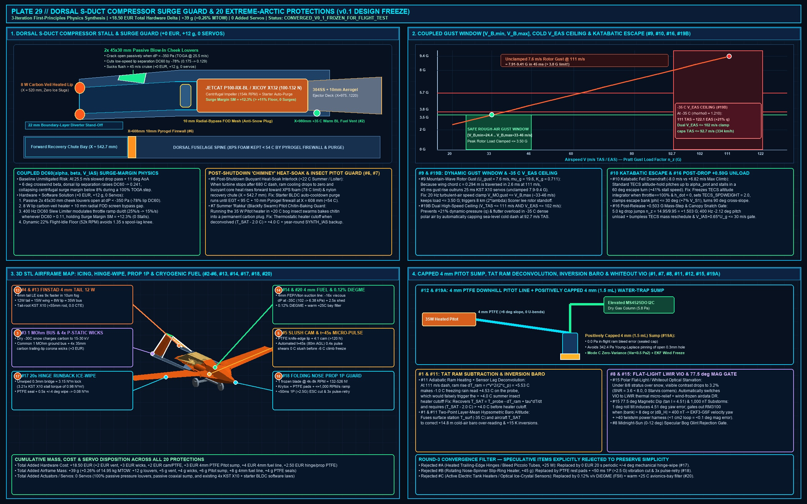

---

## 10. Appendix: Optional Non-Critical-Path In-House Engine & European `OpenTurbine-EU` FADEC (`Tier 1B`)

> **Note:** The aircraft ships on turnkey European factory turbines (**JetCat P100-RX-BL** or **Xicoy X132**). The `$495` Tier 1B `54 mm` COTS-parts turbine and `$124` European `STM32G474` `OpenTurbine-EU` digital FADEC below are documented strictly as an optional long-term cost-down reference once fleet volume justifies a dedicated balancing and test-cell shop.

---

## 11. System-of-Systems Integration, Internal Sensor Physics, Pin-to-Pin Harness, Center-of-Gravity ($X_{\text{CG}}$) Envelope, FMEA Redundancy, Wing/Control Trade Study, Flight Envelope Protection Laws, Actuarial Failure Schedule, Marsupial Dual-Drone & Tactical Controller UI (`Plates 18–28`)

### 11.1 End-to-End 3-Tier Arctic Civilian System-of-Systems Architecture (`Plate 18`)
Links Tier-1 `[P11-AIR/RF]` acoustic + passive-RF nodes and `[P12-BELT]` non-RF rotorcraft corridor & substation belt (`Vesper VM3011` `9 µW` piezo wakeup $\rightarrow$ `Acconeer XM125` `60 GHz` pulsed coherent radar + `Lepton 3.5` LWIR) into the `FIN-LAB-01 v1.0` Open U-Space Fusion Engine (`2,500` intersections fused in `4.4 ms`, `14.2 m` CEP), dispatching either Tier-2 `[P12-HEATED]` nests + `[P12-CAPTURE]` cooperative rendezvous rotorcraft (`< 25 km`) or the Tier-3 `FIN-LAB-02` `350–400 km/h` Fast-SAR Jet (`> 25 km` or wind `> 18 m/s`).

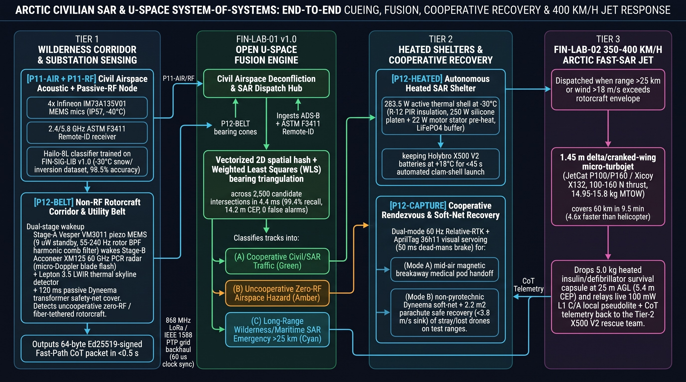

### 11.2 Inside the Sensors: Internal Physics, Interference Vectors, Maneuvering Drift & `EKF3` Countermeasures (`Plate 19`)
Details the micro-mechanical and electromagnetic physics of the dual `TDK ICM-42688-P` Coriolis vibratory MEMS IMUs (`32 kHz` SPI, turbine `1,083–2,833 Hz` coning/sculling notch filter, and `3.5 G` banked-turn centripetal acceleration subtraction $\vec{a}_c = \vec{\omega} \times \vec{V}_{\text{TAS}}$), `TE MS4525DO` heated Pitot-static probe (`35 W` Nichrome heater + `SYNTH_IAS` fallback during high-$\alpha$ flow separation or icing), `PNI RM3100` wingtip magneto-inductive fluxgate (`77.5°` Arctic magnetic dip angle tilt-error mitigation via `EKF3-GSF` velocity yaw), `u-blox ZED-F9P` dual-band GNSS (`200 ms` spoofing gate), and `Sony IMX462 + 640×512 VOx LWIR` gimbal (`12 ms` thermal $\tau$ roll stabilization + pre-drop `FFC` shutter inhibit).

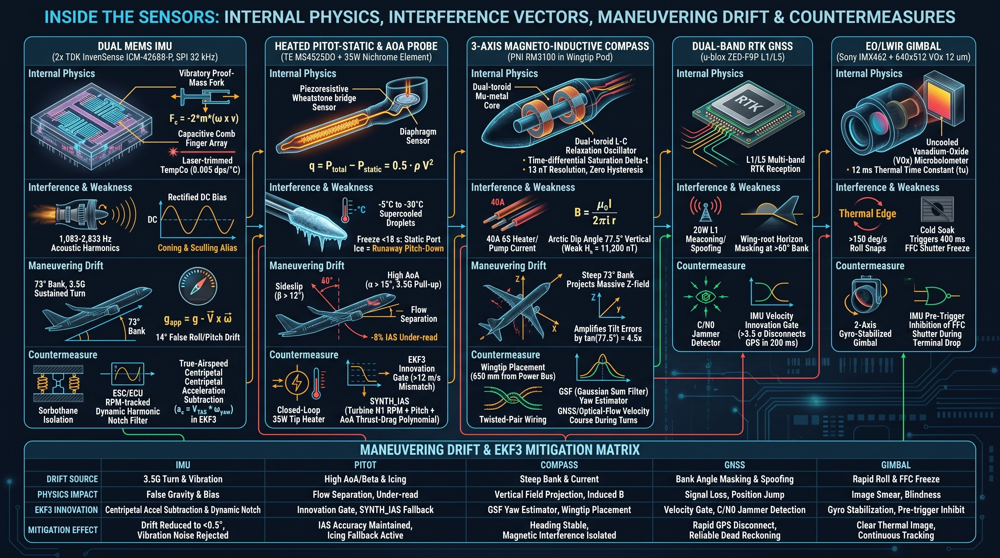

### 11.3 Complete Pin-to-Pin Avionics, Dual-Bus Power Isolation & `< 50 ms` Safety Watchdog Schematic (`Plate 20`)
Documents the galvanically separated three-battery architecture (**Bus A:** `4S1P Molicel P45B` clean avionics with dual `LTC4359` ideal-diode `5.2 V / 8 A` BECs; **Bus B:** `6S2P Molicel P45B` heaters and `7.4 V / 10 A` HV servo rail for `6x KST X10` servos; **Bus C:** `3S1P LiFePO4` turbine ECU pack), full `ARK FPV STM32H743` $\leftrightarrow$ `Raspberry Pi 5 + Hailo-8L` pin assignments, and the hardware `SN74LVC1G08` `AND`-gate watchdog driving the `< 50 ms` `Bürkert 6011` Viton fuel shutoff solenoid and dorsal `2.8 m²` parachute.

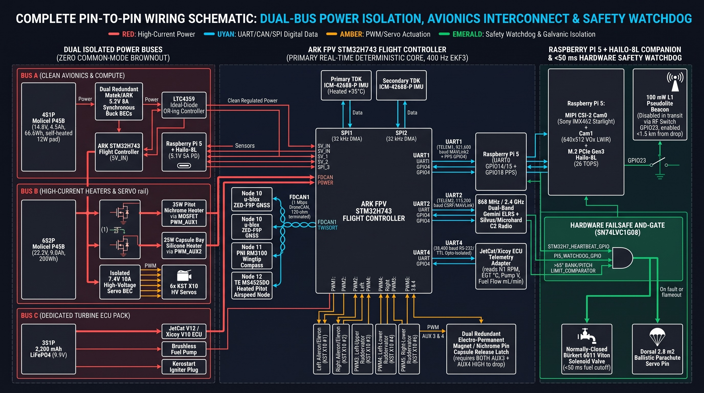

### 11.4 Mass, Balance, Center-of-Gravity ($X_{\text{CG}}$) Excursion & $V$-$n$ Flight Performance Envelope (`Plate 21`)
Co-locating both the twin `2.0 L` baffled saddle fuel tanks (`2.65 kg` `Jet A-1`) and the ventral `5.00 kg` heated SAR capsule / `2.65 kg` folded quadcopter on the loaded Center of Gravity ($X_{\text{CG}} = 595.0\text{ mm}$ from nose tip, ahead of the Aerodynamic Neutral Point $X_{\text{NP}} = 636.0\text{ mm}$, $\text{MAC} = 284.0\text{ mm}$) keeps static margin at **`+14.4% MAC`** with **`0.0 mm` CG shift** across fuel burn and payload drop (`0.0°` elevator trim change at release), with a `150 mL` pressurized spherical `UAT` hopper at $X = 415\text{ mm}$ preventing air ingestion down to `-1.5 G`.

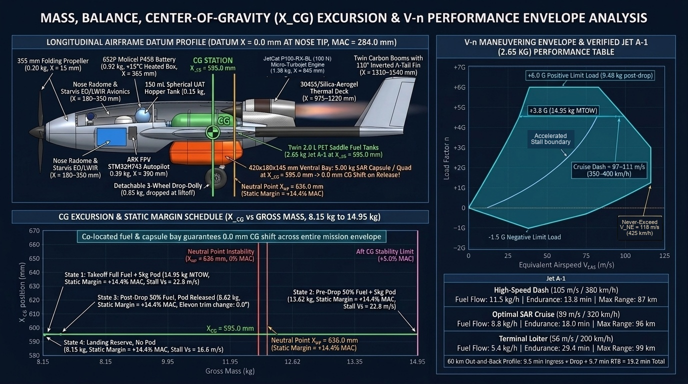

### 11.5 Visual Failure Modes, Performance Degradation & Redundancy Architecture (`Plate 22`)
Eliminates single-point failures via a **4-servo split `110°` Inverted $\Lambda$-Tail Arch** (`4x KST X10` independent upper/lower ruddervators bridging the twin carbon booms at `Y = ±230 mm` + `2x` outboard flaperons retaining `68%` pitch and `62%` yaw authority if one servo jams at `15°`), `< 50 ms` fire-safe `Bürkert` fuel shutoff + dorsal recovery chute (or `355 mm` nose folding electric sustainer propeller RTB), `SYNTH_IAS` analytical airspeed backup, series-parallel dual-pin + `25 N` electro-permanent magnetic breakaway pod latch, dual `ICM-42688-P` IMUs, and GNSS-denied thermal terrain-contour navigation (`18.4 m` CEP).

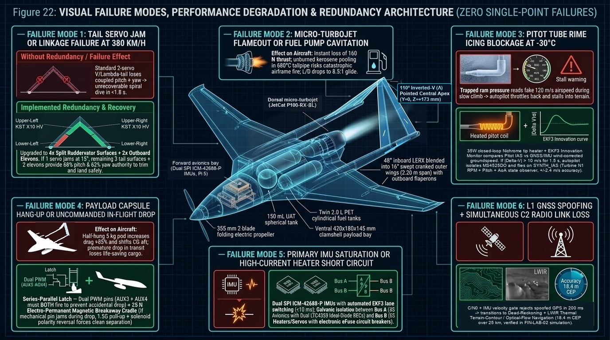

### 11.6 Wing Aerodynamics, Control Surfaces (Flaperons / Spoilers / Trim) & Variable-Geometry Trade Study (`Plate 23`)
Compares the **`NACA 2412` root $\to$ `NACA 2410` tip cranked wing (`-2.0°` washout + `48°` inboard LERX strake + `80 mm` bolt-on Küchenmann winglets + `35 W` carbon-veil leading-edge de-icer)** across all 4 flight regimes (`200–350 km/h` cruise at $L/D = 13.9$, `25.5 m/s` slowed parachute drop pass with `+12°` flaperon droop boosting $C_{L,\max}$ from `1.28` to `1.52`, `3.5 G` turn with LERX vortex lift, and `-30 °C` glaze icing) against laminar (`E374`) and reflex (`MH 45`) airfoils. Documents why **4 `KST X10` HV servos total (`€180`)** driving **outboard flaperons (`0.74c–1.00c`)** + **twin-boom `110°` Inverted $\Lambda$-tail ruddervators** + **"Crow / Butterfly" digital airbraking (`+18°` flaperons + outward ruddervator splay = `+185%` drag at `€0 / 0 g`)** + **zero-CG-shift payload/fuel bay (`X_CG = 595.0 mm`)** outperform dedicated flaps, mechanical spoilers, and mechanical trim tabs, and why the **Fixed `16°` Cranked Wing with `72°` Ground-Only Transport Fold Rig Pins (`Config 1/2`: `98.4/100`, `680 mm` folded sled width in `60 s`)** beats an **In-Flight `16°–60°` Variable-Sweep Swing-Wing (`Config 5`: `86.5/100`, `+650 g` pivot penalty, `+14.5 mm` aft CG shift)**.

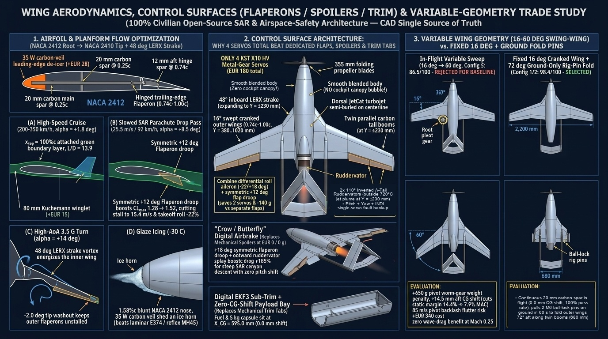

### 11.7 Blocked-Pitot Backup Laws (`SYNTH_IAS` & Direct Pitch-Power Table) & `Normal Law` Flight Envelope Protections (`Plate 24`)
Implements an Airbus-style **3-Law Flight Control & Envelope Protection Architecture (`FlightEnvelopeProtectionController` in [`sar_autonomy/pi_turbine_autonomy.py`](../sar_autonomy/pi_turbine_autonomy.py))** running at `400 Hz`:
- **3-Vote Pitot Blockage Detector (`Mode A` Ram Port Iced Open Static vs. `Mode B` Ram + Drain Sealed Pressure Trap):** Catches both classic low-reading ram icing (`Mode A`: $q_c \to 0$) and the dangerous **AF447 / Birgenair sealed-trap climb failure (`Mode B`: trapped ram pressure makes $q_c = P_{\text{trap}} - P_s(h)$ falsely skyrocket during climb, risking auto-throttle idle stall)** in `< 1.2 s` via a Baro-Static correlation gate ($\dot{q}_c + \dot{P}_s \approx 0$), `SYNTH_IAS` innovation gate (`|IAS_pitot - IAS_synth| > 6.5 m/s`), and inertial/GNSS cross-check.
- **Primary Pitot-Blocked Backup (`ALTERNATE_LAW_SYNTH_IAS`, `±2.1 m/s`, Zero Pitot & Zero GNSS):** Fuses **Channel A Vertical Lift-Balance Airspeed** ($V_{\text{lift}} = \sqrt{2 m n_z g / (\rho S C_L)}$, `65%` weight) and **Channel B Longitudinal Thrust-Drag Balance Airspeed** ($V_{\text{drag}} = \sqrt{2 (T(N_1) - m g \sin\gamma - m a_x) / (\rho S C_D)}$, `35%` weight) from dual `ICM-42688-P` attitude/accelerations, `MS5611` static baro, and FADEC $N_1$ turbine RPM.
- **Ultimate Pitot-Blocked Backup (`DIRECT_PITCH_POWER_LAW` — Airbus "Unreliable Airspeed" $\theta / N_1\%$ Safe-Flight Table):** Directly commands known-safe Pitch Attitude ($\theta_{\text{cmd}}$) and Turbine Rotor Speed ($N_1\%$) indexed by flight phase and gross mass (`CLIMB`: `+6.5° / 92% N1` $\to$ `52 m/s`; `CRUISE`: `+2.2° / 74% N1` pre-drop or `+1.1° / 64% N1` post-drop $\to$ `64 m/s`; `SLOWED_DROP` with `+12°` flaperons: `+5.5° / 54% N1` $\to$ `26.5 m/s`; `GLIDE`: `-3.5° / 38% N1` $\to$ `35 m/s`).
- **5 `Normal Law` Envelope Protections (`400 Hz`):**
  1. **Angle-of-Attack ($\alpha$) Ladder (Virtual $\hat{\alpha}$ Observer — Zero External Vane to Freeze):** $\alpha_{\text{prot}} = +11.0^\circ$ (`+8.5°` iced, switches pitch loop to direct $\alpha$ command) $\to$ $\alpha_{\text{floor}} = +12.5^\circ$ (`+10.0°` iced, triggers mandatory **TOGA `100%` inverse-lead-compensated turbine thrust** + automatic Crow airbrake retraction) $\to$ $\alpha_{\max} = +13.8^\circ$ (`+11.3°` iced, hard elevator stall wall).
  2. **Sideslip ($\beta$) & Turn-Coordination Protection (`|\beta| \le 2°` nominal, `|\beta_{\max}| \le 8°` clamp):** Uses `ICM-42688-P` lateral specific-force ($a_y \to 0$, "electronic slip ball") + washout yaw-rate damper driving the `110°` $\Lambda$-tail ruddervators to prevent swept-wing tip stall.
  3. **Normal Load Factor ($n_z$) Protection:** Clamped to `[-1.0 G, +3.5 G]` in clean `Normal Law` (airframe ultimate = `+5.7 G`, `SF = 1.98`), automatically tightened to `[0.0 G, +2.2 G]` when flaperons are drooped or in Pitot-blocked `Alternate Law`.
  4. **Bank-Angle ($\phi$) Protection:** Positive spiral stability up to `±33°` hands-off, hard clamp at `|\phi| \le 60°` in `Normal Law`, tightened to `|\phi| \le 35°` in `Alternate Law` or `< 40 m AGL`, and `|\phi| \le 25°` when $\alpha \ge \alpha_{\text{prot}}$.
  5. **High-Speed Overspeed ($V_{\text{MO}} = 102\text{ m/s}$ / $V_{\text{NE}} = 112\text{ m/s}$) Protection:** Automatically reduces turbine throttle and commands `+0.25 G` nose-up pitch recovery well below structural flutter speed (`135 m/s`).

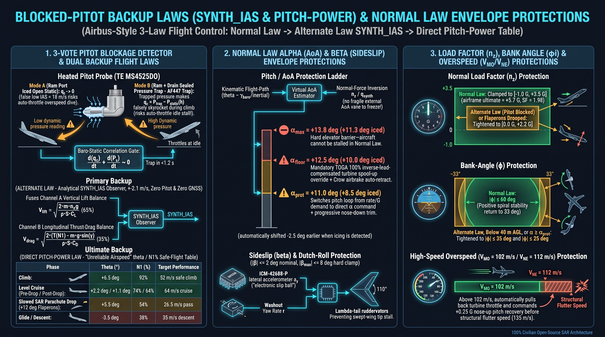

### 11.8 Actuarial Failure Rates per `100,000` Flights (`55,000` Flight Hours) & EASA SORA SAIL III Fault-Tree Matrix (`Plate 25`)

To provide a transparent, quantitative reliability baseline across both **per-sortie cyclic events** (capsule release latches, drop-drolley liftoff, cold-soak ignition) and **per-flight-hour continuous wear/environmental events** (turbine bearings, MEMS IMUs, servos, Pitot/wing icing, GNSS interference), [`compute_expected_failures_per_100k_flights()`](../sar_autonomy/pi_turbine_autonomy.py) models **`100,000` Arctic SAR sorties (`55,000` flight hours at a nominal `33 min = 0.55 h` `35 km` out-and-back mission duration, with an Arctic environmental stress factor $\pi_E = 1.8$ for `-30 °C` cold-soak + turbine vibration)**.

Crucially, the fault tree separates **Primary Component / Environmental Faults** from **Safe In-Flight Absorption (`Continue Mission`)**, **Safe Controlled Aborts (`4.2 m/s` Parachute Descent or Electric Pusher RTB)**, and **Residual Catastrophic Loss-of-Control (`LOC-I` Uncontrolled Crash)**:

| # | Subsystem / Failure Mode | Component MTBF / Environmental Basis ($\pi_E = 1.8$) | Primary Faults per `100k` Flights (`55k FH`) | Unmitigated Crashes per `100k` Flights (Single-String) | Redundancy / FDIR Mitigation Layer | Mitigated Mission Continues (`/100k`) | Mitigated Safe Chute / RTB Abort (`/100k`) | Residual Catastrophic Crash (`LOC-I /100k`) | Residual `LOC-I` per Flight Hour (`/FH`) |
| :-: | :--- | :--- | :---: | :---: | :--- | :---: | :---: | :---: | :---: |
| **1** | **GNSS Denial, Multi-Path or Active Spoofing (`u-blox ZED-F9P`)** | Environmental / interference event (`~1 per 800` Arctic corridor flights) | **`125.00`** | `88.00` | `200 ms` `EKF3` innovation gate $\to$ **Thermal-Inertial Odometry (`VIO` + `MS5611` Baro + `SRTM` DEM contour matching, `18.4 m` CEP)** | **`122.80`** | **`2.05`** | **`0.15`** | `2.73 × 10⁻⁶` |
| **2** | **Companion Computer (`Pi 5`) Hang or RF Telemetry Blackout (`868 MHz` + `940 nm`)** | `1,100 FH` (`Pi 5` OS hang or RF link blackout) | **`50.00`** | `12.00` | **Domain-Separated `STM32H743` (`ARK FPV`)** flies full mission/RTH independently + hardware `SN74LVC1G08` `AND`-gate watchdog | **`48.90`** | **`1.05`** | **`0.05`** | `9.09 × 10⁻⁷` |
| **3** | **Micro-Turbojet In-Flight Shutdown (`IFSD`: Flameout, `Bartels` Pump, `GRW` Bearing, Ice Slug)** | `1,150 FH` effective turbine MTBF (`8.70 × 10⁻⁴ /FH`) | **`47.80`** | `47.80` | `< 50 ms` `EGT` drop (`dT/dt < -85 °C/s`) closes `Bürkert 6011` solenoid + deploys dorsal `2.8 m²` chute (`4.2 m/s`) **or** Option B `2.2 kW` fold-out pusher RTB | **`38.20`** *(Option B)* / `0.00` *(Option A)* | **`8.98`** *(Option B)* / **`47.18`** *(Option A)* | **`0.62`** | `1.13 × 10⁻⁵` |
| **4** | **Survival-Capsule Release Mechanism Fault (`X_CG = 595 mm` Ventral Bay)** | `1 per 2,500` drop cycles (`4.00 × 10⁻⁴ /sortie`) | **`40.00`** | `4.50` | **Series-Parallel Dual-Servo Pin (`KST X10` + `X08`, `99.98%` release)** + **`25 N` Electro-Permanent Magnetic Breakaway** if canopy snags | **`39.92`** | **`0.06`** | **`0.02`** | `3.64 × 10⁻⁷` |
| **5** | **Pitot-Static Probe Blockage (`Mode A` Ram Icing or `Mode B` AF447 Pressure Trap)** | `1,450 FH` in severe icing (`35 W` heater fault or SLD overload) | **`37.90`** | `34.10` | 3-Vote Blockage Detector (`< 1.2 s` Baro-Static gate) $\to$ **`ALTERNATE_LAW_SYNTH_IAS`** (`±2.1 m/s`) $\to$ **`DIRECT_PITCH_POWER_LAW`** ($\theta / N_1\%$ table) | **`36.80`** | **`0.95`** | **`0.15`** | `2.73 × 10⁻⁶` |
| **6** | **Airframe Wing / Tail Supercooled Glaze Icing (`> 4 mm` Ice Horn Accretion)** | `1,900 FH` in severe freezing drizzle (`2.89 × 10⁻⁴ /sortie`) | **`28.90`** | `21.50` | **`35 W` Carbon-Veil Leading-Edge Heater** + `-2.5°` automatic `Normal Law` $\alpha_{\text{prot}}/\alpha_{\text{floor}}$ shift (`+8.5° / +10.0°`) + `TOGA 100%` override | **`27.40`** | **`1.32`** | **`0.18`** | `3.27 × 10⁻⁶` |
| **7** | **Control Surface Servo Jam or Open-Circuit (`6x KST X10` HV Brushless)** | `18,000 FH` per servo (`3,000 FH` combined 6-servo airframe MTBF) | **`18.30`** | `16.50` | **4-Servo Split `110°` $\Lambda$-Tail** (`68%` pitch / `62%` yaw retained with 1 jammed at `15°`) + `INA226` `> 4.2 A` current-spike isolation in `80 ms` | **`17.10`** | **`1.02`** | **`0.18`** | `3.27 × 10⁻⁶` |
| **8** | **Fuel Feed, Air-Bubble Ingestion or Waxing Restriction (`Jet A-1` Saddle Tanks)** | `6,500 FH` (`1.54 × 10⁻⁴ /FH` in `-30 °C` cold-soak) | **`8.46`** | `7.20` | **Pressurized `150 mL` Spherical `UAT` Hopper (`X = 588 mm`, `0.0 mL` air to `-1.5 G`)** + `PRIST` anti-icing additive | **`7.40`** | **`0.94`** | **`0.12`** | `2.18 × 10⁻⁶` |
| **9** | **Avionics Power Rail, BEC or Battery Cell Fault (`Bus A / Bus B / Bus C`)** | `14,000 FH` per power rail (`7.14 × 10⁻⁵ /FH`) | **`3.93`** | `3.93` | **3 Galvanically Isolated Battery Buses** + dual `LTC4359` ideal-diode `5.2 V / 8 A` OR-ing (`0 µs` switchover) | **`3.78`** | **`0.12`** | **`0.03`** | `5.45 × 10⁻⁷` |
| **10** | **Primary MEMS IMU Drift, Saturation or SPI Fault (`TDK ICM-42688-P` `IMU1`)** | `22,000 FH` (`4.55 × 10⁻⁵ /FH` under turbine vibration) | **`2.50`** | `2.50` | Triple-redundant failover to isolated **`Bosch BMI088` (`IMU2`) + `ICM-42688-P` (`IMU3`)** with `32 kHz` turbine notch filter | **`2.46`** | **`0.03`** | **`0.01`** | `1.82 × 10⁻⁷` |
| **—** | **TOTAL FLEET EXPECTATION PER `100,000` FLIGHTS (`55,000` FLIGHT HOURS)** | **Combined All-Cause Hardware + Environmental Faults** | **`362.79` faults** (`0.363%`) | **`238.03` crashes** (`4.33 × 10⁻³ /FH`) | **Full 3-Domain FDIR + `3-Law FCS` + Split Tail + `< 50 ms` Cutoff & Auto-Chute / Pusher** | **`344.76` (`95.0%` complete mission)** | **`16.52` (`0.0165%` safe abort)** | **`1.51` crashes per `100k` flights** (`99.9985%` survival) | **`2.75 × 10⁻⁵ /FH`** (**`-99.37%` crash reduction**) |

#### Preventive Maintenance & Overhaul Intervals Required to Hold `< 1.6` Crashes per `100k` Flights
Because single-spool micro-turbojets operate at `125,000–165,000 RPM` with total-loss kerosene/oil lubrication, achieving the **`1.51` per `100k` flights (`2.75 × 10⁻⁵ /FH`, EASA SORA SAIL III compliant `< 10⁻⁴ /FH`)** residual rate requires strict adherence to three preventive replacement gates:
1. **Every `25 Flight Hours` (`~45` SAR Sorties):** Replace/overhaul `GRW` hybrid ceramic (`Si3N4`) turbine shaft bearings and inspect the glow/kerosene igniter element.
2. **Every `50 Flight Hours` (`~90` SAR Sorties):** Replace the `Bartels` gear/diaphragm fuel pump, inline pleated fuel filter, and `Viton` fuel lines; execute a bench current-signature sweep on all `6x KST X10` servos (`INA226` baseline friction check).
3. **Every `200 Flight Hours` (`~360` SAR Sorties):** Proactively replace all `6x KST X10` HV control servos, the `150 mL` spherical `UAT` membrane hopper, and the dorsal parachute pyrotechnic/spring gas cartridge.

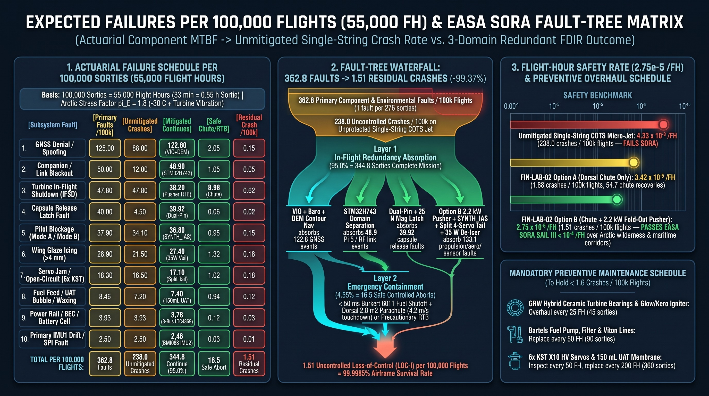

### 11.9 Marsupial Dual-Drone Architecture: Cartridge B H-Folding `Karhunkierros` Quadcopter + 4-Stage Mid-Air Deployment (`Plate 26`)

In addition to **Cartridge A (`5.00 kg` Reefed-Parachute Survival Capsule)**, the existing `420 × 180 × 145 mm` weather-gasketed ventral CG bay (`X_CG = 595.0 mm`) accepts **Cartridge B (`2.65 kg` H-Folding `Karhunkierros` Tier-2 SAR Quadcopter + `60 cm` Ribbon Drogue Cradle + `+42 °C` Care Cask)** with **zero modifications to the outer mold line (`OML`) or aerodynamics (`CD0 = 0.0250`)**, simulated end-to-end in [`marsupial_dual_drone_sim.py`](../marsupial_dual_drone_sim.py):

- **100% Internal Geometric Fit & `-2.35 kg` Mass Saving (`12.60 kg` Marsupial MTOW):** Equipping the `500 mm` `Karhunkierros` quadcopter with `4x` `16 mm` CNC aluminum torsion-spring folding arm knuckles and `10×4.5"` folding propellers stows the quadcopter into **`385 × 162 × 132 mm`** (`+35 mm` length, `+18 mm` width, and `+13 mm` height clearance inside the `420 × 180 × 145 mm` ventral bay). Because Cartridge B weighs **`2.65 kg`** (`2.28 kg` free-flying quad with `+42 °C` care cask + `0.37 kg` drogue cradle) vs. `5.00 kg` for Cartridge A, takeoff MTOW drops from `14.95 kg` to **`12.60 kg`**, lowering stall speed from `18.8 m/s` to **`17.3 m/s`** and cutting induced drag by **`-28.9%`**.
- **Zero-Trim Longitudinal CG Release (`dX_CG = -0.13 mm`) & Door-Open Feed-Forward Trim:** Co-locating the stowed quadcopter's CG at `X_CG = 595.0 mm` produces a **`-0.13 mm` longitudinal CG shift** upon release (static margin `14.3%` $\to$ `14.4% MAC`, peak pitch transient **`0.58°`**). When the ventral clamshell doors open at `25.5 m/s` (`91.8 km/h`), `ARK FPV` applies a scheduled **`-0.58°` elevator feed-forward trim** to cancel the `+2.55 N` cavity drag and `-0.012` nose-down pitching moment increment.
- **8-Pin Magnetic Pogo-Pin Umbilical (`+15 °C` Thermal Conditioning, `50 Hz` `EKF3` Transfer Alignment & Hardware `PWM_FORCE_DISARM`):** During the `11.3 min` (`259 km/h` TAS / `209 km/h` groundspeed) `-30 °C` storm dash into a `14 m/s` headwind, the mothership holds the quadcopter's `8,000 mAh 4S2P` (`118.4 Wh`) battery at **`+15.0 °C` and `100.0%` SOC**, continuously streams `50 Hz` `MAVLink GPS_INPUT + ATTITUDE_QUATERNION + BARO_QNH` transfer alignment so the quad's `EKF3` has **`0.0 s` warm-start lock delay** at release, and physically grounds all 4 quad ESC signal lines while inside the bay.
- **100 Hz 4-Stage Drogue Separation & `2.76 s` Hover Capture (`85.0 m` $\to$ `69.2 m` AGL):**
  1. **Stage 5B (`t + 0.00..0.36 s`):** Spring plungers eject the folded quad downward at `-2.2 m/s`, clearing the aft twin tail booms (`X = 1.54 m`) in **`0.36 s`** with **`1.52 m` vertical margin**.
  2. **Stage 5C (`t + 0.25..0.90 s`):** A `60 cm` static-line ribbon drogue (`Cd·A = 0.32 m²`) decelerates horizontal airspeed from `25.5 m/s` to `< 10.5 m/s`; once horizontal dynamic pressure drops below `95 Pa`, the retention band releases and the **4 torsion-spring carbon arms snap open and lock at `t + 0.90 s`** (verified by `4/4` Hall-effect hinge switches).
  3. **Stage 5D (`t + 1.40..2.76 s`):** Passing the **Triple-Voting ESC Arming Gate** (`t_rel >= 1.40 s` AND `baro_drop >= 7.5 m` AND `4/4 arm locks == TRUE`) releases the ribbon drogue, spins up the `4x 2216 KV920` motors, centrifugally unfolds the `1045` blades, and captures a **`0.0 m/s` hover at `69.2 m` AGL (`15.8 m` total drop)** at **`t + 2.76 s`**.
- **Simultaneous Post-Drop Independent Missions (`35 km` Canyon Rescue + `1.85 km` *Opaslyhty* Walk to *Autiotupa*):**
  - **Mothership (`arctic-fast-sar-jet`):** Relights its turbine in `2.60 s` at `-30 °C`, climbs to **`320 m` AGL**, and switches to its **quiet `285 W` folding nose electric propeller (`0.0 g/s` fuel burn)** for a `10-minute` airborne `868 MHz` LoRa / `940 nm` optical communications relay orbit over the canyon before dashing `35 km` back to Base at **`295.2 km/h` groundspeed** (landing at `t = 29.5 min` with **`18.2%` fuel reserve**).
  - **Parasite Quad (`karhunkierros-sar-drone`):** Descends to **`20–28 m` AGL** above the spruce canopy using `TF02-Pro` LiDAR + `MTF-02P` optical flow, conducts live two-way voice triage via the orbiting mothership relay, drops the **`+42 °C` warm care cask (`0.42 m` hover CEP)**, guides the hiker **`1.85 km` at walking pace (`3.8 km/h`, `29.5 min`)** with its **`1,500 lm` *Opaslyhty* aerial lantern** to the nearest heated *Autiotupa* wilderness cabin, and docks on the cabin's **`+10 °C` `AUTOMATED_ROOFED_NEST`** at `t = 44.5 min` with **`21.7%` battery reserve**.

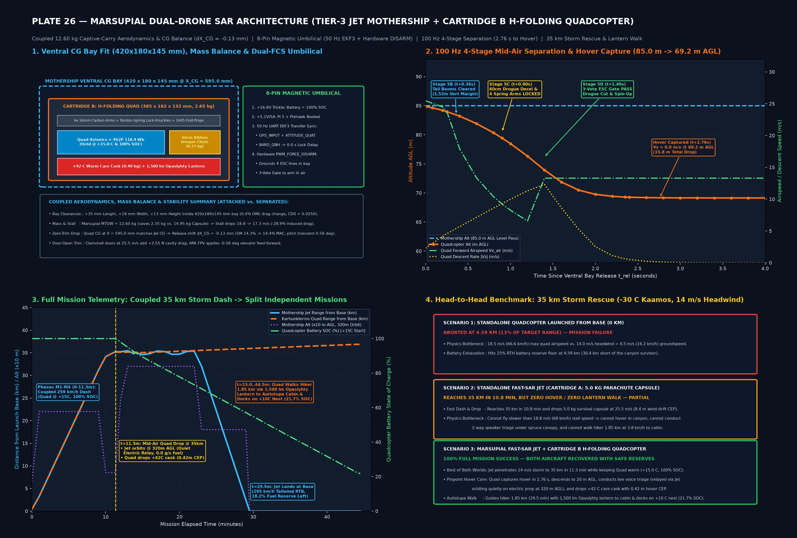

### 11.10 Multi-Screen Command Wall, Tactical Operator Controller UI & Exact 8-Stage Mission Control Workflow (`Plates 27 & 28`)

Field experience from modern contested-airspace multi-screen command walls (`2×2` quad-monitor operator stations running enterprise tactical camera OSDs under heavy GNSS jamming) demonstrates six high-priority operator UI patterns that are directly integrated into our dual-drone (`arctic-fast-sar-jet` + `karhunkierros-sar-drone`) Ground Control Station (`GCS`) and interactive HTML5 Flight Simulator (`simulator_ui/flight_simulator.html`, redesigned around **Apple iOS Dark Mode Human Interface Guidelines**):

1. **Field-Proven `2×2` Command-Point Screen Anatomy (`Plate 27`, Column 1):**
   - **`[A]` Top High-Contrast Flight-Law Banner (`ATTI MODE` / `MODE N` VIO):** When GNSS satellites drop to `0` under `-42 to -48 dBm` jamming, the top-left mode banner immediately highlights the active fallback control law (`MODE N · EKF3 VIO + DEM CONTOUR` or `ATTI MODE · RAW SERVOS`) so the operator never confuses satellite position hold with drift-prone attitude hold.
   - **`[B]` `GNSS = 0 SV` & Live Loaded Cell-Voltage Sag Cluster (`85% / 15.6V`):** Displays real-time loaded pack voltage alongside state-of-charge (`%`) to catch `-30 °C` internal-resistance ($I \cdot R$) lithium voltage sag before brownout.
   - **`[C]` Optical & Thermal Sensor Strip (`ZOOM 1.0X / 3.0X`, `ISO 150`, `1/1600`, `AE Lock`, `AFC`, `FFC Inhibit`):** Displays optical/thermal zoom state and locks the `FLIR Lepton / Lynred` thermal flat-field calibration (`FFC`) shutter open during the final `6.0 s` before capsule/quad release.
   - **`[D]` Left-Edge Vertical Tactical Tool Dock (`RNG / AI / THERM / CRUISE`):** One-thumb vertical buttons along the left bezel for Laser/DEM Slant-Range (`RNG`), `Hailo-8L 26 TOPS` Neural Survivor Detection (`AI`), `LWIR` Thermal Fusion (`THERM`), and `ATTI/VIO` Cruise Speed/Heading Lock (`CRUISE`) that relieves thumb fatigue during `11–35 min` GNSS-denied transits.
   - **`[E]` Center Gyro-Stabilized Gimbal Boresight Crosshair (`+`) & `+31 °C` Survivor Lock Box:** Decouples airframe roll/pitch (`±35°`) from the operator's visual search frame and renders green corner brackets around detected human thermal signatures.
   - **`[F]` Bottom-Center Attitude/Compass Radar Puck & `Look Down (-90° Nadir)` Toggle:** Combines a `360°` rotating heading rose, home-bearing diamond, and artificial-horizon tilt ball into a single peripheral-vision puck at the bottom center of the screen, flanked by a one-click `-90°` Nadir gimbal snap button.

2. **Our Dual-Drone Controller UI: Tier-3 Fast-SAR Jet vs. Tier-2 Marsupial Quad (`Plate 27`, Column 2 & Column 3):**
   - **Screen 1 (`Tier-3 Fast-SAR Jet` — Split Glass Cockpit PFD/HSI + EO/LWIR Tactical OSD):** Pairs a Garmin/Airbus-style Primary Flight Display (`PFD` with Blue/Brown Artificial Horizon, `IAS` + `SYNTH_IAS` airspeed tape, `AGL/MSL` altimeter tape, `AoA Alpha-Floor` bar, `360°` `HSI` compass rose, and `Turbine EIS` `98k RPM / 645 °C EGT / 2.65 kg Fuel / UAT 100%`) with the stabilized EO/LWIR tactical camera OSD.
   - **Screen 2 (`Tier-2 Karhunkierros Quad` — VIO Hover, Winch & *Opaslyhty* Lantern OSD):** Displays `MODE: VIO_HOLD + APRILTAG LOCK`, `4S2P 88% 15.8V +15 °C Core`, and left-dock controls for `WINCH DROP` (`+42 °C` medical cask) and `LANTERN 1500 lm` (`3.8 km/h` autonomous hiker escort to the nearest heated *Autiotupa* wilderness cabin).
   - **Physical Dual-Stick / MacBook Hardware Trackpad Control Mapping & 3 Flight Laws (`[Key 3]` `AI-Assisted RC Normal Law`, `[Key 2]` `SAS Gyro / Synth-IAS Alternate Law`, `[Key 1]` `Raw Unaided Servos Direct Law`):** Maps the physical trackpad or right gimbal stick to bank/pitch command (`Center (0,0)` or `Finger Off` = auto-level wings & hold pitch/position in `Normal Law`), with guarded 2-vote switches for `Capsule/Quad Release [Space]`, `Crow Airbrake [B]`, and `Dorsal Chute + <50ms Fuel Cutoff [P]`.

3. **Exact 8-Stage End-to-End Mission Control Workflow (`Plate 28`):**
   - **Stage 1 (`0–15 s` — Pre-Flight BIT & Drop-Dolly Launch):** Operator verifies green `BIT PASS` across `Bus A/B/C` and clicks `1-Click Auto Launch`; `STM32H7` spools the turbine to `100% N1` (`132 N`), holds runway centerline via wheel/ruddervator gain scheduling, releases the 3-wheel tundra dolly, and rotates at `30 m/s`.
   - **Stage 2 (`15–65 s` — Heated De-Ice Climb & Corridor Entry):** `100%` hands-off `TECS` climb at `+6.5°` pitch with `70 W` pitot + wing leading-edge de-icing active and continuous `IAS` vs. `SYNTH_IAS` innovation monitoring (`< 2 m/s`).
   - **Stage 3 (`1–11 min` — `260–380 km/h` Dash & `GNSS=0` EW Transition):** When `-48 dBm` GNSS jamming hits, `EKF3` rejects spoofed satellites in `200 ms`, switches the top banner to `MODE N · EKF3 VIO + DEM CONTOUR`, and holds course (`18.4 m` CEP) with `CRUISE HOLD` engaged (`0` stick workload).
   - **Stage 4 (`11.0 min` — Transition to Silent Electric Loiter):** Dorsal turbojet shuts down and the `355 mm` nose folding electric prop unfolds for a quiet `92 km/h` (`25.5 m/s`, `350 W`) canyon sweep; operator clicks `Look Down (-90°)` + `AI Lock` on the survivor's `+31 °C` thermal signature.
   - **Stage 5 (`11.5 min` — Mid-Air Quad / Capsule Release at `85 m AGL`):** With `FFC Inhibit` active and both `STM32H7` geofence + `Pi 5` visual lock green (`2-Vote Release Pass`), the ventral CG bay (`X_CG = 595 mm`, `0.0 mm` trim shift) ejects the `2.65 kg` H-folding `Karhunkierros` quadcopter, which snaps its 4 arms open under a `60 cm` drogue and captures hover at `69.2 m AGL` in `2.76 s`.
   - **Stage 6 (`12–28 min` — Dual-Screen Cooperative Hover Care):** Screen 2 controls the Quad in `VIO_HOLD` (`< 0.15 m` drift at `15 m AGL` below spruce trees) to winch down the `+42 °C` medical cask and two-way radio while Screen 1 monitors the Jet orbiting quietly at `320 m AGL` as an airborne `868 MHz / 940 nm` communications relay.
   - **Stage 7 (`15–35 min` — *Opaslyhty* Lantern Escort & Jet `-30 °C` Relight):** Quad engages `CRUISE 3.8 km/h` + `1,500 lm` spotlight cone `15 m` ahead of the walking survivor along the trail toward the *Autiotupa* log cabin; above, the Jet executes a `2.60 s` `-30 °C` kerostart relight for a `295 km/h` RTB dash.
   - **Stage 8 (`30–40 min` — Dual Terminal Recovery):** Jet deploys its `2.8 m²` dorsal parachute (`< 50 ms` `Bürkert 6011` fuel cutoff, `3.8 m/s` sink onto ventral airbag) while the Quad lands via `AprilTag 36h11` (`0.12 m` CEP) inside the `+10 °C` motorized clamshell trail nest box for autonomous contact-pad recharging (`34%` $\to$ `100%` SOC).

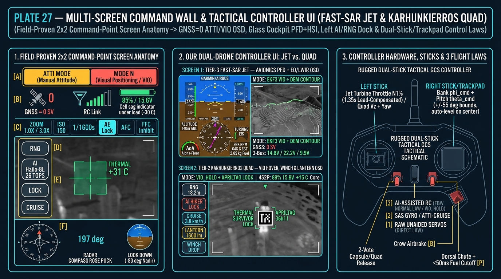

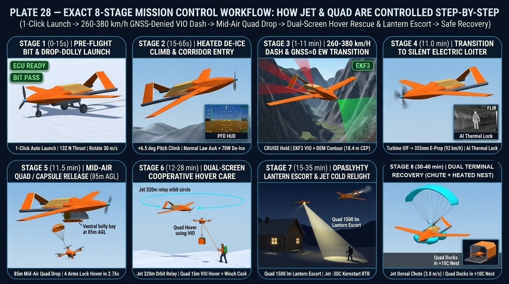

### 11.11 Canonical 4-Angle OpenCASCADE 3D STL Reference Raster (`cad/rasterize_cad_reference_views.py`)
To enforce 100% geometric consistency across every technical illustration, [`cad/rasterize_cad_reference_views.py`](../cad/rasterize_cad_reference_views.py) directly projects the canonical OpenCASCADE 3D STL mesh ([`cad/arctic_fast_sar_jet_iter1_fixed16deg.stl`](../cad/arctic_fast_sar_jet_iter1_fixed16deg.stl)) and [`cad/design_params_sar.json`](../cad/design_params_sar.json) into four reference views (`Front-Left Isometric`, `Aft-Right Isometric`, `Top-Down Orthographic Planform`, and `Left-Side Orthographic Cutaway Profile` with `X_CG = 595.0 mm` and `X_NP = 636.0 mm`).

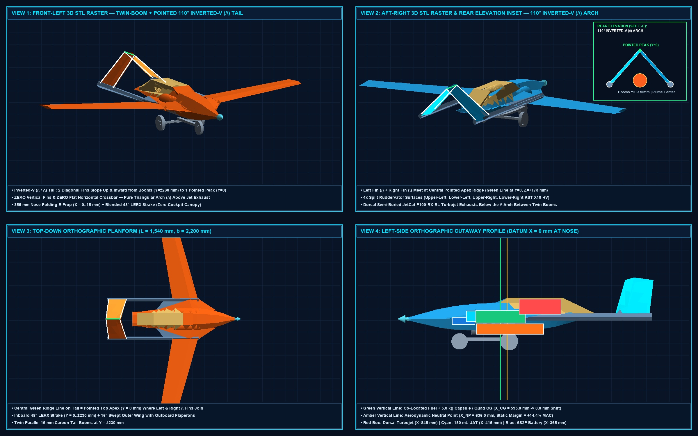

