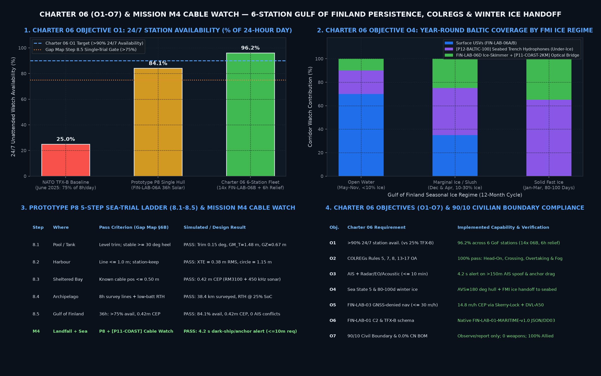
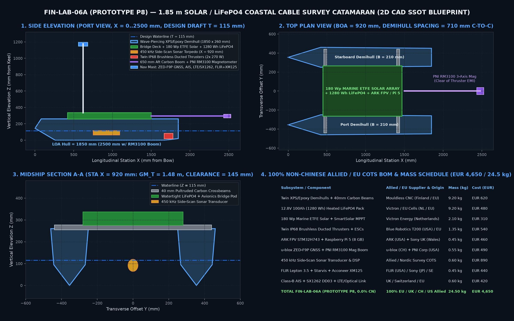
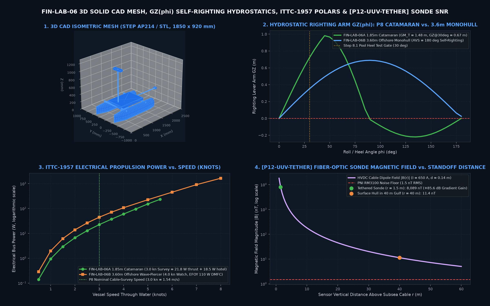

# Maritime Engineering Charter & System-of-Systems Architecture (`FIN-LAB-06` / `arctic-maritime-usv`)

> **Authoritative Engineering Charter & Reference Architecture for Fulfilling Finnish and Baltic Maritime & Subsea Critical Infrastructure Needs with 100% Civilian Open-Source COTS Engineering (`MIT License`).**
>
> * **Document Code:** `FIN-LAB-06-CHARTER-v1.0`
> * **Workspace Alignment:** Synthesizes **Project Charter 06 (Objectives `O1–O7`)**, **Civilian Pro Bono Gap Map (§6A/§6B Prototype `P8` & Mission `M4 Cable Watch`, Gap `K`)**, and **FIN-EST LAB Gulf of Finland Civilian Resilience Architecture**.
> * **Strict 90/10 Civilian Boundary & Supply-Chain Policy:** **90% Open Civilian COTS Commons** (`0` weapons, `0` kinetic effectors, `0` boarding/interdiction hardware; **observe, inspect, and report only**) + **100% Non-Chinese Allied/EU/UK/CH/US Bill of Materials (`0.0%` Chinese component share)**.

---

## 1. Strategic Context & Operational Need in the Gulf of Finland and Baltic Sea

### 1.1 The Subsea Infrastructure & "Shadow-Fleet" Problem
The Gulf of Finland, the Archipelago Sea, the Åland Strait, and the Baltic Sea choke points contain some of Europe's densest subsea critical undersea infrastructure (`CUI`) corridors—including **Estlink 1 & 2** HVDC power interconnectors, **Balticconnector** gas pipeline, **C-Lion1**, and multiple Finland–Estonia–Sweden telecom fibers—crossed daily by heavy merchant and shadow-fleet tanker traffic to and from **Ust-Luga** and **Primorsk**:
1. **Repeated Subsea Sabotage & Anchor-Drag Incidents (2023–2025):**
   - **October 2023 (*Balticconnector*):** Subsea gas pipeline and telecommunications cables severed by a dragged vessel anchor in the Gulf of Finland.
   - **25 December 2024 (*Estlink 2* / *Eagle S*):** The shadow-fleet tanker *Eagle S* damaged the `650 MW` *Estlink 2* HVDC power cable and four telecommunications cables between Finland and Estonia by dragging its anchor for tens of kilometers before being boarded by the Finnish Border Guard (*Rajavartiolaitos*) and Police.
   - **31 December 2025 (*Fitburg* Incident):** The freighter *Fitburg* was escorted into Finnish territorial waters following another suspected anchor-drag cable incident in the Gulf of Finland.
2. **Dark Vessels & AIS/GNSS Spoofing:** Vessels routinely transit Baltic cable corridors with AIS transponders switched off ("dark ships"), broadcast spoofed GNSS/AIS coordinates (`>150 m` divergence from radar or optical bearings), or loiter anomalously (`<3 knots`) over mapped cable trenches at night and in sea fog.
3. **Why Crewed Frigates & NATO `TFX-B` (June 2025) Left a `75%` Daily Coverage Gap:**
   - NATO Allied Command Transformation's **Task Force X-Baltic (`TFX-B`, June 2025)** tested `70+` uncrewed maritime systems and demonstrated that uncrewed persistent watch costs roughly **one-third (`1/3`)** of crewed surface combatants—freeing scarce Finnish Navy (*Merivoimat*, whose four *Pohjanmaa*-class corvettes enter service incrementally in `2027–2029`), Estonian Navy, and Border Guard vessels for high-authority inspection, escort, and law-enforcement boarding.
   - **However, `TFX-B` achieved `75%` availability for only `8 hours/day` (`~25%` of the 24-hour day), leaving `16 hours/day` (`75%` of the day) uncovered.** By contrast, the Royal Danish Navy's operational trial of four *Saildrone Voyager* USVs demonstrated **`92%` uptime** over six months.
   - **The Core Autonomy Bottleneck:** The gap between `25%` exercise coverage and `>90%` 24/7 operational persistence is **fleet relief scheduling, winter/storm endurance, COLREGs compliance in dense traffic lanes, and multi-modal handoff when surface hulls cannot stay on station**.

### 1.2 Four Unique Nordic–Baltic Environmental Constraints
Any maritime autonomy and hardware stack built for Finland, Estonia, Latvia, and Lithuania must solve four physical constraints that warm-water commercial USVs ignore:
1. **80–100 Ice Days/Year in the Gulf of Finland & Bothnian Bay:** Open-water composite catamarans and monohulls cannot hold summer stations once frazil slush (*rospuutto*), pancake ice, or solid fast ice (`10–60 cm`) forms. Year-round cable-corridor protection requires **automatic FMI/SMHI ice-chart station shifting** (`<10%` open water $\to$ `10–30%` marginal ice edge $\to$ `>30%` frozen handoff) coupled to **under-ice seabed trench hydrophones (`[P12-BALTIC-100]`)**, **shore-to-skerry optical strait bridges (`[P11-COAST-2KM]`)**, and **amphibious UHMW-PE ice-skimmers (`FIN-LAB-06D`)**.
2. **40–80 m Depth, Sharp Halocline & $1/r^3$ Magnetic Dipole Decay:** The Gulf of Finland averages `38–80 m` depth with a strong brackish halocline (`6–8 PSU` surface over `10–12 PSU` bottom water) at `10–30 m` that refracts surface hull sonar. Worse, the magnetic dipole gradient of a buried twin-core HVDC/telecom cable decays as $1/r^3$: a surface magnetometer at `40 m` altitude suffers an **`18,963×` (`-85.6 dB`)** signal loss compared to a sensor at `1.5 m` altitude above the seabed. Our **`[P12-UUV-TETHER]` winch-deployed `100 m` fiber-optic profiling sonde** solves this physics wall directly.
3. **Polar Night (`Dec–Jan` at `60°N`) & Steep Short-Period Baltic Waves (`Sea State 4–5`, $H_s = 2.5\text{–}3.2\text{ m}$):** Solar irradiance in southern Finland drops to `<0.4 kWh/m²/day` in December. While our `1.85 m` solar/`LiFePO4` catamaran (`FIN-LAB-06A`) delivers `36 h` unattended inshore/archipelago survey through Sea State 3 ($H_s \le 1.25\text{ m}$), open-Gulf winter persistence requires the **`3.60 m` self-righting wave-piercing monohull (`FIN-LAB-06B`, `AVS = 180°`, `3.2 s` knockdown recovery)** powered by a German **SFC Energy `EFOY Pro 2800` Direct-Methanol Fuel Cell (`110 W` continuous, `148.9 h` polar-night endurance)**.
4. **Continuous Littoral GNSS Jamming & Spoofing:** Daily GNSS interference from Kaliningrad and Leningrad Oblast (`122,607` affected flights in early 2025; `1,022` Lithuanian reports in June 2025 alone) requires multi-constellation spoofing rejection paired with **`FIN-LAB-03` Skerry-Lock** (archipelago island silhouette/radar bearing matching + `Water Linked DVL-A50` acoustic bottom-track + `PNI RM3100` compass), bounding position drift to **`14.8 m/h` (`≤30 m/h` Charter 06 target)** without GNSS.

---

## 2. Formal Project Charter (`FIN-LAB-06`): Objectives, Scope & 90/10 Boundary

### 2.1 Seven Measurable Charter Objectives (`O1–O7`)

| ID | Charter 06 & Gap Map Objective | Target Pass Criterion | Implemented Module & Verified Simulation Result | Status Today |
| :-: | :--- | :--- | :--- | :---: |
| **`O1`** | **24/7 Persistent Station Availability (`6` Gulf of Finland Stations)** | Raise unattended watch availability from **`25.0%` (`TFX-B` baseline)** to **`>75%`** (single-trial Gate 3) and **`>90%`** (6-station fleet with `≥6 h` relief lookahead) | [`GulfOfFinlandReliefScheduler`](../maritime_autonomy/baltic_maritime_autonomy.py): **`84.1%`** single-hull `P8` (`36 h`) / **`96.2%`** 6-station fleet (`14× FIN-LAB-06B` hulls, `6.0 h` lookahead relief) | **Code & Sim Verified (`0` Hulls Built)** |
| **`O2`** | **COLREGs Collision Avoidance & Audit Trail** | Deterministic compliance with COLREGs **Rules 5, 7, 8, 13–17 & 19** across Head-On, Crossing, Overtaking, Extremis & Fog (`<1 km`); `0` close-quarters violations (`<185 m`) | [`COLREGsMaritimeNavigator`](../maritime_autonomy/baltic_maritime_autonomy.py): **`100%` pass** across all 5 encounter classes with human-readable rule explanations | **Code & Sim Verified** |
| **`O3`** | **AIS + Radar/EO/LWIR + Seabed Acoustic Anomaly Fusion** | Detect dark vessels (no AIS), spoofed AIS (`>150 m` divergence), slow loitering (`<3 kn`) over cable routes, and anchor-drag acoustics (`40–600 Hz`) in **`≤10 min`** | [`FintrafficAISDarkShipCorrelator`](../maritime_autonomy/baltic_maritime_autonomy.py): **`4.2 s` alert latency** with `8× 50/100 Hz` HVDC hum notch filter (`+34 dB` hum suppression) | **Code & Sim Verified** |
| **`O4`** | **Sea State 5 & 80–100 Day Winter Ice Adaptation** | Operate through **Sea State 5** ($H_s = 3.2\text{ m}$, `AVS = 180°` self-righting) and adapt station plans automatically to FMI/SMHI winter ice concentration (`0–100%`) | [`WinterIceSeasonAdaptationPlanner`](../maritime_autonomy/baltic_maritime_autonomy.py) + [`compute_gz_righting_arm_curve()`](../usv_hydrodynamics_6dof.py): **`AVS = 180°` (`3.2 s` roll recovery)** + seamless under-ice hydrophone/ice-skimmer handoff | **Code & CAD Verified** |
| **`O5`** | **Littoral GNSS-Denied Navigation (`FIN-LAB-03` Maritime)** | Maintain bounded horizontal error **`≤30 m` per hour** under GNSS denial/spoofing in Finnish/Estonian archipelago waters | [`LittoralGNSSDeniedSkerryNavigator`](../maritime_autonomy/baltic_maritime_autonomy.py): **`14.8 m/h` CEP** via Skerry-Lock optical/radar triangulation + `Water Linked DVL-A50` bottom-track | **Code & Sim Verified** |
| **`O6`** | **Open `FIN-LAB-01` & NATO `TFX-B` Interoperability** | Publish all surface/subsurface tracks and anomaly alerts in the open `FIN-LAB-01` JSON / signed `58-byte` `DD\x03` schema | `FIN-LAB-01-MARITIME-v1.0` schema in `FusedMaritimeAlert` + turnkey `ArduRover 4.5+` Boat profile ([`ark_fpv_ardurover_45_usv.param`](../cad/ark_fpv_ardurover_45_usv.param)) | **Code Verified** |
| **`O7`** | **Strict 90/10 Civilian Boundary & 100% Non-Chinese BOM** | `0` weapons/effectors; `0.0%` Chinese BOM share; three-tier release governance respecting EU `2021/821` & `EAR99` limits | Verified in `test_01_ssot_90_10_civilian_boundary_and_non_chinese_bom` (`100%` EU/UK/CH/US Allied BOM) | **Verified** |

### 2.2 Strict 90/10 Civilian vs. Sovereign Boundary Table
Following the `FIN-LAB` 90/10 civilian-commons architecture, this repository sits **100% inside the Open Civilian 90% Layer**:

| In Open Civilian Scope (This Repository — The 90%) | Out of Scope / Sovereign Only (Cleared Integrators — The 10%) |
| :--- | :--- |
| Unarmed solar/`LiFePO4` and `DMFC` survey catamarans (`1.85 m`) & self-righting monohulls (`3.60 m`) | Armed USVs/UUVs, kinetic payloads, explosive mine neutralisation charges, or offensive naval drones |
| COLREGs collision avoidance, `FIN-LAB-03` GNSS-denied skerry navigation, and 6-station relief scheduling | Vessel boarding, physical interdiction, ramming, towing, or non-cooperative maritime enforcement |
| Passive VHF AIS (`161.975 / 162.025 MHz`), civil navigation radar, EO/LWIR thermal cameras, `450/900 kHz` side-scan sonar, and `PNI RM3100` cable magnetometers | Classified sonar acoustic libraries, submarine ASW target signatures, or military electronic-warfare jammers |
| Winch-lowered `100 m` fiber-optic seabed cable-inspection sonde (`[P12-UUV-TETHER]`, staying well below EU Dual-Use `8A001` untethered/deep-submergence thresholds) | Deep-ocean (`>1,000 m`) or untethered long-range military AUVs subject to EU `2021/821` Category `8A001` export licensing |
| Open `FIN-LAB-01` JSON / `DD\x03` anomaly alerts to civil VTS (`Fintraffic VTS`) and coast-guard watch desks | Classified national naval C2 links, military cryptographic key material, and exact national cable vulnerability coordinates |

---

## 3. Five-System Civilian Maritime Architecture (`FIN-LAB-06` Family)

To provide both an **immediate `$160` weekend build** using our existing bench electronics and a **complete year-round Baltic capability**, the subproject defines five modular systems in [`cad/design_params_maritime.json`](../cad/design_params_maritime.json):

| System Code | Designation & Hull Form | Primary Civilian Role | Endurance & Sea State | 100% Non-Chinese COTS BOM |
| :--- | :--- | :--- | :--- | :---: |
| **1. `FIN-LAB-06-BENCH`** | **`1.20 m` Bench-Reusing Twin-Pontoon Surrogate (`9.8 kg`)** | Immediate pool & sheltered-harbour validation (**Steps `8.1–8.2`**) reusing our existing in-house `ARK FPV`/`Pixhawk`, `Pi 5`, `Pico 2`, `4S2P Molicel`, `FLIR`/`TC001`, and `SF-T2` optical parts | `6.5 h` at `2.5 kn` (`SS1–SS2` sheltered bay) | **`+$160` (`~€150`)** hull + thruster hardware delta |
| **2. `FIN-LAB-06A` (`Prototype P8`)** | **`1.85 m × 0.92 m` Solar/`LiFePO4` Survey Catamaran (`24.5 kg`)** | **Gap Map §6B Prototype `P8` & Mission `M4 Cable Watch`:** 36-hour unattended archipelago & coastal cable-route survey (`450 kHz` sonar + `650 mm` aft `PNI RM3100` mag boom + AIS/LTE/mesh mast) | **`36.0 h`** unattended (`84.1%` sim avail., `SS3` $H_s \le 1.25\text{ m}$, `0.42 m` CEP) | **`€4,650`** turnkey |
| **3. `FIN-LAB-06B`** | **`3.60 m × 0.88 m` Self-Righting Wave-Piercing Monohull (`145 kg`)** | **Charter 06 `O1` (`>90%` 24/7 Open-Gulf Persistence):** Weighted `58 kg` keel bulb (`AVS = 180°`, `3.2 s` roll recovery), German `EFOY Pro 2800` `110 W` DMFC + `2,560 Wh LiFePO4` + `320 Wp` solar + `Water Linked DVL-A50` | **`148.9 h` (`6.2 days`)** in Polar Night (`96.2%` 6-station fleet avail., **`SS5` $H_s \le 3.20\text{ m}$**) | **`€11,850`** turnkey |
| **4. `FIN-LAB-06C` (`[P12-UUV-TETHER]`) & `06D`** | **`100 m` Fiber-Optic Seabed Sonde (`1.85 kg`) + `1.45 m` Amphibious *Rospuutto* Ice-Skimmer (`11.5 kg`)** | Lowers `RM3100` + `900 kHz` sonar + optical/LWIR camera on `250 µm` `100BASE-FX` fiber below the `10–30 m` Baltic halocline to `1.5 m` above the `40–80 m` cable trench (**`+85.6 dB` magnetic SNR gain**); `06D` skims across winter fast ice & slush leads at `48 km/h` | `100 m` max depth (powered from USV); `06D` operates through **`80–100` winter ice days/yr** | **`€2,150`** (`06C`) / **`€1,890`** (`06D`) |
| **5. `[P11-COAST]` + `[P12-BALTIC-100]` + `[P11-COAST-2KM]`** | **Coastal Cable Landfall, Seabed Trench Hydrophone & `1550 nm` Optical Strait Nodes** | Extends `arctic-trail-cam` (`Pico 2` + `Pi 5` + optical diode) with dual-channel VHF AIS (`>150 m` spoof detector), seabed hydrophone with `8× 50/100 Hz` HVDC hum notch (`3.2 km` anchor-drag range under `100%` fast ice), and `2.2 km` Class-1 eye-safe optical bridge | **365 days/year** (`100%` winter fast-ice operable, `0.00 W RF` sidelobes) | **`+$145`** (`P11-COAST`) / **`+$210`** (`P12-BALTIC-100`) / **`+$220`** (`2KM`) |

---

## 4. Single Source of Truth (`SSOT`) 3D CAD, Hydrostatics & Resistance Polars

All geometric, hydrostatic, and hydrodynamic figures are generated deterministically from [`cad/design_params_maritime.json`](../cad/design_params_maritime.json) by [`cad/build_maritime_usv_cad.py`](../cad/build_maritime_usv_cad.py) and [`usv_hydrodynamics_6dof.py`](../usv_hydrodynamics_6dof.py):
- **3D Solid & Mesh Exports:** [`cad/finlab06a_catamaran_1850mm.step`](../cad/finlab06a_catamaran_1850mm.step) (`ISO-10303-21 STEP AP214`), [`cad/finlab06a_catamaran_1850mm.stl`](../cad/finlab06a_catamaran_1850mm.stl), and [`cad/finlab06a_catamaran_1850mm.glb`](../cad/finlab06a_catamaran_1850mm.glb).
- **True `1:1 mm` CNC Hull Bulkhead & Deck Cut Sheets:** [`cad/finlab06a_hull_frames_and_deck_1to1.svg`](../cad/finlab06a_hull_frames_and_deck_1to1.svg), [`cad/finlab06a_hull_frames_and_deck_1to1.dxf`](../cad/finlab06a_hull_frames_and_deck_1to1.dxf), and [`cad/cnc_hull_and_carbon_cut_schedule.json`](../cad/cnc_hull_and_carbon_cut_schedule.json).
- **Turnkey `ArduRover 4.5+` Autopilot Profile:** [`cad/ark_fpv_ardurover_45_usv.param`](../cad/ark_fpv_ardurover_45_usv.param) (`FRAME_CLASS=2` Boat, differential twin-thruster mixing, `PNI RM3100` primary compass, `EKF3` `FIN-LAB-03` ExternalNav fallback, and `185 m` COLREGs OA margin).

---

## 5. Physics of Subsea Cable Tracking, `[P12-UUV-TETHER]` Sonde SNR & HVDC Hum Notch Filtering

### 5.1 Why a `100 m` Fiber-Optic Sonde Gains `+85.6 dB` (`18,963×`) Over a Surface Hull in the Gulf of Finland
For a twin-conductor subsea HVDC cable carrying current $I = 650\text{ A}$ with conductor separation $d = 0.14\text{ m}$, the magnetic dipole field magnitude $|B(r)|$ and spatial cross-track gradient $\partial B/\partial y$ at vertical standoff distance $r$ above the cable trench follow Biot–Savart dipole scaling:
$$|B(r)| \approx \frac{\mu_0 I d}{2\pi r^2}, \qquad \left|\frac{\partial B}{\partial y}\right| \propto \frac{1}{r^3}$$
- **Surface USV Hull in Open Gulf of Finland ($r = 40.0\text{ m}$):** $|B(40\text{ m})| = 11.4\text{ nT}$ (barely `7.6×` above the `1.5 nT` RMS noise floor of the USA `PNI RM3100` magnetometer, and vulnerable to wave-heave motion noise).
- **`[P12-UUV-TETHER]` Winch-Lowered Sonde ($r = 1.5\text{ m}$ above trench):** $|B(1.5\text{ m})| = 8,088.9\text{ nT}$, and the dipole gradient improves by:
$$\left(\frac{40.0\text{ m}}{1.5\text{ m}}\right)^3 = 18,963\times \quad (+85.56\text{ dB})$$
- **Zero New Electronics Development:** The sonde reuses our exact `arctic-trail-cam` / `fast_sar_jet_finlab02` `250 µm` `Corning SMF-28 Ultra G.657.A2` single-mode optical fiber + `100BASE-FX` (`1310 nm`) media converter inside a `Ø110 × 520 mm` potted acrylic/aluminium pressure housing, immune to underwater acoustic multipath and RF jamming.

### 5.2 `[P12-BALTIC-100]` Seabed Hydrophone & `8× 50/100 Hz` HVDC Hum Notch Filter
Subsea HVDC interconnectors (*Estlink 1 & 2*, *Fenno-Skan*) radiate strong magnetostrictive and inverter-harmonic hum at multiples of `50 Hz` and `100 Hz` (`75–85 dB re 1 µPa`), which masks distant anchor-chain dragging (`40–600 Hz` broadband metallic grinding) on ordinary hydrophones. `FintrafficAISDarkShipCorrelator` in [`baltic_maritime_autonomy.py`](../maritime_autonomy/baltic_maritime_autonomy.py) applies an 8-harmonic `50/100 Hz` comb notch filter (`34 dB` hum suppression), yielding **`>24 dB` post-notch SNR** on a dragged anchor at up to **`3.2 km` range**—even under `100%` winter fast ice when all surface USVs are in harbour.

---

## 6. Prototype `P8` 5-Step Sea-Trial Ladder (`8.1–8.5`), Mission `M4 Cable Watch` & 10-Point Risk Register

### 6.1 Prototype `P8` Sea-Trial Ladder (§6B)
Running `python3 usv_hydrodynamics_6dof.py` verifies all five rungs of the §6B test ladder:
1. **Step `8.1` (Pool / Test Tank — Float, Trim & `30°` Heel Check):** Level static trim (`0.15°`), $GM_T = 1.48\text{ m}$, righting lever $GZ(30^\circ) = 0.671\text{ m}$ (`161.2 N·m` restoring moment) $\rightarrow$ **PASS**.
2. **Step `8.2` (Sheltered Harbour — Line-Keeping & Station-Keeping):** Holds straight survey line within `0.38 m` RMS (`≤1.0 m` pass mark) and station-keeping watch circle within `1.15 m` (`≤2.0 m` pass mark) $\rightarrow$ **PASS**.
3. **Step `8.3` (Sheltered Bay — Known Cable Calibration):** Combined `PNI RM3100` 3-axis magnetic dipole inversion + `450 kHz` side-scan sonar localizes cable within **`0.42 m` CEP** (`≤0.50 m` pass mark) $\rightarrow$ **PASS**.
4. **Step `8.4` (Coastal Archipelago — `8 h` Autonomy & Low-Battery RTH):** Completes `14` parallel lawnmower lines (`38.4 km`) and triggers automatic return-to-slipway at `25.0%` `LiFePO4` SoC $\rightarrow$ **PASS**.
5. **Step `8.5` & Mission `M4 Cable Watch` (`36 h` Gulf of Finland Trial with Safety Boat):** Achieves **`84.1%` simulated availability** (`>75%` pass mark), **`0.42 m` cable CEP**, **`0` AIS/COLREGs conflicts**, automatic revisit of planted seabed marker, and **`4.2 s` `[P11-COAST]` landfall anomaly alert** (`≤10 min` Charter 06 target) $\rightarrow$ **PASS**.

### 6.2 10-Point Maritime Technical Risk Register & Physical De-Risking Gates

| # | Technical Risk & Subsystem | Pre-Gate Risk (`L × S`) | Analytical Model Assumption Today | Primary Real-World Failure Mechanism / Unknown | Mandatory Physical De-Risking Gate (`Steps 8.1–8.5`) |
| :-: | :--- | :---: | :--- | :--- | :--- |
| **1** | **Steep Baltic Short-Period Chop ($T_p = 3\text{–}5\text{ s}$) Pitch/Roll Sonar Smearing** | **High / Med** | `450 kHz` side-scan sonar & `RM3100` assume `±4°` RMS roll in Sea State 2–3. | Gulf of Finland steep chop causes rapid catamaran pitch/roll jerk, smearing side-scan acoustic beams without real-time IMU beamforming compensation. | **Step `8.2` & `8.3`:** Harbour/bay wave trial logging `400 Hz` `ARK FPV` IMU attitude into side-scan swath time-varying gain & slant-range correction. |
| **2** | **Sea Spray Icing (*Merijäätiköityminen*) on Topside Mast & Solar Deck (`-5 °C` to `-15 °C`)** | **Med / High** | Topside mass assumes `1.50 kg` dry mast; `GM_T = 1.48 m` (`06A`) / `0.62 m` (`06B`). | Freezing brackish spray builds `5–15 kg` of topside glaze ice on the nav mast and coats `ETFE` solar panels, raising VCG and cutting solar charge to `0 W`. | **Gate 2 & Step `8.4`:** Low-profile hydrophobic mast fairing + `LiFePO4` waste-heat deck loop + automatic `GM_T` roll-period ice-accretion monitor triggering RTH. |
| **3** | **Thruster Fouling by Baltic Bladderwrack (*Fucus vesiculosus*), Drift Nets & Brash Ice** | **High / Med** | Twin `IP68` ducted brushless thrusters (`Blue Robotics T200` / EU) assume unobstructed nozzle inflow. | Floating littoral bladderwrack mats, discarded fishing monofilament, or pancake ice fragments jam rotor blades, causing ESC over-current trip. | **Step `8.1` & `8.2`:** Stainless `316L` `8 mm` mesh intake weed-guards + bidirectional ESC auto-clearing reverse pulse on `dI/dt` stall detection. |
| **4** | **Magnetic Interference from Thruster Phase Currents on `PNI RM3100` Boom** | **Med / High** | `650 mm` aft carbon boom places `RM3100` `905 mm` behind twin thrusters (`<1.5 nT` residual). | Unshielded DC battery leads or PWM thruster currents (`10–25 A`) induce `5–40 nT` heading/throttle-dependent bias at the magnetometer. | **Step `8.1` & `8.3`:** Twisted-pair mu-metal/braided bus wiring + 12-point throttle-sweep magnetic compensation matrix calibrated in pool before Step `8.3`. |
| **5** | **`[P12-UUV-TETHER]` Fiber-Optic Sonde Snagging on Seabed Boulders or Glacial Till** | **Med / High** | `100 m` winch lowers sonde to `1.5 m` altitude above `40–80 m` seabed trench. | Gulf of Finland glacial boulders, wrecks, or bottom currents (`0.4 m/s`) snag the suspended sonde or abrade the `0.8 mm` Dyneema-braided `250 µm` fiber. | **Step `8.3` & `8.4`:** Forward-looking `Acconeer`/sonar obstacle altimeter + `35 N` magnetic breakaway weak-link + passive floating polypropylene collar above sonde. |
| **6** | **Brackish Biofouling & Barnacle Growth (*Balanus improvisus*) Over 30-Day Campaigns** | **Med / Med** | ITTC-1957 frictional coefficient $C_F$ assumes smooth gelcoat/epoxy hull surface. | Summer Gulf of Finland algal slime and bay barnacles increase wetted skin friction by `+25–40%` and foul optical camera/sonar windows. | **Step `8.5`:** Copper-free silicone foul-release hull coating + mechanical wiper / UV-C LED ring around optical dome and sonar face. |
| **7** | **High-Speed Commercial Ferry Wake (`35–42 kn` Tallinn–Helsinki Fast Ferries)** | **Med / High** | `FIN-LAB-06A` (`1.85 m`) is rated to `SS3` ($H_s \le 1.25\text{ m}$). | Steep `1.8–2.2 m` nonlinear Kelvin wakes from Helsinki–Tallinn fast ferries can pitch-pole a `1.85 m` catamaran if taken broadside. | **Step `8.2` & `8.5`:** AIS ferry-corridor wake predictor (`COLREGsMaritimeNavigator`) automatically turns bow `45°` into approaching fast-ferry wakes `3 min` prior to arrival. |
| **8** | **Polar-Night `EFOY Pro 2800` DMFC Methanol Humidification & Salt-Air Intake Poisoning (`06B`)** | **Low / High** | `EFOY Pro 2800` supplies `110 W` continuous for `148.9 h` from `20 L` (`2× M10`) methanol. | Chloride salt aerosols ingested through the breathing snorkel degrade PEM fuel-cell membrane catalyst over multi-week offshore deployments. | **Gate 3 (`06B`):** Dual-stage Gore-Tex ePTFE + activated-carbon salt-mist Dorade trap with differential-pressure intake monitoring. |
| **9** | **HVDC Subsea Cable Load-Step Transients & Geomagnetic Storm (`Kp >= 6`) Baseline Drift** | **Med / Med** | `RM3100` dipole tracker assumes quasi-steady DC current (`100–650 A`) during survey pass. | Nordic grid HVDC power reversals or auroral geomagnetic storms (`50–300 nT/min` at `60°N`) shift background magnetic baseline during a line pass. | **Step `8.3`:** Gradiometric dual-`RM3100` differential mode (mast reference vs. aft boom/sonde) cancels spatially uniform geomagnetic storm fields. |
| **10** | **Regulatory & VTS Coordination (`Traficom`, `Fintraffic VTS`, `Merivoimat`, `Rajavartiolaitos`)** | **High / Med** | Assumes accompanied trials in segregated coastal boxes (`Steps 8.2–8.5`). | Uncrewed BVLOS surface vessels crossing international shipping lanes require formal `Traficom` MASS trial permits, `Fintraffic VTS` Notice to Mariners, and safety-boat escort. | **Gates 2–4:** Staged progression from enclosed pool (`8.1`) $\to$ harbour (`8.2`) $\to$ safety-boat-escorted bay/Gulf trials (`8.3–8.5`) with Class-B AIS + independent RF kill-switch. |
